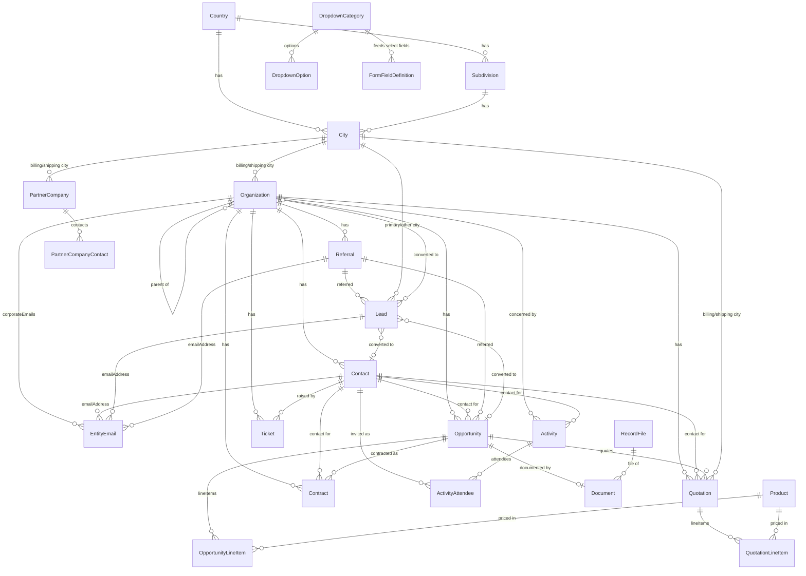

# Nandini CRM — Database Design

> **Status:** living document, generated from `backend-crm/prisma/schema.prisma` and `prisma/migrations/` (75 migrations,
> latest `20261126120000_notifications`, as of 2026-11-25). Update it in the same change as any schema migration.
> Related: [System design](system-design.md) · [API plan](api-plan.md) · [Build plan](build-plan.md)

---

## 1. Overview

| | |
| --- | --- |
| Engine | Microsoft SQL Server / Azure SQL (schema `dbo`) |
| Access | Prisma 7 ORM through `@prisma/adapter-mssql`; a few raw SQL statements (`MERGE` for counters, `sp_getapplock` for locks, `OPENJSON`) |
| Tables | **43** application tables + Prisma's `_prisma_migrations` |
| Owned child tables ("sub tables") | 6: `EntityEmail`, `OpportunityLineItem`, `QuotationLineItem`, `PartnerCompanyContact`, `DropdownOption`, `ActivityAttendee` |
| Migrations | `backend-crm/prisma/migrations/` (`npm run db:migrate` in dev, `npm run db:deploy` in prod) |
| Seed | `backend-crm/prisma/seed.ts` (`npm run seed`) |

### Tables by domain

| Domain | Tables |
| --- | --- |
| Identity | `Users` (model `User`) |
| CRM core | `Organization`, `Contact`, `Lead`, `Opportunity`, `Quotation`, `Ticket`, `Contract`, `Document`, `Product` |
| Activities & calendar | `Activity`, `ActivityAttendee` |
| Owned children | `EntityEmail`, `OpportunityLineItem`, `QuotationLineItem` |
| Partner master | `PartnerCompany`, `PartnerCompanyContact` |
| Referral master | `Referral` (Referred By of leads and opportunities) |
| Reference masters | `NatureOfCall`, `Country`, `Subdivision`, `City` |
| Numbering | `DocumentSeriesSettings`, `DocumentSeries`, `SequenceCounter` |
| Customisation | `DropdownCategory`, `DropdownOption`, `FormFieldDefinition`, `ModuleSetting`, `DrawerLayout`, `DrawerPiece` |
| PDF & files | `PdfTemplate`, `PdfAsset`, `PdfSavedItem`, `RecordFile` |
| Audit & UI state | `AuditLog`, `AuditExport`, `AuditDigest`, `TableFilter`, `ModuleScorecard` |
| Notifications & outgoing mail | `Notification` (navbar bell), `EmailLog` (every email the CRM sends) |
| Email checks | `EmailValidationRun` |

## 2. Design conventions

These rules come from SQL Server's constraints and apply across the schema:

1. **Primary keys:** `NVARCHAR(50)` UUIDs generated by Prisma for business tables. Exceptions: `Users.Id` and
   `City.id` (`INT IDENTITY`), `Country.iso2Code`, `Subdivision.subdivisionCode`, `DocumentSeries.module`,
   `SequenceCounter.prefix`, `DocumentSeriesSettings.id` (always 1).
2. **Business codes:** every core entity has a unique human code (`leadCode`, `accountCode`, `quotationCode`, …)
   issued by the document-series engine. Unique constraints cover deleted rows too, so a code is never reused.
3. **Soft delete:** core entities, `PartnerCompany`, `PdfTemplate` and `PdfSavedItem` have `isDeleted` + `deletedAt`.
   Rows are never physically deleted by the app, so foreign keys never block a "delete". `DropdownCategory` uses
   `deletedAt` as a tombstone; `NatureOfCall` uses `isActive`; `DropdownOption.isActive` is always true (archiving was removed, migration `20261120180000_remove_archive`).
4. **No cascade cycles:** SQL Server rejects multiple cascade paths (error 1785). Every cross-entity foreign key is
   `ON DELETE NO ACTION / ON UPDATE NO ACTION`. Only owned children cascade from their single parent.
5. **No scalar arrays:** string lists are stored as JSON in `NVARCHAR(MAX)` columns suffixed `Json`
   (`productCategoryJson`, `communicationTypeJson`, `partnerCompaniesJson`, `emailAddressJson`, `contractTypeJson`). Repeating
   objects with their own fields (emails, line items) are child tables.
6. **Custom fields:** each customisable entity has `customDataJson` = `{ "cf_fieldKey": value }`, described by
   `FormFieldDefinition` rows.
7. **Ownership & audit columns:** `createdBy` / `updatedBy` hold **usernames** (not FKs to `Users`), plus `createdAt`
   / `updatedAt`. The owner is `assignedTo`, also a username string.
8. **Denormalised display names:** child records keep the parent's name next to its id (`organizationName` +
   `organizationId`, `contact` + `contactId`, `billingCity` + `billingCityId`) so lists sort and search without
   joins. The app writes renames through to linked live rows in the same transaction.
9. **Unicode:** all text is `NVARCHAR`. String defaults that contain non-ASCII (e.g. `₹` in `currency`) are **not** set
   as DB defaults, because Prisma emits them without the `N` prefix; the API always sets them.
10. **Money:** `DECIMAL(18,2)` (discount percentage on products `DECIMAL(5,2)`). Tax rate is a string (`"18%"`).
11. **Dates:** `DATE` for calendar dates (follow-ups, quotation date, invoice date); `DATETIME2` for timestamps.
    Ticket `dueDate` and Contract `renewalReminderDate` are wall-clock times in `BUSINESS_TIMEZONE` (stored as if
    UTC). The exception is `Activity.startAt` / `endAt` (and `remindAt`): **true UTC instants**, with the zone they
    were entered in kept in `Activity.timeZone`; everything else stays wall-clock. Conversions go through
    `backend-crm/src/utils/zonedTime.ts`.
12. **Column widths** are ≥ the frontend's `FIELD_MAX_LENGTH` (`frontend-crm/src/config/fieldLimits.ts`).
13. **Phones** are stored in E.164 (`+919811234567`), `NVARCHAR(20)`.

## 3. Entity-relationship diagram

Not drawn (no foreign keys, linked by convention):

- `assignedTo` / `createdBy` / `updatedBy` / `changedBy` / `TableFilter.username` → `Users.Username`.
- `AuditLog.entityType + entityId` → any audited row (polymorphic).
- `DocumentSeries.module` → module name; `SequenceCounter.prefix` → series key.
- `PdfTemplate.documentJson` may reference `PdfAsset.key` (logo) — deletion of a referenced asset is blocked in code.
- `Ticket.natureOfCall` → `NatureOfCall.name`; `Ticket.partnerCompany` → `PartnerCompany.partnerName` (names, not ids).
- `Activity.relatedModule + relatedId` → the linked record (a lead, opportunity, contact, organization, quotation,
  ticket or contract; polymorphic, checked by the API). `ActivityAttendee.username` → `Users.Username`.
- `Notification.username` / `EmailLog.toUsername` → `Users.Username`; `Notification.entityModule + entityId` → the
  activity or contract it is about (no foreign key: the row outlives a deleted record and is purged by age).

## 4. Table reference

Column lists below group fields; see `schema.prisma` for exact types and lengths.

### 4.1 `Users`

Pre-existing table kept for compatibility (columns `Id`, `Username`, `Password`, `Role` mapped by Prisma).

| Column | Type | Notes |
| --- | --- | --- |
| `Id` | INT IDENTITY PK | Frontend `User.id: number` |
| `Username` | NVARCHAR(50) UNIQUE | Used everywhere as the owner/creator identifier |
| `Password` | NVARCHAR(255) | bcrypt hash; legacy plain-text values are re-hashed on next login |
| `Role` | NVARCHAR(50) | Default `Sales Executive`; drives admin access and row-level scope |
| `email`, `fullName`, `phone`, `department` | | `email` is unique in code only (SQL Server allows one NULL in a unique key) |
| `isActive`, `isGroupUser`, `onLeave`, `lastLoginAt` | | Inactive users can't sign in or be assigned |

Indexes: `email`, `isActive`.

### 4.2 `Organization` (customer accounts)

| Group | Columns |
| --- | --- |
| Identity | `id`, `accountCode` (UNIQUE), `organizationName` (stored UPPERCASE), `mailingName`, `tradeName` |
| Overview | `natureOfBusiness`, `accountStatus` (`Active`/`Inactive`), `inactivityReason`, `typeOfEntity`, `customerType`, `natureOfPartner` (partner organizations only: set, and required, when `customerType` is Partner; same `partner_nature` list as partner companies, now a shared dropdown; migration `20261125170000_org_nature_of_partner`, which also removes the organization form's Partner Company field while keeping `partnerCompaniesJson`), `sapCodeTallyId`, `showroomBranchCode`, `leadSource`, `memberOf`, `parentOrganizationId` → `Organization`, `numberOfEmployees`, `annualTurnover`, `addDescriptionAndScope`, `accountVerified`/`verifiedAt`/`verifiedBy`, `activeAmc`, `activeCloud`, `provideSupport`, `assignedTo` (owner) |
| Billing address | `billingAddress`, `billingStreet`, `billingCityId` → `City`, `billingCity`, `billingState`, `billingPostalCode`, `billingCountry`, `billingLatitude` |
| Shipping address | same set with `shipping*`, `shippingLongitude`, `copyAddressFromBilling` |
| Tax & bank | `registrationType`, `panNumber`, `msmeRegnNumber`, `gstNumber`, `cinNo`, `tanNumber`, `accountName`, `bankName`, `ifscCode`, `accountNo`, `typeOfAccount`, `bankAddress` |
| JSON | `partnerCompaniesJson` (string[]), `customDataJson` |
| Audit | `createdBy`, `updatedBy`, `createdAt`, `updatedAt`, `isDeleted`, `deletedAt` |

Indexes: `organizationName`, `accountStatus`, `assignedTo`, `gstNumber`, `billingCityId`, `shippingCityId`,
`(isDeleted, createdAt)`, `(isDeleted, accountStatus, assignedTo)`.
**Filtered unique index** (raw SQL, not in `schema.prisma`): `Organization_organizationName_live_key` on
`organizationName WHERE isDeleted = 0`. Re-check `prisma migrate diff` after future migrations so Prisma doesn't try
to drop it.

### 4.3 `Contact`

`id`, `contactCode` (UNIQUE), `name`, `organizationName` + `organizationId` → `Organization`, `mobile` (required),
`officePhone`, `phone3`–`phone5`, `assignedTo`, `isPrimaryContact`, `designation`, `department`, `leftJob`,
`communicationTypeJson` (string[]), `doNotCall`, `addDescription`, `customDataJson`, audit/soft-delete columns.
Emails live in `EntityEmail`.

Indexes: `organizationId`, `mobile`, `name`, `assignedTo`, `(isDeleted, createdAt)`, `(isDeleted, assignedTo, createdAt)`.

### 4.4 `Lead`

| Group | Columns |
| --- | --- |
| Identity | `id`, `leadCode` (UNIQUE), `name`, `mobile`, `otherPhone`, `mailingName`, `tradeName`, `organizationName`, `designation`, `department` |
| Qualification | `leadSource`, `leadType` (Lead Type: admin dropdown `lead_type`, e.g. Inbound / Outbound / Marketing), `rating` (Rating: `Hot` / `Warm` / `Cold`, set by the system and never on a form — not a form-builder field), `status` (default `New`), `productCategoryJson`, `followupType`, `customerResponse` (latest follow-up outcome from `shared_customer_response`, the list leads and opportunities share; option meta `ratingRule` for leads, `opportunityStages` / `noFollowUp` for opportunities; migration `20261125220000_shared_customer_response`, which folded the short-lived leads-only `lead_customer_response` back in), `nextFollowupDate` (DATE), `nextFollowupTime`, `registrationType`, `gstNumber`, `turnover`, `noOfEmployee`, `referredBy` (shown, and required, when `leadSource` is CA or Reference: the name of the linked Referral) + `referredById` → `Referral` (NO ACTION, migration `20261125230000_referrals`; NULL for a value typed before that migration, which is kept as it is), `partnerCompany` (set, and required, when `leadSource` is Partner: the name of an organization whose Customer Type is Partner, picked in the organization picker; migration `20261125210000_lead_partner_company`, which replaced the short-lived `natureOfPartner` column of `20261125180000_lead_source_details`), `assignedTo`, `remarks`, `description` |
| Addresses | `primary*` (with `primaryCityId` → `City`), `other*` (with `otherCityId`), `copyAddressFromLeft` |
| Conversion | `convertedAt`, `convertedBy`, `convertedOrganizationId`, `convertedContactId`, `convertedOpportunityId` (FKs) — set only by the convert endpoint |
| Other | `customDataJson`, audit/soft-delete columns |

Status `Converted` is a system option: it can only be set by conversion and can never be left.
Indexes: `status`, `rating`, `assignedTo`, `mobile`, `nextFollowupDate`, `primaryCityId`, `otherCityId`,
`(isDeleted, createdAt)`, `(isDeleted, assignedTo, createdAt)`.
Migration `20261120200000_lead_rating` added `rating` and moved any `Hot` / `Warm` / `Cold` still stored in `leadType` into it.
Rating bookkeeping ([lead-rating-rules.md](lead-rating-rules.md), migration `20261121090000_lead_rating_rules`):
`ratingReason` (why, NVARCHAR(200)), `unansweredCalls` (INT, default 0: consecutive "Unanswered calls" responses),
`ratingAgeingFrom` (DATE, indexed) + `ratingAgeingJson` (`{ limits: { hot, warm }, response }`): set only while the
Rating ages under a "Days since response" rule; the nightly job reads them. `nextFollowupDate` is now a locked,
required field for leads (closed leads have none).

### 4.5 `Opportunity` and `OpportunityLineItem`

`Opportunity`: `opportunityCode` (UNIQUE), `opportunityName`, `productCategoryJson`, `contact`/`contactId`,
`organizationName`/`organizationId`, `contactNumber` (optional), `contactEmail`, `referredBy` + `referredById` / `partnerCompany` (as on leads: required for Lead Source CA / Reference and Partner), `type`, `salesStage`, `leadSource`,
`leadGivenBy`, `nextFollowupDate`/`Time`, `followupType`, `customerResponse` (as on leads), `remarks`, `description`, `assignedTo`,
billing (`tallySerialNo` — 9 digits starting with 7, checked by the API, `invoiceNo`, `invoiceDate`), `commission` (fixed `Yes` / `No`, default `No`) with
`commissionAmount` (DECIMAL(18,2), required above 0 when `Yes`, NULL when `No`), `commissionType` (fixed `Self` /
`Other` while `Yes`; not editable: always `Self` up to 1,000 and `Other` above, set by the API from the amount), the commission payee's bank details kept only
while `Other` (`accountName`, `accountNo`, `bankName`, `ifscCode`, `panNumber`: the Organization columns' sizes and
rules; all five required by the API while `Other`), documentation (`addDocument` fixed `Yes` / `No`, must be `Yes` at Sales Stage `PO`; while `Yes` the opportunity
has a `Document` row (§4.24) with Document No, Document Date and the file, which the API returns on the
opportunity as `documentNo`, `documentDate`, `documentFile`; `No` deletes it), totals (`currency`, `groupName`,
`lumpSumDiscount`, `totalAmount`, `totalDiscount`, `subtotal`, `totalTax`, `grandTotal` — recomputed and verified
server-side), `customDataJson`, audit/soft-delete.

`OpportunityLineItem` (owned, cascades from `Opportunity`): `productId` → `Product` (nullable), `productName`
(snapshot), `quantity`, `amount`, `discount`, `discountType` (`percentage`/`amount`), `salePrice`, `taxRate`,
`taxAmount`, `total`, `description`, `note`, `sortOrder`.

Indexes: `organizationId`, `contactId`, `salesStage`, `assignedTo`, `nextFollowupDate`, scoped-list composites;
line items on `opportunityId`, `productId`.

### 4.6 `Quotation` and `QuotationLineItem`

`Quotation`: `quotationCode` (UNIQUE), `quotationTitle`, `quoteStage` (default `Draft`), `quotationDate`,
`validUntil`, `validationPeriod`, `remarks`, terms (`termsAndCondition`, `termsAndConditionDescription`),
payment terms, `assignedTo`, `opportunity` + `opportunityId` → `Opportunity`, `company`, `otherRef`,
`preparedFor`, totals (same set as Opportunity), customer snapshot (`organizationName`/`Id`, `contact`/`Id`,
`contactNumber`, `contactEmail`, `mailingName`, `gstNumber`), billing address (required) and shipping address (with city
FKs), legacy alias columns (`status`, `quotationSubject`, `notes`, `termsAndConditions`), `customDataJson`,
audit/soft-delete.

`QuotationLineItem`: same shape as `OpportunityLineItem`, cascades from `Quotation`.

Indexes: `opportunityId`, `organizationId`, `contactId`, `quoteStage`, `assignedTo`, city ids, scoped-list composites.

### 4.7 `Ticket` (support)

`ticketNumber` (UNIQUE), `amcFlag`, `cloudFlag`, `ticketSubject`, `organizationName`/`Id`, `contact` +
`contactId`, `contactNumber`, `contactEmail`, `ticketPriority`, `source`, `supportType`, `supportMode`,
`natureOfCall` (name from `NatureOfCall`), `ticketStatus` (default `New`), `dueDate` (DATETIME), `problemReported`,
`problemObserved`, `resolution`, `reasonForEscalatedCalls`, `rca`, `addDescription`, `accountAddress`, `leftJob`,
`assignedTo`, `partnerCompany`, `partnerCompanyContact`, `customDataJson`, audit/soft-delete.

Indexes: `ticketStatus`, `ticketPriority`, `assignedTo`, `dueDate`, `organizationId`, `contactId`, scoped composites.

### 4.8 `Product`

`productCode` (UNIQUE), `productName`, `hsnCode`, `category`, `type`, `manufacturer`, `taxType` (default `GST`),
`taxRate`, `discount` DECIMAL(5,2), `cost`/`mrp`/`msp` DECIMAL(18,2) (returned as strings by the API),
`contractCreate`, `description`, `termsAndConditions`, `isActive`, `customDataJson`, audit/soft-delete.
Products are not row-scoped (everyone sees all). Indexes: `productName`, `category`, `(isDeleted, createdAt)`.

### 4.9 `EntityEmail` (shared child table)

One table holds emails for four parents. Exactly one of `organizationId`, `contactId`, `leadId`, `referralId` is set per row; each
FK cascades on delete. Columns: `email`, `isPrimary`, `isOptedOut`, `isInvalidBounce`, `sortOrder`, and the
automatic check result `verificationStatus` (`valid` | `risky` | `invalid`; null = not checked / undecided),
`verificationReason`, `verifiedAt`. The database is the record of checked addresses: a decided result is final
(no periodic re-check), and an address saved on any record counts as checked everywhere — `replaceEmails` copies an
existing result onto a new row with the same address. Only an admin bulk check (`EmailValidationRun`) changes it.
Returned as `corporateEmails` (organizations) or `emailAddress` (contacts, leads, referrals). Writes replace the full set
(`replaceEmails`). Indexes on each FK and on `email` (duplicate checks).

### 4.10 `PartnerCompany` and `PartnerCompanyContact`

Channel / referral partners. `partnerName` is **globally unique** (soft-deleted partners keep their name reserved,
because seeds upsert by name). Holds overview, `emailAddressJson` (array of `{ email, isPrimary, … }`), bank details (`branch`, `accountNo`, `ifscCode`), `officePhone`, `gstNumber`,
billing/shipping addresses with city FKs, statutory IDs, `customDataJson`, soft delete. `email` and `city` mirror the
primary email and billing city for the lookup projection.

`PartnerCompanyContact` (cascades from partner): `name`, `designation`, `mobile`, `officePhone`, `email`, `location`,
`isActive`.

### 4.11 Address masters: `Country`, `Subdivision`, `City`

| Table | Key | Source |
| --- | --- | --- |
| `Country` | `iso2Code` | ISO 3166-1, sheet `Country_Master` of `seed-data/CRM_Address_Master.xlsx` |
| `Subdivision` | `subdivisionCode` (ISO 3166-2) | sheet `State_Region_Master`; cascades from `Country` |
| `City` | `id` INT IDENTITY | `seed-data/cities.csv.gz` (built by `npm run build:city-master`); admins add/rename/remove |

`City` notes: `seedKey` (`country|subdivision|searchName`) lets the seed add only new cities and never resurrect a
renamed or removed one; `isHidden` hides removed seeded cities (admin-added cities are hard-deleted); `searchName` is
lowercased without diacritics/punctuation for search; `population` orders suggestions. The `City → Subdivision` FK is
`NO ACTION` to avoid a second cascade path from `Country`.
Indexes: `seedKey`, `(countryIso2, searchName)`, `(subdivisionCode, searchName)`.

### 4.12 `NatureOfCall`

Ticket categories: `name` (UNIQUE), `priority` (`High`/`Medium`/`Low`, suggests the ticket priority), `isActive`,
`sortOrder`.

### 4.13 Document numbering: `DocumentSeriesSettings`, `DocumentSeries`, `SequenceCounter`

| Table | Rows | Columns |
| --- | --- | --- |
| `DocumentSeriesSettings` | 0 or 1 (`id = 1`) | `companyPrefix`, `separator` (`/ - _ .` or none), `fyStartMonth` (4 = April), `fyFormat` (`YY-YY`, `YYYY-YY`, …) |
| `DocumentSeries` | one per module that has a series | `module` PK (`lead`, `opportunity`, `quotation`, `organization`, `contact`, `ticket`, `contract`, `product`), `modulePrefix`, `includeCompanyPrefix`, `includeFinancialYear`, `suffix`, `padLength`, `startingNumber`, `resetEachFinancialYear` |
| `SequenceCounter` | one per counter | `prefix` PK = legacy prefix (`LD`, `QT`, …) or `LD@2026` for a counter that restarts each FY; `currentValue` |

Example output: `NIPL/L/26-27/1004`. A module with no `DocumentSeries` row keeps `LD-0001` style codes, and the UI
hides those numbers. Numbers are taken with a single `MERGE … WITH (HOLDLOCK)` inside the inserting transaction, and
codes already in use (e.g. imported) are skipped.

### 4.14 Form & dropdown customisation

| Table | Purpose | Key rules |
| --- | --- | --- |
| `DropdownCategory` | A named option list, e.g. `lead_status`. `module` = owning module or `shared` | `key` UNIQUE; `isSystem` for built-ins; `deletedAt` tombstone so startup seeding doesn't recreate a deleted built-in |
| `DropdownOption` | One option (cascades from category) | UNIQUE `(categoryId, value)`; deleting removes the row (records keep the raw value, shown tagged "Removed"); `isSystem` options (e.g. lead `Converted`) can't be deleted or renamed; `isDefault` pre-selects; `metaJson` for extras |
| `FormFieldDefinition` | One field of one module's form | UNIQUE `(module, fieldKey)`; tab/section placement, order, size, placeholder, hint, default; `isRequired`, `isCoreLocked`, `isSystem`, `isActive`, `isVisibleInForm`, `isVisibleInDrawer`, `isVisibleInConvert` (contacts / organizations / opportunities: shown on the Convert Lead form, set apart from the record's own form); Convert Lead's own `convertIsRequired`, `convertFieldSize` (a size or `auto`) and `convertSortOrder`, all nullable: `NULL` = the record's form setting applies, so changes made on that form reach Convert Lead (fields with a `convertSortOrder` fill, in that order, the places they hold on the form; others keep theirs); `convertSectionKey` (the field's Convert Lead section, see `ModuleSetting` `convertSections`; `NULL` = its section on the form); `dropdownCategoryId`; `validationRulesJson` (`min`, `max`, `minLength`, `maxLength`, `pattern`). Custom fields have keys prefixed `cf_` |

Index: `(module, isActive, sortOrder)` on fields; `(categoryId, isActive, sortOrder)` on options.
Per the project's rules, deletes in the form builder are permanent (no reset/restore).

Option `metaJson` keys the app reads: `ratingRule` on the options of the list the leads Customer Response field
uses (`{ rule: followUpGap | daysSinceResponse | unansweredCalls, hot, warm }` or `{ rule: always, rating }`),
`opportunityStages` (Sales Stage values; absent = every open stage) and `noFollowUp: true` on the options of the list
the opportunities Customer Response field uses (today the same `shared_customer_response`),
`closesLead: true` on lead Status options (all validated by the API), and `durationMinutes` / `icon` on
`shared_followup_type` options (an activity's default length and its calendar icon; seeded on the built-in types and
kept across a rename; an option without them falls back to 30 minutes and the generic icon).

`shared_followup_type` (Leads, Opportunities, Activities) has two system options, `Task` and `Note`, offered on
Activities only: the Lead / Opportunity / Convert Lead forms hide them, their APIs refuse a change to one (a record
already storing one keeps it), and neither can be the dropdown's default. Activities also have `activity_status` and
`activity_reminder` (§4.25).

`ModuleSetting` — module-level settings edited in Form Builder outside the fields: PK `(module, key)`, `valueJson`,
`updatedBy`, timestamps. Today `leads` / `ratingNewLead` = `{ hot, warm }` (no row = default Hot 0–5 days, then Warm),
and `contacts` / `organizations` / `opportunities` › `convertSections` = Convert Lead's own sections of that record:
`[{ key, label, custom?, deleted? }]`, listing form sections Convert Lead renamed (by section key) or deleted, and
sections made on Convert Lead (`custom`, keys prefixed `convert_`). No row = Convert Lead uses the form's sections. A
field's place in them is its `convertSectionKey`; deleting a section moves its fields, never deletes them. Convert Lead
shows a section only while one of its fields is on it.

Record side drawer layouts (Form Customization › Drawer Layout, migration `20261123140000_drawer_layouts`):

| Table | Purpose | Key rules |
| --- | --- | --- |
| `DrawerLayout` | The admin's layout of one module's record drawer | PK `module` (any CRM module key: `leads`, `contacts`, `organizations`, `opportunities`, `quotations`, `products`, `tickets`, `contracts`, `partner-companies`, `referrals`); `layoutJson` = the layout document (header: title / subtitle fields, avatar, badges; per form tab key: sections → blocks), validated by `modules/drawer-layouts/document/schema.ts` on save; `version` (default 1, +1 per save, optimistic concurrency: a stale save is a 409); `updatedBy`, timestamps. No row = the built-in layout (`frontend-crm/src/components/common/Drawer/layout/defaultLayouts.ts`); Reset deletes the row |
| `DrawerPiece` | A section saved to the builder's Pieces library | `id` (uuid), `module`, `name`, `sectionJson` (one layout section), `createdBy`, `createdAt`; index `(module)`; at most 100 per module; deletes are permanent |

Layouts and pieces reference fields by `fieldKey` (plus the module's system values, e.g. `leadCode`, `rating`) and
addresses by prefix (`primary`, `other`). Saving checks them against the active fields; a field removed later is left
out when the layout is read (the builder says so and the next save drops it).

### 4.15 PDF tables

| Table | Purpose |
| --- | --- |
| `PdfTemplate` | `name`, `module` (`QUOTATION`), `isSystem` (seeded, read-only except active/default), `isDefault`, `isActive`, `pageSize`, `orientation`, `documentJson` (block document), `version` (optimistic concurrency), audit/soft-delete. Index `(module, isActive, isDeleted)` |
| `PdfAsset` | Logos: `key` UNIQUE, `fileName`, `mimeType` (PNG/JPEG/WebP), `sizeBytes` (≤ 1 MB), `data` VARBINARY(MAX) |
| `RecordFile` | Files uploaded to a record field (an opportunity's Upload Doc, `Document.documentFileId`): `module`, `fileName`, `mimeType` (PDF, PNG/JPEG/WebP, Word, Excel; checked against the content), `sizeBytes` (≤ 10 MB), `data` VARBINARY(MAX), `createdBy`. Uploaded before the record saves, then linked by id |
| `PdfSavedItem` | Builder library: a saved `section` or `block` (`contentJson`) shared by a module's templates; soft delete |

### 4.16 `AuditLog`

Every change in the CRM, one row per event (migration `20261121200000_audit_ledger`; writer `services/audit.service.ts`).

**Storage.** An **append-only ledger table** (`WITH (LEDGER = ON (APPEND_ONLY = ON), DATA_COMPRESSION = PAGE)`):
rows can only be inserted. UPDATE and DELETE fail for every login, db_owner included, and
`sys.sp_verify_database_ledger` proves no row was altered. Retention is **indefinite** (owner's decision, 2026-11-21).
`id` is a `BIGINT IDENTITY` clustered key (ever-increasing, so inserts append and `id` order = write order); SQL Server
adds two hidden columns (`ledger_start_transaction_id`, `ledger_start_sequence_number`), declared in the Prisma model
with `@ignore` so schema diffs stay empty.

| Group | Columns |
| --- | --- |
| What | `category` (`DATA` / `CONFIG` / `SECURITY`), `action` (`CREATE`, `UPDATE`, `DELETE`, `RESTORE`, `REVERT`, `STATUS_CHANGE`, `CONVERT`, `FOLLOW_UP`, `EMAIL_CHECK` (an email check changed an address's result on a record: `{ verificationStatus: { from, to }, email, reason, runId? }`), `IMPORT`, `LOGIN`, `LOGIN_FAILED`, `LOGOUT`, `ACCESS_DENIED`, `SET_DEFAULT`, `DUPLICATE`, `PDF_GENERATED`, `EXPORT` (an audit log export: `{ format, rowCount, truncated, fileName, filters }`), `LEDGER_VERIFY` (a "Verify integrity" run: `{ result, message, digests, unreadableFiles, upToBlock, durationMs }`)), `severity` (`INFO` / `NOTICE` / `WARNING` / `CRITICAL`), `module` (CRM module key or admin area: `form-customization`, `pdf-templates`, `document-series`, `cities`, `users`) |
| Which record | `entityType`, `entityId`, `entityCode` (record number at the time; shown only once the module has a document series), `entityLabel` (record name at the time, so renamed / deleted records stay readable) |
| Change | `changedFields` (`\|status\|assignedTo\|` for diffs), `changesJson` (`{ field: { from, to } }` for updates, a snapshot or summary otherwise; sensitive keys stored as `[redacted]`) |
| Who | `changedBy` (username, `system` for jobs), `actorId` (`Users.Id`), `actorRole` (role at the time) |
| Where / how | `source` (`UI` = the web app, `API` = any other client, `IMPORT`, `JOB`), `requestId` (same on every row one request / import / job run writes; equals the `X-Request-Id` response header and the log line's `req.id`), `sessionId` (JWT id), `httpMethod`, `route` (`/api/leads/:id`, or `job:<name>`), `page` (the screen, sent by the web app), `ipAddress`, `userAgent` |
| Undo | `revertsId` (the entry an undo / restore reverses: a `REVERT` points at the UPDATE / STATUS_CHANGE it put back, a `RESTORE` at the DELETE; at most one per entry) |

Indexes (all PAGE-compressed): `(createdAt)`, `(entityType, entityId, id)` record timelines, `(changedBy, createdAt)`,
`(module, createdAt)`, `(category, createdAt)`, `(action, createdAt)`, `(requestId)`, `(ipAddress, createdAt)`,
`(revertsId)`.

**Rules.** Never write a migration that updates or deletes `AuditLog` rows (it fails). When a field key is renamed,
add `old → new` to `FIELD_ALIASES` in `src/modules/audit/audit.format.ts`; readers show the new key. Rows written
before 2026-11-21 were copied in date order with `category` / `module` / `severity` / labels / `actorId` /
`changedFields` / sign-in IPs worked out from the old data; their `source` is null except `JOB` for `system`, and
their request columns are null.

**Integrity.** `sys.sp_generate_database_ledger_digest` (nightly at 00:15 business time, on demand, and at the start of
every check) hashes the ledger up to its latest block; the JSON is written to a file under `AUDIT_DIGEST_DIR` (one
folder per database, never overwritten) and listed in `AuditDigest`. "Verify integrity" runs
`sys.sp_verify_database_ledger` with every digest **file** (never the database copy, which an attacker with database
access could change too). Both procedures need `ALLOW_SNAPSHOT_ISOLATION ON` (migration
`20261123120000_audit_snapshot_isolation`, which runs outside a transaction). Verifying needs `VIEW LEDGER CONTENT`
(`GRANT VIEW LEDGER CONTENT TO <login>` when the app's login isn't db_owner); generating a digest needs no grant.

### 4.17 `TableFilter`

Per-user list filters: `username`, `module`, `kind` (`recent` — last 10 kept — or `saved`), `name` (saved only),
`criteriaJson`, `fingerprint` (hash of normalised criteria, so re-applying bumps the existing recent entry),
`createdAt`, `lastUsedAt`. Hard-deleted (personal UI state). Index `(username, module, kind)`.

### 4.18 `ModuleScorecard`

Admin settings of a list screen's summary cards (Admin › List Scorecards), one row per module (PK `module`; no row =
the screen's built-in cards: Leads' status buckets, Opportunities' one card per sales stage totalling Actual (Before Tax), Quotations' one card per quote stage totalling
Grand Total, Contracts' one card per contract status totalling Contract Value; Contacts, Organizations, Products, Tickets and Partner Companies show no cards until an admin saves one). `fieldKey` (a single-choice `select` form field: one card per option), `currencyFieldKey` (optional
`amount` / `number` field totalled per card, or a `builtin.*` key for a total the list works out from the record's
line items, e.g. `builtin.grandTotal`; null = the screen's default total), `optionsJson` (`[{ value, color: "#RRGGBB", hidden? }]` in card
order; values must be options of the field's dropdown), `listViewColor` / `drawerViewColor` (colors also mark the
field in the list column / record drawer; a record's Status always shows as a colored pill on its detail page, in the scorecard color when the scorecard counts by Status), `enabled` (BIT, default 1; 0 = the list shows no cards while the
settings and the two color switches are kept), `allLabel` (NVARCHAR(60), null = the screen's own "All Leads" wording),
`version` (INT, starts at 1, +1 per save; a save naming an older version is refused with 409), `updatedBy`, timestamps. Hard-deleted on "Reset to default". Counting
runs in the browser over the loaded list.

### 4.19 `EmailValidationRun`

One admin bulk email check (Settings › Email Validation). `status` (`queued` | `running` | `completed` |
`cancelled` | `stopped` — provider out of credits / server error), `emailsJson` (lowercased addresses in check
order), `total`, `processed` (index of the next address, so a restart resumes), `validCount` / `riskyCount` /
`invalidCount` / `undecidedCount`, `message` (why it stopped), `startedBy` (username), `createdAt`,
`finishedAt`. `mode` (`single` = one provider call per address; `list` = the provider's List API, for runs of at
least `EMAIL_VERIFICATION_LIST_API_MIN` addresses) and, for list runs, `phase` (`local_checks` | `uploading` |
`provider_running` | `provider_waiting` | `importing`), `providerEmailsJson` (addresses that passed the free checks
and were sent), `providerJobId`, `providerProgress` (0–100), `lastPolledAt`. Each result is written onto every `EntityEmail` row with that address. Kept as history (never
deleted). Index `createdAt`.

### 4.20 `AuditExport`

One CSV / Excel export of the audit log (migration `20261123120100_audit_export_digest`). `id` (uuid, also the
BullMQ job id and the file name on disk under `AUDIT_EXPORT_DIR`), `requestedBy` (username; only they can poll or
download it), `format` (`csv` | `xlsx`), `filtersJson` (the list filters at the time), `status` (`queued` | `running` |
`completed` | `failed` | `expired`), `rowCount`, `truncated` (hit the cap: 1,000,000 CSV / 500,000 Excel), `fileName`
(`audit-log-YYYY-MM-DD-HHmm.csv`, or `audit-log-<username>-…` for one user's activity), `fileSize`, `message` (why it failed), `createdAt`, `finishedAt`. Files are deleted
after 24 h (row → `expired`); an export still `running` after 6 h (a crashed worker) is marked `failed`. Kept as
history. Indexes `(requestedBy, createdAt)`, `(createdAt)`. The export itself is an `AuditLog` `EXPORT` entry.

### 4.21 `AuditDigest`

The saved ledger digests, for the Integrity panel (same migration). `id` (INT identity), `blockId` (BIGINT), `hash`,
`lastCommitTime`, `digestTime`, `digestJson` (SQL Server's JSON as returned), `fileName` (the copy under
`AUDIT_DIGEST_DIR`), `source` (`JOB` nightly | `MANUAL` "Save a digest now" | `VERIFY` start of a check), `createdBy`,
`createdAt`. A digest of a block already saved is not saved again while its file exists. Verification reads the files,
not these rows. Index `(createdAt)`.

### 4.22 `Contract` (support)

Support contracts (Support › Contracts, migration `20261125042148_contracts`). `contractNumber` (UNIQUE, series
module `contract`, legacy prefix `CTR`), `contractTitle`, `status` (default `Not Started`), `contractValue`,
`assignedTo` (the Contract Manager; row-level scope), `organizationName` (uppercase) + `organizationId`, `contact` +
`contactId`, `opportunity` (the opportunity's label when picked, cut to 200 characters with "…" when its product list runs longer, or typed text) + `opportunityId` → `Opportunity`,
`tallySerialNo` (9 digits starting with 7, checked by the API), term (`startDate`, `endDate` DATE, `contractPeriod`, `renewalReminderDate` wall-clock DATETIME2),
`contractTypeJson`, billing (`billNumber`, `billDate`, `billAmount`), `description`, `customDataJson`,
audit/soft-delete. `contractValue` / `billAmount` are DECIMAL(18,2), returned as strings by the API. All three links
are `NO ACTION`; organization and contact renames are written through.

Dropdowns (`DropdownCategory.module = 'contracts'`): `contract_title`, `contract_status` (system options `Not Started`,
`Expired`; default `Not Started`), `contract_period` (a value like `2 Years` / `13 Months` sets End Date from Start
Date in the form), `contract_type` (multi-select, stored in `contractTypeJson`).

Indexes: `status`, `assignedTo`, `organizationId`, `contactId`, `opportunityId`, `endDate`, `renewalReminderDate`,
`(isDeleted, createdAt)`, `(isDeleted, assignedTo, createdAt)`.

### 4.23 `Referral` (Referred By master)

People and firms who refer business (All › Referrals, migration `20261125230000_referrals`). Uses the Contact form's
fields without Left Job, Phone 3–5, Is Primary Contact, Communication Type, DND and notes: `name`, `organizationName`
(uppercase) + `organizationId` → `Organization` (NO ACTION; organization renames are written through), `mobile`
(unique among live referrals, checked by the API), `officePhone`, `designation`, `department`, `assignedTo`, `status`
(`Active` / `Inactive`, default `Active`; fixed dropdown `referral_status`), `customDataJson`, audit/soft delete.
Emails live in `EntityEmail.referralId` (cascade). No record number (no document series).

`Lead.referredById` and `Opportunity.referredById` point here (NO ACTION) and `referredBy` keeps the referral's name,
written through on a rename (`propagateReferralName`). New values must be an **Active** referral; a referral that
later goes Inactive or is deleted stays on the records that already have it. Rows created before the migration keep
their free-text `referredBy` with `referredById` NULL (`modules/shared/referredBy.ts`).

Indexes: `organizationId`, `mobile`, `name`, `assignedTo`, `status`, `(isDeleted, createdAt)`.

### 4.24 `Document` (Activities › Documents)

The document an opportunity records in its Documentation section (migration `20261125233000_documents_module`, which
moved it here from columns on `Opportunity` and copied the existing ones). Written only by opportunity saves
(`modules/documents/document.sync.ts`): created when Add Document turns `Yes`, updated when its details change,
deleted when it turns `No`. `opportunityId` (UNIQUE: one per opportunity) → `Opportunity`, `documentNo`,
`documentDate` (DATE), `documentFileId` → `RecordFile` (required by the API; NULL only on a
migrated document that had no file), `createdBy` (who added it; on migrated rows the file's uploader), `updatedBy`,
`createdAt`, `updatedAt`. No soft delete of its own: it is listed while its opportunity is live, under the
opportunity's row-level access, and comes back with a restored opportunity. Both links are `NO ACTION`. Remarks (`documentRemarks`) was dropped on 2026-11-26 (migration `20261126210000_document_drop_remarks`).

Indexes: `opportunityId` (unique), `documentFileId`, `createdAt`.

### 4.25 `Activity` and `ActivityAttendee` (activities & calendar)

Calls, meetings, tasks, notes and every other Followup Type (migration `20261126090000_activities`; module
`backend-crm/src/modules/activities`). Unnumbered (no document series).

`Activity`: `followupType` (option of `shared_followup_type`, default `Call`), `subject`, `status` (`activity_status`,
default `Planned`), `assignedTo` (the owner; row-level scope), the linked record (`relatedModule` + `relatedId`, with
its label `relatedTo` (at most 200 characters, cut with `…`) and number `relatedCode` kept for display and search; no
foreign key), `organizationName` + `organizationId` → `Organization` and `contact` + `contactId` → `Contact` (filled
from the linked record, editable, kept when the link is cleared; both `NO ACTION`, renames written through),
schedule (`startAt`, `endAt`, `allDay`, `timeZone` default `Asia/Kolkata`, `location`), `reminder`
(`activity_reminder` label) with the system columns `remindAt` (UTC, null when no reminder applies) and
`reminderSentAt` (set by the reminder job, Phase 1 PR3; cleared when `remindAt` changes), outcome
(`customerResponse`, `remarks`, `completedAt`, `completedBy`), `revision` (+1 on every schedule-relevant change:
subject, type, times, all-day, location, owner, status, attendees added or removed), `customDataJson`,
audit/soft-delete.

Schedule rules (API): `startAt` / `endAt` are UTC instants; `endAt` ≥ `startAt` and at most 31 days after it; a Note
has neither (and no reminder or attendees). All-day activities store business-timezone midnight of the first day →
midnight after the last day (exclusive). An omitted end defaults to the type's duration (option meta
`durationMinutes`, else 30 minutes). Completing sets `completedAt` / `completedBy`; leaving Completed clears them.

`ActivityAttendee` (owned child, `ON DELETE CASCADE` from `Activity`): `kind` (`user` | `contact` | `email`),
`username` / `contactId` → `Contact` (`NO ACTION`) / `email`, `name` (display snapshot: user's full name, contact
name, or the email's name part; contact renames are written through), `responseStatus` (`needsAction` | `accepted` |
`tentative` | `declined`, default `needsAction`), `respondedAt`, `sortOrder`, `createdAt`. Saves sync attendees by
identity: unchanged rows aren't rewritten and replies of attendees who stay are kept.

Indexes: `Activity` `(isDeleted, startAt)`, `(isDeleted, assignedTo, startAt)` (calendar ranges),
`(relatedModule, relatedId)` (a record's Activities tab), `organizationId`, `contactId`, `status`,
`(reminderSentAt, remindAt)` (reminder sweep), `(isDeleted, createdAt)`, `(isDeleted, assignedTo, createdAt)`;
`ActivityAttendee` `activityId`, `username`, `contactId`, `email`, plus three hand-written **filtered unique** indexes
(one row per colleague, contact and outside email of an activity): `UX_ActivityAttendee_user (activityId, username)
WHERE username IS NOT NULL`, `UX_ActivityAttendee_contact (activityId, contactId) WHERE contactId IS NOT NULL`,
`UX_ActivityAttendee_email (activityId, email) WHERE kind = 'email'`.

Dropdowns (`DropdownCategory.module = 'activities'`): `activity_status` (fixed system options `Planned`, `Completed`,
`Cancelled`; default `Planned`) and `activity_reminder` (fixed system options; value = label, e.g. `15 minutes before`;
the minutes live in code, `ACTIVITY_REMINDER_MINUTES`). Activities share `shared_followup_type` (see §4.14) and
`shared_customer_response` with leads and opportunities. An activity's Customer Response is any active option of that
list, stored as text; activities read none of its option meta (no Rating, no Sales Stage check, no follow-up cleared).

### 4.26 `Notification` and `EmailLog`

Migration `20261126120000_notifications` (Calendar Phase 1 PR3; new tables only, nothing else changed). Module
`backend-crm/src/modules/notifications`, mail layer `src/services/mail.service.ts`. Both are personal / system logs
like `TableFilter`: **not audited**, hard-deleted by the nightly retention job (00:20, 1000 rows per batch).

`Notification`: one in-app notification for one user (the navbar bell). `id` (uuid), `username` (recipient),
`kind` (`activity_reminder` | `activity_assigned` | `activity_invited` | `contract_renewal`, NVARCHAR(40)), `title`
(≤ 200), `body` (≤ 500, nullable), `entityModule` (`activities` | `contracts`) + `entityId` (the record it is about),
`dueAt` (UTC instant it is about: the activity's start, the renewal reminder), `actor` (username who caused it, or
`system`), `dedupeKey` (**UNIQUE**, ≤ 200: one row per event and recipient, e.g.
`activity_reminder:<activityId>:<remindAtMs>:<username>`; a retried job or a second worker can't notify twice),
`readAt` (null while unread), `createdAt`. Indexes: `(username, readAt)` (unread count), `(username, createdAt)` (the
list, keyset-paged on `createdAt`, `id`), `createdAt` (purge). Inserts read the existing keys first and go in chunks of
150 rows (SQL Server has no `skipDuplicates` and a 2,100-parameter limit); a P2002 race counts as already sent.

`EmailLog`: one row per outgoing email, the idempotency claim and audit trail of what the CRM mailed whom (the
morning summary today, quotation emails later). `id` (uuid), `kind` (`morning_summary` | `morning_summary_test` | …),
`toUsername` (nullable, when the recipient is a CRM user), `toEmail` (≤ 120), `subject` (≤ 200), `dedupeKey`
(**UNIQUE**, ≤ 200, e.g. `morning_summary:<YYYY-MM-DD>:<username>`; one-off sends get a unique key), `status`
(`sending` | `sent` | `failed` | `skipped`, the last when mail was turned off), `error` (≤ 500, the SMTP / connection
message, never credentials), `messageId` (≤ 250, the id the SMTP server accepted the message under), `attempts`
(INT, default 0), `createdAt`, `sentAt`. Indexes: `createdAt` (purge), `(kind, createdAt)`. **Claim:** a send inserts
its row as `sending`; when the key exists (P2002) the send belongs to another run unless that row is `failed` with
fewer than 3 attempts or `skipped`, which is taken over by a conditional update on the status and attempts read; the
row then becomes `sent` or `failed`.

**Retention** (env, read by the nightly job): `Notification` rows that are read and older than
`NOTIFICATION_RETENTION_DAYS` (default 90), and any row older than twice that; `EmailLog` rows older than
`EMAIL_LOG_RETENTION_DAYS` (default 180).

### 4.27 `Holiday` (Admin › Holidays)

Migration `20261126150000_holidays` (new table only). Module `backend-crm/src/modules/holidays`. The company holiday
list an admin keeps in Admin › Holidays (added one by one or imported from a spreadsheet). Active holidays show on
everyone's calendar as amber all-day entries, and the activity Start / End fields warn when a day is a holiday.

`id` (uuid), `occasion` (≤ 100, spaces collapsed), `holidayDate` (DATE), `status` (`Active` | `Inactive`, default
`Active`: the same Status options and label as Referrals; only Active holidays reach the calendar), `createdBy`,
`updatedBy`, `createdAt`, `updatedAt`. **UNIQUE** `(holidayDate, occasion)`: the same holiday can't be added or
imported twice (the database's case-insensitive collation also treats `holi` and `Holi` as one). Index
`(status, holidayDate)` for the calendar read. Hard delete (no soft delete or undo); every create, edit, status change
and delete is in the audit log (entity `Holiday`, module `holidays`, category CONFIG) with the holiday's values.
Migration `20261126170000_holidays_initial_list` loads the 21 holidays of 2024 and 2025 from the old CRM (Active,
added by `system`, skipping any already there). Migration `20261126190000_holiday_drop_type` drops the short-lived
`holidayType` column (Public / Optional / Company) and its default: the option was removed from Admin › Holidays.
Migration `20261126200000_holiday_repeats_yearly` adds `repeatsYearly` (BIT, default 0): the holiday falls on the same
day and month every year. Such a row keeps its day and month in `holidayDate` with the placeholder year **1904**
(`YEARLY_ANCHOR_YEAR`: a leap year, so 29 Feb fits, and below the 2000–2100 range of one-off holidays, so the unique
index covers both kinds without clashing); the API shows it as `MM-DD`. The calendar read expands yearly rows onto
each year asked for (29 Feb falls on 28 Feb in other years). A one-off holiday that a yearly one of the same occasion
already covers is refused as a duplicate; a yearly one may be added while one-off copies exist, and the calendar
shows such a day once.

## 5. Index strategy

- **Scoped list composites** `(isDeleted, assignedTo, createdAt)` match the most common query: "live records I own or
  created, newest first" (`buildAccessScopeWhere` + default sort). Organizations use
  `(isDeleted, accountStatus, assignedTo)`.
- **`(isDeleted, createdAt)`** serves global-role lists.
- **FK columns** are indexed (SQL Server doesn't do it automatically), which also speeds up name write-through
  `UPDATE … WHERE organizationId = …` and `contactId = …`.
- **Search columns** (`name`, `mobile`, `organizationName`, `gstNumber`, `email`) have plain indexes; `contains` searches
  still scan, but code/phone/GSTIN searches are rewritten as prefix (`startsWith`) or equality matches that can seek.
- **Activity ranges** are always bounded on both sides: a calendar or list window `[from, to)` reads
  `startAt >= from − 31 days AND startAt < to` (31 days = the longest an activity may last) and then keeps the ones
  that end after `from`, so `(isDeleted, startAt)` / `(isDeleted, assignedTo, startAt)` seek instead of scanning.
- **Reminder sweep** `(reminderSentAt, remindAt)`: the equality column (`reminderSentAt IS NULL`) comes first, then the
  range on `remindAt`.
- **Notifications** `(username, readAt)` answers the bell's unread count (cached in Redis on top, dropped on every
  change), and
  `(username, createdAt)` its newest-first list; unique `dedupeKey`s on `Notification` and `EmailLog` make deliveries
  idempotent.

## 6. Data lifecycle

| Event | Effect in the database |
| --- | --- |
| Create | Number from `SequenceCounter` → INSERT row → child rows (emails/line items) → `AuditLog` CREATE, one transaction |
| Update | App lock on the record → read → diff → UPDATE → replace children → name write-through to linked rows → `AuditLog` UPDATE |
| Delete | `isDeleted = 1, deletedAt = now` (+ `AuditLog` DELETE); children stay attached. An activity's `remindAt` is also cleared (no reminder for a deleted activity); its attendees stay |
| Restore (Admin › Audit Log) | App lock → uniqueness re-checked → `isDeleted = 0, deletedAt = null` (+ `AuditLog` RESTORE with `revertsId`). A restored activity gets its `remindAt` recomputed (a reminder already past stays off) |
| Undo (Admin › Audit Log) | The module's normal Update with the entry's `from` values for fields not changed since; written as `AuditLog` REVERT with `revertsId` |
| Lead conversion | Serializable tx: create/link Organization + Contact, create Opportunity, set lead `status = Converted` + `converted*` columns, audit each |
| City rename | Name written through to every address that references the city id |
| Option value rename / field key rename | Stored values in records, saved filters and PDF template paths follow (`optionValueRename.ts`, `fieldKeyRename.ts`) |
| Activity reminder due | One transaction: claim `Activity.reminderSentAt` (matching `remindAt` and `updatedAt`, writing `updatedAt` back unchanged) + insert the missing `Notification` rows |
| Nightly retention (00:20) | Hard delete of old `Notification` and `EmailLog` rows (see §4.26) |

## 7. Migrations and seeding

- Migration history starts with `0_baseline` (the pre-existing `Users` table) and `20261030043331_init`.
- Several migrations are **data migrations** written by hand (e.g. uppercasing organization names, aligning dropdown
  labels with stored values, linking addresses to city ids). Read them before squashing.
- Prisma can't express filtered unique indexes; they live only in migration SQL (live organization names, `20261031000000_organization_name_unique_live`, and the three
  `UX_ActivityAttendee_*` indexes of `20261126090000_activities`).
- `npm run seed` is idempotent: admin user, Nature of Call and partner masters, address master, city master, address→city
  links; demo data (`seed-data/demo/*.json`) only into an empty CRM and only outside production unless
  `SEED_DEMO_DATA=true`.
- `npm run align:backend-names` is a one-off dry-run-by-default script that renames builder-created keys/values to
  match their UI labels on other databases.

## 8. Known issues / future work

- `AuditLog` keeps every row forever (an append-only ledger table, by decision). Growth estimate: ~60 users, a few
  thousand rows a day, a few GB a year after PAGE compression. **SQL Server Express caps database size** (50 GB on
  SQL Server 2025), so production should run Standard edition or Azure SQL; if retention is ever wanted, a ledger table
  can't be purged in place (drop and recreate with an archive copy).
- Owner/creator columns are usernames without FKs; renaming a username would orphan ownership. Treat usernames as
  immutable until an id-based migration is done.
- `contains` searches on large tables will need full-text indexes eventually.
- Legacy alias columns on `Quotation` (`status`, `quotationSubject`, `notes`, `termsAndConditions`) can be dropped once
  no client reads them.
