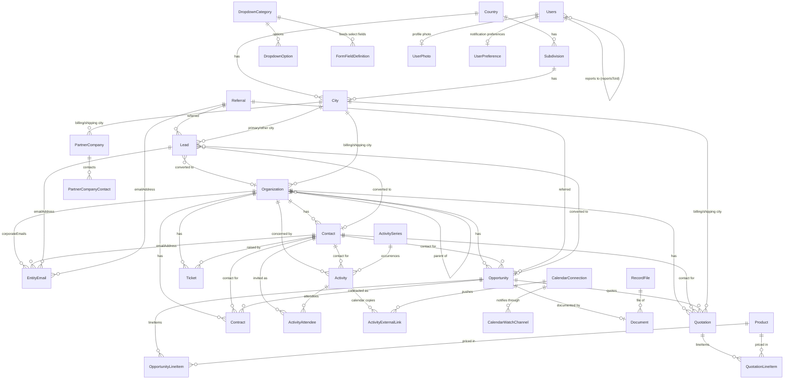

# Nandini CRM — Database Design

> **Status:** living document, generated from `backend-crm/prisma/schema.prisma` and `prisma/migrations/` (96 migrations,
> latest `20261220100000_roles` (Admin › Roles: new `Roles` table, §4.1c; `Users.Role` now names a row of it; start-up seeding fills it from the role names in use with the access they had), as of 2026-11-27; before it `20261220090000_product_catalog_dropdowns`, data only (Products, Jira CRM-15 / CRM-108: the "Zz Rename Check" custom field of the product form is deleted with its stored values and list cards; new `product_manufacturer` dropdown (Manufacturer) holding the Product Catalog sheet's manufacturers and every manufacturer products carry, and the built-in `manufacturer` field row becomes a `select` linked to it; the sheet's product lines join `shared_product_category` and `Software` joins `product_type`), as of 2026-11-27; before it `20261219100000_product_catalog_fields` (Products: `category` renamed `productCategory`, `taxType` dropped after Tax Type None became Tax Rate 0%, `manufacturer` indexed; the Form Builder's product rows, saved product drawer layouts and table filters follow; the Sale Information section becomes Product Information), as of 2026-11-27; before it `20261217100000_opportunity_organization_text`, data only: the Opportunities form's built-in `organizationName` field row in `FormFieldDefinition` goes from `lookup` to `text` (the form's Organization name is a plain input now; `Opportunity.organizationName` / `organizationId` unchanged, the API still links by name), as of 2026-11-27; before it `20261216110000_booking_video`, booking links' default video meeting (`BookingLink.videoMeeting`); before that `20261216100000_email_logging`, Calendar Phase 4 email logging, with its review fixes; before that `20261215110000_recurring_activities`, Calendar Phase 4 recurring activities; before that `20261215100000_activity_conference`, Calendar Phase 3 P3-1 video meetings; before that `20261215090000_calendar_watch_channels`, Calendar Phase 2 P2-7 webhooks; before that `20261128120000_booking_links`, Calendar Phase 4 booking links; before that `20261128100000_activity_calendar_sync`, Calendar Phase 2 P2-3b, whose columns P2-3c (first-sync backfill) and P2-5 (calendar → CRM pull) use without a migration of their own; P2-6 busy times needed no migration (it reads `Activity` through the existing `[isDeleted, startAt]` index and stores nothing); P2-8 customer meetings from the calendar and replies both ways needed none either (as of 2026-11-27: it writes imported activities into the existing `Activity` organizer / `syncKey` columns, `attendee` rows of `ActivityExternalLink` (`baseJson` `{ self, mine? }`: the reply last agreed with the calendar, and the CRM reply of the owner of a meeting organized outside the CRM) and reads `CalendarSyncUser.importMeetings`; a meeting organized outside the CRM keeps the organizer's `ready` join link in the P3-1 conference columns, read only, and never gets a `seriesId`). Update it in the same change as any schema migration.
> Related: [System design](system-design.md) · [API plan](api-plan.md) · [Build plan](build-plan.md)

---

## 1. Overview

| | |
| --- | --- |
| Engine | Microsoft SQL Server / Azure SQL (schema `dbo`) |
| Access | Prisma 7 ORM through `@prisma/adapter-mssql`; a few raw SQL statements (`MERGE` for counters, `sp_getapplock` for locks, `OPENJSON`) |
| Tables | **55** application tables + Prisma's `_prisma_migrations` |
| Owned child tables ("sub tables") | 8: `EntityEmail`, `OpportunityLineItem`, `QuotationLineItem`, `PartnerCompanyContact`, `DropdownOption`, `ActivityAttendee`, `UserPhoto`, `UserPreference` |
| Migrations | `backend-crm/prisma/migrations/` (`npm run db:migrate` in dev, `npm run db:deploy` in prod) |
| Seed | `backend-crm/prisma/seed.ts` (`npm run seed`) |

### Tables by domain

| Domain | Tables |
| --- | --- |
| Identity | `Users` (model `User`), `Roles` (Admin › Roles), `SecurityGroups` / `SecurityGroupMembers` (Admin › Security Groups), `UserPhoto` (profile photos), `UserPreference` (My Profile › Notifications), `UserInvites` (set-password links) |
| CRM core | `Organization`, `Contact`, `Lead`, `Opportunity`, `Quotation`, `Ticket`, `Contract`, `Document`, `Product` |
| Activities & calendar | `Activity`, `ActivityAttendee`, `ActivityExternalLink` (an activity's copy in a connected calendar + push outbox, P2-3b), `ActivitySeries` (a recurring activity's rule; its occurrences are `Activity` rows, Calendar Phase 4) |
| Owned children | `EntityEmail`, `OpportunityLineItem`, `QuotationLineItem` |
| Partner master | `PartnerCompany`, `PartnerCompanyContact` |
| Referral master | `Referral` (Referred By of leads and opportunities) |
| Reference masters | `NatureOfCall`, `Country`, `Subdivision`, `City` |
| Numbering | `DocumentSeriesSettings`, `DocumentSeries`, `SequenceCounter` |
| Customisation | `DropdownCategory`, `DropdownOption`, `FormFieldDefinition`, `ModuleSetting`, `DrawerLayout`, `DrawerPiece` |
| Admin lists | `Holiday` (Admin › Holidays, shown on the Calendar) |
| Company settings | `CompanyFormatSettings` (Admin › Company formats: date, time and number display) |
| PDF & files | `PdfTemplate`, `PdfAsset`, `PdfSavedItem`, `RecordFile` |
| Audit & UI state | `AuditLog`, `AuditExport`, `AuditDigest`, `TableFilter`, `ModuleScorecard` |
| Notifications & outgoing mail | `Notification` (navbar bell), `EmailLog` (every email the CRM sends) |
| Email checks | `EmailValidationRun` |
| Integrations | `IntegrationProvider` (Admin › API Integrations), `CalendarConnection` (an employee's company calendar sync state, P2-2b), `CalendarSyncUser` (admin's per-person calendar choice, P2-2b), `CalendarWatchChannel` (a person's calendar webhook channel, P2-7) |
| Booking links | `BookingLink` (an employee's public scheduling page), `BookingLinkBooking` (one booking made on it), Calendar Phase 4 |

## 2. Design conventions

These rules come from SQL Server's constraints and apply across the schema:

1. **Primary keys:** `NVARCHAR(50)` UUIDs generated by Prisma for business tables. Exceptions: `Users.Id` and
   `City.id` (`INT IDENTITY`), `Country.iso2Code`, `Subdivision.subdivisionCode`, `DocumentSeries.module`,
   `SequenceCounter.prefix`, `DocumentSeriesSettings.id` and `CompanyFormatSettings.id` (always 1).
2. **Business codes:** every core entity has a unique human code (`leadCode`, `accountCode`, `quotationCode`, …)
   issued by the document-series engine. Unique constraints cover deleted rows too, so a code is never reused.
3. **Soft delete:** core entities, `PartnerCompany`, `PdfTemplate` and `PdfSavedItem` have `isDeleted` + `deletedAt`.
   Rows are never physically deleted by the app, so foreign keys never block a "delete". `DropdownCategory` uses
   `deletedAt` as a tombstone; `NatureOfCall` uses `isActive`; `DropdownOption.isActive` is always true (archiving was removed, migration `20261120180000_remove_archive`).
4. **No cascade cycles:** SQL Server rejects multiple cascade paths (error 1785). Every cross-entity foreign key is
   `ON DELETE NO ACTION / ON UPDATE NO ACTION`. Only owned children cascade from their single parent.
5. **No scalar arrays:** string lists are stored as JSON in `NVARCHAR(MAX)` columns suffixed `Json`
   (`productCategoryJson`, `communicationTypeJson`, `partnerCompaniesJson`, `emailAddressJson`, `contractTypeJson`). Repeating
   objects with their own fields (emails, line items) are child tables.
6. **Custom fields:** each customisable entity has `customDataJson` = `{ "cf_fieldKey": value }`, described by
   `FormFieldDefinition` rows.
7. **Ownership & audit columns:** `createdBy` / `updatedBy` hold **usernames** (not FKs to `Users`), plus `createdAt`
   / `updatedAt`. The owner is `assignedTo`, also a username string.
8. **Denormalised display names:** child records keep the parent's name next to its id (`organizationName` +
   `organizationId`, `contact` + `contactId`, `billingCity` + `billingCityId`) so lists sort and search without
   joins. The app writes renames through to linked live rows in the same transaction.
9. **Unicode:** all text is `NVARCHAR`. String defaults that contain non-ASCII (e.g. `₹` in `currency`) are **not** set
   as DB defaults, because Prisma emits them without the `N` prefix; the API always sets them.
10. **Money:** `DECIMAL(18,2)` (discount percentage on products `DECIMAL(5,2)`). Tax rate is a string (`"18%"`).
11. **Dates:** `DATE` for calendar dates (follow-ups, quotation date, invoice date); `DATETIME2` for timestamps.
    Ticket `dueDate` and Contract `renewalReminderDate` are wall-clock times in `BUSINESS_TIMEZONE` (stored as if
    UTC). The exception is `Activity.startAt` / `endAt` (and `remindAt`): **true UTC instants**, with the zone they
    were entered in kept in `Activity.timeZone`; everything else stays wall-clock. Conversions go through
    `backend-crm/src/utils/zonedTime.ts`.
12. **Column widths** are ≥ the frontend's `FIELD_MAX_LENGTH` (`frontend-crm/src/config/fieldLimits.ts`). Long text columns (descriptions, remarks, notes, terms, reasons, line item description / note, ticket case notes) are `NVARCHAR(MAX)`: long text has no limit (migration `20261227090000_long_text_unlimited`).
13. **Phones** are stored in E.164 (`+919811234567`), `NVARCHAR(20)`.

## 3. Entity-relationship diagram

Not drawn (no foreign keys, linked by convention):

- `assignedTo` / `createdBy` / `updatedBy` / `changedBy` / `TableFilter.username` → `Users.Username`.
- `AuditLog.entityType + entityId` → any audited row (polymorphic).
- `DocumentSeries.module` → module name; `SequenceCounter.prefix` → series key.
- `CompanyFormatSettings` (one row, `id = 1`) stands alone: it relates to no table.
- `PdfTemplate.documentJson` may reference `PdfAsset.key` (logo) — deletion of a referenced asset is blocked in code.
- `Ticket.natureOfCall` → `NatureOfCall.name`; `Ticket.partnerCompany` → `PartnerCompany.partnerName` (names, not ids).
- `Activity.relatedModule + relatedId` → the linked record (a lead, opportunity, contact, organization, quotation,
  ticket or contract; polymorphic, checked by the API). `ActivityAttendee.username` → `Users.Username`.
- `Notification.username` / `EmailLog.toUsername` → `Users.Username`; `Notification.entityModule + entityId` → the
  activity or contract it is about (no foreign key: the row outlives a deleted record and is purged by age).

## 4. Table reference

Column lists below group fields; see `schema.prisma` for exact types and lengths.

### 4.1 `Users`

Pre-existing table kept for compatibility (columns `Id`, `Username`, `Password`, `Role` mapped by Prisma).

| Column | Type | Notes |
| --- | --- | --- |
| `Id` | INT IDENTITY PK | Frontend `User.id: number` |
| `Username` | NVARCHAR(50) UNIQUE | Used everywhere as the owner/creator identifier |
| `Password` | NVARCHAR(255) | bcrypt hash; legacy plain-text values are re-hashed on next login |
| `Role` | NVARCHAR(50) | Default `Sales Executive`. The **name** of a row in `Roles` (§4.1c), matched by `normalizeRole` (case, spacing and dash style ignored). The role's permissions and admin panel switch decide what the user can do (`modules/roles`). Admin › Users picks one of the roles in the table (400 `VALIDATION_ERROR` on `role` for any other name). Renaming a role in Admin › Roles renames it here on every holder; deleting one moves its holders to the role the admin picks |
| `email`, `department` (NVARCHAR(50)) | | `email` is unique in code only (SQL Server allows one NULL in a unique key). Since P2-1 the CRM writes it through `modules/users/userEmail.service.ts` (Admin › API Integrations › People, Admin › Users through its in-transaction checks `assertCompanyEmailAllowed` / `assertEmailKeepsConnection` / `assertUserEmailFree`, and the calendar connect auto-fill): trimmed and lower-cased, unique among **active non-group** users (writers serialise on an application lock), a company domain (`activities/calendarSync` `companyDomains`) unless the admin allows another, audited `User UPDATE`. As of 2026-11-26 (P2-2) the database enforces it too: filtered unique index `UX_Users_email` (`WHERE email IS NOT NULL AND isActive = 1 AND isGroupUser = 0`; the migration lower-cases stored emails first and stops on duplicates, pre-check `npm run calendar:check-emails`). While the user has a live calendar connection the address can't be changed or cleared (409 `EMAIL_CONNECTED`; every email writer also takes the user's `calendar-connection:user:<username>` lock, the one the connect takes, so the two can't both pass on stale data); an empty one is filled from the verified company account at connect. Both admin-managed (read-only on My Profile) |
| `fullName` | NVARCHAR(100), default `''` | Display name read everywhere (lookups, audit log, quotation PDFs). A profile write that changes a name sets it to `trim(firstName + ' ' + lastName)` |
| `firstName`, `lastName` | NVARCHAR(100) NULL | Edited on My Profile (name-cased like other person names; together ≤ 99 characters so `fullName` fits). NULL or stale for users created or renamed outside the app: the API then shows them split from `fullName` (`resolveNameParts`) |
| `phone` | NVARCHAR(20) NULL | The **mobile** number (E.164); My Profile calls it Mobile, quotation PDFs print it as the sales person's phone |
| `officePhone` | NVARCHAR(20) NULL | Desk / landline number (E.164), My Profile |
| `passwordChangedAt` | DATETIME2 NULL | Set by `POST /api/auth/change-password` and by using a set-password link; NULL = never changed in this CRM. Sending a reset link leaves it as it is |
| `jobTitle` | NVARCHAR(100) NULL | Free text set in Admin › Users (read-only on My Profile). Not an access rule |
| `reportsToId` | INT NULL, FK → `Users.Id` (NO ACTION / NO ACTION), indexed | The user's manager (Admin › Users "Reports to"). The API refuses the user themselves, anyone below them (no cycles; chain walked up to 50 levels, writers serialise on an application lock), an inactive or group login. Kept when the manager is deactivated. NO ACTION: a user with direct reports can't be deleted |
| `invitePending` | BIT NOT NULL, default 0 | **Invited**: added in Admin › Users and hasn't set a password from the emailed link yet (the stored hash is of a random value nobody knows; sign-in answers `403 INVITE_PENDING`). Cleared when a set-password link is used (`POST /api/auth/invite/accept`). Replaced `mustChangePassword` (2026-11-27) |
| `failedLoginCount` | INT NOT NULL, default 0 | Account lockout (`auth/accountLockout.ts`): wrong passwords in the current run. Back to 0 on a successful sign-in, a password set from a link, an admin unlock, and when a lock is applied |
| `lastFailedLoginAt` | DATETIME2 NULL | When the last wrong password was typed; a run older than the policy window (15 min) starts again from 1 |
| `lockedUntil` | DATETIME2 NULL | Sign-in refused (`423 ACCOUNT_LOCKED`) until then; shown as **Locked** in Admin › Users. NULL or past = not locked. Cleared by "Unlock account" |
| `createdBy` | NVARCHAR(50) NULL | Username of the admin who added the user in Admin › Users; NULL for older users (seed, SQL) |
| `deactivatedAt` | DATETIME2 NULL | When an admin last deactivated the user; NULL again on activation |
| `isActive`, `isGroupUser`, `onLeave`, `lastLoginAt` | | Inactive users can't sign in or be assigned. Set in Admin › Users (`onLeave` is a plain switch). Out-of-office dates live in `UserPreference` (§4.30, set by the user in My Profile); a user is **effectively on leave** when `onLeave` is set or today (business timezone) is in their out-of-office range |

Indexes: `email`, `isActive`, `reportsToId`.

The username is set once (Admin › Users validates `^[a-z0-9][a-z0-9._-]*$`, 3–50, stored lower-cased, unique
case-insensitively) and never changes: records store it as their owner. Users are never deleted by the app, only
deactivated.

Migration `20261126235000_user_admin` (Profile Phase 2) adds `jobTitle`, `reportsToId` (+ index `Users_reportsToId_idx`
and the self foreign key `Users_reportsToId_fkey`), `mustChangePassword` (NOT NULL, default 0), `createdBy` and
`deactivatedAt`. Nothing is backfilled: existing users keep `mustChangePassword = 0` and NULL elsewhere. Writes from
Admin › Users are audited as the acting admin: `CREATE` (a snapshot without any password), `UPDATE` (diff),
`STATUS_CHANGE` (`isActive`) and `PASSWORD_RESET` (retired with temporary passwords; old entries stay readable).

Migration `20261229090000_account_lockout` (2026-11-28) adds `failedLoginCount` (NOT NULL, default 0, constraint
`Users_failedLoginCount_df`), `lastFailedLoginAt` and `lockedUntil` (both NULL). No backfill: every account starts
unlocked. Locks and unlocks are audited (`ACCOUNT_LOCKED`, `ACCOUNT_UNLOCKED`).

Migration `20261217090000_user_invites` (2026-11-27) replaces `mustChangePassword` with `invitePending` (NOT NULL,
default 0, constraint `Users_invitePending_df`): users who still had `mustChangePassword = 1` (a temporary password
they never changed) become Invited (`invitePending = 1`), so their temporary password stops working and an admin
sends them an invite from Admin › Users; then the old column and its default constraint are dropped. It also
creates `UserInvites` (§4.1b).

Migration `20261126230000_user_profile` adds `firstName`, `lastName`, `officePhone` and `passwordChangedAt` (all NULL)
and splits every existing name once: `firstName` = the text before the first space of `LTRIM(RTRIM(fullName))`,
`lastName` = the rest, trimmed (NULL when empty); a blank `fullName` leaves both NULL. `fullName` itself is not
rewritten (`npm run seed` splits the same way, `splitFullName` in `modules/profile/profile.dto.ts`). Writes: the
user's own profile edit (My Profile, audited as a User `UPDATE` with a diff of first / last / full name, mobile and
office phone), sign-in (`lastLoginAt`, legacy password re-hash) and the password change (`passwordHash`,
`passwordChangedAt`, audited as `PASSWORD_CHANGE` with only the timestamp).

### 4.1c `Roles` (Admin › Roles)

Migration `20261220100000_roles` (model `Role`, new table only). Module `backend-crm/src/modules/roles`. One row per
role a user can hold; `Users.Role` stores the role's `name`.

| Column | Type | Notes |
| --- | --- | --- |
| `id` | INT IDENTITY PK | |
| `name` | NVARCHAR(50) UNIQUE | Shown everywhere a role is shown. Unique also by `normalizeRole` (checked in code: `Sales-Executive` clashes with `Sales Executive`) |
| `description` | NVARCHAR(MAX) NULL | Shown on the role card (2 lines); long text, no limit |
| `adminPanel` | BIT NOT NULL, default 0 | Opens the admin panel (`requireAdmin`: forms and dropdowns, users, roles, PDF templates, audit log, settings) |
| `permissionsJson` | NVARCHAR(MAX) NOT NULL | `{ "<module>": { "<action>": "all" \| "group" \| "own" \| "none" } }` (`group` since migration `20261230090000_security_groups`; offered wherever `own` is) for the 12 modules of `PERMISSION_MODULES` (leads, contacts, organizations, opportunities, quotations, contracts, tickets, referrals, activities, documents, products, partnerCompanies) and the actions each offers (view, create, edit, delete, export, import: every module has all six except documents, which has view and export; as of 2026-11-28 a stored role that predates a module's export / import reads it as `none` until an admin turns it on, except an unset `export` of organizations and documents, which is `all` while the module can be viewed: `EXPORT_FOLLOWS_VIEW`, as those lists exported for everyone before). Read through `normalizePermissions`: a missing or unknown value is `none`, Create / Export / Import are only `all` or `none`, modules without an owner (products, partner companies) only `all` or `none`, Edit / Delete never exceed View, and a module at View `none` allows nothing |
| `isSystem` | BIT NOT NULL, default 0 | Super Admin: always full access and the admin panel whatever the row says; can't be edited, renamed or deleted |
| `createdAt`, `createdBy`, `updatedAt`, `updatedBy` | | |

**Seeding** (`roleSeed.ts`, at API start-up, idempotent). When the table is empty it is filled with the role names
the CRM used to hard-code plus every role a user holds, each with the access its name gave before: `Super Admin`
(system), `Admin` (admin panel, every record), `Administrator` (admin panel, own records), the other every-record
roles of `GLOBAL_ACCESS_ROLES` (every action on every record, no admin panel) and every other name (own records: View / Edit / Delete own, Create,
Export and Import yes; referrals stay viewable by all, as before). After that only `Super Admin` and roles that users hold
but no row matches are added; a role an admin deleted is not brought back. Writes are audited (entity `Role`, module
`roles`, category CONFIG, admin-only in the audit log).

### 4.1d `SecurityGroups` and `SecurityGroupMembers` (Admin › Security Groups)

Migration `20261230090000_security_groups` (models `SecurityGroup`, `SecurityGroupMember`; new tables only, no
backfill). Module `backend-crm/src/modules/security-groups`. Teams / branches read by a role's **Group** level
([system design](system-design.md) › Authorization › Security groups).

`SecurityGroups`

| Column | Type | Notes |
| --- | --- | --- |
| `id` | INT IDENTITY PK | |
| `name` | NVARCHAR(100) UNIQUE | Also unique in any case (checked in code) |
| `description` | NVARCHAR(MAX) NULL | Long text, no limit |
| `parentId` | INT NULL FK → `SecurityGroups.id` (NO ACTION) | The group this one sits under; never a loop (`400 GROUP_CYCLE`). A group with sub-groups can't be deleted (`400 HAS_SUB_GROUPS`). Index `SecurityGroups_parentId_idx` |
| `isActive` | BIT NOT NULL, default 1 | 0 = archived: keeps its members, grants nothing, and cuts off its sub-groups |
| `createdAt`, `createdBy`, `updatedAt`, `updatedBy` | | |

`SecurityGroupMembers`

| Column | Type | Notes |
| --- | --- | --- |
| `groupId` | INT FK → `SecurityGroups.id` (CASCADE) | PK (`groupId`, `userId`) |
| `userId` | INT FK → `Users.Id` (CASCADE) | Index `SecurityGroupMembers_userId_idx`. A user can be in several groups |
| `addedAt`, `addedBy` | DATETIME2, NVARCHAR(50) NULL | |

Writes are audited (entity `SecurityGroup`, module `security-groups`, CONFIG, admin-only). Both tables are read whole
into the role registry snapshot (a few hundred rows at most), never per request.

### 4.1b `UserInvites` (set-password links)

Migration `20261217090000_user_invites` (model `UserInvite`). Module `backend-crm/src/modules/auth` (`invite.token.ts`,
`invite.service.ts`). One row per emailed set-password link: a new user's invite or an admin-sent password reset.

| Column | Type | Notes |
| --- | --- | --- |
| `id` | INT IDENTITY PK | Also orders a user's links (newest wins) |
| `userId` | INT, FK → `Users.Id` **ON DELETE CASCADE** | |
| `tokenHash` | CHAR(64) **UNIQUE** | Hex SHA-256 of the 256-bit token; the token itself is only in the email, never stored or logged |
| `purpose` | NVARCHAR(20) | `invite` (user still Invited) or `reset` |
| `expiresAt` | DATETIME2 | Sent + 72 h |
| `usedAt` | DATETIME2 NULL | Set once, by a conditional update, when the link sets the password: single use |
| `revokedAt` | DATETIME2 NULL | A newer link was sent, another link was used, the email changed or the user was deactivated |
| `createdAt`, `createdBy` | DATETIME2, NVARCHAR(50) NULL | The admin who sent it |

Index `UserInvites_userId_createdAt_idx`. A link works while `usedAt` and `revokedAt` are NULL and `expiresAt` is in
the future. A row whose email couldn't be sent is deleted again. Rows are kept after use (no retention job yet; they
hold no secret).

### 4.1a `UserPhoto` (profile photos)

Migration `20261126230000_user_profile` (new table). Module `backend-crm/src/modules/profile`. A user's profile photo,
bytes in the database like `RecordFile` / `PdfAsset`: `id` (uuid), `userId` (INT, **UNIQUE**, FK → `Users.Id`
**ON DELETE CASCADE**), `mimeType` (≤ 50, detected from the bytes: PNG, JPEG or WebP), `sizeBytes`, `data`
(VARBINARY(MAX), ≤ 512 KB; the crop dialog sends 256 × 256), `createdAt`. One row per user; a new upload deletes the
old row and inserts a new one with a **new id** (one transaction, serialized per user with an app lock), so
`/api/user-photos/:id` never changes content and is cached forever. Photo changes are audited on the user
(`UPDATE`, `changes.photo: { from: oldId, to: newId }`). User queries never load the bytes (the profile selects only
`photo.id`).

### 4.2 `Organization` (customer accounts)

| Group | Columns |
| --- | --- |
| Identity | `id`, `accountCode` (UNIQUE), `organizationName` (stored UPPERCASE), `mailingName`, `tradeName` |
| Overview | `natureOfBusiness`, `accountStatus` (`Active`/`Inactive`), `inactivityReason`, `typeOfEntity`, `customerType`, `natureOfPartner` (partner organizations only: set, and required, when `customerType` is Partner; same `partner_nature` list as partner companies, now a shared dropdown; migration `20261125170000_org_nature_of_partner`, which also removes the organization form's Partner Company field while keeping `partnerCompaniesJson`), `sapCodeTallyId`, `showroomBranchCode`, `leadSource`, `memberOf`, `parentOrganizationId` → `Organization`, `numberOfEmployees`, `annualTurnover`, `addDescriptionAndScope`, `accountVerified`/`verifiedAt`/`verifiedBy`, `activeAmc`, `activeCloud`, `provideSupport`, `assignedTo` (owner) |
| Billing address | `billingAddress`, `billingStreet`, `billingCityId` → `City`, `billingCity`, `billingState`, `billingPostalCode`, `billingCountry`, `billingLatitude` |
| Shipping address | same set with `shipping*`, `shippingLongitude`, `copyAddressFromBilling` |
| Tax & bank | `registrationType`, `panNumber`, `msmeRegnNumber`, `gstNumber`, `cinNo`, `tanNumber`, `accountName`, `bankName`, `ifscCode`, `accountNo`, `typeOfAccount`, `bankAddress` |
| JSON | `partnerCompaniesJson` (string[]), `customDataJson` |
| Audit | `createdBy`, `updatedBy`, `createdAt`, `updatedAt`, `isDeleted`, `deletedAt` |

Indexes: `organizationName`, `accountStatus`, `assignedTo`, `gstNumber`, `billingCityId`, `shippingCityId`,
`(isDeleted, createdAt)`, `(isDeleted, accountStatus, assignedTo)`.
**Filtered unique index** (raw SQL, not in `schema.prisma`): `Organization_organizationName_live_key` on
`organizationName WHERE isDeleted = 0`. Re-check `prisma migrate diff` after future migrations so Prisma doesn't try
to drop it.

### 4.3 `Contact`

`id`, `contactCode` (UNIQUE), `name`, `organizationName` + `organizationId` → `Organization`, `mobile` (required),
`officePhone`, `phone3`–`phone5`, `assignedTo`, `isPrimaryContact`, `designation`, `department`, `leftJob`,
`communicationTypeJson` (string[]), `doNotCall`, `addDescription`, `customDataJson`, audit/soft-delete columns.
Emails live in `EntityEmail`.

Indexes: `organizationId`, `mobile`, `name`, `assignedTo`, `(isDeleted, createdAt)`, `(isDeleted, assignedTo, createdAt)`.

### 4.4 `Lead`

| Group | Columns |
| --- | --- |
| Identity | `id`, `leadCode` (UNIQUE), `name`, `mobile`, `otherPhone`, `mailingName`, `tradeName`, `organizationName`, `designation`, `department` |
| Qualification | `leadSource`, `leadType` (Lead Type: admin dropdown `lead_type`, e.g. Inbound / Outbound / Marketing), `rating` (Rating: `Hot` / `Warm` / `Cold`, set by the system and never on a form — not a form-builder field), `status` (default `New`), `productCategoryJson`, `followupType`, `customerResponse` (latest follow-up outcome from the leads' own list `lead_customer_response`, option meta `ratingRule`; opportunities have their own `opportunity_customer_response` with `opportunityStages` / `noFollowUp`. History: migration `20261125220000_shared_customer_response` had merged them into one shared list; start-up seeding (`customerResponseSplit.ts`) splits that list again, copying the admin's options to each module, and the old row becomes `activity_customer_response`. Customer Response is the documented exception to "same key = same field": `UNSHARED_FIELD_KEYS`), `nextFollowupDate` (DATE), `nextFollowupTime`, `registrationType`, `gstNumber`, `turnover`, `noOfEmployee`, `referredBy` (shown, and required, when `leadSource` is CA or Reference: the name of the linked Referral) + `referredById` → `Referral` (NO ACTION, migration `20261125230000_referrals`; NULL for a value typed before that migration, which is kept as it is), `partnerCompany` (set, and required, when `leadSource` is Partner: the name of an organization whose Customer Type is Partner, picked in the organization picker; migration `20261125210000_lead_partner_company`, which replaced the short-lived `natureOfPartner` column of `20261125180000_lead_source_details`), `assignedTo`, `remarks`, `description` |
| Addresses | `primary*` (with `primaryCityId` → `City`), `other*` (with `otherCityId`), `copyAddressFromLeft` |
| Conversion | `convertedAt`, `convertedBy`, `convertedOrganizationId`, `convertedContactId`, `convertedOpportunityId` (FKs) — set only by the convert endpoint |
| Other | `customDataJson`, audit/soft-delete columns |

Status `Converted` is a system option: it can only be set by conversion and can never be left.
Indexes: `status`, `rating`, `assignedTo`, `mobile`, `nextFollowupDate`, `primaryCityId`, `otherCityId`,
`(isDeleted, createdAt)`, `(isDeleted, assignedTo, createdAt)`.
Migration `20261120200000_lead_rating` added `rating` and moved any `Hot` / `Warm` / `Cold` still stored in `leadType` into it.
Rating bookkeeping ([lead-rating-rules.md](lead-rating-rules.md), migration `20261121090000_lead_rating_rules`):
`ratingReason` (why, NVARCHAR(200)), `unansweredCalls` (INT, default 0: consecutive "Unanswered calls" responses),
`ratingAgeingFrom` (DATE, indexed) + `ratingAgeingJson` (`{ limits: { hot, warm }, response }`): set only while the
Rating ages under a "Days since response" rule; the nightly job reads them. `nextFollowupDate` is now a locked,
required field for leads (closed leads have none).

### 4.5 `Opportunity` and `OpportunityLineItem`

`Opportunity`: `opportunityCode` (UNIQUE), `opportunityName`, `productCategoryJson`, `contact`/`contactId`,
`organizationName`/`organizationId`, `contactNumber` (optional), `contactEmail`, `referredBy` + `referredById` / `partnerCompany` (as on leads: required for Lead Source CA / Reference and Partner), `type`, `salesStage`, `leadSource`,
`leadGivenBy`, `nextFollowupDate`/`Time`, `followupType`, `customerResponse` (as on leads), `remarks`, `description`, `assignedTo`,
billing (`tallySerialNo` — 9 digits starting with 7, checked by the API, `invoiceNo`, `invoiceDate`), `commission` (fixed `Yes` / `No`, default `No`) with
`commissionAmount` (DECIMAL(18,2), required above 0 when `Yes`, NULL when `No`), `commissionType` (fixed `Self` /
`Other` while `Yes`; not editable: always `Self` up to 1,000 and `Other` above, set by the API from the amount), the commission payee's bank details kept only
while `Other` (`accountName`, `accountNo`, `bankName`, `ifscCode`, `panNumber`: the Organization columns' sizes and
rules; all five required by the API while `Other`), documentation (`addDocument` fixed `Yes` / `No`, must be `Yes` at Sales Stage `PO`; while `Yes` the opportunity
has a `Document` row (§4.24) with Document No, Document Date and the file, which the API returns on the
opportunity as `documentNo`, `documentDate`, `documentFile`; `No` deletes it), totals (`lumpSumDiscount`,
`totalAmount` (Gross Amount), `totalDiscount`, `subtotal` (Total Taxable Amount), `actualBeforeTax` (Total Taxable
Amount − Lump Sum Discount), `totalTax` (GST), `gstType` (NVARCHAR(10) NULL: `IGST`, `CGST_SGST`, or NULL = plain
GST because no Company State was set when it was saved), `roundOff` (BIT, default 1: the Round Off checkbox),
`roundOffAmount` (signed: what rounding the Grand Total to the rupee added or took off), `grandTotal` — recomputed
server-side to the paisa, see "Summary Breakdown" below), `customDataJson`, audit/soft-delete. An opportunity has no currency (its amounts are in ₹):
`currency` and `groupName` were dropped by `20261221090000_line_items` (Jira CRM-111).

`OpportunityLineItem` (owned, cascades from `Opportunity`; Jira CRM-111): `productId` → `Product` (nullable),
`productName` (snapshot, label Product), `quantity` (≥ 1), `rate` (DECIMAL(18,2), the product's MRP, or typed for a
product without one), `grossAmount` (= quantity × rate), `discount` (as entered: a percentage 0–100, or an amount off
the line up to the gross amount), `discountType` (NVARCHAR(20), `percentage` (default) or `amount`; migration
`20261222090000_line_item_discount_type`, existing lines `percentage`), `discountAmount` (= gross × discount %, or the
amount), `taxRate` (GST, a `product_tax_rate` option such as `18%`; the product's Tax Rate when it has one),
`taxableAmount` (= gross − discount amount), `description`, `note`, `sortOrder`. The three amounts are DECIMAL(18,2)
(default 0) and always computed by the API (`modules/shared/lineItemMath.ts`, mirrored by the frontend's
`lib/line-items`). Only `discount`, `description` and `note` may be empty. Totals: Gross Amount = Σ gross, Discount = Σ
discount amount, Taxable Amount = Σ taxable, GST = Σ taxable × rate, Grand Total = max(0, taxable + GST − lump sum
discount), all rounded to whole rupees. Migration `20261221090000_line_items` renamed `amount` → `rate`, turned
per-unit (`direct`) discounts into percentages, normalized `GST 18%` / `--None--` to `18%` / `0%`, filled the new
amounts and dropped the old `discountType` (`percentage` / `direct`), `salePrice`, `taxAmount` and `total`.

Indexes: `organizationId`, `contactId`, `salesStage`, `assignedTo`, `nextFollowupDate`, scoped-list composites;
line items on `opportunityId` and (`productId`, `opportunityId`) (migration `20261218090000_product_usage_index`, which
replaced the single-column `productId` index: product usage counts read distinct product / opportunity pairs).

### 4.6 `Quotation` and `QuotationLineItem`

`Quotation`: `quotationCode` (UNIQUE), `quotationTitle`, `quoteStage` (default `Draft`), `quotationDate`,
`validUntil`, `validationPeriod`, `remarks`, terms (`termsAndCondition`, `termsAndConditionDescription`),
payment terms, `assignedTo`, `opportunity` + `opportunityId` → `Opportunity`, `company`, `otherRef`,
`preparedFor`, `currency` (the quotation's currency label, e.g. `US Dollar: $`; default `Indian Rupee: ₹`), totals
(same set as Opportunity), customer snapshot (`organizationName`/`Id`, `contact`/`Id`,
`contactNumber`, `contactEmail`, `mailingName`, `gstNumber`), billing address (required) and shipping address (with city
FKs), legacy alias columns (`status`, `quotationSubject`, `notes`, `termsAndConditions`), `customDataJson`,
audit/soft-delete.

`QuotationLineItem`: same shape and rules as `OpportunityLineItem`, cascades from `Quotation`; a quotation needs at
least one line. `groupName` was dropped by `20261221090000_line_items`.

**Summary Breakdown (Jira CRM-111, migration `20261223090000_line_item_summary`).** Opportunities and quotations work
out their totals with one shared module (`backend-crm/src/modules/shared/lineItemMath.ts`, mirrored byte for byte in
`frontend-crm/src/lib/line-items/lineItemMath.ts`), in integer paisa:

1. `subtotal` (Total Taxable Amount) = Σ line `taxableAmount`; `lumpSumDiscount` (at most the subtotal, else `400`).
2. `actualBeforeTax` = subtotal − lump sum. The lump sum is shared across the GST rates in proportion to their taxable
   amounts (largest remainder, so the shares add up to it exactly).
3. GST per rate on its share: `IGST` = rate × base when the customer's state differs from the Company State
   (`CompanySettings`), `CGST_SGST` = half the rate × base twice (each rounded) when it is the same or the customer has
   none, plain GST when no Company State is set. The customer's state is the shipping state, else the billing state
   (the billing one when "copy address from billing" is on): a quotation's own address, an opportunity's
   organization's. States compare ignoring case and accents, with ISO codes (`IN-GJ`) and old names (`Orissa`) accepted.
4. `grandTotal` = actual + GST, rounded to the nearest rupee (0.50 up) while `roundOff` is on; `roundOffAmount` holds
   the difference.

`gstType` is a snapshot taken on every save, so a later Company State change doesn't move saved totals; the one
exception is records saved while no Company State was set (`gstType` NULL), which take the split when an admin first
saves one. The migration adds the four columns (existing rows `roundOff = 1`, `actualBeforeTax = max(subtotal −
lumpSumDiscount, 0)`); on the first start after it, the API recomputes every opportunity and quotation (and their line
amounts) with this math once (`ModuleSetting (system, lineItemSummaryTotals)` marks it done), keeping `updatedAt`.

### 4.6a `CompanySettings` (Admin › Company Details)

Same migration. Module `backend-crm/src/modules/company-settings`. **Single row, `id = 1`**, written by the first save.

| Column | Type | Notes |
| --- | --- | --- |
| `id` | INT PK | Always 1 |
| `companyState` | NVARCHAR(80), default `''` | Our company's Indian state or union territory (canonical name from the address master); `''` = not set |
| `updatedBy` | NVARCHAR(50) NULL | Username of the last admin who saved |
| `updatedAt` | DATETIME2 | |

Saves are audited as `CompanySettings UPDATE` (entity id `company-settings`, audit module `company-settings`, CONFIG).

Indexes: `opportunityId`, `organizationId`, `contactId`, `quoteStage`, `assignedTo`, city ids, scoped-list composites.

### 4.7 `Ticket` (support)

`ticketNumber` (UNIQUE), `amcFlag`, `cloudFlag`, `ticketSubject`, `organizationName`/`Id`, `contact` +
`contactId`, `contactNumber`, `contactEmail`, `ticketPriority`, `source`, `supportType`, `supportMode`,
`natureOfCall` (name from `NatureOfCall`), `ticketStatus` (default `New`), `dueDate` (DATETIME), `problemReported`,
`problemObserved`, `resolution`, `reasonForEscalatedCalls`, `rca`, `addDescription`, `accountAddress`, `leftJob`,
`assignedTo`, `partnerCompany`, `partnerCompanyContact`, `customDataJson`, audit/soft-delete.

Indexes: `ticketStatus`, `ticketPriority`, `assignedTo`, `dueDate`, `organizationId`, `contactId`, scoped composites.

### 4.8 `Product`

`productCode` (UNIQUE), `productName`, `hsnCode`, `productCategory` (one option of the shared Product Category dropdown;
`category` until `20261219100000_product_catalog_fields`), `type`, `manufacturer`, `taxRate` (Tax Type was dropped in
that migration: products with Tax Type None got Tax Rate `0%`), `discount` DECIMAL(5,2), `cost`/`mrp`/`msp` DECIMAL(18,2) (returned as strings by the API),
`contractCreate`, `description`, `termsAndConditions`, `status` NVARCHAR(30) (`Active` / `Inactive`, default
`Active`; fixed dropdown `product_status`), `inactivityReason` NVARCHAR(500), `inactiveSince` DATETIME2 (the exact moment, shown as date + time) and
`inactivatedBy` NVARCHAR(50) (username), `customDataJson`, audit/soft-delete. Only roles with the admin panel (`isAdminUser`) change
`status`; making a product Inactive needs a reason and stamps `inactiveSince` / `inactivatedBy` (kept while it stays
Inactive, cleared when it is made Active again; both changes are in the audit diff). Only Active products can be put
on new opportunity / quotation line items; lines that already hold an inactive product keep it. Migration
`20261219090000_product_status` replaced the former `isActive` BIT (every existing product became Active; a row with
`isActive = 0` became Inactive since its last update).
Products are not row-scoped (everyone sees all). A new or restored product's name must not match a live product's
(checked in code); renaming one is not checked. Indexes: `productName`, `manufacturer`, `productCategory`, `status`,
`(isDeleted, createdAt)`.

### 4.9 `EntityEmail` (shared child table)

One table holds emails for four parents. Exactly one of `organizationId`, `contactId`, `leadId`, `referralId` is set per row; each
FK cascades on delete. Columns: `email`, `isPrimary`, `isOptedOut`, `isInvalidBounce`, `sortOrder`, and the
automatic check result `verificationStatus` (`valid` | `risky` | `invalid`; null = not checked / undecided),
`verificationReason`, `verifiedAt`. The database is the record of checked addresses: a decided result is final
(no periodic re-check), and an address saved on any record counts as checked everywhere — `replaceEmails` copies an
existing result onto a new row with the same address. Only an admin bulk check (`EmailValidationRun`) changes it.
Returned as `corporateEmails` (organizations) or `emailAddress` (contacts, leads, referrals). Writes replace the full set
(`replaceEmails`). Indexes on each FK and on `email` (duplicate checks).

### 4.10 `PartnerCompany` and `PartnerCompanyContact`

Channel / referral partners. `partnerName` is **globally unique** (soft-deleted partners keep their name reserved,
because seeds upsert by name). Holds overview, `emailAddressJson` (array of `{ email, isPrimary, … }`), bank details (`branch`, `accountNo`, `ifscCode`), `officePhone`, `gstNumber`,
billing/shipping addresses with city FKs, statutory IDs, `customDataJson`, soft delete. `email` and `city` mirror the
primary email and billing city for the lookup projection.

`PartnerCompanyContact` (cascades from partner): `name`, `designation`, `mobile`, `officePhone`, `email`, `location`,
`isActive`.

### 4.11 Address masters: `Country`, `Subdivision`, `City`

| Table | Key | Source |
| --- | --- | --- |
| `Country` | `iso2Code` | ISO 3166-1, sheet `Country_Master` of `seed-data/CRM_Address_Master.xlsx` |
| `Subdivision` | `subdivisionCode` (ISO 3166-2) | sheet `State_Region_Master`; cascades from `Country` |
| `City` | `id` INT IDENTITY | `seed-data/cities.csv.gz` (built by `npm run build:city-master`); admins add/rename/remove |

`City` notes: `seedKey` (`country|subdivision|searchName`) lets the seed add only new cities and never resurrect a
renamed or removed one; `isHidden` hides removed seeded cities (admin-added cities are hard-deleted); `searchName` is
lowercased without diacritics/punctuation for search; `population` orders suggestions. The `City → Subdivision` FK is
`NO ACTION` to avoid a second cascade path from `Country`.
Indexes: `seedKey`, `(countryIso2, searchName)`, `(subdivisionCode, searchName)`.

### 4.12 `NatureOfCall`

Ticket categories: `name` (UNIQUE), `priority` (`High`/`Medium`/`Low`, suggests the ticket priority), `isActive`,
`sortOrder`.

### 4.13 Document numbering: `DocumentSeriesSettings`, `DocumentSeries`, `SequenceCounter`

| Table | Rows | Columns |
| --- | --- | --- |
| `DocumentSeriesSettings` | 0 or 1 (`id = 1`) | `companyPrefix`, `separator` (`/ - _ .` or none), `fyStartMonth` (4 = April), `fyFormat` (`YY-YY`, `YYYY-YY`, …) |
| `DocumentSeries` | one per module that has a series | `module` PK (`lead`, `opportunity`, `quotation`, `organization`, `contact`, `ticket`, `contract`, `product`), `modulePrefix`, `includeCompanyPrefix`, `includeFinancialYear`, `suffix`, `padLength`, `startingNumber`, `resetEachFinancialYear` |
| `SequenceCounter` | one per counter | `prefix` PK = legacy prefix (`LD`, `QT`, …) or `LD@2026` for a counter that restarts each FY; `currentValue` |

Example output: `NIPL/L/26-27/1004`. A module with no `DocumentSeries` row keeps `LD-0001` style codes, and the UI
hides those numbers. Numbers are taken with a single `MERGE … WITH (HOLDLOCK)` inside the inserting transaction, and
codes already in use (e.g. imported) are skipped.

### 4.14 Form & dropdown customisation

| Table | Purpose | Key rules |
| --- | --- | --- |
| `DropdownCategory` | A named option list, e.g. `lead_status`. `module` = owning module or `shared` | `key` UNIQUE; `isSystem` for built-ins; `deletedAt` tombstone so startup seeding doesn't recreate a deleted built-in |
| `DropdownOption` | One option (cascades from category) | UNIQUE `(categoryId, value)`; deleting removes the row (records keep the raw value, shown tagged "Removed"); `isSystem` options (e.g. lead `Converted`) can't be deleted or renamed; `isDefault` pre-selects; `metaJson` for extras |
| `FormFieldDefinition` | One field of one module's form | UNIQUE `(module, fieldKey)`; tab/section placement, order, size, placeholder, hint, default; `isRequired`, `isCoreLocked`, `isSystem`, `isActive`, `isVisibleInForm`, `isVisibleInDrawer`, `isVisibleInConvert` (contacts / organizations / opportunities: shown on the Convert Lead form, set apart from the record's own form); Convert Lead's own `convertIsRequired`, `convertFieldSize` (a size or `auto`) and `convertSortOrder`, all nullable: `NULL` = the record's form setting applies, so changes made on that form reach Convert Lead (fields with a `convertSortOrder` fill, in that order, the places they hold on the form; others keep theirs); `convertSectionKey` (the field's Convert Lead section, see `ModuleSetting` `convertSections`; `NULL` = its section on the form); `dropdownCategoryId`; `validationRulesJson` (`min`, `max`, `minLength`, `maxLength`, `pattern`). Custom fields have keys prefixed `cf_` |

Index: `(module, isActive, sortOrder)` on fields; `(categoryId, isActive, sortOrder)` on options.
Per the project's rules, deletes in the form builder are permanent (no reset/restore).

Option `metaJson` keys the app reads: `ratingRule` on the options of the list the leads Customer Response field
uses (`{ rule: followUpGap | daysSinceResponse | unansweredCalls, hot, warm }` or `{ rule: always, rating }`),
`opportunityStages` (Sales Stage values; absent = every open stage) and `noFollowUp: true` on the options of the list
the opportunities Customer Response field uses (`opportunity_customer_response`; the leads use their own `lead_customer_response`),
`closesLead: true` on lead Status options (all validated by the API), and `durationMinutes` / `icon` on
`shared_followup_type` options (an activity's default length and its calendar icon; seeded on the built-in types and
kept across a rename; an option without them falls back to 30 minutes and the generic icon).

`shared_followup_type` (Leads, Opportunities, Activities) has two system options, `Task` and `Note`, offered on
Activities only: the Lead / Opportunity / Convert Lead forms hide them, their APIs refuse a change to one (a record
already storing one keeps it), and neither can be the dropdown's default. Activities also have `activity_status` and
`activity_reminder` (§4.25).

`ModuleSetting` — module-level settings edited in Form Builder outside the fields: PK `(module, key)`, `valueJson`,
`updatedBy`, timestamps. Today `leads` / `ratingNewLead` = `{ hot, warm }` (no row = default Hot 0–5 days, then Warm),
and `contacts` / `organizations` / `opportunities` › `convertSections` = Convert Lead's own sections of that record:
`[{ key, label, custom?, deleted? }]`, listing form sections Convert Lead renamed (by section key) or deleted, and
sections made on Convert Lead (`custom`, keys prefixed `convert_`). No row = Convert Lead uses the form's sections. A
field's place in them is its `convertSectionKey`; deleting a section moves its fields, never deletes them. Convert Lead
shows a section only while one of its fields is on it.

Record side drawer layouts (Form Customization › Drawer Layout, migration `20261123140000_drawer_layouts`):

| Table | Purpose | Key rules |
| --- | --- | --- |
| `DrawerLayout` | The admin's layout of one module's record drawer | PK `module` (any CRM module key: `leads`, `contacts`, `organizations`, `opportunities`, `quotations`, `products`, `tickets`, `contracts`, `partner-companies`, `referrals`); `layoutJson` = the layout document (header: title / subtitle fields, avatar, badges; per form tab key: sections → blocks), validated by `modules/drawer-layouts/document/schema.ts` on save; `version` (default 1, +1 per save, optimistic concurrency: a stale save is a 409); `updatedBy`, timestamps. No row = the built-in layout (`frontend-crm/src/components/common/Drawer/layout/defaultLayouts.ts`); Reset deletes the row |
| `DrawerPiece` | A section saved to the builder's Pieces library | `id` (uuid), `module`, `name`, `sectionJson` (one layout section), `createdBy`, `createdAt`; index `(module)`; at most 100 per module; deletes are permanent |

Layouts and pieces reference fields by `fieldKey` (plus the module's system values, e.g. `leadCode`, `rating`) and
addresses by prefix (`primary`, `other`). Saving checks them against the active fields; a field removed later is left
out when the layout is read (the builder says so and the next save drops it).

### 4.15 PDF tables

| Table | Purpose |
| --- | --- |
| `PdfTemplate` | `name`, `module` (`QUOTATION`), `description` (NVARCHAR(MAX), no limit), `isSystem` (seeded, read-only except active/default), `isDefault`, `isActive`, `pageSize`, `orientation`, `documentJson` (block document), `version` (optimistic concurrency), audit/soft-delete. Index `(module, isActive, isDeleted)` |
| `PdfAsset` | Logos: `key` UNIQUE, `fileName`, `mimeType` (PNG/JPEG/WebP), `sizeBytes` (≤ 1 MB), `data` VARBINARY(MAX) |
| `RecordFile` | Files uploaded to a record field (an opportunity's Upload Doc, `Document.documentFileId`): `module`, `fileName`, `mimeType` (PDF, PNG/JPEG/WebP, Word, Excel; checked against the content), `sizeBytes` (≤ 10 MB), `data` VARBINARY(MAX), `createdBy`. Uploaded before the record saves, then linked by id |
| `PdfSavedItem` | Builder library: a saved `section` or `block` (`contentJson`) shared by a module's templates; soft delete |

### 4.16 `AuditLog`

Every change in the CRM, one row per event (migration `20261121200000_audit_ledger`; writer `services/audit.service.ts`).

**Storage.** An **append-only ledger table** (`WITH (LEDGER = ON (APPEND_ONLY = ON), DATA_COMPRESSION = PAGE)`):
rows can only be inserted. UPDATE and DELETE fail for every login, db_owner included, and
`sys.sp_verify_database_ledger` proves no row was altered. Retention is **indefinite** (owner's decision, 2026-11-21).
`id` is a `BIGINT IDENTITY` clustered key (ever-increasing, so inserts append and `id` order = write order); SQL Server
adds two hidden columns (`ledger_start_transaction_id`, `ledger_start_sequence_number`), declared in the Prisma model
with `@ignore` so schema diffs stay empty.

| Group | Columns |
| --- | --- |
| What | `category` (`DATA` / `CONFIG` / `SECURITY`), `action` (`CREATE`, `UPDATE`, `DELETE`, `RESTORE`, `REVERT`, `STATUS_CHANGE`, `CONVERT`, `FOLLOW_UP`, `EMAIL_CHECK` (an email check changed an address's result on a record: `{ verificationStatus: { from, to }, email, reason, runId? }`), `IMPORT`, `LOGIN`, `LOGIN_FAILED`, `LOGOUT`, `ACCESS_DENIED`, `SET_DEFAULT`, `DUPLICATE`, `PDF_GENERATED`, `EXPORT` (an audit log export: `{ format, rowCount, truncated, fileName, filters }`), `LEDGER_VERIFY` (a "Verify integrity" run: `{ result, message, digests, unreadableFiles, upToBlock, durationMs }`), `PASSWORD_CHANGE` (a user changed their own password: `{ passwordChangedAt: { from, to } }` plus `passwordChangeRequired: { from: true, to: false }` when it replaced a temporary one, never a password), `PASSWORD_RESET` (an admin reset a user's password in Admin › Users: `{ passwordChangeRequired: true, generated }`, never a password; keys ending in `Password` are redacted, hence `passwordChangeRequired`), `SESSION_REVOKE` (My Profile sign-out of other sessions: `{ scope: 'one', sessionId }` or `{ scope: 'others', signedOutSessions }`), `ENROL` / `STOP` (calendar sync of one person started / stopped, P2-2b), `TEST_AS_USER` (an admin's "Test connection" acted as one person on their company calendar: entity `IntegrationProvider`, `{ asUsername, ok, code, userStep }`, never a token; SECURITY, NOTICE; as of 2026-11-26, P2-2b review fixes)), `severity` (`INFO` / `NOTICE` / `WARNING` / `CRITICAL`), `module` (CRM module key or admin area: `form-customization`, `pdf-templates`, `document-series`, `cities`, `users`) |
| Which record | `entityType`, `entityId`, `entityCode` (record number at the time; shown only once the module has a document series), `entityLabel` (record name at the time, so renamed / deleted records stay readable) |
| Change | `changedFields` (`\|status\|assignedTo\|` for diffs), `changesJson` (`{ field: { from, to } }` for updates, a snapshot or summary otherwise; sensitive keys stored as `[redacted]`) |
| Who | `changedBy` (username, `system` for jobs), `actorId` (`Users.Id`), `actorRole` (role at the time) |
| Where / how | `source` (`UI` = the web app, `API` = any other client, `IMPORT`, `JOB`), `requestId` (same on every row one request / import / job run writes; equals the `X-Request-Id` response header and the log line's `req.id`), `sessionId` (JWT id), `httpMethod`, `route` (`/api/leads/:id`, or `job:<name>`), `page` (the screen, sent by the web app), `ipAddress`, `userAgent` |
| Undo | `revertsId` (the entry an undo / restore reverses: a `REVERT` points at the UPDATE / STATUS_CHANGE it put back, a `RESTORE` at the DELETE; at most one per entry) |

Indexes (all PAGE-compressed): `(createdAt)`, `(entityType, entityId, id)` record timelines, `(changedBy, createdAt)`,
`(module, createdAt)`, `(category, createdAt)`, `(action, createdAt)`, `(requestId)`, `(ipAddress, createdAt)`,
`(revertsId)`.

**Rules.** Never write a migration that updates or deletes `AuditLog` rows (it fails). When a field key is renamed,
add `old → new` to `FIELD_ALIASES` in `src/modules/audit/audit.format.ts`; readers show the new key. Rows written
before 2026-11-21 were copied in date order with `category` / `module` / `severity` / labels / `actorId` /
`changedFields` / sign-in IPs worked out from the old data; their `source` is null except `JOB` for `system`, and
their request columns are null.

**Integrity.** `sys.sp_generate_database_ledger_digest` (nightly at 00:15 business time, on demand, and at the start of
every check) hashes the ledger up to its latest block; the JSON is written to a file under `AUDIT_DIGEST_DIR` (one
folder per database, never overwritten) and listed in `AuditDigest`. "Verify integrity" runs
`sys.sp_verify_database_ledger` with every digest **file** (never the database copy, which an attacker with database
access could change too). Both procedures need `ALLOW_SNAPSHOT_ISOLATION ON` (migration
`20261123120000_audit_snapshot_isolation`, which runs outside a transaction). Verifying needs `VIEW LEDGER CONTENT`
(`GRANT VIEW LEDGER CONTENT TO <login>` when the app's login isn't db_owner); generating a digest needs no grant.

### 4.17 `TableFilter`

Per-user list filters: `username`, `module`, `kind` (`recent` — last 10 kept — or `saved`), `name` (saved only),
`criteriaJson`, `fingerprint` (hash of normalised criteria, so re-applying bumps the existing recent entry),
`createdAt`, `lastUsedAt`. Hard-deleted (personal UI state). Index `(username, module, kind)`.

### 4.18 `ModuleScorecard`

Admin settings of a list screen's summary cards (Admin › List Scorecards), one row per module (PK `module`; no row =
the screen's built-in cards: Leads' status buckets, Opportunities' one card per sales stage totalling Actual (Before Tax), Quotations' one card per quote stage totalling
Grand Total, Contracts' one card per contract status totalling Contract Value; Contacts, Organizations, Products, Tickets and Partner Companies show no cards until an admin saves one). `fieldKey` (a single-choice `select` form field: one card per option), `currencyFieldKey` (optional
`amount` / `number` field totalled per card, or a `builtin.*` key for a total the list works out from the record's
line items, e.g. `builtin.grandTotal`; null = the screen's default total), `optionsJson` (`[{ value, color: "#RRGGBB", hidden? }]` in card
order; values must be options of the field's dropdown), `listViewColor` / `drawerViewColor` (colors also mark the
field in the list column / record drawer; a record's Status always shows as a colored pill on its detail page, in the scorecard color when the scorecard counts by Status), `enabled` (BIT, default 1; 0 = the list shows no cards while the
settings and the two color switches are kept), `allLabel` (NVARCHAR(60), null = the screen's own "All Leads" wording),
`version` (INT, starts at 1, +1 per save; a save naming an older version is refused with 409), `updatedBy`, timestamps. Hard-deleted on "Reset to default". Counting
runs in the browser over the loaded list.

### 4.19 `EmailValidationRun`

One admin bulk email check (Settings › Email Validation). `status` (`queued` | `running` | `completed` |
`cancelled` | `stopped` — provider out of credits / server error), `emailsJson` (lowercased addresses in check
order), `total`, `processed` (index of the next address, so a restart resumes), `validCount` / `riskyCount` /
`invalidCount` / `undecidedCount`, `message` (why it stopped), `startedBy` (username), `createdAt`,
`finishedAt`. `mode` (`single` = one provider call per address; `list` = the provider's List API, for runs of at
least `EMAIL_VERIFICATION_LIST_API_MIN` addresses) and, for list runs, `phase` (`local_checks` | `uploading` |
`provider_running` | `provider_waiting` | `importing`), `providerEmailsJson` (addresses that passed the free checks
and were sent), `providerJobId`, `providerProgress` (0–100), `lastPolledAt`. Each result is written onto every `EntityEmail` row with that address. Kept as history (never
deleted). Index `createdAt`.

### 4.20 `AuditExport`

One CSV / Excel export of the audit log (migration `20261123120100_audit_export_digest`). `id` (uuid, also the
BullMQ job id and the file name on disk under `AUDIT_EXPORT_DIR`), `requestedBy` (username; only they can poll or
download it), `format` (`csv` | `xlsx`), `filtersJson` (the list filters at the time), `status` (`queued` | `running` |
`completed` | `failed` | `expired`), `rowCount`, `truncated` (hit the cap: 1,000,000 CSV / 500,000 Excel), `fileName`
(`audit-log-YYYY-MM-DD-HHmm.csv`, or `audit-log-<username>-…` for one user's activity), `fileSize`, `message` (why it failed), `createdAt`, `finishedAt`. Files are deleted
after 24 h (row → `expired`); an export still `running` after 6 h (a crashed worker) is marked `failed`. Kept as
history. Indexes `(requestedBy, createdAt)`, `(createdAt)`. The export itself is an `AuditLog` `EXPORT` entry.

### 4.21 `AuditDigest`

The saved ledger digests, for the Integrity panel (same migration). `id` (INT identity), `blockId` (BIGINT), `hash`,
`lastCommitTime`, `digestTime`, `digestJson` (SQL Server's JSON as returned), `fileName` (the copy under
`AUDIT_DIGEST_DIR`), `source` (`JOB` nightly | `MANUAL` "Save a digest now" | `VERIFY` start of a check), `createdBy`,
`createdAt`. A digest of a block already saved is not saved again while its file exists. Verification reads the files,
not these rows. Index `(createdAt)`.

### 4.22 `Contract` (support)

Support contracts (Support › Contracts, migration `20261125042148_contracts`). `contractNumber` (UNIQUE, series
module `contract`, legacy prefix `CTR`), `contractTitle`, `status` (default `Not Started`), `contractValue`,
`assignedTo` (the Contract Manager; row-level scope), `organizationName` (uppercase) + `organizationId`, `contact` +
`contactId`, `opportunity` (the opportunity's label when picked, cut to 200 characters with "…" when its product list runs longer, or typed text) + `opportunityId` → `Opportunity`,
`tallySerialNo` (9 digits starting with 7, checked by the API), term (`startDate`, `endDate` DATE, `contractPeriod`, `renewalReminderDate` wall-clock DATETIME2),
`contractTypeJson`, billing (`billNumber`, `billDate`, `billAmount`), `description`, `customDataJson`,
audit/soft-delete. `contractValue` / `billAmount` are DECIMAL(18,2), returned as strings by the API. All three links
are `NO ACTION`; organization and contact renames are written through.

Dropdowns (`DropdownCategory.module = 'contracts'`): `contract_title`, `contract_status` (system options `Not Started`,
`Expired`; default `Not Started`), `contract_period` (a value like `2 Years` / `13 Months` sets End Date from Start
Date in the form), `contract_type` (multi-select, stored in `contractTypeJson`).

Indexes: `status`, `assignedTo`, `organizationId`, `contactId`, `opportunityId`, `endDate`, `renewalReminderDate`,
`(isDeleted, createdAt)`, `(isDeleted, assignedTo, createdAt)`.

### 4.23 `Referral` (Referred By master)

People and firms who refer business (All › Referrals, migration `20261125230000_referrals`). Uses the Contact form's
fields without Left Job, Phone 3–5, Is Primary Contact, Communication Type, DND and notes: `name`, `companyName`
(optional free text, stored uppercase, ≤ 200; not linked to an organization), `mobile`
(unique among live referrals, checked by the API), `officePhone`, `designation`, `department`, `assignedTo`, `status`
(`Active` / `Inactive`, default `Active`; fixed dropdown `referral_status`), `customDataJson`, audit/soft delete.
Emails live in `EntityEmail.referralId` (cascade). No record number (no document series).

`Lead.referredById` and `Opportunity.referredById` point here (NO ACTION) and `referredBy` keeps the referral's name,
written through on a rename (`propagateReferralName`). New values must be an **Active** referral; a referral that
later goes Inactive or is deleted stays on the records that already have it. Rows created before the migration keep
their free-text `referredBy` with `referredById` NULL (`modules/shared/referredBy.ts`).

Indexes: `mobile`, `name`, `assignedTo`, `status`, `(isDeleted, createdAt)`.

Migration `20261127110000_referral_company_name` replaced `organizationName` + `organizationId` (an organization picker)
with `companyName`: each referral's organization name was copied into it, then the two columns, their index and
foreign key were dropped. The built-in Form Builder row became `companyName` (Company Name, text, optional), every
field of the referral form moved into one "Referral Details" section, and saved referral drawer layouts and table
filters naming `organizationName` were rewritten to `companyName`.

### 4.24 `Document` (Activities › Documents)

The document an opportunity records in its Documentation section (migration `20261125233000_documents_module`, which
moved it here from columns on `Opportunity` and copied the existing ones). Written only by opportunity saves
(`modules/documents/document.sync.ts`): created when Add Document turns `Yes`, updated when its details change,
deleted when it turns `No`. `opportunityId` (UNIQUE: one per opportunity) → `Opportunity`, `documentNo`,
`documentDate` (DATE), `documentFileId` → `RecordFile` (required by the API; NULL only on a
migrated document that had no file), `createdBy` (who added it; on migrated rows the file's uploader), `updatedBy`,
`createdAt`, `updatedAt`. No soft delete of its own: it is listed while its opportunity is live, under the
opportunity's row-level access, and comes back with a restored opportunity. Both links are `NO ACTION`. Remarks (`documentRemarks`) was dropped on 2026-11-26 (migration `20261126210000_document_drop_remarks`).

Indexes: `opportunityId` (unique), `documentFileId`, `createdAt`.

### 4.25 `Activity` and `ActivityAttendee` (activities & calendar)

Calls, meetings, tasks, notes and every other Followup Type (migration `20261126090000_activities`; module
`backend-crm/src/modules/activities`). Unnumbered (no document series).

`Activity`: `followupType` (option of `shared_followup_type`, default `Call`), `subject`, `status` (`activity_status`,
default `Planned`), `assignedTo` (the owner; row-level scope), the linked record (`relatedModule` + `relatedId`, with
its label `relatedTo` (at most 200 characters, cut with `…`) and number `relatedCode` kept for display and search; no
foreign key), `organizationName` + `organizationId` → `Organization` and `contact` + `contactId` → `Contact` (filled
from the linked record, editable, kept when the link is cleared; both `NO ACTION`, renames written through),
schedule (`startAt`, `endAt`, `allDay`, `timeZone` default `Asia/Kolkata`, `location`), `reminder`
(`activity_reminder` label) with the system columns `remindAt` (UTC, null when no reminder applies) and
`reminderSentAt` (set by the reminder job, Phase 1 PR3; cleared when `remindAt` changes), outcome
(`customerResponse`, `remarks`, `completedAt`, `completedBy`), `revision` (+1 on every schedule-relevant change:
subject, type, times, all-day, location, owner, status, attendees added or removed), `customDataJson`,
`origin` (NVARCHAR(20), default `crm`; who made the row: `crm` = the CRM, `followup` = a lead / opportunity follow-up
activity, `calendar` = brought in from a calendar (P2-8), `booking` = booked by a visitor on a public booking page
(Calendar Phase 4, as of 2026-11-26; no schema change); set on insert by the system write path only, never by a form;
migration `20261127130000_followup_activities`, as of 2026-11-26, Calendar Phase 2 P2-4), audit/soft-delete.
Calendar columns (migration `20261128100000_activity_calendar_sync`, as of 2026-11-26, P2-3b; NULL / 0 on existing
rows): `iCalUid` (NVARCHAR(1024), the event's calendar identity), `syncKey` (NVARCHAR(64), sha256 hex of
`iCalUid + '|'`, the indexed key), `organizerEmail` (NVARCHAR(254)), `organizerName` (NVARCHAR(200)),
`externalOrganizer` (BIT, default 0: a meeting someone outside the CRM organizes; the organizer columns are filled
from P2-8), `externalUpdatedAt` (DATETIME2, the last calendar-side change applied; set by the P2-5 pull, as of 2026-11-26, without moving `updatedAt`). Set by the sync engine only (system
write path), never by a form. P2-8 (as of 2026-11-26): a meeting imported from a calendar has `origin = 'calendar'`,
`createdBy = 'calendar-sync'`, `iCalUid` / `syncKey` of the event and the organizer columns; `externalOrganizer = 1`
when a customer organized it (then subject, times, all-day, location, attendees, owner and the video meeting are
locked in the CRM, 409 `EXTERNAL_EVENT_LOCKED`; its conference columns mirror the organizer's `ready` Meet / Teams
link, written with `updatedAt` kept, and the row never joins an `ActivitySeries`). The three organizer columns are now in the audited DTO. A deleted imported row keeps its
`syncKey` (and so its `UX_Activity_syncKey` slot), so the meeting is never imported again; a second colleague's copy
of the same meeting finds the row by `syncKey` and gets an `attendee` link (one activity, two links, D45: the
`syncKey` holder is pre-read, never a caught unique-index error inside the transaction).
Video meeting columns (migration `20261215100000_activity_conference`, as of 2026-11-26, Calendar Phase 3 P3-1; NULL /
0 on existing rows): `conferenceProvider` (NVARCHAR(20): `meet` / `teams` / `zoom` / NULL, the form's Video meeting
choice; the DTO key is `videoMeeting`), `conferenceState` (NVARCHAR(20): `requested` / `ready` / `failed`),
`conferenceJoinUrl` (NVARCHAR(1000): https only, host allow-list `meet.google.com`, `teams.microsoft.com`,
`*.zoom.us`), `conferenceId` (NVARCHAR(200): Meet conference id / Teams online meeting id), `conferenceError`
(NVARCHAR(300): `<code>: <text>`, codes `conference_failed`, `not_created`, `join_url_rejected`, `conference_timeout`,
`provider_unavailable`, `no_event`, `event_refused`), `conferenceRequest` (INT NOT NULL, default 0, constraint `Activity_conferenceRequest_df`: the
request number `n`; a new choice, an owner change or Retry bumps it, and Google's `createRequest.requestId` is
`<requestedId>-c<n>`). A CRM save writes the provider / `requested` / the counter; the push engine and the `conference`
job write the outcome with `updatedAt` kept (never a user edit) and compare-and-set on `conferenceProvider` +
`conferenceRequest`. The same migration sets option meta `videoMeeting: true` on the seeded Followup Types `Meeting`
and `Demo / Presentation` (`DropdownOption.metaJson` via `JSON_MODIFY`, only where the key is missing; admins switch it
per type in Admin › API Integrations › What goes to calendars). Index `Activity_conferenceState_updatedAt_idx`
(`conferenceState`, `updatedAt`): the nightly sweep that fails links still `requested` an hour after the last save.

**Follow-up activities** (P2-4, `activities/activity.followUp.ts`): every open lead / opportunity with a next
follow-up has exactly one row with `origin = 'followup'`, `status = 'Planned'`, `relatedModule` / `relatedId` = the
record. The record's `nextFollowupDate` / `nextFollowupTime` stay the source of truth (Lead Rating reads them); the
row mirrors them, is written in the record's own transaction under its lock, and is guarded by the hand-written
filtered unique index `UX_Activity_openFollowUp (relatedModule, relatedId) WHERE origin = N'followup' AND status =
N'Planned' AND isDeleted = 0` (a second open follow-up activity of one record is refused; the save rolls back and is
retried once). Completed / Cancelled follow-up activities stay as the record's follow-up history. Its `createdBy` is
the record's creator (so whoever can see the record sees it).

Schedule rules (API): `startAt` / `endAt` are UTC instants; `endAt` ≥ `startAt` and at most 31 days after it; a Note
has neither (and no reminder or attendees). All-day activities store business-timezone midnight of the first day →
midnight after the last day (exclusive). An omitted end defaults to the type's duration (option meta
`durationMinutes`, else 30 minutes). Completing sets `completedAt` / `completedBy`; leaving Completed clears them.

`ActivityAttendee` (owned child, `ON DELETE CASCADE` from `Activity`): `kind` (`user` | `contact` | `email`),
`username` / `contactId` → `Contact` (`NO ACTION`) / `email`, `name` (display snapshot: user's full name, contact
name, or the email's name part; contact renames are written through), `responseStatus` (`needsAction` | `accepted` |
`tentative` | `declined`, default `needsAction`), `respondedAt`, `sortOrder`, `createdAt`. Saves sync attendees by
identity: unchanged rows aren't rewritten and replies of attendees who stay are kept.

Indexes: `Activity` `(isDeleted, startAt)`, `(isDeleted, assignedTo, startAt)` (calendar ranges),
`(relatedModule, relatedId)` (a record's Activities tab), `organizationId`, `contactId`, `status`,
`(reminderSentAt, remindAt)` (reminder sweep), `(isDeleted, createdAt)`, `(isDeleted, assignedTo, createdAt)`,
`(conferenceState, updatedAt)` (P3-1 nightly sweep of video links still `requested`);
`ActivityAttendee` `activityId`, `username`, `contactId`, `email`, plus three hand-written **filtered unique** indexes
(one row per colleague, contact and outside email of an activity): `UX_ActivityAttendee_user (activityId, username)
WHERE username IS NOT NULL`, `UX_ActivityAttendee_contact (activityId, contactId) WHERE contactId IS NOT NULL`,
`UX_ActivityAttendee_email (activityId, email) WHERE kind = 'email'`; and `UX_Activity_openFollowUp` on `Activity`
(above) and `UX_Activity_syncKey (syncKey) WHERE syncKey IS NOT NULL` (one activity per calendar event identity,
soft-deleted rows included, so a meeting removed from the CRM is never imported again; P2-3b) on `Activity` (not in
`schema.prisma`, as Prisma can't express a filtered index: `prisma migrate diff` from the schema never shows them, so
don't drop them in a later migration).

**Recurring activities** (migration `20261215110000_recurring_activities`, as of 2026-11-26, Calendar Phase 4;
`activities/activity.series.ts`). Phase 1 R12 holds: a series is stored as **one `Activity` row per occurrence**, never
as an RRULE master, so reminders (`remindAt` / `reminderSentAt` claim), the `startAt`-bounded range queries, busy
times, the 31-day cap and the calendar push keep working on single rows. `Activity` gains `seriesId` (→
`ActivitySeries`, `NO ACTION`; null on a single activity), `originalStartAt` (the rule slot the row fills, UTC; kept when
the occurrence alone is moved), `seriesIndex` (1-based position from the series' first day; rows a split or a new
rule leaves alone are renumbered, null on a day the rule doesn't have) and `seriesException`
(BIT, default 0: changed on its own, series edits leave it). Index `(seriesId, startAt)` (series edits, the nightly
sync window) and the hand-written filtered unique `UX_Activity_seriesOccurrence (seriesId, originalStartAt) WHERE
seriesId IS NOT NULL` (one row per slot, **soft-deleted rows included**, so the nightly extension never re-creates a
deleted occurrence; created through `sp_executesql` because its columns are added in the same batch). An occurrence a
series rewrite removes (the rule no longer has its day, or another row fills its slot) is soft-deleted **and detached**
(`seriesId`, `originalStartAt`, `seriesIndex` set to null), so its slot is free again if the rule returns to that day;
a user's own delete keeps its series columns (as of 2026-11-26, review fixes). The code pairs
occurrences by business day of `originalStartAt` (at most one row per series and day).

**`ActivitySeries`**: `id`, `assignedTo` (owner of every occurrence), rule columns `frequency` (`daily` | `weekly` |
`monthly`, NVARCHAR(10)), `interval` (1–99), `weekdays` (weekly: ISO weekday csv, `"1,3"`), `monthlyMode` (`day` |
`weekday`), `monthDay` (1–31; months without it are skipped), `setPos` (1–4, -1 = last), `setWeekday` (1–7), end
`untilDay` (NVARCHAR(10) `YYYY-MM-DD`, inclusive) or `count` (1–366) or neither (no end); anchor `startDay`
(occurrence 1), `startTime` (NVARCHAR(5) `HH:mm`, null when all-day), `allDay`, `durationMinutes`, `spanDays`
(all-day length); `timeZone` (BUSINESS_TIMEZONE); `templateJson` (NVARCHAR(MAX): the fields every occurrence copies:
type, subject, owner, related record, organization, contact, location, reminder, remarks, `videoMeeting` (the P3-1
choice `meet` / `teams` / null only: never a join URL, conference id, state or request number), attendees, custom fields);
`materializedThrough` (the last business day occurrences were created through, today + 90 after a run);
`endedAt` (no more occurrences will be created: ended, split, cancelled, deleted or the count / until reached);
`splitFromId` (the series a "This and following" edit split it from; no FK); `revision`; `createdBy` / `updatedBy` /
timestamps; soft delete (`isDeleted`, `deletedAt`). Indexes `(isDeleted, endedAt, materializedThrough)` (the nightly
extension: live series not ended whose horizon is behind, least recently written first, so a series that fails is
retried after the others) and `(assignedTo)`. Audited as `ActivitySeries` (module
`activities`).

**`ActivityExternalLink`** (migration `20261128100000_activity_calendar_sync`, as of 2026-11-26, Calendar Phase 2
P2-3b; module `backend-crm/src/modules/calendar-sync`): one activity as seen in one connected calendar, and the
durable push outbox. Owned by `Activity` (`ON DELETE CASCADE`); `connectionId` → `CalendarConnection` (`NO ACTION`:
stopped rows are kept and their links become `detached`). Not audited (the activity's own audit covers the change;
sync-made activity changes are audited under route `job:calendar-sync:<provider>`).

| Column | Type | Notes |
| --- | --- | --- |
| `id` | NVARCHAR(50) PK | `uuid()` |
| `activityId`, `connectionId` | NVARCHAR(50) | Unique together |
| `provider` | NVARCHAR(30) | The connection's provider |
| `role` | NVARCHAR(10), default `organizer` | `organizer` \| `attendee` (P2-5). P2-8 (as of 2026-11-26): an `attendee` link is an invited colleague's own copy of the meeting, made by the import or lazily by the `rsvp` job (found by iCalUID); its `baseJson` is `{ "self": "<reply>" }`, the last reply both sides agreed on; `lastErrorCode` `rsvp_refused` / `rsvp_failed` when the calendar refused a CRM reply. When the activity is handed to that colleague, their attendee link becomes their (fresh, `pending`) organizer link, so there is still one link per calendar |
| `state` | NVARCHAR(20), default `pending` | `pending` \| `synced` \| `error` \| `cancelled` \| `removed_remote` \| `unsupported` \| `detached`. An error on a link whose event is gone keeps `cancelled` / `removed_remote` (with `lastErrorCode`), so the next try restores rather than patches |
| `invites` | NVARCHAR(10), default `send` | `send` \| `withhold` (a private copy without attendees: saved by someone other than the owner, D41, or copied by the first-sync backfill with guests, D23; `send` again when the owner presses Send invitations, P2-3c) |
| `heldAttendeesJson` | NVARCHAR(MAX) NULL | Guests a non-owner added to an event that invites (also while the link is `detached`), or that were not on the event when someone other than the new owner re-assigned the activity: held until the owner sends them (D41). JSON array of keys (as of 2026-11-26, P2-3c): `user:<username>` / `contact:<contactId>` (lower-cased) for CRM people, so a contact who gets an email later stays held, and lower-cased addresses for typed emails and entries written before P2-3c; the push resolves them to today's addresses. Null after Send invitations |
| `generation` | INT, default 0 | Re-create counter |
| `requestedId` | NVARCHAR(64) | Google event id we ask for / Graph `transactionId`: `crm` + 40 hex of sha256(activityId:connectionId:generation), so a retried create never duplicates |
| `externalEventId`, `externalEventKey` | NVARCHAR(1024) / NVARCHAR(64) | The provider's event id and its sha256 hex (the indexed key) |
| `iCalUid`, `etag`, `htmlLink`, `providerUpdatedAt` | | The event's identity, last etag (`If-Match`), "open in calendar" link (owner / editors only) |
| `baseJson`, `crmSyncedAt` | NVARCHAR(MAX) / DATETIME2 | `{ crm, provider }`: the last state both sides agreed on (three-way merge on a 412) |
| `dirtyAt` | DATETIME2 NULL | **Outbox**: set inside the activity write's own transaction, cleared by the push with compare-and-set |
| `nextAttemptAt`, `attempts` | | Backoff after a failure / gate (null = now) |
| `lastErrorCode`, `lastErrorMessage` (≤ 300), `lastWarning` (≤ 500), `lastConflictAt`, `lastSyncedAt` | | Status shown in `ActivityView.calendar`; the message to the owner / editors only. P2-5 (as of 2026-11-26): `lastErrorCode = 'too_long'` on a `synced` link whose event is longer than 31 days in the calendar (its time isn't taken); `lastWarning` starting `Follow-ups keep a time` after a follow-up was made all-day there (shown for 7 days after `Activity.externalUpdatedAt`; a push drops it once older, or at once when the CRM moved the follow-up itself) |
| `createdAt`, `updatedAt` | | A link made by the first-sync backfill has `createdAt` = its connection's `backfilledAt` (the run stamp, the same across runs; P2-3c: how the drawer says "copied when your calendar was connected") |

Indexes: unique `(activityId, connectionId)`, `(connectionId, state)`, `(dirtyAt, nextAttemptAt)` (the outbox sweep:
`dirtyAt IS NOT NULL AND dirtyAt < now − 2 min AND (nextAttemptAt IS NULL OR nextAttemptAt <= now)`), and the
hand-written filtered unique `UX_ActivityExternalLink_event (connectionId, externalEventKey) WHERE externalEventKey IS
NOT NULL` (one link per provider event and connection). A unique-index clash is never caught inside a transaction
(D45).

Dropdowns (`DropdownCategory.module = 'activities'`): `activity_status` (fixed system options `Planned`, `Completed`,
`Cancelled`; default `Planned`) and `activity_reminder` (fixed system options; value = label, e.g. `15 minutes before`;
the minutes live in code, `ACTIVITY_REMINDER_MINUTES`). Activities share `shared_followup_type` (see §4.14) and
have their own Customer Response list `activity_customer_response`. An activity related to a lead or an opportunity
offers that record's list instead (`lead_customer_response` / `opportunity_customer_response`, see §4.14); stored as
text; activities read none of the option meta (no Rating, no Sales Stage check, no follow-up cleared).

### 4.26 `Notification` and `EmailLog`

Migration `20261126120000_notifications` (Calendar Phase 1 PR3; new tables only, nothing else changed). Module
`backend-crm/src/modules/notifications`, mail layer `src/services/mail.service.ts`. Both are personal / system logs
like `TableFilter`: **not audited**, hard-deleted by the nightly retention job (00:20, 1000 rows per batch).

`Notification`: one in-app notification for one user (the navbar bell). `id` (uuid), `username` (recipient),
`kind` (`activity_reminder` | `activity_assigned` | `activity_invited` | `contract_renewal` | `calendar_sync_issue` |
`booking_created` (Phase 4, to a booking link's owner, dedupe `booking_created:<bookingId>`, always delivered), NVARCHAR(40)), `title`
(≤ 200), `body` (≤ 500, nullable), `entityModule` (`activities` | `contracts`) + `entityId` (the record it is about),
`dueAt` (UTC instant it is about: the activity's start, the renewal reminder), `actor` (username who caused it, or
`system`), `dedupeKey` (**UNIQUE**, ≤ 200: one row per event and recipient, e.g.
`activity_reminder:<activityId>:<remindAtMs>:<username>`; a retried job or a second worker can't notify twice),
`readAt` (null while unread), `createdAt`. Indexes: `(username, readAt)` (unread count), `(username, createdAt)` (the
list, keyset-paged on `createdAt`, `id`), `createdAt` (purge). Inserts read the existing keys first and go in chunks of
150 rows (SQL Server has no `skipDuplicates` and a 2,100-parameter limit); a P2002 race counts as already sent.

`EmailLog`: one row per outgoing email, the idempotency claim, the email queue and the log of what the CRM mailed
whom (Admin › Email › Email Queue). `id` (uuid), `kind` (`morning_summary` | `morning_summary_test` | `user_invite` |
`password_reset_link` | `outbound_test` | `template_test` | …), `templateKey` (≤ 40, nullable: the `EmailTemplate`
it was rendered from), `toUsername` (nullable, when the recipient is a CRM user), `toEmail` (≤ 120), `fromEmail`
(≤ 120, nullable: the sender it went out as), `subject` (≤ 200), `dedupeKey` (**UNIQUE**, ≤ 200, e.g.
`morning_summary:<YYYY-MM-DD>:<username>`; one-off sends get a unique key), `status` (`queued` | `sending` | `sent` |
`failed` | `skipped`, the last when mail was turned off), `provider` (`gmail` | `smtp`, nullable), `error` (≤ 500, the
provider / connection message or why it was skipped / held, never credentials), `messageId` (≤ 250), `attempts` (INT,
default 0), `bodyEnc` (NVARCHAR(MAX), nullable: the message sealed with secretBox, AAD `EmailLog:<dedupeKey>:body`,
kept until sent so it can be retried; never kept for set-password links), `nextAttemptAt` (nullable: when the queue
may send or retry it), `lastAttemptAt`, `createdAt`, `sentAt`. Indexes: `createdAt` (purge), `(kind, createdAt)`,
`(status, nextAttemptAt)` (the queue; migration `20261229100000_outbound_email`). **Claim:** a send inserts its row
as `sending`; when the key exists (P2002) the send belongs to another run unless that row is `failed` with fewer than
`MAX_SEND_ATTEMPTS` (5) attempts or `skipped`, which is taken over by a conditional update on the status and attempts
read; the row then becomes `sent` or `failed` (with `nextAttemptAt` after 1 min, 5 min, 30 min, 2 h when the error may
pass). The queue claims `queued` / `failed` rows the same way. See system-design §5.2a.

**Retention** (env, read by the nightly job): `Notification` rows that are read and older than
`NOTIFICATION_RETENTION_DAYS` (default 90), and any row older than twice that; `EmailLog` rows older than
`EMAIL_LOG_RETENTION_DAYS` (default 180).

### 4.26a `OutboundEmailSetting` and `EmailTemplate` (Admin › Email)

Migration `20261229100000_outbound_email`. Module `backend-crm/src/modules/email`. Admin settings: changes are
audited (`EmailSettings` / `EmailTemplate`, CONFIG).

`OutboundEmailSetting`: one row (`id` 1). `provider` (`gmail` | `smtp`, default `gmail`), `enabled` (BIT, default 0:
the company switch), `senderEmail` / `senderName` / `replyTo` (≤ 120, nullable), `dailyLimit` (INT, default 1500,
1–2000), `lastTestAt` / `lastTestOk` / `lastTestMessage` (≤ 300: the last Check connection / Send test email),
`updatedBy`, `createdAt`, `updatedAt`. **No credential column**: Gmail uses the Google service account key sealed in
`IntegrationProvider` (`google`), SMTP the server's `SMTP_*` environment settings. No row = SMTP from the environment.

`EmailTemplate`: an admin's wording of a system email; no row = the built-in wording (`email.templates.ts`). `key`
(PK, ≤ 40: `user_invite` | `password_reset` | `password_reset_self` | `account_locked` | `morning_summary`),
`subject` (≤ 200), `heading` (≤ 200), `body`, `afterButton`, `footer` (NVARCHAR(MAX), long text: no limit),
`buttonLabel` (≤ 80), `updatedBy`, `createdAt`, `updatedAt`. Plain text with `{{mergeField}}` tags, escaped when
rendered.

### 4.27 `Holiday` (Admin › Holidays)

Migration `20261126150000_holidays` (new table only). Module `backend-crm/src/modules/holidays`. The company holiday
list an admin keeps in Admin › Holidays (added one by one or imported from a spreadsheet). Active holidays show on
everyone's calendar as amber all-day entries, and the activity Start / End fields warn when a day is a holiday.

`id` (uuid), `occasion` (≤ 100, spaces collapsed), `holidayDate` (DATE), `status` (`Active` | `Inactive`, default
`Active`: the same Status options and label as Referrals; only Active holidays reach the calendar), `createdBy`,
`updatedBy`, `createdAt`, `updatedAt`. **UNIQUE** `(holidayDate, occasion)`: the same holiday can't be added or
imported twice (the database's case-insensitive collation also treats `holi` and `Holi` as one). Index
`(status, holidayDate)` for the calendar read. Hard delete (no soft delete or undo); every create, edit, status change
and delete is in the audit log (entity `Holiday`, module `holidays`, category CONFIG) with the holiday's values.
Migration `20261126170000_holidays_initial_list` loads the 21 holidays of 2024 and 2025 from the old CRM (Active,
added by `system`, skipping any already there). Migration `20261126190000_holiday_drop_type` drops the short-lived
`holidayType` column (Public / Optional / Company) and its default: the option was removed from Admin › Holidays.
Migration `20261126200000_holiday_repeats_yearly` adds `repeatsYearly` (BIT, default 0): the holiday falls on the same
day and month every year. Such a row keeps its day and month in `holidayDate` with the placeholder year **1904**
(`YEARLY_ANCHOR_YEAR`: a leap year, so 29 Feb fits, and below the 2000–2100 range of one-off holidays, so the unique
index covers both kinds without clashing); the API shows it as `MM-DD`. The calendar read expands yearly rows onto
each year asked for (29 Feb falls on 28 Feb in other years). A one-off holiday that a yearly one of the same occasion
already covers is refused as a duplicate; a yearly one may be added while one-off copies exist, and the calendar
shows such a day once.

### 4.28 `IntegrationProvider` (Admin › API Integrations)

Migration `20261126220000_integrations` (new table only; Calendar Phase 2 P2-1); columns reshaped for admin-managed
calendar connections by `20261128090000_calendar_admin_connect` (P2-2b, as of 2026-11-26). Module
`backend-crm/src/modules/integrations`. One row per external provider an admin has saved; no row = not set up, and
every provider starts switched off. The Google key and the Microsoft / Zoom secrets are stored **only** here, sealed.

| Column | Type | Notes |
| --- | --- | --- |
| `provider` | NVARCHAR(30) PK | `google` \| `microsoft` \| `zoom` |
| `enabled` | BIT, default 0 | People on this provider's domains are enrolled only while on; switching on needs a passing app-level test; Zoom stays off until Phase 3 |
| `clientId` | NVARCHAR(200) NULL | Google: the service account's numeric `client_id`, taken from the uploaded key; Microsoft / Zoom: the app's client id. Not secret |
| `secretsEnc` | NVARCHAR(MAX) NULL | Sealed JSON: Google `{ serviceAccountKey }` (the whole key file as text), Microsoft `{ clientSecret }`, Zoom `{ clientSecret, webhookSecret? }`: `enc:v1:<keyId>:<iv>:<tag>:<ct>`, AES-256-GCM, AAD `IntegrationProvider:<provider>:secrets` ([system design §3.6](system-design.md#36-security-model)). Never returned, logged or audited |
| `keyId` | NVARCHAR(8) NULL | Key that sealed `secretsEnc` (`npm run integrations:reencrypt` moves rows to the active key) |
| `secretHintsJson` | NVARCHAR(MAX) NULL | Non-secret hints: Google `{ serviceAccountKey: { clientEmail, clientId, projectId, privateKeyId, updatedAt, updatedBy } }`; Microsoft / Zoom `{ clientSecret: { last4, updatedAt, updatedBy, expiresOn? }, webhookSecret?: {…} }`; also the marker of the last passing app-level test (`appTest`, with the `clientVersion` it passed for) |
| `settingsJson` | NVARCHAR(MAX) NULL | Google `{ domains }`, Microsoft `{ tenantId, domains }`, Zoom `{}`. `domains`: company email domains the provider serves (a domain belongs to at most one provider, checked under the app lock `integration-provider:domains`) |
| `clientVersion` | INT, default 1 | Bumped by any credentials change (key, client id, secret, tenant): part of the in-memory token cache key, so grants made with old credentials are never reused |
| `lastTestAt`, `lastTestOk`, `lastTestMessage` (≤ 300) | | Last "Test connection" result; cleared when credentials change |
| `healthStatus` | NVARCHAR(10), default `unknown` | App-level health found while syncing: `unknown` \| `ok` \| `error` (P2-2b) |
| `healthCode`, `healthAt` | NVARCHAR(50) NULL, DATETIME2 NULL | The app-level error code (`delegation_missing`, `key_invalid`, `invalid_client`, …) and when |
| `updatedBy`, `createdAt`, `updatedAt` | | |

Saves lock the row (`acquireLocks`) and are audited as entity `IntegrationProvider` (module `admin-integrations`,
category CONFIG) with `secretChanged` / `serviceAccountKeyChanged` / `webhookSecretChanged` / `secretCleared` flags instead of values. Company
calendar settings are not here: they are the module setting `ModuleSetting (activities, calendarSync)`; which
Followup Types sync is option meta `calendarSync` on `shared_followup_type` options (missing = on; Task / Note never).

### 4.29 `CalendarConnection` (an employee's company calendar sync state) and `CalendarSyncUser`

Migration `20261127090000_calendar_connections` (Calendar Phase 2 P2-2) created it for per-user OAuth; migration
`20261128090000_calendar_admin_connect` (P2-2b, as of 2026-11-26) turned it into **per-user sync state with no tokens**.
Module `backend-crm/src/modules/calendar-sync`. Rows are created and stopped only by the enrolment reconcile
(`enrolment.ts`), never by the employee. One row per (user, provider, mailbox) identity: an email or provider change
stops the old row and starts a new one; stopped rows are kept for link history (their `ActivityExternalLink` rows
become `detached`; re-activation re-attaches the organizer links of activities ending after yesterday, P2-3b, and the
invitation copies (attendee links) of live activities ending after yesterday as `synced` with no etag, which the next
pull reads back once, P2-8 as of 2026-11-27). No FK to `Users`.

| Column | Type | Notes |
| --- | --- | --- |
| `id` | NVARCHAR(50) PK | `uuid()` |
| `username` | NVARCHAR(50) | The CRM user |
| `provider` | NVARCHAR(30) | `google` \| `microsoft` \| `fake` (dev-only test calendar, `CALENDAR_FAKE_PROVIDER`) |
| `accountEmail` | NVARCHAR(254) | The user's company email at enrolment, lower-cased (Google JWT `sub`, Graph `/users/{mailbox}`) |
| `status` | NVARCHAR(20), default `pending` | `pending` (enrolled, not checked yet) \| `ok` \| `error` (a user-level problem) \| `stopped` |
| `statusReason` | NVARCHAR(50) NULL | `error`: `user_not_found`, `user_unavailable`, `calendar_unavailable`, `mailbox_out_of_scope`, `no_mailbox`; `stopped`: `excluded`, `user_inactive`, `email_changed`, `provider_changed`, `provider_removed`, `no_email`, `oauth_retired` (P2-2's OAuth rows; never reactivated) |
| `source` | NVARCHAR(10), default `domain` | How the provider was chosen: `domain` \| `override` |
| `calendarId` | NVARCHAR(200), default `primary` | `primary` (Google) / `''` = default calendar (Graph) |
| `syncCursor`, `syncWindowStart`, `syncWindowEnd`, `fullSyncAt` | | The pull (P2-5, as of 2026-11-26): Google sync token / Graph delta link (never logged; stored only when every change of the run applied, and only over the cursor the pull started from, so a cursor dropped while it ran stays dropped, P2-8 as of 2026-11-27; null = the next pull is a full sync), the full sync's window (now − 7 days … now + 400 days; an Outlook window is re-baselined nightly 30 days after its full sync, i.e. once `syncWindowStart` is older than 37 days), the last full sync |
| `backfilledAt`, `backfillCount` | | The first-sync backfill (as of 2026-11-26, P2-3c): `backfilledAt` = its run stamp, claimed when the first run starts (`WHERE backfilledAt IS NULL`) and reused by a run started again; `backfillCount` = how many activities it copied (links on the row carrying the stamp), written last (`WHERE backfillCount IS NULL`). `backfillCount` null = not done (the `enrolled` job and the poll re-queue it). Never reset, so it runs once per row |
| `lastPulledAt`, `lastPushedAt`, `lastSuccessAt`, `lastCheckedAt` | | Sync health |
| `nextCheckAt` | DATETIME2 NULL | Earliest next health check after a user-level error (backoff 15 min → 1 h → 6 h → 24 h) |
| `lastErrorAt`, `lastErrorCode`, `lastErrorMessage` (≤ 300), `consecutiveFailures` | | `lastErrorMessage`: provider text for admins only (never shown to the employee, never logged at info) |
| `leaseId`, `leaseUntil` | | Per-connection push mutex (P2-3b): claimed with a compare-and-set `UPDATE`, 120 s, extended while a long run works (checked before every provider call, extended when less than 110 s is left; a push that lost it stops); expired ones cleared by the 00:25 calendar nightly |
| `enrolledAt` (was `connectedAt`), `stoppedAt` (was `disconnectedAt`), `stoppedBy` (was `disconnectedBy`) | | Renamed with `sp_rename`, data kept. `stoppedBy`: the admin whose change stopped it, or `system` |
| `createdAt`, `updatedAt` | | |

Dropped by P2-2b: `kind`, `accountId`, `tenantId`, `grantedScopes`, `clientVersion`, `accessTokenEnc`,
`refreshTokenEnc`, `accessTokenExpiresAt`, `refreshTokenExpiresAt`, `keyId`, `tokenVersion`, `importMeetings` (moved to
`CalendarSyncUser`), and the indexes on them. Before dropping, the migration stops live P2-2 rows (`oauth_retired`) and
nulls their tokens, clears Google's stored OAuth client (switched off, `clientVersion` + 1), switches Microsoft off
with `domains: []` (client id, secret and tenant kept) and deletes `calendar_reconnect` notifications.

Indexes: `(username, status)`, `(provider, status)`, `(status, nextCheckAt)`, and two hand-written **filtered unique**
indexes on the live statuses (`WHERE status IN ('pending','ok','error')`): `UX_CalendarConnection_user (username)` (one
live calendar per person) and `UX_CalendarConnection_mailbox (provider, accountEmail)` (one person per mailbox). The
reconcile takes the app lock `calendar-connection:user:<username>`; a unique-index clash is never caught inside the
transaction (D45): another live row on the same mailbox is found before the insert, its owner is reconciled first
(outside the transaction), then this person once more. Audited as entity `CalendarConnection` (audit module
`calendar`) with actions `ENROL` (`{ username, provider, accountEmail, source, trigger, reactivated? }`) / `STOP`
(`{ username, provider, accountEmail, reason, by }`); P2-2's `CONNECT` / `DISCONNECT` stay in history.

**`CalendarSyncUser`** (new in P2-2b): the admin's choices for one employee (Admin › API Integrations › People). A row
exists only while something differs from the default (provider by email domain, included, no import).

| Column | Type | Notes |
| --- | --- | --- |
| `username` | NVARCHAR(50) PK | |
| `provider` | NVARCHAR(30) NULL | null = by email domain; `google` \| `microsoft` \| `fake` (only while `CALENDAR_FAKE_PROVIDER` is on) |
| `excluded` | BIT, default 0 | 1 = never synced (live row stopped `excluded`; events already in the calendar stay) |
| `note` | NVARCHAR(200) NULL | Why; shown on the People table |
| `importMeetings` | BIT, default 0 | P2-8 (as of 2026-11-26): "Import customer meetings", set by admins only on the People dialog (409 `MEETING_IMPORT_OFF` while the company switch `allowMeetingImport` is off). With both on, the person's calendar pull imports customer meetings and their CRM replies go to their calendar |
| `updatedBy`, `createdAt`, `updatedAt` | | |

Audited as entity `CalendarSyncUser` (module `admin-integrations`) CREATE / UPDATE / DELETE.

**`CalendarWatchChannel`** (migration `20261215090000_calendar_watch_channels`, as of 2026-11-26, Calendar Phase 2
P2-7; new table only, empty on deploy): one Google push channel (`events.watch`) or Microsoft Graph subscription per
synced person, so changes made in their calendar reach the CRM in seconds ([system design](system-design.md) §5.4
Webhooks). Its own table because a Google renewal overlaps two channels for a while (Google has no renew call).

| Column | Type | Notes |
| --- | --- | --- |
| `id` | NVARCHAR(64) PK | Our channel id `w<8 hex of sha256(PUBLIC_API_URL)>-<uuid>` (Google `X-Goog-Channel-ID`); a channel made for another public address is replaced |
| `connectionId` | NVARCHAR(50) → `CalendarConnection` | `NO ACTION` (connection rows are never deleted) |
| `provider` | NVARCHAR(30) | `google` \| `microsoft` \| `fake` |
| `externalId` | NVARCHAR(200) NULL | Google `resourceId` / Graph subscription id; NULL on a `failed` row |
| `tokenKeyId` | NVARCHAR(8) | The `INTEGRATIONS_ENCRYPTION_KEY` ring key whose HKDF `webhook` subkey signs the Google channel token / Graph `clientState` (no secret is stored); an old key id → replaced |
| `generation` | INT, default 1 | Graph: + 1 on each re-create (part of the signed `clientState`, so an old subscription's notifications are refused) |
| `expiresAt` | DATETIME2 | The provider's expiry (Google ≤ 7 days, Graph ≤ 10,080 minutes); renewed 3 days before. On a `failed` row: when it was tried |
| `status` | NVARCHAR(20), default `active` | `active` \| `stopped` \| `failed` (the provider refused the watch; retried after 6 h, nightly always) |
| `createdAt` | DATETIME2, default now | `stopped` / `failed` rows are deleted 30 days after it (nightly) |

Indexes: `(connectionId, status)` (a person's channels; People's webhook column), `(externalId)` (Graph notifications
look up by subscription id), `(status, expiresAt)` (renewals, the safety-net poll's healthy set). No filtered index
and no unique index: two `ensure` runs racing for one person can leave two active rows; the next run stops the older
one (no unique-index error to handle, D45). Not audited (system bookkeeping, like `ActivityExternalLink`).

### 4.30 `UserPreference` (My Profile › Notifications)

Migration `20261127100000_user_preferences` (Profile Phase 3, as of 2026-11-26; new table only). Module
`backend-crm/src/modules/preferences`. A user's own notification switches, default reminder and out of office: one row
per user, created on their first save that changes something. **No row = every default** (all switches on, company
default reminder, not out of office), which is the behaviour before this table, so nothing is backfilled or seeded.

| Column | Type | Notes |
| --- | --- | --- |
| `userId` | INT PK, FK → `Users.Id` (CASCADE / NO ACTION) | Deleting a user deletes the row (the app only deactivates users) |
| `inAppActivityReminder`, `inAppActivityAssigned`, `inAppActivityInvited`, `inAppContractRenewal` | BIT NOT NULL, default 1 | Bell kinds `activity_reminder` / `activity_assigned` / `activity_invited` / `contract_renewal`; 0 = no `Notification` row of that kind is written for the user (`notifications/notification.preferences.ts`). Other kinds (`calendar_sync_issue`) have no column and always deliver |
| `emailMorningSummary` | BIT NOT NULL, default 1 | The 9 AM morning summary email |
| `defaultReminder` | NVARCHAR(30) NULL | Pre-fills Reminder on activities the user creates (client side): an `ACTIVITY_REMINDERS` label, `none` (No reminder), NULL = company default |
| `outOfOfficeFrom`, `outOfOfficeTo` | DATE NULL | Inclusive business-timezone days, stored at UTC midnight like `Holiday` / `Contract` dates; both set or both NULL. At most 365 days; a new or changed range can't end in the past or start more than 365 days ahead (`preferences.rules.ts`). While today is in range: no morning summary, and "Out of office until …" next to the user in pickers and Admin › Users. Bell notifications keep arriving. An ended range stays stored but reads as none |
| `outOfOfficeMessage` | NVARCHAR(200) NULL | Optional; shown as the tooltip of the away label |
| `createdAt`, `updatedAt` | DATETIME2 | |

No extra index: reads are by primary key, by a batch of usernames through the `Users` join (the bell producer, at
most 500 per query), or the full list with the user directory. Saves take the per-user application lock
(`user:id:<id>`, shared with My Profile and Admin › Users) and are audited as `User UPDATE` with the changed columns
(dates as `YYYY-MM-DD`); a save that changes nothing writes nothing.

### 4.31 `CompanyFormatSettings` (Admin › Company formats)

Migration `20261127120000_company_formats` (Profile Phase 5, as of 2026-11-26; new table only). Module
`backend-crm/src/modules/company-formats`. How dates, times and numbers are shown across the CRM, its PDFs, the
morning email and new notification texts: one company-wide setting (no per-user locale). **Single row, `id = 1`**,
written by the first save and deleted by "Reset to CRM defaults". **No row = not customized**: every screen keeps the
style it had before this table (each call site has its own legacy pattern, e.g. `24-Oct-2026` in lists, `25 Nov 2026`
in forms and PDFs), so nothing is seeded or backfilled. Formats change display only: no stored value, API field or
export column changes with them.

| Column | Type | Notes |
| --- | --- | --- |
| `id` | INT PK | Always 1 |
| `dateFormat` | NVARCHAR(12), default `DD-MMM-YYYY` | `DD-MMM-YYYY`, `DD MMM YYYY`, `DD/MM/YYYY`, `DD-MM-YYYY`, `MM/DD/YYYY` or `YYYY-MM-DD` (`DATE_FORMATS`) |
| `timeFormat` | NVARCHAR(3), default `12h` | `12h` (`1:07 PM`) or `24h` (`13:07`) |
| `numberGrouping` | NVARCHAR(13), default `indian` | `indian` (12,34,567.89, lakh / crore words) or `international` (1,234,567.89, million / billion words) |
| `updatedBy` | NVARCHAR(50) NULL | Username of the last admin who saved |
| `updatedAt` | DATETIME2 | |

Values are checked by the API (no CHECK constraints, like the rest of the schema); a stored value outside the lists
reads as that field's default (with a warning in the log). The currency is not stored: it stays INR (`₹`, 2 decimals
in documents), and opportunities and quotations keep their own per-record `currency` label. The timezone stays
`BUSINESS_TIMEZONE` (env). Saves and resets take the `company-formats` application lock and are audited as
`CompanyFormats UPDATE` (entity id `company-formats`, audit module `company-formats`, CONFIG) with the changed fields
and `customized`; saving the stored values again writes nothing.

### 4.32 `BookingLink` and `BookingLinkBooking` (booking links, Calendar Phase 4)

Migration `20261128120000_booking_links` (as of 2026-11-26; new tables only, no existing data changes; hand-written,
identical to `prisma migrate diff --from-empty` for these tables). Module `backend-crm/src/modules/booking-links`. The
company switch and who may create links live in `ModuleSetting (activities, bookingLinks)` `{ enabled, whoCanCreate }`
(no row = off, everyone).

`BookingLink`: one public scheduling page (`/book/<slug>`) of one employee. **Never hard-deleted** (turned off with
`isActive`), so a slug is never handed to someone else. Audited (`BookingLink` CREATE / UPDATE, module `booking-links`).

| Column | Type | Notes |
| --- | --- | --- |
| `id` | NVARCHAR(50) PK | uuid |
| `slug` | NVARCHAR(60), **UNIQUE** (`BookingLink_slug_key`, every row) | `<first name>-<title>-<8 random chars>`, generated by the server; "New address" replaces it |
| `ownerUsername` | NVARCHAR(50) | Whose calendar is offered and who owns the booked activities (no FK, as everywhere) |
| `title` | NVARCHAR(120) | |
| `followupType` | NVARCHAR(30), default `Meeting` | Followup Type of the booked activity (not Task / Note) |
| `durationsJson` | NVARCHAR(200) | JSON array of minutes, first = default (1–4 of 10–240) |
| `slotStepMinutes` | INT, default 30 | 15 / 30 / 60 |
| `location` | NVARCHAR(250) NULL | Copied to the activity, shown on the page |
| `videoMeeting` | NVARCHAR(20) NULL | Default video meeting of booked meetings: `meet` \| `teams` \| NULL (none; Zoom never). Saved only when the type offers video and the owner's company calendar creates that kind of link (`409 VIDEO_PROVIDER_NOT_CONNECTED`); copied to the booked activity's `conferenceProvider` (state `requested`, the push makes the link) when both still hold at booking time, else the activity's remarks say why. Migration `20261216110000_booking_video` (as of 2026-11-27; NULL on existing rows, no index: read only with its row) |
| `note` | NVARCHAR(1000) NULL | Shown on the page |
| `availabilityJson` | NVARCHAR(MAX) | `{ "1": [{ "start": "09:00", "end": "13:00" }], … }`, ISO weekday → ≤ 3 ranges in `BUSINESS_TIMEZONE`; an unreadable value reads as "no hours" |
| `bufferBeforeMinutes` / `bufferAfterMinutes` | INT, default 0 | 0–120 |
| `minNoticeMinutes` | INT, default 240 | 0–20160 |
| `horizonDays` | INT, default 30 | 1–60 |
| `maxPerDay` | INT NULL | Bookings of this link per business day; null = no limit |
| `reminder` | NVARCHAR(30) NULL | Activity reminder label of the booked activity |
| `askPhone` / `askCompany` | BIT, default 0 | Extra questions on the page |
| `relatedModule` / `relatedId` | NVARCHAR(30) / NVARCHAR(50) NULL | Optional related record of every booked activity |
| `isActive` | BIT, default 1 | |
| `createdBy`, `updatedBy`, `createdAt`, `updatedAt` | | `updatedAt` is also the link version signed into slot tokens: an edit voids times already shown |

Index `(ownerUsername, isActive)` (the owner's list, the 20-per-person cap).

`BookingLinkBooking`: one booking that came in from the internet (not audited itself: the activity's CREATE entry is,
with route `public:booking`, IP and user agent). `id`, `bookingLinkId` (FK → `BookingLink`, NO ACTION), `activityId` (the
activity created; no FK, activities are soft-deleted), `ownerUsername`, `startAt` / `endAt`, `visitorName` (≤ 100),
`visitorEmail` (≤ 120, lower-cased), `visitorPhone` (≤ 30), `visitorCompany` (≤ 200), `contactId` (the Contact matched by
email, if exactly one live contact had it), `tokenHash` (NVARCHAR(64), sha256 hex of the slot token, **UNIQUE**
`BookingLinkBooking_tokenHash_key`: a token books once; a resubmit by the same email gets the same confirmation, looked up by this hash before the
token's expiry and the busy check, as of 2026-11-26), `createdAt`. Indexes
`(bookingLinkId, startAt)` (bookings per day for `maxPerDay`, counting only activities still live and not cancelled) and
`(bookingLinkId, createdAt)` (the management list, newest first). Kept with the link (no purge yet; visitor details are
also on the activity as an attendee and in its remarks).

### 4.33 `LoggedEmail`, `LoggedEmailCopy`, `LoggedEmailLink`, `LoggedEmailMailbox` (email logging, Calendar Phase 4)

Migration `20261216100000_email_logging` (as of 2026-11-27, with the review fixes; new tables only, no existing data changes; hand-written,
identical to `prisma migrate diff` for these tables plus the filtered index below). Module
`backend-crm/src/modules/email-log`; see [system design §5.5](system-design.md). Named `LoggedEmail*` because `EmailLog`
is the outgoing-mail delivery log (§4.26). Company settings live in `ModuleSetting (activities, emailLogging)`
`{ enabled, defaultForPeople, visibility, retentionMonths, storeSnippets, enabledAt, defaultOnAt }` (no row = off, off,
restricted, 24, true, null, null; the two ISO stamps are written by the server when the switch / the default for people
turns on and bound the logging start).
No FKs to users or records (usernames and record ids, as everywhere); FKs inside the group cascade from `LoggedEmail`.

`LoggedEmail`: one email, stored **once per RFC Message-ID** whichever employees' mailboxes hold it. Not audited.

| Column | Type | Notes |
| --- | --- | --- |
| `id` | NVARCHAR(50) PK | uuid |
| `messageIdHash` | NVARCHAR(64) NULL | sha256 hex of the trimmed Message-ID + `\n` + the lower-cased sender (the header is sender-controlled, so a reused id from another sender is another email); **filtered UNIQUE** `UX_LoggedEmail_messageIdHash` `WHERE messageIdHash IS NOT NULL` (hand-written; decides concurrent inserts, D45). NULL when the mail has no Message-ID, or when a row with the same hash has a sent time more than 48 h apart (stored as its own email, not merged) |
| `threadId` | NVARCHAR(200) NULL | Provider thread / conversation id of the first copy |
| `subject` | NVARCHAR(300) | `(no subject)` when empty; one line |
| `fromEmail` / `fromName` | NVARCHAR(254) / NVARCHAR(200) NULL | |
| `toJson` / `ccJson` | NVARCHAR(4000) | JSON `[{ email, name? }]`, ≤ 25 addresses kept across both, never Bcc |
| `moreRecipients` | INT, default 0 | Addresses not kept |
| `sentAt` | DATETIME2 | Received time for received mail (Gmail `internalDate`, Graph `receivedDateTime`), sent time for the employee's sent mail; capped at ingestion time + 5 min (a forged future Date header can't escape retention) |
| `direction` | NVARCHAR(3) | `in` / `out` (sender on a company domain) |
| `snippet` | NVARCHAR(500) NULL | Plain text only (entities decoded, tags / control characters stripped); NULL with "Keep a short snippet" off (turning it off clears the stored ones in bounded batches, and the API never returns one while it is off) |
| `hasAttachments` | BIT | Flag only; attachments are never stored |
| `provider` | NVARCHAR(30) | `google` / `microsoft` / `fake` of the first copy |
| `ownerUsername` | NVARCHAR(50) | Mailbox of the first copy |
| `createdAt` | DATETIME2 | |

Indexes `(sentAt)` (retention), `(ownerUsername)`.

`LoggedEmailCopy`: one mailbox that holds the email. `id`, `emailId` (FK → `LoggedEmail`, CASCADE), `username`,
`provider`, `providerMessageId` (NVARCHAR(300)), `providerThreadId` (NVARCHAR(200) NULL), `webLink` (NVARCHAR(1000) NULL,
Graph's link; Gmail's is built from the id), `direction`, `addressed` (BIT, default 0: the mailbox's address is the
sender or in To / Cc, or it is the sender's copy; 0 = received as Bcc or through a list, so it is listed as a participant
only to that employee), `createdAt`. **UNIQUE** `(username, providerMessageId)` (a
re-run never doubles a copy); index `(emailId)`. Visibility `restricted` reads "the caller holds a copy" from here.

`LoggedEmailLink`: one CRM record the email shows on. `id`, `emailId` (FK → `LoggedEmail`, CASCADE), `module`
(NVARCHAR(20): `contacts` / `leads` / `opportunities`), `recordId` (NVARCHAR(50)), `matchedEmail` (NVARCHAR(120) NULL, the
address that matched; for an opportunity, its contact's address), `sentAt` (copied for the list order),
`createdAt`. **UNIQUE** `(emailId, module, recordId)`; index `(module, recordId, sentAt)` answers a record's Emails tab
newest first.

`LoggedEmailMailbox`: per employee, the admin's switch and the ingestion state. `username` PK; `mode` (NVARCHAR(10) NULL:
`on` / `off` / NULL = company default), `modeUpdatedBy`, `modeUpdatedAt`; `provider`, `accountEmail` (NVARCHAR(254), the
mailbox read); `cursorJson` (NVARCHAR(MAX): Gmail `{ historyId }`, Graph `{ inbox, sent }` delta links, fake
`{ position }`); `status` (default `idle`; `ok` / `error`), `errorLevel` (`user` / `app`), `lastErrorCode`
(NVARCHAR(50)), `lastErrorMessage` (NVARCHAR(300), admin text), `lastErrorAt`, `consecutiveFailures`; `lastRunAt`,
`lastSuccessAt`, `nextRunAt`; `loggedCount`; `loggingSince` (DATETIME2 NULL: when the person's effective switch last
turned on; mail from before max(`loggingSince`, `purgedAt`, the company `enabledAt`, and `defaultOnAt` for people on the
default) is never logged); `leaseId` / `leaseUntil` (one run per mailbox; a purge takes it too); `purgedAt` / `purgedBy`;
`createdAt`, `updatedAt`. Index `(status, nextRunAt)`. Audited: `LoggedEmailMailbox` CREATE / UPDATE (the mode) and PURGE
(module `admin-integrations`). A new table rather than a `CalendarSyncUser` column, so it doesn't touch the calendar
choice rows.

## 5. Index strategy

- **Scoped list composites** `(isDeleted, assignedTo, createdAt)` match the most common query: "live records I own or
  created, newest first" (`buildAccessScopeWhere` + default sort). Organizations use
  `(isDeleted, accountStatus, assignedTo)`.
- **`(isDeleted, createdAt)`** serves global-role lists.
- **FK columns** are indexed (SQL Server doesn't do it automatically), which also speeds up name write-through
  `UPDATE … WHERE organizationId = …` and `contactId = …`.
- **Search columns** (`name`, `mobile`, `organizationName`, `gstNumber`, `email`) have plain indexes; `contains` searches
  still scan, but code/phone/GSTIN searches are rewritten as prefix (`startsWith`) or equality matches that can seek.
- **Activity ranges** are always bounded on both sides: a calendar or list window `[from, to)` reads
  `startAt >= from − 31 days AND startAt < to` (31 days = the longest an activity may last) and then keeps the ones
  that end after `from`, so `(isDeleted, startAt)` / `(isDeleted, assignedTo, startAt)` seek instead of scanning.
- **Reminder sweep** `(reminderSentAt, remindAt)`: the equality column (`reminderSentAt IS NULL`) comes first, then the
  range on `remindAt`.
- **Notifications** `(username, readAt)` answers the bell's unread count (cached in Redis on top, dropped on every
  change), and
  `(username, createdAt)` its newest-first list; unique `dedupeKey`s on `Notification` and `EmailLog` make deliveries
  idempotent.
- **Calendar connections** (as of 2026-11-26): `(username, status)` serves the user's own list and the People table,
  `(provider, status)` the admin counts, `(keyId)` key rotation; the filtered unique indexes enforce one live
  connection per person and per provider account.
- **Recurring activities** (Calendar Phase 4, as of 2026-11-26): the nightly reads `ActivitySeries (isDeleted,
  endedAt, materializedThrough)` (an equality pair then a range); series edits read occurrences by `(seriesId,
  startAt)`; slot pre-reads and the unique guard use `UX_Activity_seriesOccurrence`. The nightly window mark reads the
  last CRM write of occurrences changed on their own or older than their owner's backfill from `AuditLog (entityType,
  entityId, id)` (D41 / D23; as of 2026-11-26, review round 2).
- **Calendar push outbox** (P2-3b, as of 2026-11-26): `ActivityExternalLink (dirtyAt, nextAttemptAt)` answers the
  5-minute sweep (07:00–21:55) with a seek on `dirtyAt` (most rows have it null); `(connectionId, state)` serves the
  `enrolled` job and stopping / re-attaching a connection; `UX_ActivityExternalLink_event` and `UX_Activity_syncKey`
  index 64-character sha256 keys because the providers' ids (up to 1,024 characters) would exceed SQL Server's
  1,700-byte index key limit.

- **Email logging** (Calendar Phase 4, as of 2026-11-26): `LoggedEmailLink (module, recordId, sentAt)` serves the
  record's Emails tab with a seek and an ordered range; `UX_LoggedEmail_messageIdHash` indexes the 64-character sha256 of
  the Message-ID (ids can be long) and is filtered so mail without one doesn't collide; `LoggedEmail (sentAt)` bounds the
  nightly retention delete.

## 6. Data lifecycle

| Event | Effect in the database |
| --- | --- |
| Create | Number from `SequenceCounter` → INSERT row → child rows (emails/line items) → `AuditLog` CREATE, one transaction |
| Update | App lock on the record → read → diff → UPDATE → replace children → name write-through to linked rows → `AuditLog` UPDATE |
| Delete | `isDeleted = 1, deletedAt = now` (+ `AuditLog` DELETE); children stay attached. An activity's `remindAt` is also cleared (no reminder for a deleted activity); its attendees stay |
| Restore (Admin › Audit Log) | App lock → uniqueness re-checked → `isDeleted = 0, deletedAt = null` (+ `AuditLog` RESTORE with `revertsId`). A restored activity gets its `remindAt` recomputed (a reminder already past stays off) |
| Undo (Admin › Audit Log) | The module's normal Update with the entry's `from` values for fields not changed since; written as `AuditLog` REVERT with `revertsId` |
| Lead conversion | Serializable tx: create/link Organization + Contact, create Opportunity, set lead `status = Converted` + `converted*` columns, audit each |
| City rename | Name written through to every address that references the city id |
| Option value rename / field key rename | Stored values in records, saved filters and PDF template paths follow (`optionValueRename.ts`, `fieldKeyRename.ts`) |
| Activity reminder due | One transaction: claim `Activity.reminderSentAt` (matching `remindAt` and `updatedAt`, writing `updatedAt` back unchanged) + insert the missing `Notification` rows |
| Profile edit / photo (My Profile) | App lock on the user → UPDATE `Users` (or replace the `UserPhoto` row) → `AuditLog` UPDATE; user lookup caches dropped after commit |
| Company State saved (Admin › Company Details) | Upsert the `CompanySettings` row → `AuditLog` CompanySettings UPDATE; `cache:lookups:company-settings` dropped after commit; when the state changed, opportunities and quotations with `gstType` NULL are recomputed with the new split (`updatedAt` kept) |
| Company formats saved / reset (Admin › Company formats) | App lock `company-formats` → upsert (or delete) the `CompanyFormatSettings` row → `AuditLog` CompanyFormats UPDATE; `cache:lookups:company-formats` dropped after commit. Nothing else is rewritten: stored notification texts, lead rating reasons and saved PDFs keep the format they were written in |
| Notification preferences (My Profile › Notifications) | App lock on the user → upsert the `UserPreference` row → `AuditLog` User UPDATE; user lookup caches dropped after commit when the out-of-office changed |
| User added / edited (Admin › Users) | App locks (username, email address, reports-to chain, admin roster as needed; the per-user lock on edits) → checks → INSERT / UPDATE `Users` → `AuditLog` CREATE / UPDATE; user lookup caches dropped after commit |
| User deactivated (Admin › Users) | App lock on the user → `isActive = 0, deactivatedAt = now`, outstanding `UserInvites` revoked → `AuditLog` STATUS_CHANGE; after commit every Redis session of the user is deleted |
| Set-password link sent (Admin › Users) | INSERT `UserInvites` → email sent → older links of the user revoked + `AuditLog` INVITE_SENT (a failed send deletes the new row instead) |
| Set-password link used | App lock on the user → `UserInvites.usedAt` (conditional) + the user's other links revoked + `passwordHash`, `passwordChangedAt`, `invitePending = 0` → `AuditLog` PASSWORD_SET; after commit every Redis session of the user is deleted and a new one opened (`LOGIN`) |
| Nightly retention (00:20) | Hard delete of old `Notification` and `EmailLog` rows (see §4.26) |
| Calendar nightly (00:25, P2-3b, as of 2026-11-26) | Reconcile everyone's `CalendarConnection` enrolment, run due health checks, write the admins' `calendar_sync_issue` digest when someone's calendar went to `error` that day (moved from 00:20), the follow-up activity backfill (moved from 00:20), mark `error` links of activities that haven't ended dirty again (`pending`, attempts 0; `cancelled` / `removed_remote` links whose restore was refused are dirtied keeping their state), `integration_secret_expiring` notifications, clear expired `CalendarConnection` leases; since P2-7 webhook channels: create / renew / retry failed, Graph existence check, stop strays (all of them while webhooks are off), delete `stopped` / `failed` rows older than 30 days; since P2-8 (as of 2026-11-26) imported meetings (`origin = 'calendar'`) with no related record that ended before today (business timezone) and are still Planned are set Completed (`completedBy = 'calendar-sync'`, batches of 200, audited system writes, never pushed, nobody notified) |
| Activity saved (P2-3b) | Inside its transaction: the owner's `ActivityExternalLink` inserted or `dirtyAt` set (only with a live connection). After commit: pushed; success writes the link's ids, etag, base and clears `dirtyAt` only if it didn't change meanwhile. A deletion in the calendar cancels the activity (system write) unless it is Completed or a follow-up activity (link `removed_remote`) |
| Calendar enrolment reconcile (P2-2b) | App lock `calendar-connection:user:<username>` → read user, choice, providers → INSERT `pending` / UPDATE to `stopped` → `AuditLog` ENROL / STOP; a new row's first health check runs after commit |
| Public booking (Phase 4) | Company calendar re-read (no transaction) → transaction: app lock `booking:owner:<username>` → `tokenHash` pre-read → CRM activities re-read → day count → INSERT `Activity` (+ attendee, `AuditLog` CREATE by `system`, route `public:booking`) → INSERT `BookingLinkBooking` → INSERT `Notification` `booking_created`; a P2002 aborts and the booking is retried once (D45) |
| Booking link saved | App lock (`booking:links:<owner>` on create, `booking:link:<id>` on change) → INSERT / UPDATE `BookingLink` → `AuditLog`; `cache:booking-link:<slug>` dropped after commit |
| Calendar webhook channel (P2-7) | No transaction: the provider's watch call, then INSERT `CalendarWatchChannel` (`active`, or `failed` when refused); an insert that fails after the provider created the channel stops it there. Renewal UPDATEs `expiresAt` (Graph) or inserts the new row before marking the old `stopped` (Google). A stopped connection row marks its channels `stopped` after the enrolment transaction commits, then stops them at the provider |
| People calendar choice | Upsert / delete `CalendarSyncUser` → `AuditLog` → reconcile the person after commit |
| Email logged (Calendar Phase 4) | No transaction (D45): claim the mailbox lease (UPDATE … WHERE lease free, or INSERT) → per message: INSERT `LoggedEmail` (a `P2002` on `UX_LoggedEmail_messageIdHash` reads the winner) → INSERT `LoggedEmailCopy` / `LoggedEmailLink` (a `P2002` = already there) → cursor, health and lease release in one UPDATE |
| Email logging switch / purge (Admin) | Mode: transaction upsert `LoggedEmailMailbox` (`loggingSince` when it turns on, `cursorJson = NULL` when it turns off) + `AuditLog` CREATE / UPDATE. Settings: the form-config write, then (switch / default off) one `UPDATE … SET cursorJson = NULL`, (snippets off) bounded `UPDATE … SET snippet = NULL` batches. Purge: one upsert taking the lease + `purgedAt` + `cursorJson = NULL`, bounded deletes of the person's copies and of emails left without a copy (outside a transaction), lease release, then `AuditLog` PURGE. A run overtaken by the purge deletes its own copies (same bounded delete) |
| Email retention (00:25 nightly) | Bounded deletes (≤ 20 × 500) of `LoggedEmail` older than the retention months, then of emails without a copy for 24 h (≤ 4 × 500), then, while snippets are off, `snippet = NULL` (≤ 20 × 500); copies and links cascade |

## 7. Migrations and seeding

- Migration history starts with `0_baseline` (the pre-existing `Users` table) and `20261030043331_init`.
- Several migrations are **data migrations** written by hand (e.g. uppercasing organization names, aligning dropdown
  labels with stored values, linking addresses to city ids). Read them before squashing.
- Prisma can't express filtered unique indexes; they live only in migration SQL (live organization names, `20261031000000_organization_name_unique_live`, the three
  `UX_ActivityAttendee_*` indexes of `20261126090000_activities`, `UX_Users_email` of
  `20261127090000_calendar_connections`, and `UX_CalendarConnection_user` / `UX_CalendarConnection_mailbox` of
  `20261128090000_calendar_admin_connect`, which replaced P2-2's `UX_CalendarConnection_user_kind` /
  `UX_CalendarConnection_account`; `UX_Activity_openFollowUp` of `20261127130000_followup_activities`;
  `UX_ActivityExternalLink_event` and `UX_Activity_syncKey` of `20261128100000_activity_calendar_sync`, the latter
  created through `sp_executesql` because its column is added in the same batch); `UX_Activity_seriesOccurrence` of
  `20261215110000_recurring_activities` (also through `sp_executesql`); `UX_LoggedEmail_messageIdHash` of
  `20261216100000_email_logging`, created through `EXEC` after its table. `20261127090000_calendar_connections`
  also lower-cases `Users.email` and stops (THROW 50001, rolled back) when two active non-group users share an
  address: run `npm run calendar:check-emails` before deploying; after a stop, fix the users, run
  `npx prisma migrate resolve --rolled-back 20261127090000_calendar_connections` and deploy again.
- `npm run seed` is idempotent: admin user, Nature of Call and partner masters, address master, city master, address→city
  links; demo data (`seed-data/demo/*.json`) only into an empty CRM and only outside production unless
  `SEED_DEMO_DATA=true`.
- `npm run align:backend-names` is a one-off dry-run-by-default script that renames builder-created keys/values to
  match their UI labels on other databases.

## 8. Known issues / future work

- `AuditLog` keeps every row forever (an append-only ledger table, by decision). Growth estimate: ~60 users, a few
  thousand rows a day, a few GB a year after PAGE compression. **SQL Server Express caps database size** (50 GB on
  SQL Server 2025), so production should run Standard edition or Azure SQL; if retention is ever wanted, a ledger table
  can't be purged in place (drop and recreate with an archive copy).
- Owner/creator columns are usernames without FKs; renaming a username would orphan ownership. Treat usernames as
  immutable until an id-based migration is done.
- `contains` searches on large tables will need full-text indexes eventually.
- Legacy alias columns on `Quotation` (`status`, `quotationSubject`, `notes`, `termsAndConditions`) can be dropped once
  no client reads them.
