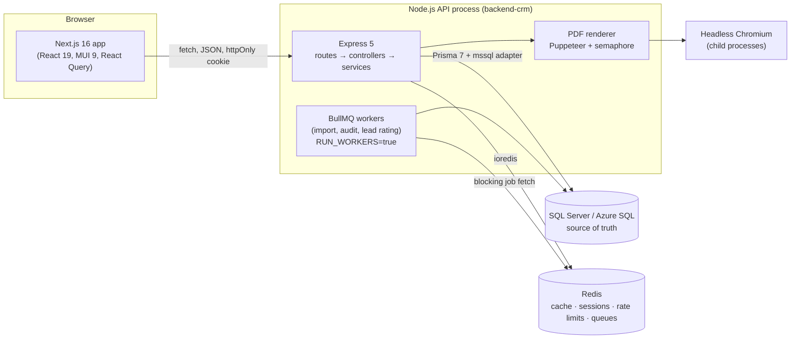
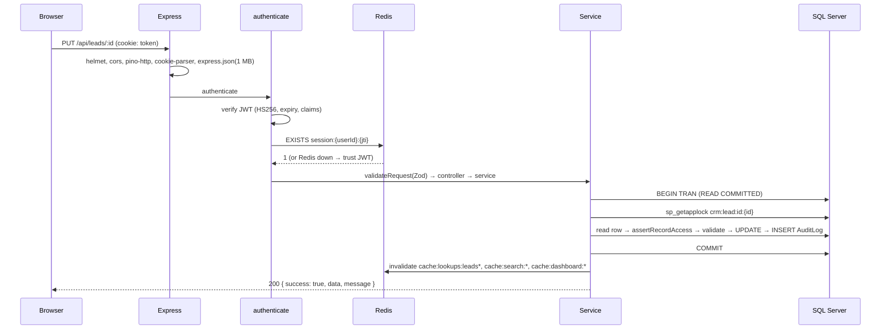
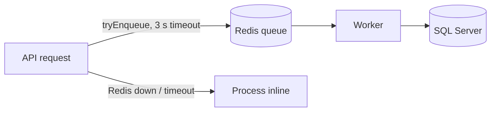
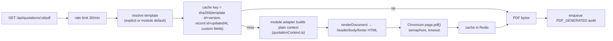
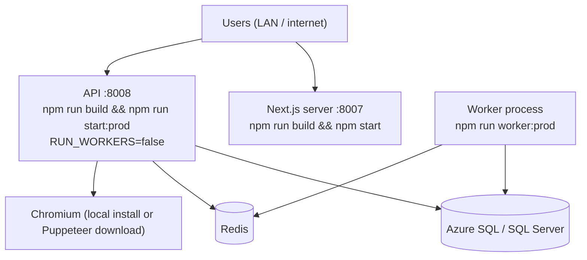

# Nandini CRM — System Design

> **Status:** living document. Describes the system as built (code as of 2026-11-23; audit context + ledger audit table, admin audit query API).
> Update it in the same change that alters architecture, infrastructure, Redis usage, queues or security.
> Related: [Database design](database-design.md) · [API plan](api-plan.md) · [Build plan](build-plan.md)

---

## 1. What the system is

An internal sales and support CRM for Nandini Infosystems. Sales staff move work through
**Leads → Opportunities → Quotations**, keep **Organizations** and **Contacts** as the customer master, log support
**Tickets**, and manage **Products** and **Partner Companies**. Admins customise forms and dropdowns, number
documents, maintain the city list and design printable PDF templates.

## 2. High-level architecture



| Tier | Tech | Runs where |
| --- | --- | --- |
| Frontend | Next.js 16 (App Router), React 19, MUI v9 (CSS variables), Tailwind v4, TanStack Query 5, react-hook-form + Zod | `frontend-crm`, port **8007** |
| API | Express 5, Zod 4, Prisma 7 (`@prisma/adapter-mssql`), pino logging, helmet, cors | `backend-crm`, port **8008** |
| Database | Microsoft SQL Server / Azure SQL | external |
| Cache / queue broker | Redis (ioredis 6, BullMQ 6) | external, **optional** in dev |
| PDF | Puppeteer 25 → headless Chromium | spawned by the API |
| Background jobs | BullMQ workers | inside the API (`RUN_WORKERS=true`) or a separate `npm run worker` process |

The two apps are deployed independently. The frontend calls the API directly from the browser (no Next.js
API routes / BFF). It resolves the API URL as `NEXT_PUBLIC_API_URL`, or else
`<page protocol>//<page hostname>:NEXT_PUBLIC_API_PORT` so one build works on localhost, LAN IPs and the server IP
(`frontend-crm/src/config/env.ts`).

## 3. Backend design

### 3.1 Layering

Every business module under `backend-crm/src/modules/<name>/` follows the same shape:

```
<name>.routes.ts      Express Router: auth, role checks, validateRequest(Zod), rate limiters
<name>.controller.ts  Thin: reads req, calls the service, sends the envelope (often generated by shared/crud.ts)
<name>.service.ts     Business rules, transactions, audit, cache invalidation
<name>.validator.ts   Zod schemas (ported from the frontend's schemas so both sides enforce the same rules)
<name>.mapper.ts      DB row  <->  API DTO (the DTO matches frontend-crm/src/types/*.types.ts)
```

Cross-cutting code:

| Folder | Responsibility |
| --- | --- |
| `src/config` | `env.ts` (Zod-validated environment), `prisma.ts` (single client, connect-with-retry, keep-alive), `redis.ts` (shared client), `logger.ts` (pino with secret redaction), `fieldLimits.ts` |
| `src/middlewares` | `authenticate` / `requireRole`, `validateRequest`, Redis rate limiter, global `errorHandler` |
| `src/services` | `audit.service` (diffs + write paths), `auditContext` (per-request who / where), `auditCatalog` + `auditLabels` (entry columns), `cache.service` (fail-open Redis cache), `recentViews.service` |
| `src/modules/shared` | Generic CRUD controller/routes, row-level access control, transactions + application locks, email child rows, name write-through (`nameSync`), tax-ID uniqueness, search term parsing, bulk prefetch |
| `src/jobs` | BullMQ queues, workers, standalone worker entry point |
| `src/utils` | Response envelopes, pagination, `HttpError`, Prisma error helpers, code generator, name formatting |

### 3.2 Request lifecycle



Order of global middleware (`src/app.ts`): `helmet` → `cors` (credentials, LAN origins allowed) → `pino-http`
→ `cookie-parser` → routers that need bigger bodies (`/api/import` 10 MB, `/api/pdf-*` 2 MB) → `express.json` (1 MB)
→ `/api/health` → module routers → `notFoundHandler` → `errorHandler`.

### 3.3 Startup and shutdown

`start()` in `src/app.ts`:

1. Start connecting to Redis **in the background** (never blocks startup).
2. Connect to SQL Server, `SELECT 1`, up to 3 attempts 5 s apart (Azure SQL Serverless may be waking up). Failure = exit 1.
3. Start the optional DB keep-alive ping (`DB_KEEPALIVE_INTERVAL_MS`).
4. Seed missing form-field / dropdown defaults (`seedFormConfigsSafely`), never overwriting admin edits.
5. Seed built-in PDF templates (Classic, Modern, Compact).
6. Resume bulk email checks a restart interrupted (`resumeEmailValidationRuns`).
7. Start BullMQ workers if `RUN_WORKERS=true`.
8. `listen(PORT)`.

On `SIGINT`/`SIGTERM`: stop accepting connections → stop keep-alive → let workers finish in-flight jobs → close queues,
Chromium, Prisma and Redis in parallel → exit. A 10 s hard timeout guarantees the process ends.

### 3.4 Concurrency model ("threads")

Node.js runs JavaScript on **one thread** with an event loop. Nothing in the app uses `worker_threads`. Parallelism
comes from these places instead:

| Where | How it runs concurrently | Bound |
| --- | --- | --- |
| HTTP requests | Interleaved on the event loop while each awaits I/O (SQL, Redis) | Node / OS |
| SQL Server | Connection pool inside the mssql driver adapter; each interactive transaction holds one connection | Pool default; tx `maxWait` 5 s, `timeout` 15 s |
| bcrypt (login) | Runs on libuv's thread pool (4 threads by default), so hashing doesn't block the loop | 12 rounds |
| BullMQ import worker | Async job loop on the same event loop (or the separate worker process) | **concurrency 1** |
| BullMQ audit worker | Same | **concurrency 5** |
| BullMQ lead rating worker | Same; one run a night (plus a catch-up at start-up) | **concurrency 1** |
| PDF rendering | Separate **Chromium processes**; one shared browser, a fresh incognito context + page per job | `PDF_MAX_CONCURRENCY` (default 3) via an in-process FIFO `Semaphore` |

Because the import worker shares the event loop with HTTP handling when `RUN_WORKERS=true`, production should run
`npm run worker:prod` as its own process and set `RUN_WORKERS=false` on the API.

### 3.5 Data consistency and race-condition handling

SQL Server is the only source of truth; Redis only ever holds derived or disposable data.

| Mechanism | Where | What it protects |
| --- | --- | --- |
| `runInTransaction` (READ COMMITTED) | All writes | Record + its child rows + its `AuditLog` row commit or roll back together |
| `runSerializable` (SERIALIZABLE) | Lead conversion | Creating Organization + Contact + Opportunity and marking the lead converted sees a stable snapshot |
| Retry with jittered backoff (4 attempts) | Both of the above | Deadlock victims, write conflicts, "transaction couldn't start" |
| `sp_getapplock` application locks (`acquireLocks`, `lockRecords`) | Updates, deletes, duplicate checks | Read-modify-write races; "check duplicate, then insert" races. Keys are sorted to avoid lock-order deadlocks |
| `MERGE … WITH (HOLDLOCK)` on `SequenceCounter` | `generateDocumentCode` | Gap-free, unique document numbers even on the first call; a rolled-back insert releases its number |
| Filtered unique index `Organization_organizationName_live_key` | DB | Two live organizations can't share a name; soft-deleted ones don't block reuse |
| `version` column on `PdfTemplate` | PDF template updates | Optimistic concurrency → `409 VERSION_CONFLICT` |

### 3.6 Security model

**Authentication**

- `POST /api/auth/login` checks the bcrypt hash (12 rounds). Unknown usernames are compared against a dummy hash so
  timing doesn't reveal valid usernames. Legacy plain-text passwords are compared in constant time and
  re-hashed to bcrypt on the next successful login.
- On success the API signs a **JWT** (HS256, `JWT_SECRET`, expiry = `SESSION_TTL_SECONDS`, default 8 h) with
  `{ id, username, role, tracked, jti }` and sets it as an **httpOnly cookie** named `token`
  (`secure` + `SameSite=None` in production, `Lax` in dev). A `Bearer` header is accepted as a fallback.
- The session is also written to Redis as `session:{userId}:{jti}` with the same TTL. A *tracked* token whose key
  is missing is treated as revoked (logout, deactivation, password change). If Redis is unreachable at login the
  token is issued *untracked*; if Redis is unreachable at request time, a valid JWT is trusted so an outage doesn't
  log everyone out.

**Authorization** (`modules/shared/accessControl.ts`)

| Level | Rule |
| --- | --- |
| Admin features | `requireRole('Admin', 'Administrator', 'Super Admin')` — form customisation, document series, cities, PDF template management |
| Global data roles | Admin, Director – Operations, Regional Sales Head, Sales Manager, System Administrator, Accounts Manager see **all** records |
| Everyone else | Row-level scope: only records where they are the owner (`assignedTo`) **or** the creator (`createdBy`). Lists add this as a Prisma `where`; single-record reads/writes call `assertRecordAccess` (403) |

Role names are compared case-insensitively and with any dash style.

**Other protections**

- `helmet` headers; CORS allows `CLIENT_ORIGIN` and private LAN origins only (any origin in dev).
- Zod validation on every body/query/param; sort fields are whitelisted so arbitrary column names never reach Prisma.
- Admin form configuration (required fields, option lists, formats) is re-enforced server-side by
  `customFieldValidator.ts`, so API clients and stale tabs can't bypass it.
- Rate limits in Redis (fail-open): failed logins per IP, PDF renders per user, PDF previews per user.
- Logger redacts passwords, auth headers and cookies. 5xx responses hide internals in production.
- **Audit log** (`AuditLog`, an append-only SQL Server ledger table — see §5 "Audit write paths"): every change,
  sign-in, failed sign-in (wrong password or deactivated account) and refused request (403, at most one per user +
  route per minute) is recorded with who / where / how. Record history (`GET /api/audit-logs/...`) follows the
  record's own access rule; sign-in history, PDF template and Form Customization trails are admin-only. The
  CRM-wide log (`GET /api/admin/audit-logs`, list / entry / facets / stats) is admin-only.
- PDF rendering: Chromium runs with JavaScript disabled and every network request except `data:` / `about:blank`
  aborted; images are embedded as data URIs.

### 3.7 Error contract

All errors use one envelope, produced by `middlewares/errorHandler.ts`:

```json
{ "status": "error", "code": "VALIDATION_ERROR", "message": "…", "errors": [{ "message": "…", "path": ["gstNumber"] }] }
```

`errors[].path` matches react-hook-form field paths, so the frontend highlights the exact field. See the
[API plan](api-plan.md#4-error-codes) for the full code list.

## 4. Redis: what it does and what happens without it

Redis is **optional**. Every use is fail-open: when Redis is unreachable the API keeps working against SQL Server.
The shared client (`config/redis.ts`) is created with `enableOfflineQueue: false` and `maxRetriesPerRequest: 1`, so
commands fail immediately instead of hanging, and reconnects in the background (backoff up to 30 s). BullMQ uses
**separate connections** with `maxRetriesPerRequest: null` (a BullMQ requirement).

### 4.1 Key map

| Key pattern | Type | TTL | Written by | Purpose |
| --- | --- | --- | --- | --- |
| `session:{userId}:{jti}` | string (JSON: ip, userAgent, createdAt) | `SESSION_TTL_SECONDS` (8 h) | login | Revocable sessions; logout / deactivation deletes the key |
| `ratelimit:login:{ip}` | counter | `LOGIN_RATE_LIMIT_WINDOW_SECONDS` (15 min) | failed logins only | Brute-force protection (default 10 failures / window); reset on success |
| `ratelimit:pdf:{module}:user:{id}` | counter | 60 s | `GET /:id/pdf` | 30 PDF renders / min / user |
| `ratelimit:pdf-preview:user:{id}` | counter | 60 s | `POST /api/pdf-templates/preview` | 20 previews / min / user |
| `cache:lookups:users:{all\|active}` | JSON | 5 min | lookups | User picker list |
| `cache:lookups:organizations:{limit}` / `contacts:{limit}` / `products:{limit}` | JSON | 5 min | lookups (no search term only) | Lookup dialogs' default lists |
| `cache:lookups:nature-of-calls` / `partner-companies` / `partner-contacts` | JSON | 1 h | lookups | Master lists |
| `cache:lookups:form-configs:{all\|active}` | JSON | 1 h | `formConfig.service` | Whole form/dropdown configuration |
| `cache:address-master…` | JSON | 24 h | lookups | Countries, states, cities by state |
| `cache:search:{limit}:{sha256}` | JSON | 30 s | global search | Search results; hash covers the user's access scope + query |
| `pdf:{MODULE}:{sha256}` | binary (PDF) | `PDF_CACHE_TTL_SECONDS` (600 s) | PDF render | Rendered PDFs; key covers template id + version, record id + `updatedAt`, custom-field definitions |
| `recent:{userId}:{entity}` | sorted set (score = view time) | 30 days | `GET /api/organizations/:id` | "Recently viewed" (max 20 per user per entity) |
| `bull:crm-import:*` | BullMQ internals | 1 day (completed) / 7 days (failed) | import queue | Import jobs, progress, results |
| `bull:crm-audit:*` | BullMQ internals | 1 h (completed) / 7 days (failed) | audit queue | Async audit events |
| `bull:crm-lead-rating:*` | BullMQ internals (job scheduler + runs) | 7 days (completed) / 30 days (failed) | lead rating worker | Nightly Rating ageing |

`cache:dashboard:*` is defined and invalidated but nothing writes it yet (no dashboard API).

### 4.2 Cache invalidation

Caches are read-through (`cacheService.getOrSet`). After a write **commits**, the service calls
`cacheService.invalidateEntityCaches(entity)`, which deletes `cache:lookups:{entity}*`, every `cache:search:*` and
every `cache:dashboard:*` using `SCAN` + `UNLINK` (never `KEYS`, so Redis isn't blocked). Form-config writes drop
`cache:lookups:form-configs*`. PDF cache entries never need invalidation: any change to the template or the record
changes the key.

### 4.3 Degraded mode (Redis down)

| Feature | Behaviour |
| --- | --- |
| Caching | Every read goes to SQL Server |
| Sessions | New logins issue untracked tokens; existing tokens are trusted until they expire; logout can't revoke |
| Rate limiting | Disabled (requests allowed) |
| Audit events (logins, PDF generated, import summaries) | Written directly to SQL instead of queued |
| Imports | ≤ 500 rows run synchronously inside the request; larger imports return `503 IMPORT_QUEUE_UNAVAILABLE` |
| Import status polling | `503` |
| Recently viewed | Not recorded, lists report none |
| `/api/health` | Reports `redis: "unavailable"` |

## 5. Background jobs (BullMQ)



| Queue | Producer | Worker concurrency | Attempts | Job retention | Notes |
| --- | --- | --- | --- | --- | --- |
| `crm-import` | `POST /api/import/:entity` (job id = import id) | 1 | **1** (a retry would duplicate rows already created) | done 1 day / 500 jobs; failed 7 days | Reports progress every 20 rows; result `{ total, created, failed[] }` |
| `crm-audit` | `auditService.enqueue` (login, login failed, logout, access denied, PDF generated, import summary); each job carries the request's audit origin | 5 | 5, exponential backoff from 1 s | done 1 h / 1000 jobs; failed 7 days | Data-change audits do **not** go through the queue (see below) |
| `crm-lead-rating` | Job scheduler `lead-rating-ageing`, cron `5 0 * * *` in `BUSINESS_TIMEZONE` (upserted when the worker starts) | 1 | 1 (the next night catches up) | done 7 days / 30 jobs; failed 30 days | `ageLeadRatings`: re-rates leads ageing under a "Days since response" rule, writing only changed rows (history by `system`). The worker also runs it once at start-up, so a night missed while nothing ran (or Redis was down) is made up; runs are idempotent ([lead-rating-rules.md](lead-rating-rules.md)) |

**Import flow:** the frontend wizard parses the CSV/XLSX in the browser (papaparse / xlsx), maps columns, validates
rows client-side, then posts up to 5,000 mapped rows. The worker validates each row with the same Zod schema and
form-config rules as the API, prefetches active usernames and organization names in bulk, and creates each row in
its own transaction through the same `create<Entity>Record` function the API uses (so codes, links and audit rows are
identical). The browser polls `GET /api/import/jobs/:importId` until the job completes.

**Audit write paths** (`services/audit.service.ts`):

1. `record` / `recordMany` — inside the caller's transaction. Used for every data change, so a record and its audit
   entry can never disagree.
2. `enqueue` — fire-and-forget through `crm-audit` for events that have no transaction of their own; falls back to a
   direct write when Redis is down. Never throws.

**Audit context** (`services/auditContext.ts`): the first middleware gives each request an id (`X-Request-Id`
response header, pino `req.id`) and opens an AsyncLocalStorage context. When an entry is written, `auditService`
fills in the actor id / role and session (from `req.user` / `req.auth`), source (`UI` when the web app sent
`X-CRM-Client: web`, else `API`), route pattern, screen (`X-CRM-Page`), IP and browser, so the individual audit calls
pass nothing extra. `enqueue` snapshots this origin into the job, because the worker runs outside the request.
Imports run under source `IMPORT` with the import id as request id (every imported row + the summary share it, plus
the upload request's IP / browser); the nightly Lead Rating ageing runs under source `JOB`, route
`job:lead-rating-ageing`, one request id per run. `services/auditCatalog.ts` sets category / module / severity /
changed fields and redacts sensitive keys; `services/auditLabels.ts` stores the record's number and name at the time
(one lookup per entity type per write, falling back to the entry's own snapshot).

## 6. PDF generation



- Templates are **JSON documents** (`PdfTemplate.documentJson`): page setup, theme, and header/body/footer sections
  made of columns and blocks. The block model lives in `backend-crm/src/modules/pdf/document/` and is **copied** to
  `frontend-crm/src/lib/pdf-document/` by `npm run sync:pdf-document`, so the builder canvas renders with the exact code
  the server prints with. `validators/contractSync.test.ts` fails while the copies differ.
- Module support is pluggable through `moduleAdapters.ts` (only `QUOTATION` today). The renderer sits behind the
  `PdfRenderer` interface, so Puppeteer could be swapped for e.g. Gotenberg.
- The README's PDF section still mentions Handlebars (`templateEngine.ts`, `sanitize.ts`); those files no longer exist —
  the block document model replaced them (migration `20261112000000_pdf_block_documents`).

## 7. Cross-cutting business features

| Feature | How it works |
| --- | --- |
| **Form customisation** | `FormFieldDefinition` rows per module describe every field (label, tab, section, order, size, required, visibility). Custom fields (`cf_*`) store values in each record's `customDataJson`. Dropdowns are `DropdownCategory` + `DropdownOption`. Built-in defaults live in `formConfig.defaults.ts` and are inserted at startup if missing. Field tiers (locked / default-required / free) are described in [field-locking-policy.md](field-locking-policy.md). |
| **Document numbering** | `DocumentSeries` per module + `DocumentSeriesSettings` (company prefix, separator, financial year). `generateDocumentCode` builds e.g. `NIPL/L/26-27/1004`; modules without a series keep `LD-0001` style codes, which the UI hides. |
| **Soft delete** | Core entities set `isDeleted` / `deletedAt`; lists and lookups always filter `isDeleted = false`. |
| **Denormalised names** | Contacts, opportunities, quotations and tickets store the organization/contact *name* next to the id (for sort/search). `shared/nameSync.ts` writes renames through to all live linked rows in the same transaction. City names are written through the same way when an admin renames a city. |
| **Audit trail / revisions** | Every create/update/delete stores a field-level diff in `AuditLog` (append-only ledger table, kept forever, with who / where / how per entry — [database design §4.16](database-design.md#416-auditlog)); `GET /api/audit-logs/:entityType/:entityId` turns it into a revision timeline. `GET /api/admin/audit-logs` queries the whole log for admins (filters, keyset paging, labelled entry, facets, stats); the screen, undo / restore and integrity checks are being built ([build plan Phase 11](build-plan.md)). |
| **Global search** | One query per category (organizations, contacts, leads, opportunities), access-scoped, with smart detection of entity codes, phone numbers and GSTIN prefixes. |
| **Table filters** | Each user's recent (last 10) and saved filters per module are stored in `TableFilter`. |
| **Email verification** | Free checks (syntax, typo of a common provider, disposable domain, DNS — the domain lookup is cached in Redis for a day) then QuickEmailVerification for the mailbox. **The database is the record of checked addresses**: an address saved on any lead / contact / organization with a result is never sent to the provider again from a form or a save, and there is no periodic re-check. Invalid addresses are never stored: the form refuses to save once its on-blur check said "invalid" (toast, no second call), and the save check rejects them server-side. No Redis cache of results; a 30-minute in-process memory of recent provider answers makes the on-blur check, the save check and the post-save background check of one new address cost one credit (lost on restart or across API instances, costing at most one extra credit). Admins re-check addresses in bulk under Settings › Email Validation; an `EmailValidationRun` is processed in the API process (one run at a time, cancellable, resumed at startup). Small runs call the single-address API per address and stop when the provider runs out of credits. Runs of at least `EMAIL_VERIFICATION_LIST_API_MIN` (default 1,000, the provider's own cut-off) use its **List API**: the free checks run first (8 at a time, failures decided for free), the rest are uploaded as one CSV (`POST /v1/bulk-verify`; credits for the whole list are taken at upload, "unknown" results refunded), the job is polled (`GET /v1/bulk-verify/status/{id}`, every 2 / 5 / 15 min by list size; no callback URL, so the API needn't be reachable from the internet; status `ready` = waiting for credits), then the safe-to-send / valid / invalid reports are downloaded and written onto the records (safe to send = valid, valid only = risky, invalid = invalid, unknown = undecided; reasons from the full report when its columns are recognised) and the job is deleted at the provider. **Every result that changes an address on a record is audited** (`EMAIL_CHECK` on the record, from / to result + reason; bulk runs by the admin who started them with the run id as request id, the post-save check by `system`; re-checks that confirm the stored result write nothing). Env: `EMAIL_VERIFICATION_ENABLED`, `QUICKEMAILVERIFICATION_API_KEY`, `EMAIL_VERIFICATION_LIST_API_MIN`. |
| **Lead conversion** | `POST /api/leads/:id/convert` creates or links an Organization and Contact, creates an Opportunity and marks the lead `Converted` in one serializable transaction. |

## 8. Frontend design

### 8.1 Structure

```
frontend-crm/src/
  app/                 App Router pages; every module has list, [id], [id]/edit, new (+ leads/[id]/convert,
                       opportunities/[id]/quote, quotations/[id]/print, admin/*)
  components/
    common/            CommonMasterView, DataTable, Drawer, TableFilter, import wizard, lookup dialogs …
    forms/, forms/rhf/ react-hook-form field wrappers
    <module>/          module forms, sections, master views
    pdf/builder/       drag-and-drop PDF template builder (dnd-kit, TipTap rich text)
    settings/          form customisation, document series admin
  context/             AuthContext, FormConfigContext, QueryProvider, FormModeContext, CodedFieldDefaultsContext
  services/            apiClient + one service per backend module (createCrudService)
  hooks/queries/       React Query hooks per entity (createEntityHooks) and query keys
  validations/         Zod schemas (mirrored by the backend validators)
  types/               API contracts (mirrored by backend mappers)
  lib/pdf-document/    synced copy of the backend PDF block model
  theme/               MUI theme + CSS colour tokens (light = blue, dark = green)
```

### 8.2 Data flow

- **Rendering:** pages are client components (`'use client'`). Each page reads `useAuth()` and redirects to `/login`
  when unauthenticated; the root `/` page checks the `token` cookie server-side and redirects to dashboard or login.
  There is no Next.js middleware.
- **API access:** `services/apiClient.ts` wraps `fetch` with `credentials: 'include'`, JSON headers, a 30 s timeout
  (GETs retried once on timeout, to ride out a cold database) and `ApiClientError` normalisation.
- **Server state:** TanStack Query (stale 60 s, gc 5 min, no refetch on focus, 1 retry). `createEntityHooks` gives
  every entity `useList`, `usePaginatedList`, `useDetail`, `useCreate`, `useUpdate`, `useDelete`.
- **Cross-tab sync:** every write calls `notifyCrmUpdate(entity)`, which fires a window event and a
  `BroadcastChannel('crm_sync_channel')` message. `QueryProvider` listens and invalidates that entity's queries (and
  audit logs) in this tab and every other open tab.
- **Bootstrap:** after sign-in, `CrmDataBootstrap` prefetches lightweight masters (users, Nature of Call, partners);
  on sign-out it clears the whole query cache.
- **Theme:** MUI `cssVariables` with class-based colour schemes; see the root `CLAUDE.md` for the token rules.

## 9. Deployment topology



- Production requires `JWT_SECRET` (≥ 32 chars) — the env schema refuses to start without it.
- Behind a proxy (Azure App Service), `trust proxy` is set to 1 hop so rate limits see the client IP.
- Migrations: `npm run db:deploy` (`prisma migrate deploy`). Reference data: `npm run seed`.
- Chromium needs its system libraries and fonts on Linux; see the README's "Installing Chromium" section.
- Health probe: `GET /api/health` (excluded from request logs).

## 10. Known gaps and risks

| Item | Notes |
| --- | --- |
| No user management API/UI | Users come from the seed or direct DB edits. `ROUTES.ADMIN_USERS` exists in the frontend but has no page. `sessionService.revokeAll` is ready for deactivation / password change. |
| Dashboard has no data API | The dashboard page is static; `cache:dashboard:*` is reserved. |
| No automated frontend tests | Backend has 14 `node:test` files (pure logic: validators, numbering, PDF document, access control). No integration/E2E tests. |
| Workers inside the API by default | Long imports share the event loop with requests unless `RUN_WORKERS=false` + separate worker. |
| Rate limits fail open | Intentional for availability; brute-force protection disappears while Redis is down. |
| Stale README PDF section | Describes the removed Handlebars engine. |
| `SequenceCounter` doc comment | Points to `documentSeries.sequence.ts`; the code lives in `documentSeries.service.ts`. |
