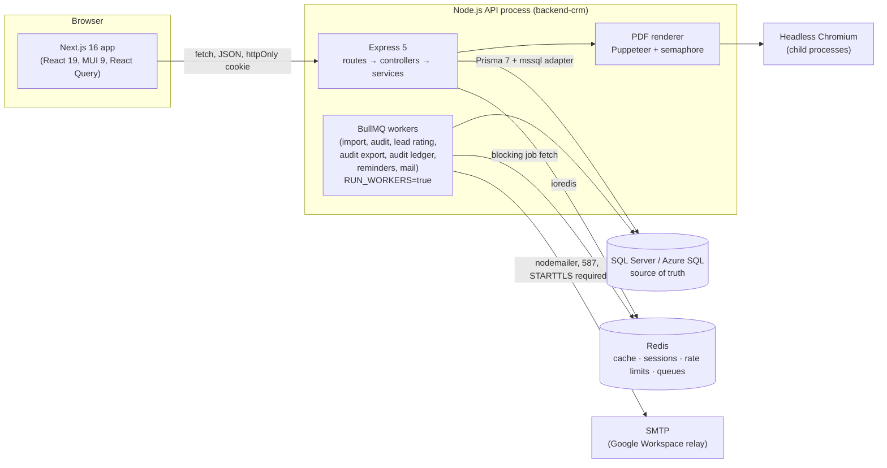
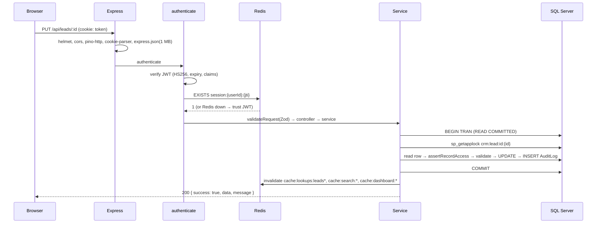
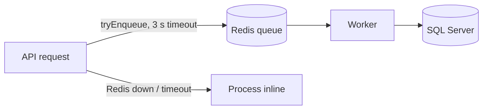
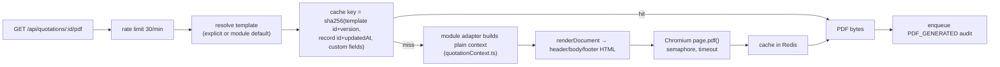
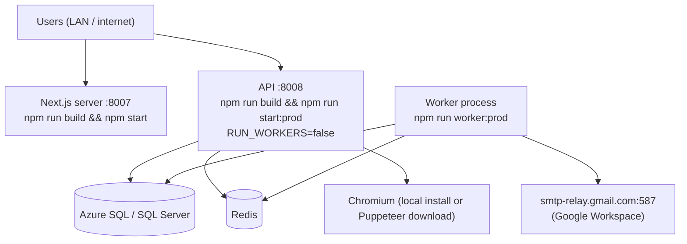

# Nandini CRM — System Design

> **Status:** living document. Describes the system as built (code as of 2026-11-26; audit context + ledger audit table, admin audit query API and screen, Users tab; Contracts module; Referrals module; Documents module; Activities data model and API, Calendar Phase 1 PR1; Activities screens and Calendar, PR2; notifications, reminders and mail workers, navbar bell and the morning summary email, PR3, with its review fixes; guarded cache reads for lookups, form configs and search, with its review fixes; Calendar Phase 2 P2-1, Admin › API Integrations foundation: encrypted provider credentials, connection tests, calendar sync settings, company emails, with its review fixes; My Profile (Profile Phase 1): profile, photo, change password, signed-in sessions; Calendar Phase 2 P2-2, employees connect / disconnect Google or Microsoft 365 calendars: OAuth with PKCE, sealed tokens, refresh, reconnect notifications).
> Update it in the same change that alters architecture, infrastructure, Redis usage, queues or security.
> Related: [Database design](database-design.md) · [API plan](api-plan.md) · [Build plan](build-plan.md)

---

## 1. What the system is

An internal sales and support CRM for Nandini Infosystems. Sales staff move work through
**Leads → Opportunities → Quotations**, keep **Organizations** and **Contacts** as the customer master, log support
**Tickets** and **Contracts**, browse the **Documents** added on opportunities, and manage **Products**, **Partner Companies** and **Referrals**. Admins customise forms and dropdowns, number
documents, maintain the city list and design printable PDF templates.

## 2. High-level architecture



| Tier | Tech | Runs where |
| --- | --- | --- |
| Frontend | Next.js 16 (App Router), React 19, MUI v9 (CSS variables), Tailwind v4, TanStack Query 5, react-hook-form + Zod | `frontend-crm`, port **8007** |
| API | Express 5, Zod 4, Prisma 7 (`@prisma/adapter-mssql`), pino logging, helmet, cors | `backend-crm`, port **8008** |
| Database | Microsoft SQL Server / Azure SQL | external |
| Cache / queue broker | Redis (ioredis 6, BullMQ 6) | external, **optional** in dev |
| PDF | Puppeteer 25 → headless Chromium | spawned by the API |
| Background jobs | BullMQ workers | inside the API (`RUN_WORKERS=true`) or a separate `npm run worker` process |
| Outgoing email | nodemailer 10 (MIT-0) → Google Workspace SMTP relay (or a mailbox with an app password) | the mail worker (morning summary); the API for an admin's test send. Off until `MAIL_ENABLED=true` (§5.2) |

The two apps are deployed independently. The frontend calls the API directly from the browser (no Next.js
API routes / BFF). It resolves the API URL as `NEXT_PUBLIC_API_URL`, or else
`<page protocol>//<page hostname>:NEXT_PUBLIC_API_PORT` so one build works on localhost, LAN IPs and the server IP
(`frontend-crm/src/config/env.ts`).

## 3. Backend design

### 3.1 Layering

Every business module under `backend-crm/src/modules/<name>/` follows the same shape:

```
<name>.routes.ts      Express Router: auth, role checks, validateRequest(Zod), rate limiters
<name>.controller.ts  Thin: reads req, calls the service, sends the envelope (often generated by shared/crud.ts)
<name>.service.ts     Business rules, transactions, audit, cache invalidation
<name>.validator.ts   Zod schemas (ported from the frontend's schemas so both sides enforce the same rules)
<name>.mapper.ts      DB row  <->  API DTO (the DTO matches frontend-crm/src/types/*.types.ts)
```

Cross-cutting code:

| Folder | Responsibility |
| --- | --- |
| `src/config` | `env.ts` (Zod-validated environment), `prisma.ts` (single client, connect-with-retry, keep-alive), `redis.ts` (shared client), `logger.ts` (pino with secret redaction), `fieldLimits.ts` |
| `src/middlewares` | `authenticate` / `requireRole`, `validateRequest`, Redis rate limiter, global `errorHandler` |
| `src/services` | `audit.service` (diffs + write paths), `auditContext` (per-request who / where), `auditCatalog` + `auditLabels` (entry columns), `cache.service` (fail-open Redis cache), `recentViews.service` |
| `src/modules/shared` | Generic CRUD controller/routes, row-level access control, transactions + application locks, email child rows, name write-through (`nameSync`), tax-ID uniqueness, search term parsing, bulk prefetch |
| `src/jobs` | BullMQ queues, workers, standalone worker entry point |
| `src/utils` | Response envelopes, pagination, `HttpError`, Prisma error helpers, code generator, name formatting |

### 3.2 Request lifecycle



Order of global middleware (`src/app.ts`): `helmet` → `cors` (credentials, LAN origins allowed) → `pino-http`
→ `cookie-parser` → routers that need bigger bodies (`/api/import` 10 MB, `/api/pdf-*` 2 MB) → `express.json` (1 MB)
→ `/api/health` → module routers → `notFoundHandler` → `errorHandler`.

### 3.3 Startup and shutdown

`start()` in `src/app.ts`:

1. Start connecting to Redis **in the background** (never blocks startup).
2. Check the generated Prisma client matches `prisma/schema.prisma` (every model and column; `prismaClientCheck.ts`).
   A client older than the schema (code updated without `npm install` / `npm run prisma:generate`) = exit 1 naming
   the fix. Then connect to SQL Server, `SELECT 1`, up to 3 attempts 5 s apart (Azure SQL Serverless may be waking
   up). Failure = exit 1.
3. Start the optional DB keep-alive ping (`DB_KEEPALIVE_INTERVAL_MS`).
4. Seed missing form-field / dropdown defaults (`seedFormConfigsSafely`), never overwriting admin edits.
5. Seed built-in PDF templates (Classic, Modern, Compact).
6. Resume bulk email checks a restart interrupted (`resumeEmailValidationRuns`).
7. Start BullMQ workers if `RUN_WORKERS=true`.
8. `listen(PORT)`.

On `SIGINT`/`SIGTERM`: stop accepting connections → stop keep-alive → let workers finish in-flight jobs → close the
SMTP transport → close queues, Chromium, Prisma and Redis in parallel → exit. A 10 s hard timeout guarantees the process ends.

### 3.4 Concurrency model ("threads")

Node.js runs JavaScript on **one thread** with an event loop. Nothing in the app uses `worker_threads`. Parallelism
comes from these places instead:

| Where | How it runs concurrently | Bound |
| --- | --- | --- |
| HTTP requests | Interleaved on the event loop while each awaits I/O (SQL, Redis) | Node / OS |
| SQL Server | Connection pool inside the mssql driver adapter; each interactive transaction holds one connection | Pool default; tx `maxWait` 5 s, `timeout` 15 s |
| bcrypt (login) | Runs on libuv's thread pool (4 threads by default), so hashing doesn't block the loop | 12 rounds |
| BullMQ import worker | Async job loop on the same event loop (or the separate worker process) | **concurrency 1** |
| BullMQ audit worker | Same | **concurrency 5** |
| BullMQ lead rating worker | Same; one run a night (plus a catch-up at start-up) | **concurrency 1** |
| BullMQ audit export / audit ledger workers | Same; an export streams entries 1,000 at a time to a file, a ledger check holds one long SQL call on its own connection | **concurrency 1** each |
| BullMQ reminders worker | Same; one job at a time (reminder, sweep, nightly) | **concurrency 1** |
| BullMQ mail worker | Same; the morning summary, on its own queue so slow SMTP never delays a reminder. It builds and sends 3 users' emails at a time | **concurrency 1**; 3 SMTP sends in flight |
| PDF rendering | Separate **Chromium processes**; one shared browser, a fresh incognito context + page per job | `PDF_MAX_CONCURRENCY` (default 3) via an in-process FIFO `Semaphore` |

Because the import worker shares the event loop with HTTP handling when `RUN_WORKERS=true`, production should run
`npm run worker:prod` as its own process and set `RUN_WORKERS=false` on the API.

### 3.5 Data consistency and race-condition handling

SQL Server is the only source of truth; Redis only ever holds derived or disposable data.

| Mechanism | Where | What it protects |
| --- | --- | --- |
| `runInTransaction` (READ COMMITTED) | All writes | Record + its child rows + its `AuditLog` row commit or roll back together |
| `runSerializable` (SERIALIZABLE) | Lead conversion | Creating Organization + Contact + Opportunity and marking the lead converted sees a stable snapshot |
| Retry with jittered backoff (4 attempts) | Both of the above | Deadlock victims, write conflicts, "transaction couldn't start" |
| `sp_getapplock` application locks (`acquireLocks`, `lockRecords`) | Updates, deletes, duplicate checks | Read-modify-write races; "check duplicate, then insert" races. Keys are sorted to avoid lock-order deadlocks |
| `MERGE … WITH (HOLDLOCK)` on `SequenceCounter` | `generateDocumentCode` | Gap-free, unique document numbers even on the first call; a rolled-back insert releases its number |
| Filtered unique index `Organization_organizationName_live_key` | DB | Two live organizations can't share a name; soft-deleted ones don't block reuse |
| `version` column on `PdfTemplate` | PDF template updates | Optimistic concurrency → `409 VERSION_CONFLICT` |

### 3.6 Security model

**Authentication**

- `POST /api/auth/login` checks the bcrypt hash (12 rounds). Unknown usernames are compared against a dummy hash so
  timing doesn't reveal valid usernames. Legacy plain-text passwords are compared in constant time and
  re-hashed to bcrypt on the next successful login.
- On success the API signs a **JWT** (HS256, `JWT_SECRET`, expiry = `SESSION_TTL_SECONDS`, default 8 h) with
  `{ id, username, role, tracked, jti }` and sets it as an **httpOnly cookie** named `token`
  (`secure` + `SameSite=None` in production, `Lax` in dev). A `Bearer` header is accepted as a fallback.
- The session is also written to Redis as `session:{userId}:{jti}` with the same TTL. A *tracked* token whose key
  is missing is treated as revoked (logout, a password change, "Sign out" on My Profile). If Redis is unreachable at
  login the token is issued *untracked*; if Redis is unreachable at request time, a valid JWT is trusted so an outage
  doesn't log everyone out.
- `GET /api/auth/me` reads the user from the database on every call (name, first / last name, photo URL), so the JWT
  stays `{ id, username, role }` and a profile edit shows at once; a token whose user row is gone gets 401. If the
  database can't answer (an outage, a paused Azure SQL resuming), it answers from the JWT with no name or photo and
  logs a warning, so a database blip never signs anyone out. The login response's `user` has the same shape. The
  frontend's `refreshUser()` drops the user only on a 401.
- **Change password** (`POST /api/auth/change-password`, My Profile › Security): the current password is checked like a
  sign-in (bcrypt, or a legacy plain-text row), the new one against `modules/auth/passwordPolicy.ts` (8–128
  characters, a letter and a digit, not the username, not the current password; the frontend's live checklist uses a
  contract-tested copy). The bcrypt hash and `passwordChangedAt` are written in one transaction with a
  `PASSWORD_CHANGE` audit entry (no password in it; `currentPassword`, `newPassword` and `confirmPassword` are
  redacted from any audit entry anyway), under the per-user lock `user:id:<id>` with the stored hash re-checked inside
  it, so two concurrent changes can't both succeed. After the commit `sessionService.revokeAllExcept(userId, jti)` deletes every
  other `session:{userId}:*` key, so a stolen session can't outlive the password; the request's own session stays
  signed in. If Redis is down or fails partway the response says `signedOutSessions: null` and the UI tells the user
  to sign out other sessions again from My Profile. Rate limited per user (10 requests / 15 min, every request counts). An untracked session (Redis was down
  at its sign-in) can't be revoked early and keeps working until its JWT expires.
- **Signed-in sessions** (`/api/me/sessions`): the list is a `SCAN` of `session:{userId}:*` with `GET` + `PTTL` per key
  in one pipeline (`sessionService.list`), shown with a device name parsed from the stored User-Agent
  (`describeUserAgent`), IP, sign-in and expiry times. A user can sign out one other session (deletes its key) or all
  others (`revokeAllExcept`), both audited as `SESSION_REVOKE`; the current session can only end with Sign out. With
  Redis down the list is empty (`tracked: false`) and nothing can be revoked (both sign-out routes answer
  `503 SESSIONS_UNAVAILABLE`).

**Authorization** (`modules/shared/accessControl.ts`)

| Level | Rule |
| --- | --- |
| Admin features | `requireRole('Admin', 'Administrator', 'Super Admin')` — form customisation, document series, cities, PDF template management, API Integrations (`/api/admin/integrations`) |
| Global data roles | Admin, Director – Operations, Regional Sales Head, Sales Manager, System Administrator, Accounts Manager see **all** records |
| Everyone else | Row-level scope: only records where they are the owner (`assignedTo`) **or** the creator (`createdBy`). Lists add this as a Prisma `where`; single-record reads/writes call `assertRecordAccess` (403) |
| Activities (`modules/activities/activity.access.ts`) | The same rule **plus attendees**: a colleague invited to an activity (`ActivityAttendee.username`) can see it (lists, calendar, record, its audit trail) and reply to it (`POST /api/activities/:id/response`), but only the owner, the creator or a global role can change or delete it. Linking an activity to a record (Related To, and the `link-targets` picker) needs access to that record under its own module's rule (403 otherwise); an unchanged link is kept even if the editor can't see the record. The calendar's lead / opportunity follow-ups and contract renewals follow their modules' rules. Activities are not in global search |
| Referrals (`modules/referrals`) | Lists and records are **not** row-scoped (everyone picks Referred By from them); changes and deletes need the owner, the creator or a global role (`assertRecordAccess`) |

Role names are compared case-insensitively and with any dash style.

**Other protections**

- `helmet` headers; CORS allows `CLIENT_ORIGIN` and private LAN origins only (any origin in dev).
- Zod validation on every body/query/param; sort fields are whitelisted so arbitrary column names never reach Prisma.
- Admin form configuration (required fields, option lists, formats) is re-enforced server-side by
  `customFieldValidator.ts`, so API clients and stale tabs can't bypass it.
- Rate limits in Redis (fail-open): failed logins per IP, PDF renders per user, PDF previews per user, password changes
  per user, session sign-outs per user.
- Profile photos (`/api/user-photos/:id`, any signed-in user) are served only after their bytes were recognised as
  PNG, JPEG or WebP at upload, with `nosniff` and the detected `Content-Type` (no SVG, so no script in an image).
- Logger redacts passwords, auth headers and cookies, and (P2-1) every token / secret / verifier / `secretsEnc` /
  `syncCursor` field and the `x-goog-channel-token` header (`LOG_REDACT_PATHS` in `config/logger.ts`). Request URLs
  are logged through `utils/redactUrl.ts` (pino-http `req` serializer `serializeRequestForLog`, error-handler log
  lines, the 404 message): the values of `code`, `state`, `id_token`, `session_state`, `validationToken`, `token`,
  `syncToken`, `pageToken`, `$deltatoken` and `$skiptoken` (names case-insensitive) become `[REDACTED]` both in the
  logged URL and in the parsed `req.query` object the standard serializer adds, and a URL fragment carrying one of
  them is dropped (redactUrl.test.ts sends a real request through pino-http). 5xx
  responses hide internals in production.
- **Integration secrets (secret box, `services/secretBox.ts`, P2-1).** Client secrets and webhook secrets of
  Google / Microsoft / Zoom (`IntegrationProvider.secretsEnc`) are sealed with **AES-256-GCM**: format
  `enc:v1:<keyId>:<iv>:<tag>:<ciphertext>` (base64url), a fresh 12-byte IV per seal, AAD
  `IntegrationProvider:<provider>:secrets` so a value copied to another row doesn't open. The key ring comes from
  `INTEGRATIONS_ENCRYPTION_KEY` (`k2:<base64 32 bytes>,k1:<…>`; the first key seals, every key opens; a bare base64
  key means `k1`), validated at start-up (a malformed value stops the process); it is not exposed through `ENV`.
  Secrets are **write-only**: no API response, log line or audit entry carries one (the DTO shows `set`, `last4`,
  who / when; audit entries say `secretChanged: true`). Without a key the API runs normally and API Integrations
  shows the setup steps; saving a secret answers 503 `INTEGRATIONS_NOT_READY`. A stored secret the ring can't open
  (key replaced without keeping the old one) shows as "Needs attention" and is kept until a new one is entered.
  Rotation: put the new key first (`k2:…,k1:…`) on the API and the worker, restart, run
  `npm run integrations:reencrypt` (compare-and-set per row; `--dry-run` reports; it also re-seals calendar
  connection tokens, compare-and-set on `tokenVersion`, never on a disconnected row), then drop the old key. HKDF
  subkeys (`subkey(purpose)`) are reserved for webhook channel tokens (P2-7).
- **Calendar connections (OAuth, P2-2, as of 2026-11-26; `modules/calendar-sync`).** Authorization code flow with
  PKCE (S256), `state` and `nonce`. `POST /api/calendar-connections/:provider/start` puts `{ state, verifier, nonce,
  userId, provider, return origin, expiry }` into the httpOnly cookie `crm_oauth`, sealed with the secret box (AAD
  `oauth:<provider>:<userId>`, 10 min, `SameSite=Lax` so it rides the provider's top-level redirect back, path
  `/api/calendar-connections/oauth` so no other request carries it). The callback
  (`/api/calendar-connections/oauth/:provider/callback`, outside `authenticate`) checks the CRM session itself (signed
  JWT + tracked-session check), opens the cookie (same user and provider, not expired), compares `state` in constant
  time, exchanges the code with the verifier, decodes the id_token (no signature check: it came straight from the
  provider's token endpoint over TLS) and checks `iss`, `aud`, `exp` / `iat` (±120 s), `nonce`; Google needs
  `email_verified` and an `hd` claim in the company domains; Microsoft needs the configured tenant (`tid`, when the
  tenant is a GUID) and reads the address from Graph `/me` (`mail`, else UPN). Granted scopes are compared with the
  requested ones (`scope_denied`). The address must equal the user's company email, or fills an empty one when it is
  a company address held by nobody else. It always answers with a **302** to `/connected-calendars?calendar=…` on the
  CRM origin that started the flow (`isAppOrigin`, `config/origins.ts`, also used by CORS), never to another site,
  with a fixed reason code (no provider text is reflected). A refused grant is revoked at Google unless it is live
  for another user. Tokens are sealed per row and column (AAD `CalendarConnection:<id>:accessToken|refreshToken`);
  no DTO, log line or audit entry carries one. Refresh (`connectionTokens.ts` `withAccessToken`): 5 minutes before
  expiry, compare-and-set on `tokenVersion` (no Redis needed; a lost race uses the winner's token), a provider 401
  refreshes once and retries; `invalid_grant` (and the AADSTS expiry codes) → `reauth_required` + a
  `calendar_reconnect` notification; `invalid_client` is a provider problem and leaves the connection alone. Every
  use re-checks the user is active, the provider still on and the company app unchanged (`clientVersion`).
  Provider calls go through `providerFetch` (timeouts, Retry-After, full-jitter backoff, a per-process pause after a
  long 429, typed errors whose message is only `"<provider> <operation> failed: <status> <code>"`, never a URL or
  body). Connect start is limited to 10 / min per user. The `fake` provider (`CALENDAR_FAKE_PROVIDER=true`, ignored in
  production) runs the same flow without Google or Microsoft for local testing.
- **Audit redaction** (`services/auditCatalog.ts` `isSensitiveKey`): an exact, case-insensitive list (password,
  token, secret, clientSecret, refreshToken, accessToken, …) plus a case-sensitive camelCase suffix rule
  `(Secret|Secrets|Token|Password)(Enc)?$`, applied to **every** entity's before / after values.
- **Connection tests** (`POST /api/admin/integrations/providers/:provider/test`) call Google / Microsoft with the
  saved credentials only (no user): 6 per minute per admin in Redis, with an in-memory per-process limit whenever
  Redis can't count a test (down, or a command failing while it reports ready: `createRateLimiter`'s `fallback`
  option), so the probe can't be used to hammer the providers. A result is stored as `lastTest` only if the client
  id, sealed secret and `clientVersion` are unchanged since the probe started (conditional `updateMany`); otherwise
  the admin gets `credentials_changed` and tests again.
- **Audit log** (`AuditLog`, an append-only SQL Server ledger table — see §5 "Audit write paths"): every change,
  sign-in, failed sign-in (wrong password or deactivated account) and refused request (403, at most one per user +
  route per minute) is recorded with who / where / how. Record history (`GET /api/audit-logs/...`) follows the
  record's own access rule; sign-in history, PDF template and Form Customization trails are admin-only. The
  CRM-wide log (`GET /api/admin/audit-logs`, list / entry / facets / stats / users) is admin-only.
- PDF rendering: Chromium runs with JavaScript disabled and every network request except `data:` / `about:blank`
  aborted; images are embedded as data URIs.

### 3.7 Error contract

All errors use one envelope, produced by `middlewares/errorHandler.ts`:

```json
{ "status": "error", "code": "VALIDATION_ERROR", "message": "…", "errors": [{ "message": "…", "path": ["gstNumber"] }] }
```

`errors[].path` matches react-hook-form field paths, so the frontend highlights the exact field. See the
[API plan](api-plan.md#4-error-codes) for the full code list.

## 4. Redis: what it does and what happens without it

Redis is **optional**. Every use is fail-open: when Redis is unreachable the API keeps working against SQL Server.
The shared client (`config/redis.ts`) is created with `enableOfflineQueue: false` and `maxRetriesPerRequest: 1`, so
commands fail immediately instead of hanging, and reconnects in the background (backoff up to 30 s). BullMQ uses
**separate connections** with `maxRetriesPerRequest: null` (a BullMQ requirement).

### 4.1 Key map

| Key pattern | Type | TTL | Written by | Purpose |
| --- | --- | --- | --- | --- |
| `session:{userId}:{jti}` | string (JSON: ip, userAgent, createdAt) | `SESSION_TTL_SECONDS` (8 h) | login | Revocable sessions; logout deletes the key; a password change deletes every other key of the user; My Profile lists them (`SCAN` + `GET` + `PTTL`) and signs out one or all others |
| `ratelimit:change-password:user:{id}` | counter | 15 min | `POST /api/auth/change-password` | 10 password changes (right or wrong) / 15 min / user |
| `ratelimit:session-revoke:user:{id}` | counter | 10 min | `DELETE /api/me/sessions[/:id]` | 30 session sign-outs / 10 min / user |
| `ratelimit:login:{ip}` | counter | `LOGIN_RATE_LIMIT_WINDOW_SECONDS` (15 min) | failed logins only | Brute-force protection (default 10 failures / window); reset on success |
| `ratelimit:pdf:{module}:user:{id}` | counter | 60 s | `GET /:id/pdf` | 30 PDF renders / min / user |
| `ratelimit:pdf-preview:user:{id}` | counter | 60 s | `POST /api/pdf-templates/preview` | 20 previews / min / user |
| `ratelimit:integration-test:user:{id}` | counter | 60 s | `POST /api/admin/integrations/providers/:provider/test` | 6 connection tests / min / admin (in-memory per process whenever Redis can't count) |
| `cache:lookups:users:{all\|active}` | JSON, guarded ¹ | 5 min | lookups | User picker list; dropped by a company email change (`invalidateUserCaches`, Admin › API Integrations › People) and by My Profile name / photo changes (`invalidateUserLookupCaches`) |
| `cache:lookups:organizations:{limit}` / `contacts:{limit}` / `products:{limit}` | JSON, guarded ¹ | 5 min | lookups (no search term only) | Lookup dialogs' default lists |
| `cache:lookups:partner-companies` / `partner-contacts` | JSON, guarded ¹ | 1 h | lookups | Partner master lists; dropped by partner company writes |
| `cache:lookups:nature-of-calls` | JSON | 1 h | lookups (plain read) | Seeded master list; TTL only |
| `cache:lookups:form-configs:{all\|active}` | JSON, guarded ¹ | 1 h | `formConfig.service` | Whole form/dropdown configuration |
| `cache:address-master` / `cache:address-master:{country}` | JSON | 24 h | lookups (plain read) | Countries and states (seeded ISO data); TTL only |
| `cache:address-master:cities:{state}:{limit}` | JSON, guarded ¹ | 24 h | lookups | A state's biggest cities; dropped by city admin writes |
| `cache:search:{category\|all}:{page}:{limit}:{t\|-}:{i\|-}:d{minDigits}:{sha256}` | JSON, guarded ¹ (180 s placeholder) | 30 s | global search | Search results; everyone sees the same results, so one entry per query (hashed, so user text never reaches a key or SCAN pattern) |
| `cache:email-domain:{domain}` | JSON string (`mx`, `a_only`, `null_mx`, `not_found`) | 24 h | email checks (plain read) | DNS answer for a domain; TTL only (an `unknown` answer is dropped at once) |
| `cache:notifications:unread:{username}` | number (briefly a `pending:<uuid>` placeholder while it is read) | 24 h (a safety net: it is dropped long before) | `GET /api/notifications/unread-count`; the list reads SQL and re-caches it | The bell's unread count (username lowercased), so a minute's polling from every open tab doesn't wake SQL Server; dropped by every write to that user's notifications, by the 00:20 nightly job and on every Redis reconnect (§4.2) |
| `pdf:{MODULE}:{sha256}` | binary (PDF) | `PDF_CACHE_TTL_SECONDS` (600 s) | PDF render | Rendered PDFs; key covers template id + version, record id + `updatedAt`, custom-field definitions |
| `recent:{userId}:{entity}` | sorted set (score = view time) | 30 days | `GET /api/organizations/:id` | "Recently viewed" (max 20 per user per entity) |
| `bull:crm-import:*` | BullMQ internals | 1 day (completed) / 7 days (failed) | import queue | Import jobs, progress, results |
| `bull:crm-audit:*` | BullMQ internals | 1 h (completed) / 7 days (failed) | audit queue | Async audit events |
| `bull:crm-lead-rating:*` | BullMQ internals (job scheduler + runs) | 7 days (completed) / 30 days (failed) | lead rating worker | Nightly Rating ageing |
| `bull:crm-audit-export:*` | BullMQ internals | 1 day (completed) / 7 days (failed) | audit export queue | Audit log exports over 5,000 entries |
| `bull:crm-audit-ledger:*` | BullMQ internals (job scheduler + runs) | removed when done | audit ledger worker | Nightly ledger digest; "Verify integrity" (job id `ledger-verify`: present = running) |
| `bull:crm-reminders:*` | BullMQ internals (2 job schedulers, delayed jobs, runs) | 1 day / 1000 jobs (completed) / 7 days (failed) | activity saves, reminders worker | Delayed job per activity reminder (job id `reminder-<activityId>-<remindAtMs>`), schedulers `reminder-sweep`, `reminder-nightly` (§5.1) |
| `bull:crm-mail:*` | BullMQ internals (job scheduler + runs) | 7 days / 100 jobs (completed) / 30 days (failed) | mail worker | Scheduler `morning-summary`, catch-up jobs `morning-catchup-<day>` (§5.2) |

¹ Read with `cacheService.getOrSetGuarded`, so the key briefly holds a `pending:<uuid>` placeholder while it is read
(§4.2). `cache:dashboard:*` is defined and invalidated but nothing writes it yet (no dashboard API).

### 4.2 Cache invalidation

Caches are read-through. After a write **commits**, the service calls
`cacheService.invalidateEntityCaches(entity)`, which deletes `cache:lookups:{entity}*`, every `cache:search:*` and
every `cache:dashboard:*` using `SCAN` + `UNLINK` (never `KEYS`, so Redis isn't blocked). Form-config writes drop
`cache:lookups:form-configs*` (`invalidateFormConfigCaches`), partner company writes also
`cache:lookups:partner-contacts*`, city admin writes `cache:address-master:cities:*`. Two form-config writes rewrite
records too, so they also call `invalidateEntityCaches` for the modules they touched: renaming a dropdown option (its
stored value follows, e.g. every organization's Customer Type or product's Category; only the modules whose records
held the old value) and renaming a custom field's key. The one-off `npm run align:backend-names -- --apply` drops the
same keys; the shared Redis client connects lazily, so the script connects it first (waiting up to 5 s) and, when
Redis can't be reached, tells the operator to restart the API. PDF cache entries never need invalidation: any change
to the template or the record changes the key.

Every key a CRM write invalidates is read with **`cacheService.getOrSetGuarded`** (lookups of users,
organizations, contacts, products, partner companies and partner contacts, cities, form configs, global search, unread counts). A
plain read-through can cache a value it read just before a write *after* that write's invalidation, and serve it until
the TTL (an hour for form configs, a day for cities). The guarded read closes that gap: on a miss it first writes a
`pending:<uuid>` placeholder (`SET NX`), reads the source, then swaps the placeholder for the value only if the
placeholder is still there (Lua compare-and-set). An invalidation in between deletes the placeholder (`SCAN MATCH`
matches key names whatever they hold), so the swap does nothing and the next read goes to the source. A placeholder
written after the scan started belongs to a read that began after the commit, so missing it is harmless. A reader
that finds another's placeholder reads the source and does not cache (it is never handed the placeholder). A read
that outlives its placeholder is not cached either: the swap finds no placeholder or another reader's. Placeholders
live 90 s (a cold connect is up to 30 s, the driver's request timeout 15 s, a paused Azure SQL Serverless database
takes up to a minute to resume); search's live 180 s, because a search runs a document series query and then up to 27
queries on a 10-connection pool. A placeholder left behind by a crash only keeps that key uncached, never stale,
until it expires. Cost: one more round trip on a miss; a hit is the same single `GET`. Values are JSON (`null` and
empty lists are cached; `undefined` is not). Redis down or a failed Redis call: the source, uncached, no error.
Keys only their TTL expires stay on the plain `cacheService.getOrSet`: nature of calls and countries/states
(no CRM write changes them; the seed drops `cache:*`), and DNS answers. Users moved to the guarded read in P2-1,
when the company email editor became a CRM write path for them (My Profile name / photo edits are another). A key is read one way only: a plain read of a
guarded key would overwrite its placeholder.

Invalidations made while a process cannot reach Redis are lost, so a value cached before an outage can outlive a write
made during it until its TTL: every `cache:*` key is dropped only on the first `ready` after start-up (unread counts
on every reconnect, below).

A user's `cache:notifications:unread:{username}` is deleted whenever notifications are written for
them (producer, also when a later insert chunk fails) and whenever they mark one or all read (even when nothing changed, so a user can always clear a wrong
badge); every `cache:notifications:unread:*` is deleted by the 00:20 nightly job and on every `ready` of the shared
Redis client in each API and worker process (`dropUnreadCountsOnRedisReady`), because an invalidation made while
Redis was unreachable is lost. The count is read with `cacheService.getOrSetGuarded` (above), so a count read just
before a new notification and its invalidation is never cached. The list (`GET /api/notifications`, when the bell
opens) always counts in SQL and re-caches that the same way.

### 4.3 Degraded mode (Redis down)

| Feature | Behaviour |
| --- | --- |
| Caching | Every read goes to SQL Server |
| Sessions | New logins issue untracked tokens; existing tokens are trusted until they expire; logout, a password change and My Profile's Sign out can't revoke; the My Profile session list is empty |
| Rate limiting | Disabled (requests allowed) |
| Audit events (logins, PDF generated, import summaries) | Written directly to SQL instead of queued |
| Imports | ≤ 500 rows run synchronously inside the request; larger imports return `503 IMPORT_QUEUE_UNAVAILABLE` |
| Import status polling | `503` |
| Audit log export / Verify integrity | Run in the API process instead (the export after its response; one check at a time per process); the nightly digest doesn't run |
| Recently viewed | Not recorded, lists report none |
| Activity reminders, contract renewals, morning email | Delayed reminder jobs can't be queued and the schedulers don't fire. Each worker process runs one-minute in-process ticks instead: while `isQueueAvailable()` is false the reminders worker runs the reminder sweep (missed reminders + renewals), so **the database is queried every minute while Redis is down**, and the mail worker makes up a missed morning summary (between its time and noon). Duplicates across processes are harmless (claims and unique dedupe keys). The check is made on every tick, not once at start-up |
| Redis comes back | On every `ready` of the shared client (start-up and each reconnect) the reminders worker upserts its two schedulers, re-arms every pending reminder (`armPendingReminders`, batches of 500, same job ids) and runs one sweep; the mail worker upserts `morning-summary` and makes up a missed morning summary; every API and worker process drops all cached unread counts |
| Notification bell | Unread count read from SQL on every poll (no cache); assignment / invitation notifications are still written after activity saves. Counts cached before the outage are dropped when Redis comes back |
| `/api/health` | Reports `redis: "unavailable"` |

## 5. Background jobs (BullMQ)



| Queue | Producer | Worker concurrency | Attempts | Job retention | Notes |
| --- | --- | --- | --- | --- | --- |
| `crm-import` | `POST /api/import/:entity` (job id = import id) | 1 | **1** (a retry would duplicate rows already created) | done 1 day / 500 jobs; failed 7 days | Reports progress every 20 rows; result `{ total, created, failed[] }` |
| `crm-audit` | `auditService.enqueue` (login, login failed, logout, access denied, PDF generated, import summary); each job carries the request's audit origin | 5 | 5, exponential backoff from 1 s | done 1 h / 1000 jobs; failed 7 days | Data-change audits do **not** go through the queue (see below) |
| `crm-audit-export` | `POST /api/admin/audit-logs/exports` over 5,000 entries (job id = export id) | 1 | 1 | done 1 day / 200 jobs; failed 7 days | Streams the matching entries newest first, 1,000 per query, to a CSV or a streaming Excel writer (`utils/xlsxWriter.ts`: constant memory; peak heap ~120 MB on a 169 k-entry export) under `AUDIT_EXPORT_DIR`; writes the `EXPORT` entry with the requesting admin's origin; files deleted after 24 h by the nightly ledger job |
| `crm-audit-ledger` | Job scheduler `audit-ledger-digest`, cron `15 0 * * *` in `BUSINESS_TIMEZONE`; `POST /api/admin/audit-logs/integrity/verify` (job id `ledger-verify`) | 1 | 1 | removed when done | Nightly: saves a ledger digest outside the database (`AUDIT_DIGEST_DIR` + `AuditDigest`) and tidies old exports. Verify: `sys.sp_verify_database_ledger` against every digest file on a separate SQL connection with a long timeout (`AUDIT_VERIFY_TIMEOUT_MS`, default 30 min; ~100 s per million entries) and writes a `LEDGER_VERIFY` entry |
| `crm-lead-rating` | Job scheduler `lead-rating-ageing`, cron `5 0 * * *` in `BUSINESS_TIMEZONE` (upserted when the worker starts) | 1 | 1 (the next night catches up) | done 7 days / 30 jobs; failed 30 days | `ageLeadRatings`: re-rates leads ageing under a "Days since response" rule, writing only changed rows (history by `system`). The worker also runs it once at start-up, so a night missed while nothing ran (or Redis was down) is made up; runs are idempotent ([lead-rating-rules.md](lead-rating-rules.md)) |
| `crm-reminders` | Activity saves (`remind`, delayed to `remindAt`); job schedulers `reminder-sweep` (`*/15 7-21 * * *`) and `reminder-nightly` (`20 0 * * *`), both in `BUSINESS_TIMEZONE`, upserted on every Redis `ready` | 1 | 3, exponential backoff from 30 s (every job is idempotent) | done 1 day / 1000 jobs; failed 7 days | In-app notifications (activity reminders, assignments, invitations, contract renewals); see §5.1 |
| `crm-mail` | Job scheduler `morning-summary` (`MORNING_SUMMARY_CRON`, default `0 9 * * 1-6`, `BUSINESS_TIMEZONE`), upserted on every Redis `ready` (removed while `MORNING_SUMMARY_ENABLED=false`); a missed run as a one-off `morning` job (`morning-catchup-<day>`) | 1 | 3, exponential backoff from 30 s (sends are deduplicated in `EmailLog`, so a retry re-sends only what failed) | done 7 days / 100 jobs; failed 30 days | The morning summary email (§5.2). Its own queue so a slow or unreachable SMTP server (20 s timeouts per send, retries) never delays a reminder; later mail jobs (quotation emails) belong here too |

**Import flow:** the frontend wizard parses the CSV/XLSX in the browser (papaparse / xlsx), maps columns, validates
rows client-side, then posts up to 5,000 mapped rows. The worker validates each row with the same Zod schema and
form-config rules as the API, prefetches active usernames and organization names in bulk, and creates each row in
its own transaction through the same `create<Entity>Record` function the API uses (so codes, links and audit rows are
identical). The browser polls `GET /api/import/jobs/:importId` until the job completes.

**Audit write paths** (`services/audit.service.ts`):

1. `record` / `recordMany` — inside the caller's transaction. Used for every data change, so a record and its audit
   entry can never disagree.
2. `enqueue` — fire-and-forget through `crm-audit` for events that have no transaction of their own; falls back to a
   direct write when Redis is down. Never throws.

**Audit context** (`services/auditContext.ts`): the first middleware gives each request an id (`X-Request-Id`
response header, pino `req.id`) and opens an AsyncLocalStorage context. When an entry is written, `auditService`
fills in the actor id / role and session (from `req.user` / `req.auth`), source (`UI` when the web app sent
`X-CRM-Client: web`, else `API`), route pattern, screen (`X-CRM-Page`), IP and browser, so the individual audit calls
pass nothing extra. `enqueue` snapshots this origin into the job, because the worker runs outside the request.
Imports run under source `IMPORT` with the import id as request id (every imported row + the summary share it, plus
the upload request's IP / browser); the nightly Lead Rating ageing runs under source `JOB`, route
`job:lead-rating-ageing`, one request id per run. `services/auditCatalog.ts` sets category / module / severity /
changed fields and redacts sensitive keys; `services/auditLabels.ts` stores the record's number and name at the time
(one lookup per entity type per write, falling back to the entry's own snapshot).

### 5.1 Reminders and notifications (`crm-reminders`)

Module `backend-crm/src/modules/notifications`, worker `src/jobs/workers/reminders.worker.ts` (Calendar Phase 1, PR3).
Notifications are personal rows in `Notification` ([database design §4.26](database-design.md#426-notification-and-emaillog)),
one per event and recipient, made unique by `dedupeKey`, never audited.

| Kind | When | Recipients | `dedupeKey` |
| --- | --- | --- | --- |
| `activity_reminder` | `remindAt` reached (delayed job, or the sweep) | owner + colleagues invited and not `declined`; active users only, each once | `activity_reminder:<activityId>:<remindAtMs>:<username>` |
| `activity_assigned` | a committed create / update gives the activity to someone other than the person saving | the new owner | `activity_assigned:<activityId>:<updatedAtMs>:<username>` |
| `activity_invited` | a committed create / update adds a colleague (not the person saving or the owner) to a **Planned** activity that isn't a Note | that colleague | `activity_invited:<activityId>:<updatedAtMs>:<username>` |
| `contract_renewal` | the sweep finds `renewalReminderDate` (wall clock) in the last 7 days, contract not Expired | the Contract Manager (`assignedTo`), if active | `contract_renewal:<contractId>:<renewalWallClock>:<username>` |
| `calendar_reconnect` (P2-2) | a calendar refresh is refused, the company app changed or a time-limited grant ended (the connection turns `reauth_required`); or, from the nightly job, a time-limited Google grant ends within 3 days | the connection's user | `calendar_reconnect:<connectionId>:<ISO week>` / `calendar_reconnect:<connectionId>:expiring` |

- **After an activity save** (create, update, restore, RSVP), `activity.service.ts` calls `afterActivityCommit` once
  the transaction has committed: it schedules the reminder job and writes assignment / invitation notifications on the
  root client. Each step has its own `try/catch` + `logger.warn`, like cache invalidation, so a failure never blocks
  or rolls back the save. Assignment and invitation keys use the save's `updatedAt`, so a B → C → B reassignment
  notifies B twice, as it should.
- **Producer** (`notification.producer.ts`, `notify(rows)`): reads which `dedupeKey`s already exist (500 per query),
  inserts the missing ones with `createMany` in chunks of 150 rows (SQL Server's 2,100-parameter limit; there is no
  `skipDuplicates` on SQL Server), treats a P2002 race as "already sent", and drops the recipients' unread-count cache.
  The chunks are not one transaction, so when one fails the earlier ones stay and a retry skips their keys: on any
  failure every recipient of the rows it tried has their count dropped before the error is thrown.
- **Delayed job per reminder** (`scheduleActivityReminder`): when `remindAt` is set and `reminderSentAt` is null,
  `tryEnqueue(remindersQueue, 'remind', { activityId }, { delay: remindAt − now, jobId: 'reminder-<activityId>-<remindAtMs>' })`.
  A reschedule enqueues a new id; the old job then finds `remindAt` changed and does nothing.
- **Delivery** (`deliverActivityReminder`): reads the activity with its attendees and returns unless it is live,
  Planned, unsent and due. In **one transaction** it claims the row with
  `updateMany({ id, reminderSentAt: null, remindAt, updatedAt } → { reminderSentAt: now, updatedAt: <unchanged> })`
  (writing `updatedAt` back stops Prisma's `@updatedAt` from marking the activity modified; matching on it lets a
  concurrent user edit win, and the reminder is retried up to 3 times, then left to the sweep) and inserts the
  missing notifications. If anything throws, nothing is claimed and nothing is inserted. **Stale policy:** a reminder
  more than 6 h late for an activity that has already ended is claimed without notifying, so catching up after
  downtime doesn't spam.
- **Sweep** (`reminder-sweep`, every 15 minutes 07:00–21:45): due unsent reminders (index
  `[reminderSentAt, remindAt]`, 200 per batch, at most 10 batches), then contract renewals (at most 1000 per sweep;
  the Contract table is only read, and a changed `renewalReminderDate` re-arms itself through the key). Renewals are
  therefore delivered within 15 minutes in those hours; a reminder time outside them is delivered at 07:00.
- **Nightly** (`reminder-nightly`, 00:20, after the 00:05 Lead Rating ageing and the 00:15 ledger digest): deletes
  read notifications older than `NOTIFICATION_RETENTION_DAYS` (90) and any older than twice that, and `EmailLog`
  rows older than `EMAIL_LOG_RETENTION_DAYS` (180), 1000 at a time, and drops every cached unread count (open tabs
  re-read it within a minute, while the database is awake for these jobs); then re-arms every pending reminder
  (`armPendingReminders`: live, Planned, unsent, `remindAt` in the future, batches of 500, same job ids, so BullMQ
  ignores those it already holds). This recovers jobs lost to a Redis flush or added while Redis was down.
- **Start-up and Redis recovery:** `src/jobs/worker.ts` doesn't wait for Redis, so the worker never decides degraded
  mode once at boot. On every `ready` of the shared Redis client it upserts the schedulers, re-arms pending
  reminders and runs one sweep; without Redis the one-minute fallback tick of §4.3 runs the sweep instead.
- **First deploy:** contracts whose renewal reminder fell in the 7 days before the deploy get one notification at the
  first sweep.
- **Worker needed:** nothing is delivered unless a worker runs, `RUN_WORKERS=true` in the API or `npm run worker`
  (§9). Jobs run under audit origin `JOB` / `job:reminders`.

### 5.2 Morning summary email and the mail layer

At 09:00 Monday–Saturday (`MORNING_SUMMARY_CRON`, business timezone) every active user with an email address
(`isActive`, not a group user, not `onLeave`) gets one email about their day, built with the calendar feed's
where-builders and access rules (`morningSummary.service.ts` / `.sections.ts` / `.render.ts` / `.links.ts`):

| Section | Rows |
| --- | --- |
| Today's schedule | Planned activities (not Notes) the user owns or attends (not declined) that overlap today, all-day first, then by start; each Meeting / Call / other non-Task row has an **Add to Google Calendar** link; "and N more" opens that day's calendar agenda (`/calendar?view=agenda&date=<day>`) |
| Overdue activities | The user's Planned activities (not Notes) that were over by the start of today: started before it and ended at or before it, or without an end. The exact complement of today's overlap rule, so an activity is never in both (one running past midnight stays in today's schedule); count + the 10 oldest + "and N more" |
| Follow-ups due today | Open leads and opportunities assigned to the user with `nextFollowupDate` today, with the time when set; at most 50 per module listed, the full counts in the headline and "and N more leads / opportunities" links to that day's calendar agenda (`/calendar?view=agenda&date=<day>`, which shows the user's own follow-ups of the day; the lead / opportunity lists can't be filtered to them by URL) |
| Overdue follow-ups | The same with `nextFollowupDate` before today; count + the 10 oldest + "and N more" (to `/leads`, `/opportunities`) |
| Contract renewals | The user's contracts (not Expired) whose renewal reminder is today or whose end date is within 30 days, one row each; at most 50 listed (soonest end first), the full count in the headline and "and N more" to the contracts list on its "Expiring in 30 Days" pill (`/contracts?view=expiring_soon`) |

- **Email:** a headline with the counts ("3 meetings today · 5 follow-ups due · 2 overdue"), an "Open the CRM" button
  (`${APP_PUBLIC_URL}/calendar`), rows linking to their record pages (activities `/activities/<id>`), and a footer
  saying why the user gets it and that a Google Calendar copy is a one-time copy (real sync is Phase 2). HTML with
  inline styles, table layout, 600 px wide, light background, brand blue `#2563EB` button (the one place hex colours
  are right: mail clients don't see the CRM theme), every value escaped (`escapeHtml`), plus a plain-text part.
- **Google Calendar link:** Google's public template URL (`calendar.google.com/calendar/render?action=TEMPLATE&text&dates&details&location&ctz`),
  no API or sign-in: timed `YYYYMMDDTHHMMSSZ/…` (an event without an end gets 30 minutes), all-day `YYYYMMDD/YYYYMMDD`
  with the exclusive end; details = related record, remarks (≤ 500 characters) and the CRM link.
- **Who gets none:** users with nothing in any section (`MORNING_SUMMARY_SKIP_EMPTY=true`, the default), users without
  an email address, and everyone while `MORNING_SUMMARY_ENABLED=false` or mail is off (the run then reads no table).
- **Run** (`runMorningSummary`, job `morning` on the `crm-mail` queue, worker `src/jobs/workers/mail.worker.ts`, audit
  origin `JOB` / `job:mail`): the business day is computed once; users are built and sent 3 at a time, each in its
  own `try/catch`; the result is `{ sent, skipped, failed, empty }`. A run with failed sends throws, so BullMQ retries
  the job (3 attempts); already-sent users are skipped by their dedupe key. With SMTP unreachable a run takes about
  ⌈users / 3⌉ × 20 s per attempt; that only holds the mail queue, never the reminders. Lists that come back full (50)
  are counted (one `COUNT` each), so a user's query count stays about eleven.
- **Missed run:** BullMQ's scheduler doesn't backfill, and the scheduler upsert on mail worker start / Redis `ready`
  removes an occurrence left overdue while no worker ran (checked against a local Redis). So right after that upsert,
  `missedMorningSummaryDay` checks whether today is a cron day, the time is between the scheduled time and 12:00, and
  no `morning_summary:<today>:*` row is in `EmailLog` yet (pure helper `shouldCatchUpMorningSummary`, unit-tested); if
  so the run is queued as a one-off `morning` job with job id `morning-catchup-<day>` (every process adds it once), so
  it gets the scheduled job's retries, stalled-job recovery and graceful shutdown. A catch-up job still waiting after
  midnight is skipped (it would mail the next day's summary). While Redis is down the fallback tick runs it inline
  instead (`catchUpMorningSummary`): no retries, and a shutdown doesn't wait for it.
- **Preview / test** (`/api/notifications/morning-summary/*`, [API plan §2.5](api-plan.md#25-personal-state)): any
  user can preview their own email for today (works while mail is off); admin roles can send it to their own address
  now (`kind = 'morning_summary_test'`, no dedupe).

**Mail layer** (`src/services/mail.service.ts`, reusable for quotation emails): one lazily created nodemailer
transport from the `SMTP_*` settings (`smtpTransportOptions`), with 20 s connection / greeting / socket timeouts so a
blocked port can't hang the worker, and `name: SMTP_EHLO_NAME` (Google's relay refuses a bare `localhost` greeting).
Never plaintext: `SMTP_SECURE=true` is TLS from the first byte (465); otherwise `requireTLS` makes STARTTLS mandatory on
587, so if the server (or someone in between) leaves STARTTLS out of its EHLO reply the send fails instead of sending
AUTH and the message unencrypted (nodemailer's default would carry on in plaintext; unit-tested against a fake SMTP
server).
`sendMail({ to, toUsername, subject, html, text, kind, dedupeKey })` never throws for a failed or disabled send; it
returns `sent`, `failed` (with the SMTP error), `skipped` (mail off) or `duplicate`. Every send is recorded in
`EmailLog`, claimed first: insert the row as `sending` (unique `dedupeKey`, e.g. `morning_summary:2026-11-26:palak`);
on P2002 the send is someone else's unless that row is `failed` with fewer than 3 attempts, or `skipped` (mail was
off), and then it is taken over by a conditional update on the status and attempts read; then the row becomes `sent`
(with `messageId`) or `failed`. Logs name the kind, the recipient's username and domain and the outcome, never
credentials or message bodies. While `MAIL_ENABLED=false` or `SMTP_HOST` is empty nothing is sent and the
skip is logged once.

### 5.3 When background jobs wake the database

Today every periodic job is at night or in business hours, so Azure SQL Serverless can still auto-pause overnight
(any frequent query prevents auto-pause and bills compute continuously; `DB_KEEPALIVE_INTERVAL_MS=0` by default).
The same list is next to `DB_KEEPALIVE_INTERVAL_MS` in `.env.example`.

| When (business timezone) | Job |
| --- | --- |
| 00:05 | Lead Rating ageing |
| 00:15 | Audit ledger digest |
| 00:20 | Notification / email log purge + reminder re-arm |
| 09:00 Mon–Sat | Morning summary email (only while mail is on; `crm-mail`) |
| Every 15 min, 07:00–21:45 | Reminder sweep (contract renewals, missed reminders) |
| At each due reminder | Its delayed job |
| Every minute, **only while Redis is down** | The workers' fallback tick |

The navbar bell's unread count is served from Redis, so open browser tabs polling it don't keep the database awake:
the key lives 24 h and is dropped only by a change to the user's notifications (which already used the database), by
the 00:20 job (tabs re-read it at about 00:21, while the database is awake for the nightly jobs) and when Redis comes
back. With Redis down every poll reads SQL. Opening the bell reads the count from SQL (user-initiated, not polled).

## 6. PDF generation



- Templates are **JSON documents** (`PdfTemplate.documentJson`): page setup, theme, and header/body/footer sections
  made of columns and blocks. The block model lives in `backend-crm/src/modules/pdf/document/` and is **copied** to
  `frontend-crm/src/lib/pdf-document/` by `npm run sync:pdf-document`, so the builder canvas renders with the exact code
  the server prints with. `validators/contractSync.test.ts` fails while the copies differ.
- Record drawer layouts follow the same pattern: the layout document (`backend-crm/src/modules/drawer-layouts/document/`)
  is copied to `frontend-crm/src/lib/drawer-layout/` by `npm run sync:drawer-layout`, and the same contract test guards
  the copy. Drawers read the saved layouts once (`GET /api/drawer-layouts`, TanStack Query, stale 5 min); a save or reset
  fires `notifyCrmUpdate('drawer-layouts')` so open tabs refetch.
- Module support is pluggable through `moduleAdapters.ts` (only `QUOTATION` today). The renderer sits behind the
  `PdfRenderer` interface, so Puppeteer could be swapped for e.g. Gotenberg.
- The README's PDF section still mentions Handlebars (`templateEngine.ts`, `sanitize.ts`); those files no longer exist —
  the block document model replaced them (migration `20261112000000_pdf_block_documents`).

## 7. Cross-cutting business features

| Feature | How it works |
| --- | --- |
| **Form customisation** | `FormFieldDefinition` rows per module describe every field (label, tab, section, order, size, required, visibility). Custom fields (`cf_*`) store values in each record's `customDataJson`. Dropdowns are `DropdownCategory` + `DropdownOption`. Built-in defaults live in `formConfig.defaults.ts` and are inserted at startup if missing. Field tiers (locked / default-required / free) are described in [field-locking-policy.md](field-locking-policy.md). |
| **Document numbering** | `DocumentSeries` per module + `DocumentSeriesSettings` (company prefix, separator, financial year). `generateDocumentCode` builds e.g. `NIPL/L/26-27/1004`; modules without a series keep `LD-0001` style codes, which the UI hides. |
| **Soft delete** | Core entities set `isDeleted` / `deletedAt`; lists and lookups always filter `isDeleted = false`. |
| **Denormalised names** | Contacts, opportunities, quotations, tickets and contracts store the organization/contact *name* next to the id (for sort/search). `shared/nameSync.ts` writes renames through to all live linked rows in the same transaction. City names are written through the same way when an admin renames a city. |
| **Audit trail / revisions** | Every create/update/delete stores a field-level diff in `AuditLog` (append-only ledger table, kept forever, with who / where / how per entry — [database design §4.16](database-design.md#416-auditlog)); `GET /api/audit-logs/:entityType/:entityId` turns it into a revision timeline. `GET /api/admin/audit-logs` queries the whole log for admins (filters, keyset paging, labelled entry, facets, stats, per-user activity for the Users tab) for Admin › Audit Log. From an entry an admin can **undo** an update (the `from` values go back through the module's own update, inside `runAsRevertOf` so its entry is written as `REVERT`; fields changed since are left alone) or **restore** a deleted record (`<module>Service.restore`, uniqueness checked again), each once; **export** the current filter to CSV / Excel; and **verify integrity** against ledger digests kept outside the database ([build plan Phase 11](build-plan.md)). |
| **Global search** | One query per category (leads, opportunities, quotations, organizations, contacts, tickets, contracts, products, partner companies), access-scoped, with smart detection of entity codes, phone numbers and GSTIN prefixes. |
| **Table filters** | Each user's recent (last 10) and saved filters per module are stored in `TableFilter`. |
| **Email verification** | Free checks (syntax, typo of a common provider, disposable domain, DNS — the domain lookup is cached in Redis for a day) then QuickEmailVerification for the mailbox. **The database is the record of checked addresses**: an address saved on any lead / contact / organization with a result is never sent to the provider again from a form or a save, and there is no periodic re-check. Invalid addresses are never stored: the form refuses to save once its on-blur check said "invalid" (toast, no second call), and the save check rejects them server-side. No Redis cache of results; a 30-minute in-process memory of recent provider answers makes the on-blur check, the save check and the post-save background check of one new address cost one credit (lost on restart or across API instances, costing at most one extra credit). Admins re-check addresses in bulk under Settings › Email Validation; an `EmailValidationRun` is processed in the API process (one run at a time, cancellable, resumed at startup). Small runs call the single-address API per address and stop when the provider runs out of credits. Runs of at least `EMAIL_VERIFICATION_LIST_API_MIN` (default 1,000, the provider's own cut-off) use its **List API**: the free checks run first (8 at a time, failures decided for free), the rest are uploaded as one CSV (`POST /v1/bulk-verify`; credits for the whole list are taken at upload, "unknown" results refunded), the job is polled (`GET /v1/bulk-verify/status/{id}`, every 2 / 5 / 15 min by list size; no callback URL, so the API needn't be reachable from the internet; status `ready` = waiting for credits), then the safe-to-send / valid / invalid reports are downloaded and written onto the records (safe to send = valid, valid only = risky, invalid = invalid, unknown = undecided; reasons from the full report when its columns are recognised) and the job is deleted at the provider. **Every result that changes an address on a record is audited** (`EMAIL_CHECK` on the record, from / to result + reason; bulk runs by the admin who started them with the run id as request id, the post-save check by `system`; re-checks that confirm the stored result write nothing). Env: `EMAIL_VERIFICATION_ENABLED`, `QUICKEMAILVERIFICATION_API_KEY`, `EMAIL_VERIFICATION_LIST_API_MIN`. |
| **Lead conversion** | `POST /api/leads/:id/convert` creates or links an Organization and Contact, creates an Opportunity and marks the lead `Converted` in one serializable transaction. |
| **Time handling** | Most date-times are **wall clocks** in `BUSINESS_TIMEZONE` (default `Asia/Kolkata`) stored as if UTC (ticket `dueDate`, contract `renewalReminderDate`), and follow-ups are a `DATE` plus a time text. **Activities are the exception:** `startAt` / `endAt` / `remindAt` are true UTC instants, the API takes and returns ISO strings with a zone, and `Activity.timeZone` keeps the zone they were entered in (always `BUSINESS_TIMEZONE` in Phase 1). All-day activities are sent as inclusive days (`allDay: true`, `startDay` / `endDay` `YYYY-MM-DD`) and stored as midnight of the first day → midnight after the last day in that zone, so they stay on the same days whatever zone a viewer is in. Conversions (instant ↔ zoned wall clock, zoned midnight, day arithmetic, the old fake-UTC values → instants for the calendar feed) live in `backend-crm/src/utils/zonedTime.ts` (`Intl`-based, DST-safe, unit-tested). The no-past-dates rule compares in the business timezone; Completed / Cancelled activities may be in the past so a call can be logged afterwards. |

## 8. Frontend design

### 8.1 Structure

```
frontend-crm/src/
  app/                 App Router pages; every module has list, [id], [id]/edit, new (+ leads/[id]/convert,
                       opportunities/[id]/quote, quotations/[id]/print, admin/*)
  components/
    common/            CommonMasterView, DataTable, Drawer, TableFilter, import wizard, lookup dialogs …
    forms/, forms/rhf/ react-hook-form field wrappers
    <module>/          module forms, sections, master views
    pdf/builder/       drag-and-drop PDF template builder (dnd-kit, TipTap rich text)
    settings/          form customisation, document series admin
  context/             AuthContext, FormConfigContext, QueryProvider, FormModeContext, CodedFieldDefaultsContext
  services/            apiClient + one service per backend module (createCrudService)
  hooks/queries/       React Query hooks per entity (createEntityHooks) and query keys
  validations/         Zod schemas (mirrored by the backend validators)
  types/               API contracts (mirrored by backend mappers)
  lib/pdf-document/    synced copy of the backend PDF block model
  theme/               MUI theme + CSS colour tokens (light = blue, dark = green)
```

### 8.2 Data flow

- **Rendering:** pages are client components (`'use client'`). Each page reads `useAuth()` and redirects to `/login`
  when unauthenticated; the root `/` page checks the `token` cookie server-side and redirects to dashboard or login.
  There is no Next.js middleware.
- **API access:** `services/apiClient.ts` wraps `fetch` with `credentials: 'include'`, JSON headers, a 30 s timeout
  (GETs retried once on timeout, to ride out a cold database) and `ApiClientError` normalisation.
- **Server state:** TanStack Query (stale 60 s, gc 5 min, no refetch on focus, 1 retry). `createEntityHooks` gives
  every entity `useList`, `usePaginatedList`, `useDetail`, `useCreate`, `useUpdate`, `useDelete`. The notification
  bell's unread count is the one polled query (every 60 s while the tab is visible, and on focus; §8.4).
- **Cross-tab sync:** every write calls `notifyCrmUpdate(entity)`, which fires a window event and a
  `BroadcastChannel('crm_sync_channel')` message. `QueryProvider` listens and invalidates that entity's queries (and
  audit logs) in this tab and every other open tab. Three entities without query keys of their own are mapped
  explicitly: `form-configs`, `drawer-layouts` and `master-data` (users, Nature of Call, partners).
- **Bootstrap:** after sign-in, `CrmDataBootstrap` prefetches lightweight masters (users, Nature of Call, partners);
  on sign-out it clears the whole query cache.
- **Theme:** MUI `cssVariables` with class-based colour schemes; see the root `CLAUDE.md` for the token rules.

### 8.3 Activities and the calendar

- **Screens:** `/activities` (list; `?mine=1`, `?type=`, `?status=` from the nav), `/activities/new` (query prefill
  `type`, `status`, `subject`, `relatedModule`, `relatedId`, `start`, `end`, `allDay`; the form remounts for every
  query string and on every return, as Next keeps the page alive), `/activities/[id]` and `/[id]/edit`, and
  `/calendar?view=&date=&users=&activity=`. A quick-create dialog (same Form Builder fields) opens from a calendar
  slot, the record drawers' Activities tab and the phone FAB, and hands what it holds to `/activities/new` ("Open the
  full form"). `ActivityDetailDrawer` marks complete, reschedules, cancels and deletes (`viewer.canEdit`), and shows
  Accept / Maybe / Decline to anyone invited as a colleague, owner or not. The list hides Edit / Delete on rows the
  user was only invited to and leaves them out of a bulk delete. Seven record drawers (lead, opportunity, contact,
  organization, quotation, ticket, contract) get an Activities tab before Changes (`EntityDetailDrawer activities`).
- **Time zone:** activities are true UTC instants; the screens show and enter them in the business timezone from
  `GET /api/activities/meta` (`Asia/Kolkata` by default), never the device's. `utils/zonedTime.ts` (Intl only, a copy
  of the backend's) converts wall clocks and days; `utils/activitySchedule.ts` holds the form's schedule rules
  (Start required, End not before Start, 31 days at most, no Planned start in the past with 5 minutes' grace) with
  the API's messages. Both are checked against the backend by `validators/contractSync.test.ts`. The "now" of the
  past rule is the server's (`meta.now` plus the time elapsed since it was read), not the device clock.
- **All-day contract:** the form holds the first and last day (inclusive) and sends `{ allDay: true, startDay,
  endDay }`; timed activities send `{ allDay: false, startAt, endAt }` as instants. Updates are merge patches, so
  the form always sends all four keys (`''` for the unused ones).
- **Calendar:** FullCalendar v7 (`@fullcalendar/react` 7.1.4, MIT; `temporal-polyfill` for its named-time-zone
  support), loaded with `next/dynamic` on `/calendar` only. Views: month, week, 3 days (tablets), day and agenda
  (phones). `timeZone` is the business timezone: timed entries are ISO instants, all-day entries day strings with
  FullCalendar's exclusive end. The classic theme plugin is used for layout with its palette replaced by
  `calendar/calendar.css`, which maps every `--fc-classic-*` variable to CRM tokens (light blue, dark green). Event
  chips carry the source module's tint (activities, lead / opportunity follow-ups, contract renewals). Activities
  drag and resize to reschedule (long press on touch, no resize on coarse pointers) with an optimistic update and a
  revert on error; follow-ups and renewals are read-only and open their record. Filters (users, types, sources,
  statuses) sit in a rail on desktops, a right drawer on tablets and a bottom sheet on phones.
- **Cache:** the calendar feed is `['activities', 'calendar', …]`; lead, opportunity and contract writes invalidate it
  too (`QueryProvider`), since it shows their follow-ups and renewals.

### 8.4 Notifications (navbar bell)

- **Component:** `components/layout/NotificationBell.tsx` (extracted from `Navbar.tsx`; the navbar menus' shared
  hover / click behaviour moved to `components/layout/useDropdown.ts`). Data: `services/notification.service.ts`,
  `hooks/queries/useNotifications.ts`, `types/notification.types.ts`, query keys `['notifications', …]`.
- **Polling, no push:** `useUnreadNotificationCount` refetches every 60 s (`refetchInterval`), never in a background
  tab (`refetchIntervalInBackground: false`), and on window focus; the server answers from Redis
  (`cache:notifications:unread:{username}`). A reminder therefore shows within about a minute of its time. There is
  no WebSocket / SSE infrastructure and the app may sit behind an Azure App Service proxy; at about 50 users this is
  under one request a second. SSE through Redis pub/sub can come later with the same endpoints.
- **List:** loaded when the popover opens (`useNotifications`, an infinite query of 20 per page, newest first,
  "Show older" for the next cursor); each page also refreshes the badge with an unread count read from SQL (not the
  cache), so opening the bell corrects a wrong badge and re-caches the right count. Rows: an icon tile in the record's module tint
  (activities olive, contracts their own colour), title, body, time relative to now in the business timezone (exact
  time on hover), unread dot and tinted background. A click marks the row read (optimistic) and opens `href`
  (activities `/calendar?activity=<id>`, which opens the activity drawer even when the calendar is already open;
  contracts `/contracts/<id>`). Header "Mark all as read"; empty state "You're all caught up". Badge: unread count on
  the brand fill, capped at "99+". Phones: the popover is `calc(100vw − 32px)` wide with the list scrolling inside
  (`70vh` at most); rows and buttons are at least 40 px tall.
- **Cross-tab:** read / read-all call `notifyCrmUpdate('/api/notifications')`; `QueryProvider` invalidates only the
  `notifications` keys (no audit log refresh: these writes aren't audited), in this tab and every other open tab.
- **Morning email preview:** the popover footer's "Preview morning email" opens `MorningSummaryPreviewDialog`, which
  fetches `GET /api/notifications/morning-summary/preview` on every opening and renders the email's HTML in a
  sandboxed `<iframe srcDoc sandbox="">` (no scripts, links inert), full screen on phones, with notes when mail is
  off, the user has no address or nothing is due. Admin roles also get "Send me a test"
  (`POST …/morning-summary/test`); the API's message shows in a toast.

### 8.5 Admin › API Integrations (P2-1)

`/admin/integrations` (`components/settings/integrations/ApiIntegrationsView.tsx` in `AdminPageShell`; the navbar
"Integrations" item is shown to admin roles only, `navGroupsFor(role)`). One read
(`GET /api/admin/integrations`, query key `integrations.admin`) feeds: readiness alerts (no key, unreadable secret,
no public address, not HTTPS), the server facts row, one `ProviderCard` per provider (switch, client ID, write-only
secret with "Replace", expiry date, Microsoft tenant, Google permission profile / PKCE, redirect URI and webhook URLs
to copy, "Test connection"), the company calendar settings card, "What goes to calendars" (Followup Types) and the
People table with the company email editor (`integrations.people`). Each card keeps its own draft; the view joins
their dirty flags into one `useLeaveGuard`. Writes call `notifyCrmUpdate('/api/admin/integrations')`; settings and
sync-type saves also notify `FORM_CONFIG_SYNC_ENTITY`, so an open Form Builder reloads instead of saving stale module
settings or option meta back; a company email change also notifies `MASTER_DATA_SYNC_ENTITY` (`'master-data'`), which
`QueryProvider` maps to the master data (user directory) query only, so every open tab picks up the new address. A
failed background refetch keeps the cards (and their unsaved drafts) on screen with an inline "Try again" warning;
the full-page error shows only when nothing has loaded yet.

### 8.6 Connected calendars (`/connected-calendars`, P2-2)

As of 2026-11-26. A temporary page (`app/connected-calendars/page.tsx`, any signed-in user) hosting the
self-contained `components/integrations/CalendarConnectionsCard` (own service, hooks with query key
`calendarConnections`, and types contract-tested against the API), so the card can later move into My Profile
unchanged. Reached from "Connected calendars" in the navbar user menu and the mobile drawer (My Profile is not
changed), from `calendar_reconnect` notifications, and from the OAuth callback redirect. The card lists the live
connection (provider, account, status, connected / access-ends dates) with Reconnect and Disconnect (a confirm dialog;
Microsoft also points to myapps.microsoft.com because it has no per-app revoke), or one Connect button per provider an
admin switched on ("Connect" leaves for the provider's consent screen via `window.location.assign`). It reads the
callback's `?calendar=connected|error&reason=` itself (or takes it as a prop), shows a toast or a fixed sentence per
reason, then drops the params with `router.replace`. Until P2-3 it says the calendar is connected and sync arrives in
the next update. The CRM calendar shows `CalendarReconnectAlert` when the connection needs a reconnect; Admin › API
Integrations › People shows each person's connection with an admin Disconnect (optional note, audited). Login honours
`?next=` for CRM paths only (`utils/safeNextPath.ts`), so a callback without a session returns here after sign-in.

### 8.7 My Profile (`/profile`)

- **Page:** `app/profile/page.tsx` (signed-in only), content in `components/profile/` (`ProfileView`,
  `PhotoCropDialog`). Reached from the navbar user menu's "My Profile" and the mobile drawer's account block. A header
  card (large `UserAvatar` with change / remove photo, name, role, department, username, last sign-in) and two pill
  tabs, **Profile** and **Security**, kept in the URL (`?tab=security`).
- **Profile tab:** "Personal details" (first name, last name, mobile, office phone; `PATCH /api/me/profile`, field
  errors mapped back to the inputs) and read-only "Work details" (username, work email, role, department, member
  since: admin-managed). User fields are not in Form Builder (they are treated like admin settings).
- **Security tab:** "Change password" (current / new / confirm, live checklist from `utils/passwordPolicy.ts`, the same
  rules as the API) and "Where you're signed in" (`GET /api/me/sessions`: device, IP, signed-in time, "This device"
  for the current one, Sign out per other row, "Sign out of all other sessions").
- **Photo:** picked, cropped to a circle in the browser (zoom + drag / arrow keys to pan) and uploaded as a 256 × 256
  WebP (JPEG fallback) of at most 512 KB, base64 JSON like other uploads. Shown everywhere through `UserAvatar`
  (`src` = `${API_URL}/api/user-photos/<id>`, initials on the brand gradient as the fallback); the URL changes with
  every upload, so the browser caches each one forever. The navbar reads name and photo from the auth user (login
  response, then `GET /api/auth/me`); profile / photo saves merge the saved name and photo into it (`updateUser`)
  and refresh the users master data (`['masters']`) so pickers show the new name at once.
- **Data:** `services/profile.service.ts`, `hooks/queries/useProfile.ts` (keys `['me', 'profile']`,
  `['me', 'sessions']`), `types/profile.types.ts`.

## 9. Deployment topology



- Production requires `JWT_SECRET` (≥ 32 chars) — the env schema refuses to start without it.
- Behind a proxy (Azure App Service), `trust proxy` is set to 1 hop so rate limits see the client IP.
- Migrations: `npm run db:deploy` (`prisma migrate deploy`). Reference data: `npm run seed`.
- Chromium needs its system libraries and fonts on Linux; see the README's "Installing Chromium" section.
- Health probe: `GET /api/health` (excluded from request logs).
- Audit log: `AUDIT_DIGEST_DIR` must point at storage the database server can't write (another disk, a mounted
  share or blob container), or the digests prove little; `AUDIT_EXPORT_DIR` (default the OS temp folder) needs room
  for a day of exports (a CSV of a million entries is ~0.5 GB, an Excel file of 500 k entries ~45 MB). A database login that isn't db_owner needs
  `GRANT VIEW LEDGER CONTENT TO <user>` for "Verify integrity".

### 9.1 Workers: reminders and the morning email need one

Activity reminders, contract renewal notifications and the nightly purge are run by the reminders worker, and the
morning summary by the mail worker; both start together. Run **either** `RUN_WORKERS=true` in the API **or** `npm run worker:prod` as its own process
(recommended in production, with `RUN_WORKERS=false` on the API). With neither, assignment and invitation
notifications (written by the API after a save) still appear, but reminders, renewals and the email never do. Several
processes are safe: claims and unique dedupe keys stop double delivery. Without Redis the worker falls back to a
one-minute database check (§4.3); off-hours contract renewals wait for the 07:00 sweep.

### 9.2 Integrations key and public address (before Calendar sync is used)

1. Generate a key **per environment** (laptop, server):
   `node -e "console.log('k1:'+require('crypto').randomBytes(32).toString('base64'))"`.
2. Set it as `INTEGRATIONS_ENCRYPTION_KEY` in `backend-crm/.env` for **both** the API and the worker, and restart both.
3. Keep a copy in the company password manager. Losing it means re-entering the client secrets and everyone
   reconnecting their calendar (connection tokens become `error` / `key_error`).
4. Set `PUBLIC_API_URL` to the https address the browser, Google and Microsoft reach the API at (e.g.
   `https://crm.nandiniinfosys.com`). Redirect URIs and webhook URLs are built from it; outside production it defaults
   to `http://localhost:<PORT>`. Production without it: API Integrations shows an error and nobody can connect. Not
   https: calendar webhooks stay off (changes from calendars arrive by polling); the API logs a warning at start-up.
5. Rotation: §3.6.
6. Before deploying P2-2 (as of 2026-11-26): run `npm run calendar:check-emails`. Exit 0 ("No duplicates") is safe;
   otherwise fix the listed users on Admin › API Integrations › People first. The `calendar_connections` migration
   lower-cases every stored email and stops (THROW, nothing changed) on duplicates among active non-group users; then
   fix them, run `npx prisma migrate resolve --rolled-back 20261127090000_calendar_connections` and deploy again.
7. Register the OAuth apps (Google Cloud: an Internal consent screen, the Calendar API, redirect URI
   `<PUBLIC_API_URL>/api/calendar-connections/oauth/google/callback`; Entra: a single-tenant app with redirect URI
   `<PUBLIC_API_URL>/api/calendar-connections/oauth/microsoft/callback`), save them on Admin › API Integrations and
   switch a provider on. Nobody can connect before that. `CALENDAR_FAKE_PROVIDER=true` (development only) adds a test
   provider that needs no app.

### 9.3 Outgoing email (Google Workspace SMTP relay)

Email is off until `MAIL_ENABLED=true` and `SMTP_HOST` is set; until then the morning summary can still be previewed
from the bell. The CRM sends from `MAIL_FROM` (default `Nandini CRM <crm@nandiniinfosys.com>`); links in emails use
`APP_PUBLIC_URL` (default `CLIENT_ORIGIN`), e.g. `https://crm.nandiniinfosys.com`.

**Recommended: the Workspace SMTP relay, allowed by the server's IP (no password stored on the server).** Steps for
the Google Workspace admin:

1. Find the CRM server's **public** outgoing IP address (the address Google sees, e.g. `curl -s https://ifconfig.me`
   on the server). It must be a fixed IP.
2. Sign in to the Google Admin console (admin.google.com) as a super admin.
3. Go to **Apps › Google Workspace › Gmail › Routing**.
4. Under **SMTP relay service**, click **Configure** (or **Add another rule**) and give it a name, e.g.
   `Nandini CRM server`.
5. **Allowed senders:** choose **Only addresses in my domains**.
6. **Authentication:** tick **Only accept mail from the specified IP addresses** and add the server's public IP (as
   `203.0.113.10/32`, one entry per server). Leave **Require SMTP Authentication** unticked.
7. **Encryption:** tick **Require TLS encryption**.
8. Save. Changes can take up to an hour (occasionally 24 h) to apply.
9. Make sure the sender address exists in the domain (e.g. a `crm@nandiniinfosys.com` user or group), so replies
   and bounces have somewhere to go.
10. On the server set, in `backend-crm/.env`: `MAIL_ENABLED=true`, `SMTP_HOST=smtp-relay.gmail.com`,
    `SMTP_PORT=587`, `SMTP_SECURE=false` (STARTTLS, which the CRM requires: it never sends in plaintext),
    `SMTP_USER=` and `SMTP_PASS=` empty, `SMTP_EHLO_NAME` = the
    server's host name (e.g. `crm.nandiniinfosys.com`; the relay refuses a bare `localhost` greeting), `MAIL_FROM`
    and `APP_PUBLIC_URL`; then restart the API and the worker.
11. Check outbound port 587 is open in the server's firewall / cloud network rules.
12. As an admin in the CRM: bell › **Preview morning email** › **Send me a test**. The toast shows the SMTP error if
    the relay refuses (an "invalid credentials for relay" error means the IP rule doesn't match the server's address
    yet). `EmailLog` keeps every attempt with its error.

**Alternative: a mailbox with an app password** (when the server has no fixed IP): create or pick the
`crm@nandiniinfosys.com` mailbox, turn on 2-Step Verification for it, create an **App password**
(myaccount.google.com › Security › App passwords; the Workspace admin must allow 2-Step Verification for that user),
then set `SMTP_HOST=smtp.gmail.com`, `SMTP_PORT=587`, `SMTP_SECURE=false` (STARTTLS required, so the app password
never crosses the network unencrypted), `SMTP_USER=crm@nandiniinfosys.com`, `SMTP_PASS=<16-character app password>`. Gmail's sending limits for one mailbox (about 2,000 messages a day) are far
above one email per user per day.

The morning summary's schedule and behaviour: `MORNING_SUMMARY_ENABLED` (default true; still needs mail on),
`MORNING_SUMMARY_CRON` (default `0 9 * * 1-6`, business timezone), `MORNING_SUMMARY_SKIP_EMPTY` (default true).
Retention: `NOTIFICATION_RETENTION_DAYS` (90), `EMAIL_LOG_RETENTION_DAYS` (180).

## 10. Known gaps and risks

| Item | Notes |
| --- | --- |
| No user management API/UI | Users come from the seed or direct DB edits; each user can edit only their own name, phones and photo and change their own password (My Profile). `ROUTES.ADMIN_USERS` exists in the frontend but has no page (Profile Phase 2: job title, reports to, must change password, deactivate). `sessionService.revokeAll` is ready for deactivation. |
| Sessions opened while Redis was down | They are untracked: not in the My Profile list and not signed out by a password change; they last until their JWT expires (8 h by default). |
| Dashboard has no data API | The dashboard page is static; `cache:dashboard:*` is reserved. |
| No automated frontend tests | Backend has 88 `node:test` files (pure logic: validators, numbering, PDF document, access control, audit, time zones, activities, referrals, documents, notifications, mail, cache, integrations: secret box, URL redaction, probes against recorded provider answers, a fake Prisma for the integrations service; profile, password rules, sessions; calendar connections: the connect → callback → refresh → disconnect flow against the fake provider and replayed Google / Microsoft answers, token refresh races, `providerFetch`). The guarded cache read's Redis tests (Lua compare-and-set, `SCAN` + `UNLINK`, placeholder expiry, 2 MB values) run only with `REDIS_TEST_URL` set. No integration/E2E tests. |
| Notifications are polled, not pushed | The bell asks every minute (§8.4), so a reminder can show up to a minute late; background tabs don't poll. SSE through Redis pub/sub is the upgrade path. There are no browser / push notifications and no notification preferences yet. |
| Reminders depend on a worker | No worker running = no reminders, renewals or morning email (§9.1). Off-hours contract renewals wait for the 07:00 sweep. With Redis down the fallback polls the database every minute. |
| Morning email not yet proven against the relay | The mail layer, EmailLog claims and the summary are unit-tested (STARTTLS enforcement against a fake SMTP server), and the job schedulers and the guarded unread-count cache were checked against a local Redis, but no real SMTP send or SQL Server run has been done yet; the first real send should be an admin's "Send me a test". `MORNING_SUMMARY_CRON` is read with a small cron subset for the catch-up check (numbers, names, ranges, lists, steps). |
| "Add to Google Calendar" is a one-time copy | Moving the meeting in the CRM doesn't update the copy; real Google / Microsoft 365 sync is Calendar Phase 2 (needs HTTPS on a nandiniinfosys.com hostname). |
| Calendar sync stores grants only (P2-1, P2-2) | As of 2026-11-26 employees can connect and disconnect a calendar, but nothing syncs yet: pushing activities (P2-3) and webhooks (P2-7) are later PRs, and `syncActive` / `webhooksActive` are false. The nightly calendar steps run from the reminders worker's nightly job until the calendar worker exists (P2-3b). The adapters and probes were written against the providers' documented answers; no real Google / Microsoft / SQL Server call was made when P2-1 and P2-2 were built. Each process pauses a provider by itself after a long 429 (not shared through Redis). |
| Integrations key is a single point of loss | Losing `INTEGRATIONS_ENCRYPTION_KEY` makes stored secrets unreadable (re-enter them); keep it in the password manager (§9.2). |
| Workers inside the API by default | Long imports share the event loop with requests unless `RUN_WORKERS=false` + separate worker. |
| Rate limits fail open | Intentional for availability; brute-force protection disappears while Redis is down. |
| Stale README PDF section | Describes the removed Handlebars engine. |
| `SequenceCounter` doc comment | Points to `documentSeries.sequence.ts`; the code lives in `documentSeries.service.ts`. |
