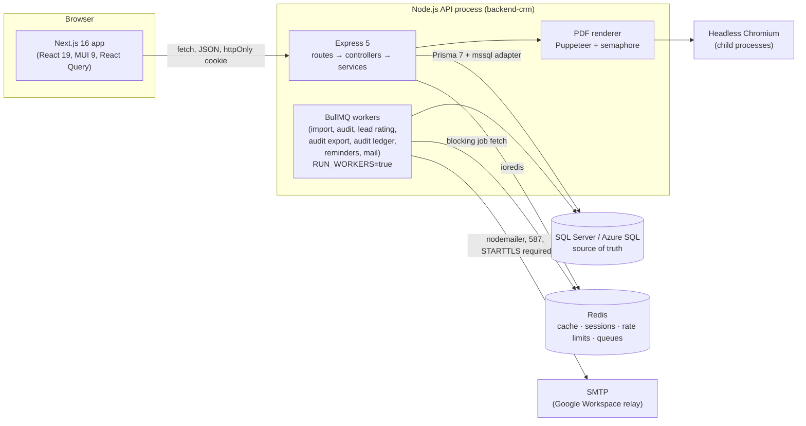
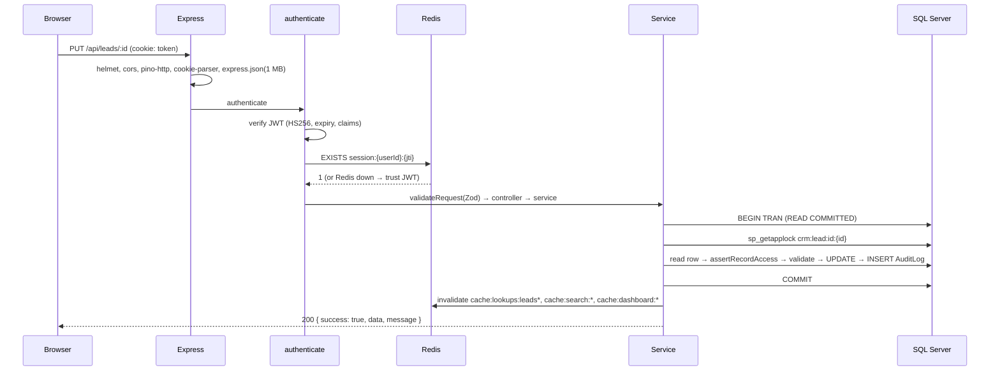
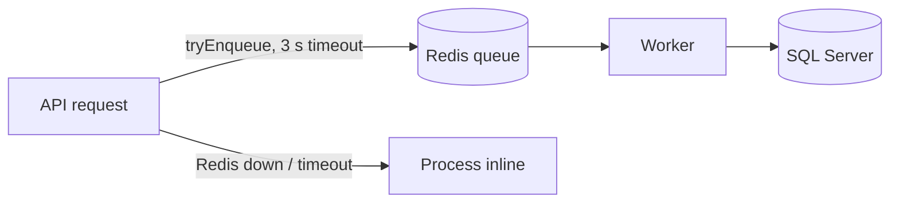
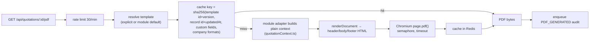
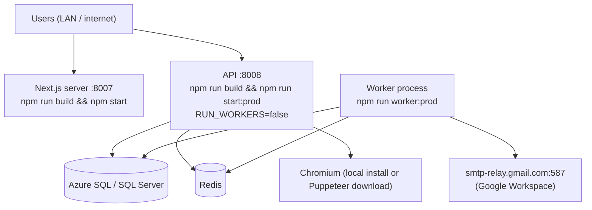

# Nandini CRM — System Design

> **Status:** living document. Describes the system as built (code as of 2026-11-27; audit context + ledger audit table, admin audit query API and screen, Users tab; Contracts module; Referrals module; Documents module; Activities data model and API, Calendar Phase 1 PR1; Activities screens and Calendar, PR2; notifications, reminders and mail workers, navbar bell and the morning summary email, PR3, with its review fixes; guarded cache reads for lookups, form configs and search, with its review fixes; Calendar Phase 2 P2-1, Admin › API Integrations foundation: encrypted provider credentials, connection tests, calendar sync settings, company emails, with its review fixes; My Profile (Profile Phase 1): profile, photo, change password, signed-in sessions; Admin › Users (Profile Phase 2, 2026-11-26): user management, sessions revoked on deactivation / role change; emailed set-password links for new users and admin-sent resets, replacing temporary passwords (2026-11-27); Calendar Phase 2 P2-2, employees connect / disconnect Google or Microsoft 365 calendars (replaced by P2-2b); Calendar Phase 2 P2-2b, admin-managed calendar connections: a Google service account with domain-wide delegation and a Microsoft Entra app with application permissions, automatic enrolment of everyone with a company email, in-memory tokens only, admin problem notifications; My Profile › Notifications (Profile Phase 3): bell kinds a user can turn off, the morning summary opt-out, a personal default reminder and out-of-office dates; Calendar Phase 2 P2-3a: one activity write path (system writes, write hook, lock seam, shared post-commit step), no behaviour change; Admin › Company formats (Profile Phase 5, PR5a): one company-wide date / time / number display setting, a shared formatter core, legacy styles kept until an admin saves; PR5b: the remaining ad-hoc format sites and the audit log's Before / After values follow it too; Calendar Phase 2 P2-4: lead / opportunity follow-ups create activities, locked follow-up fields, the nightly follow-up backfill; Calendar Phase 2 P2-3b: the CRM → calendar push engine (outbox, `crm-calendar-sync` queue and worker, Google / Graph event writes for enrolled people); Calendar Phase 2 P2-6: colleagues' busy times when picking a time, `GET /api/activities/busy`; Calendar Phase 2 P2-3c: the first-sync backfill, Send invitations / Retry / Add again and the sync status in the activity drawer; Calendar Phase 4: booking links, public scheduling pages `/book/<slug>` on free/busy; Calendar Phase 2 P2-5: calendar → CRM pull (Google sync tokens, Graph delta), office-hours polling, Sync now; Calendar Phase 2 P2-7: calendar webhooks (Google push channels, Graph subscriptions, `/api/webhooks/*`), the slower safety-net poll and the HTTPS go-live checklist; Calendar Phase 3 P3-1: Google Meet and Microsoft Teams links on activities from the owner's company calendar; Calendar Phase 4: recurring activities, CRM-authored series stored as one row per occurrence over a rolling 90-day horizon; Calendar Phase 2 P2-8: customer meetings imported from the calendar, two colleagues on one meeting, outside-organizer locks (the video meeting included; the organizer's join link shown read only), replies both ways (`rsvp` job), nightly auto-complete; Calendar Phase 4: email logging from Gmail / Outlook on contacts, leads and opportunities (§5.5, §8.10), with its review fixes (2026-11-27: no catch-up after switching off and on, purge vs running runs, Bcc never shown, sender-bound dedupe, capped times, snippets cleared when off, job ids / priority); booking links' default video meeting and on-demand pulls never absorbed by a finished job; as of 2026-11-27).
> Update it in the same change that alters architecture, infrastructure, Redis usage, queues or security.
> Related: [Database design](database-design.md) · [API plan](api-plan.md) · [Build plan](build-plan.md)

---

## 1. What the system is

An internal sales and support CRM for Nandini Infosystems. Sales staff move work through
**Leads → Opportunities → Quotations**, keep **Organizations** and **Contacts** as the customer master, log support
**Tickets** and **Contracts**, browse the **Documents** added on opportunities, and manage **Products**, **Partner Companies** and **Referrals**. Admins customise forms and dropdowns, number
documents, maintain the city list and design printable PDF templates.

## 2. High-level architecture



| Tier | Tech | Runs where |
| --- | --- | --- |
| Frontend | Next.js 16 (App Router), React 19, MUI v9 (CSS variables), Tailwind v4, TanStack Query 5, react-hook-form + Zod | `frontend-crm`, port **8007** |
| API | Express 5, Zod 4, Prisma 7 (`@prisma/adapter-mssql`), pino logging, helmet, cors | `backend-crm`, port **8008** |
| Database | Microsoft SQL Server / Azure SQL | external |
| Cache / queue broker | Redis (ioredis 6, BullMQ 6) | external, **optional** in dev |
| PDF | Puppeteer 25 → headless Chromium | spawned by the API |
| Background jobs | BullMQ workers | inside the API (`RUN_WORKERS=true`) or a separate `npm run worker` process |
| Outgoing email | nodemailer 10 (MIT-0) → Google Workspace SMTP relay (or a mailbox with an app password) | the mail worker (morning summary); the API for an admin's test send. Off until `MAIL_ENABLED=true` (§5.2) |

The two apps are deployed independently. The frontend calls the API directly from the browser (no Next.js
API routes / BFF). It resolves the API URL as `NEXT_PUBLIC_API_URL`, or else
`<page protocol>//<page hostname>:NEXT_PUBLIC_API_PORT` so one build works on localhost, LAN IPs and the server IP
(`frontend-crm/src/config/env.ts`).

## 3. Backend design

### 3.1 Layering

Every business module under `backend-crm/src/modules/<name>/` follows the same shape:

```
<name>.routes.ts      Express Router: auth, role checks, validateRequest(Zod), rate limiters
<name>.controller.ts  Thin: reads req, calls the service, sends the envelope (often generated by shared/crud.ts)
<name>.service.ts     Business rules, transactions, audit, cache invalidation
<name>.validator.ts   Zod schemas (ported from the frontend's schemas so both sides enforce the same rules)
<name>.mapper.ts      DB row  <->  API DTO (the DTO matches frontend-crm/src/types/*.types.ts)
```

Cross-cutting code:

| Folder | Responsibility |
| --- | --- |
| `src/config` | `env.ts` (Zod-validated environment), `prisma.ts` (single client, connect-with-retry, keep-alive), `redis.ts` (shared client), `logger.ts` (pino with secret redaction), `fieldLimits.ts` |
| `src/middlewares` | `authenticate` / `requireRole`, `validateRequest`, Redis rate limiter, global `errorHandler` |
| `src/services` | `audit.service` (diffs + write paths), `auditContext` (per-request who / where), `auditCatalog` + `auditLabels` (entry columns), `cache.service` (fail-open Redis cache), `recentViews.service` |
| `src/modules/shared` | Generic CRUD controller/routes, row-level access control, transactions + application locks, email child rows, name write-through (`nameSync`), tax-ID uniqueness, search term parsing, bulk prefetch |
| `src/jobs` | BullMQ queues, workers, standalone worker entry point |
| `src/utils` | Response envelopes, pagination, `HttpError`, Prisma error helpers, code generator, name formatting |

### 3.2 Request lifecycle



Order of global middleware (`src/app.ts`): `helmet` → `cors` (credentials, LAN origins allowed) → `pino-http`
→ `cookie-parser` → routers that need bigger bodies (`/api/import` 10 MB, `/api/pdf-*` 2 MB) → `express.json` (1 MB)
→ `/api/health` → module routers → `notFoundHandler` → `errorHandler`.

### 3.3 Startup and shutdown

`start()` in `src/app.ts`:

1. Start connecting to Redis **in the background** (never blocks startup).
2. Check the generated Prisma client matches `prisma/schema.prisma` (every model and column; `prismaClientCheck.ts`).
   A client older than the schema (code updated without `npm install` / `npm run prisma:generate`) = exit 1 naming
   the fix. Then connect to SQL Server, `SELECT 1`, up to 3 attempts 5 s apart (Azure SQL Serverless may be waking
   up). Failure = exit 1.
3. Start the optional DB keep-alive ping (`DB_KEEPALIVE_INTERVAL_MS`).
4. Seed missing form-field / dropdown defaults (`seedFormConfigsSafely`), never overwriting admin edits.
5. Seed built-in PDF templates (Classic, Modern, Compact).
6. Resume bulk email checks a restart interrupted (`resumeEmailValidationRuns`).
7. Start BullMQ workers if `RUN_WORKERS=true`.
8. `listen(PORT)`.

On `SIGINT`/`SIGTERM`: stop accepting connections → stop keep-alive → let workers finish in-flight jobs → close the
SMTP transport → close queues, Chromium, Prisma and Redis in parallel → exit. A 10 s hard timeout guarantees the process ends.

### 3.4 Concurrency model ("threads")

Node.js runs JavaScript on **one thread** with an event loop. Nothing in the app uses `worker_threads`. Parallelism
comes from these places instead:

| Where | How it runs concurrently | Bound |
| --- | --- | --- |
| HTTP requests | Interleaved on the event loop while each awaits I/O (SQL, Redis) | Node / OS |
| SQL Server | Connection pool inside the mssql driver adapter; each interactive transaction holds one connection | Pool default; tx `maxWait` 5 s, `timeout` 15 s |
| bcrypt (login) | Runs on libuv's thread pool (4 threads by default), so hashing doesn't block the loop | 12 rounds |
| BullMQ import worker | Async job loop on the same event loop (or the separate worker process) | **concurrency 1** |
| BullMQ audit worker | Same | **concurrency 5** |
| BullMQ lead rating worker | Same; one run a night (plus a catch-up at start-up) | **concurrency 1** |
| BullMQ audit export / audit ledger workers | Same; an export streams entries 1,000 at a time to a file, a ledger check holds one long SQL call on its own connection | **concurrency 1** each |
| BullMQ reminders worker | Same; one job at a time (reminder, sweep, nightly) | **concurrency 1** |
| BullMQ calendar sync worker (P2-3b) | Same; pushes to Google / Outlook. Jobs of one connection never overlap: a per-connection lease in SQL (`CalendarConnection.leaseId`, 120 s) makes a second job move itself back | **concurrency 4**, limiter 10 jobs / s |
| BullMQ mail worker | Same; the morning summary, on its own queue so slow SMTP never delays a reminder. It builds and sends 3 users' emails at a time | **concurrency 1**; 3 SMTP sends in flight |
| PDF rendering | Separate **Chromium processes**; one shared browser, a fresh incognito context + page per job | `PDF_MAX_CONCURRENCY` (default 3) via an in-process FIFO `Semaphore` |

Because the import worker shares the event loop with HTTP handling when `RUN_WORKERS=true`, production should run
`npm run worker:prod` as its own process and set `RUN_WORKERS=false` on the API.

### 3.5 Data consistency and race-condition handling

SQL Server is the only source of truth; Redis only ever holds derived or disposable data.

| Mechanism | Where | What it protects |
| --- | --- | --- |
| `runInTransaction` (READ COMMITTED) | All writes | Record + its child rows + its `AuditLog` row commit or roll back together |
| `runSerializable` (SERIALIZABLE) | Lead conversion | Creating Organization + Contact + Opportunity and marking the lead converted sees a stable snapshot |
| Retry with jittered backoff (4 attempts) | Both of the above | Deadlock victims, write conflicts, "transaction couldn't start" |
| `sp_getapplock` application locks (`acquireLocks`, `lockRecords`) | Updates, deletes, duplicate checks | Read-modify-write races; "check duplicate, then insert" races. Keys are sorted to avoid lock-order deadlocks |
| `MERGE … WITH (HOLDLOCK)` on `SequenceCounter` | `generateDocumentCode` | Gap-free, unique document numbers even on the first call; a rolled-back insert releases its number |
| Filtered unique index `Organization_organizationName_live_key` | DB | Two live organizations can't share a name; soft-deleted ones don't block reuse |
| `version` column on `PdfTemplate` | PDF template updates | Optimistic concurrency → `409 VERSION_CONFLICT` |

### 3.6 Security model

**Authentication**

- `POST /api/auth/login` checks the bcrypt hash (12 rounds). Unknown usernames are compared against a dummy hash so
  timing doesn't reveal valid usernames. Legacy plain-text passwords are compared in constant time and
  re-hashed to bcrypt on the next successful login. After the Redis session is recorded the user row is read again:
  if an admin deactivated the user while the password was being checked (their `revokeAll`
  ran before this session existed), the new session is deleted and the sign-in refused (403 `ACCOUNT_INACTIVE` / 401
  `INVALID_CREDENTIALS`). A user still **Invited** (`Users.invitePending`: never set a password from their link) gets
  403 `INVITE_PENDING` after a correct password (only a user who still had a temporary password when those were
  retired can have one).
- On success the API signs a **JWT** (HS256, `JWT_SECRET`, expiry = `SESSION_TTL_SECONDS`, default 8 h) with
  `{ id, username, role, tracked, jti }` and sets it as an **httpOnly cookie** named `token`
  (`secure` + `SameSite=None` in production, `Lax` in dev). A `Bearer` header is accepted as a fallback.
- The session is also written to Redis as `session:{userId}:{jti}` with the same TTL. A *tracked* token whose key
  is missing is treated as revoked (logout, a password change, "Sign out" on My Profile). If Redis is unreachable at
  login the token is issued *untracked*; if Redis is unreachable at request time, a valid JWT is trusted so an outage
  doesn't log everyone out.
- `GET /api/auth/me` reads the user from the database on every call (name, first / last name, photo URL), so the JWT
  stays `{ id, username, role }` and a profile edit shows at once; a token whose user row is gone gets 401. If the
  database can't answer (an outage, a paused Azure SQL resuming), it answers from the JWT with no name or photo and
  logs a warning, so a database blip never signs anyone out. The login response's `user` has the same shape. The
  frontend's `refreshUser()` treats only a 401 as the session ending (handled as below).
- **Frontend sign-in redirects** (`hooks/useRequireAuth.ts`, `context/AuthContext.tsx`, `utils/safeNextPath.ts`): every
  signed-in page calls `useRequireAuth()`. Signed out, it `replace`s the page with `/login?next=<path+query+hash>`
  (`loginPathWithNext()`; `safeNextPath` still validates it: CRM paths only, no open redirect). Signing in always goes
  to the **dashboard** (as of 2026-11-27, at the owner's request; `?next=` is no longer followed). Any API 401 other than a wrong
  password at sign-in (`INVALID_CREDENTIALS`), including a background poll's, means the session ended on its own
  (expired after the 8 h TTL, revoked, signed out in another tab). What happens depends on whether unsaved edits are on
  screen (`utils/unsavedWork.ts`: `useFormDraftGuard`, `useLeaveGuard` and Document Series hold a claim while dirty):
  - **Unsaved edits**: `AuthContext` keeps the user and sets `sessionExpired`, so the page and its draft stay mounted,
    and `components/auth/SessionExpiredDialog` (root layout, blocking) asks for the password of the same account and
    signs in again in place (`reauthenticate`, which also checks the returned user id); the user then saves. Signing in
    from another tab also clears it (checked on tab focus, same user id only). Either way every active React Query is
    refetched (`invalidateQueries`). While the dialog is up, `apiClient` holds the session (`setSessionOnHold`): every
    request except `POST /api/auth/login` and `GET /api/auth/me` is refused locally with a 401 (`SESSION_ON_HOLD`)
    before it reaches the network, so a cookie from another account signed in elsewhere in the browser can neither
    load data into this tab's cache nor save this draft (e.g. Ctrl+S behind the dialog). File and PDF fetches
    (`fetchWithSession`, `pdfTemplate.service` `fetchBinary`) are held the same way and report their errors to the
    same listeners (`notifyApiError`), so their 401s end the session too. If the unsaved work goes away while the dialog is up (the browser's Back button), it falls
    through to the next case (`subscribeUnsavedWork`). **Discard changes** (`endExpiredSession`) does too.
  - **Nothing unsaved**: `AuthContext` drops the user and sets the "session expired" note, and the guard sends the
    user to `/login?next=<this page>`; signing in again opens the dashboard.

  A 401 while nobody is signed in (the initial check, the login page, a late answer after Sign out) is ignored. An
  explicit **Sign out** sets `signedOutByUser` in the same render as clearing the user, so guards go to plain `/login`
  (never `?next=`), matching the navbar's own navigation. `utils/safeNextPath.ts` has no imports (its login path
  mirrors `ROUTES.LOGIN`) because the backend contract test loads it with tsx, which can't resolve the `@/` alias.
- **Change password** (`POST /api/auth/change-password`, My Profile › Security): the current password is checked like a
  sign-in (bcrypt, or a legacy plain-text row; always required), the new one against `modules/auth/passwordPolicy.ts` (8–128
  characters, a letter and a digit, not the username, not the current password; the frontend's live checklist uses a
  contract-tested copy). The bcrypt hash and `passwordChangedAt` are written in one transaction with a
  `PASSWORD_CHANGE` audit entry (no password in it; `currentPassword`, `newPassword` and `confirmPassword` are
  redacted from any audit entry anyway), under the per-user lock `user:id:<id>` with the stored hash re-checked inside
  it, so two concurrent changes can't both succeed. After the commit `sessionService.revokeAllExcept(userId, jti)` deletes every
  other `session:{userId}:*` key, so a stolen session can't outlive the password; the request's own session stays
  signed in. If Redis is down or fails partway the response says `signedOutSessions: null` and the UI tells the user
  to sign out other sessions again from My Profile. Rate limited per user (10 requests / 15 min, every request counts). An untracked session (Redis was down
  at its sign-in) can't be revoked early and keeps working until its JWT expires.
- **Set-password links** (invites and admin-sent resets; replaced temporary passwords and the must-change-password
  gate on 2026-11-27): `modules/auth/invite.token.ts`, `invite.service.ts`, `inviteEmail.render.ts`.
  - *Token*: 32 random bytes as 43 base64url characters, emailed as `${APP_PUBLIC_URL}/set-password?token=…`. Only its
    SHA-256 (hex) is stored, in `UserInvites` (`purpose` invite | reset, `expiresAt` = 72 h, `usedAt`, `revokedAt`,
    `createdBy`); a lookup by hash is followed by a constant-time compare (`timingSafeEqual`). Anything that isn't
    43 base64url characters is refused before any lookup. The token is never logged or audited (`token`,
    `newPassword` and `currentPassword` are redacted by the logger).
  - *Sending* (`inviteService.send`, from Admin › Users create and `send-invite`): writes the row, renders the email
    (the morning email's layout: a button, the username, the expiry in `BUSINESS_TIMEZONE`, a plain-link fallback),
    sends it through the mail service (`EmailLog` kinds `user_invite` / `password_reset_link`), and only when it was
    sent revokes the user's older links. A failed send deletes the new row (the older link keeps working) and the
    admin sees the mail server's reason; with email off (`MAIL_ENABLED`) no link is created. Audited `INVITE_SENT`.
  - *Using it* (public `POST /api/auth/invite/verify` and `/invite/accept`, 30 requests / 15 min per IP across both,
    in-process fallback while Redis can't count): every bad link gets the same `400 INVALID_INVITE`. Accept checks the
    password rules (a reset link also refuses the current password), then under `user:id:<id>` burns the link with a
    conditional update (single use even with two tabs), revokes the user's other links, stores the hash, clears
    `invitePending`, audits `PASSWORD_SET`; after commit it revokes every session of the user, opens a new one (cookie,
    `LOGIN` audited `via: set_password_link`), and the page opens the dashboard.
  - *Revoked* also by an email change (Admin › Users, People) and a deactivation. A reset link doesn't touch the
    current password until it is used. Sessions still carrying the retired `mcp` claim are refused by `verifyToken`.
  - *Page*: `app/set-password` (public, `noindex`, `Referrer-Policy: no-referrer`) reads the token once and drops it
    from the address bar (`history.replaceState`).
- **Admin › Users** (`/api/admin/users`, admin roles): deactivating a user and changing their
  role delete every `session:{userId}:*` key after the commit (`sessionService.revokeAll`), so a tracked session ends
  on its next request (`authenticate` finds the key gone → 401). The token carries the role, which is why a role
  change signs the user out (the acting admin's own sessions are left alone; their new role applies at next sign-in).
  Login already refuses an inactive user (403 `ACCOUNT_INACTIVE`). **Gap:** an *untracked* token (Redis was down at its
  sign-in), or any token while Redis is down, isn't checked against the database, so a deactivated or demoted user
  keeps that session until its JWT expires (8 h by default). Nothing records a revocation that failed: if Redis can't
  be reached at the moment of the deactivation / role change (`signedOutSessions: null`) but keeps its data,
  the user's tracked sessions are **still valid after Redis comes back**, until their JWTs expire. The admin is warned
  and can retry: Reset password again, or **Sign out all sessions** in an inactive user's row menu (it calls
  `/deactivate`, which re-runs `revokeAll` for a user who is already inactive). A role change that couldn't sign the
  user out has no retry short of a password reset. Guards: an admin can't remove their own admin access or
  deactivate themselves (`400 SELF_LOCKOUT`), and the last active admin-role user can't lose it (`400 LAST_ADMIN`;
  those writes serialise on an application lock). Admin password resets are rate limited (20 / 10 min per admin) and
  audited as `PASSWORD_RESET` without the password.
- **Signed-in sessions** (`/api/me/sessions`): the list is a `SCAN` of `session:{userId}:*` with `GET` + `PTTL` per key
  in one pipeline (`sessionService.list`), shown with a device name parsed from the stored User-Agent
  (`describeUserAgent`), IP, sign-in and expiry times. A user can sign out one other session (deletes its key) or all
  others (`revokeAllExcept`), both audited as `SESSION_REVOKE`; the current session can only end with Sign out. With
  Redis down the list is empty (`tracked: false`) and nothing can be revoked (both sign-out routes answer
  `503 SESSIONS_UNAVAILABLE`).

**Authorization** (`modules/shared/accessControl.ts`)

| Level | Rule |
| --- | --- |
| Admin features | `requireRole('Admin', 'Administrator', 'Super Admin')` — form customisation, document series, cities, PDF template management, API Integrations (`/api/admin/integrations`), Users (`/api/admin/users`) |
| Global data roles | Super Admin, Admin, Director – Operations, Regional Sales Head, Sales Manager, System Administrator, Accounts Manager see **all** records |
| Everyone else | Row-level scope: only records where they are the owner (`assignedTo`) **or** the creator (`createdBy`). Lists add this as a Prisma `where`; single-record reads/writes call `assertRecordAccess` (403) |
| Activities (`modules/activities/activity.access.ts`) | The same rule **plus attendees**: a colleague invited to an activity (`ActivityAttendee.username`) can see it (lists, calendar, record, its audit trail) and reply to it (`POST /api/activities/:id/response`), but only the owner, the creator or a global role can change or delete it. Linking an activity to a record (Related To, and the `link-targets` picker) needs access to that record under its own module's rule (403 otherwise); an unchanged link is kept even if the editor can't see the record. The calendar's lead / opportunity follow-ups and contract renewals follow their modules' rules. Activities are not in global search |
| Referrals (`modules/referrals`) | Lists and records are **not** row-scoped (everyone picks Referred By from them); changes and deletes need the owner, the creator or a global role (`assertRecordAccess`) |

Role names are compared case-insensitively and with any dash style. Roles are plain names on `Users.role` (no
permissions table): Admin › Users picks from the roles in use or a new one, and shows which give the admin panel and
which see every record (`modules/user-admin/roles.ts`, mirrored and contract-tested by `frontend-crm/src/utils/roleAccess.ts`).
"Administrator" opens the admin panel but is not a global data role. "Super Admin" is the developer role: it opens the
admin panel **and** sees every record, and only a Super Admin can add, edit, deactivate, activate or reset the password
of a Super Admin user, or give / take the Super Admin role (`403 SUPER_ADMIN_ONLY`, `userAdmin.rules.ts` `superAdminOnly`).

**Other protections**

- `helmet` headers; CORS allows `CLIENT_ORIGIN` and private LAN origins only (any origin in dev).
- Zod validation on every body/query/param; sort fields are whitelisted so arbitrary column names never reach Prisma.
- Admin form configuration (required fields, option lists, formats) is re-enforced server-side by
  `customFieldValidator.ts`, so API clients and stale tabs can't bypass it.
- Rate limits in Redis (fail-open): failed logins per IP, PDF renders per user, PDF previews per user, password changes
  per user, session sign-outs per user.
- Profile photos (`/api/user-photos/:id`, any signed-in user) are served only after their bytes were recognised as
  PNG, JPEG or WebP at upload, with `nosniff` and the detected `Content-Type` (no SVG, so no script in an image).
- Logger redacts passwords, auth headers and cookies, and (P2-1) every token / secret / verifier / `secretsEnc` /
  `syncCursor` field and the `x-goog-channel-token` header (`LOG_REDACT_PATHS` in `config/logger.ts`). Request URLs
  are logged through `utils/redactUrl.ts` (pino-http `req` serializer `serializeRequestForLog`, error-handler log
  lines, the 404 message): the values of `code`, `state`, `id_token`, `session_state`, `validationToken`, `token`,
  `syncToken`, `pageToken`, `$deltatoken` and `$skiptoken` (names case-insensitive) become `[REDACTED]` both in the
  logged URL and in the parsed `req.query` object the standard serializer adds, and a URL fragment carrying one of
  them is dropped (redactUrl.test.ts sends a real request through pino-http). 5xx
  responses hide internals in production.
- **Integration secrets (secret box, `services/secretBox.ts`, P2-1).** Client secrets and webhook secrets of
  Google / Microsoft / Zoom (`IntegrationProvider.secretsEnc`) are sealed with **AES-256-GCM**: format
  `enc:v1:<keyId>:<iv>:<tag>:<ciphertext>` (base64url), a fresh 12-byte IV per seal, AAD
  `IntegrationProvider:<provider>:secrets` so a value copied to another row doesn't open. The key ring comes from
  `INTEGRATIONS_ENCRYPTION_KEY` (`k2:<base64 32 bytes>,k1:<…>`; the first key seals, every key opens; a bare base64
  key means `k1`), validated at start-up (a malformed value stops the process); it is not exposed through `ENV`.
  Secrets are **write-only**: no API response, log line or audit entry carries one (the DTO shows `set`, `last4`,
  who / when; audit entries say `secretChanged: true`). Without a key the API runs normally and API Integrations
  shows the setup steps; saving a secret answers 503 `INTEGRATIONS_NOT_READY`. A stored secret the ring can't open
  (key replaced without keeping the old one) shows as "Needs attention" and is kept until a new one is entered.
  Rotation: put the new key first (`k2:…,k1:…`) on the API and the worker, restart, run
  `npm run integrations:reencrypt` (compare-and-set per row; `--dry-run` reports; since P2-2b it covers only
  `IntegrationProvider.secretsEnc`, which also holds the Google service account key: no token is stored anywhere), then
  drop the old key. HKDF
  subkeys (`subkey(purpose)`) are reserved for webhook channel tokens (P2-7).
- **Calendar connections (admin-managed, P2-2b, as of 2026-11-26; `modules/calendar-sync`; replaces P2-2's
  per-user OAuth).** Admins connect the company once on Admin › API Integrations; employees connect nothing.
  - **Google Workspace**: one service account with **domain-wide delegation**. The admin uploads (or pastes) the key
    JSON; it is checked (`type` service_account, `client_email`, numeric `client_id`, an RSA `private_key`, ≤ 10 KB),
    sealed with the secret box (AAD `IntegrationProvider:google:secrets`) and never returned, logged or audited (the
    audit says `serviceAccountKeyChanged: true` plus the client email / client id / key id). The CRM signs a JWT
    itself (`providers/googleServiceAccount.ts`, `node:crypto` RS256, no SDK): header `{ alg: RS256, typ: JWT, kid }`,
    claims `iss` = client email, `sub` = the employee's company email (left out for the app-level test), `scope`,
    `aud` = `https://oauth2.googleapis.com/token` (a constant: the key file's own `token_uri` is ignored), `iat` =
    now − 30 s, `exp` = `iat` + 3,000 s; exchanged with the `jwt-bearer` grant. Scopes, exactly what the Admin
    console entry must list: `calendar.events.owned` and `calendar.events.freebusy`.
  - **Microsoft 365**: one single-tenant Entra app with **application** permission `Calendars.ReadWrite` (scoped with
    Exchange RBAC for Applications, or tenant-wide admin consent). Client credentials (`providers/microsoftAppToken.ts`,
    scope `https://graph.microsoft.com/.default`), calls to `/users/{mailbox}/…`. The client secret is sealed the same way.
  - **Tokens are never stored** (`tokenSource.ts`): an in-memory LRU per process (5,000 entries) keyed by
    `provider:clientVersion:subject:scopeHash` (Microsoft: one tenant token), reused until 5 minutes before expiry,
    one in-flight call per key; failures are remembered for 10 minutes per user (user-level) and 5 minutes per
    provider (app-level). Any credentials change bumps `clientVersion`, so every process drops old grants within the
    60 s credentials cache.
  - **Errors** (`syncErrors.ts`): every token / API answer maps to a fixed code at one of three levels: **user**
    (`user_not_found`, `user_unavailable`, `calendar_unavailable`, `mailbox_out_of_scope`, `no_mailbox`: that person's
    row turns `error`, rechecked with backoff 15 min → 1 h → 6 h → 24 h; a Microsoft `mailbox_out_of_scope` counts as
    the app's `no_application_permission` only when no other live Microsoft row is `ok` and the provider's last 3–10
    other checked live rows all failed the same way, so people left outside an RBAC scope never read as the whole
    app), **app** (`delegation_missing`,
    `delegation_wrong_id`, `scopes_not_authorised`, `admin_policy`, `key_invalid`, `clock_skew`, `invalid_client`,
    `secret_expired`, `app_not_in_tenant`, `tenant_not_found`, `no_application_permission`, `provider_error`: the
    provider's health turns `error`, rows are left alone and employees see "paused") or **transient** (`rate_limited`,
    `provider_unavailable`, `network`: retried). Each code has one admin sentence; provider text is kept to 300
    characters for admins only and never shown to the employee.
  - **Use** (`calendarAccess.ts` `withCalendarAccess(connectionId, fn)`): re-checks the row is live, the provider on
    and the health not blocked, mints, runs `fn`, and on a provider 401 drops the cached grant and retries once.
  - **Busy times / free-busy visibility** (P2-6, as of 2026-11-26; `busy.service.ts`, `GET /api/activities/busy`):
    any signed-in user may ask for up to 20 colleagues' busy blocks, and the answer carries **times only** (start,
    end, `busy` / `tentative` / `away`): never a subject, location, attendee or record link, whether the block comes
    from a CRM activity (Phase 1 D11 still limits who sees activity details) or a company calendar. Google: one
    `POST /freeBusy` **impersonating the requester** (scope `calendar.events.freebusy`, already in the DWD entry), so
    Workspace's own free/busy sharing applies; a colleague whose calendar comes back with an error is then read
    impersonating that colleague (owner's decision: busy blocks come from colleagues' calendars). Microsoft:
    `POST /users/{mailbox}/calendar/getSchedule` with the **app token** (`Calendars.ReadWrite` covers it; under
    Exchange RBAC the scope must include the mailboxes asked about), on the requester's mailbox or, without one, the
    first colleague's; Graph returns subjects / locations, which are dropped on read and never stored or logged.
    Calls: one try, 5 s, ≤ 14-day windows, ≤ 5 at once per request, none started after the request's 8 s deadline
    (people still unread then are `unavailable`), and at most 120 provider calls / min / user
    (`ratelimit:activity-busy-calls`). Per-colleague calls happen only for calendars that come back with an error,
    when the requester has no usable row, or when the requester's own token / mailbox is refused; a call that fails as
    a whole otherwise (timeout, 5xx, 429, provider off or unhealthy) leaves that batch `unavailable` / `error` with no
    more calls. Reads go through `withCalendarAccess(…, { readOnly: true })` (review fix, as of 2026-11-26): a refused
    calendar call (e.g. Graph 403 `ErrorAccessDenied`) marks **no** row, no provider health and sends no admin
    notification (`ConnectionUnavailableError('call_refused')`; that person shows `error`, CRM only); only checks and
    sync jobs change connection state. Token failures and successes are recorded as for any call. The asked window is
    widened to the 15-minute grid for the SQL read, the provider calls and both cache keys, then clipped back, so a
    window moved by milliseconds still hits the caches. `exclude` drops only a calendar block with exactly the
    activity's start and end (its copy); a longer meeting around it stays. A person whose row is in `error` is not
    called (CRM only). Rate limit 60 / min / user. Nothing new is stored in SQL.
  - **Enrolment** (`enrolment.ts`): pure `resolveTarget` / `planEnrolment` decide per person (active, non-group, a
    company email, a provider serving the domain or the admin's override in `CalendarSyncUser`, not excluded) and
    `reconcileUser` applies it under the per-user lock `calendar-connection:user:<username>` (create `pending`, keep,
    or stop with `excluded`, `user_inactive`, `email_changed`, `provider_changed`, `provider_removed`, `no_email`; a
    `oauth_retired` row is never reactivated). Triggers: provider save / removal and settings save (everyone,
    `reconcileAll`), People email and calendar changes, Admin › Users create / update / activate / deactivate, and the
    nightly job. A new row gets an immediate health check: a `check` job on `crm-calendar-sync` (§5.4), or in-process
    when Redis is down (as of 2026-11-26, P2-3b). Stopping a row sets its links `detached` (the calendar events stay);
    re-activating it re-attaches the organizer links of the person's activities that end after yesterday (dirty, so
    they push again) and, since P2-8 (as of 2026-11-27), its invitation copies of live activities ending after
    yesterday (`synced` with no etag: the row's first pull reads each back once; a read that fails is tried again by the
    next pull, and while a link is still unread a replacement copy of that meeting is not ignored: the pull keeps its
    cursor so the replay moves the link to it, bounded by `PULL_HOLD_CURSOR_RUNS`, as of 2026-11-27 review fix; no extra
    database wakes, it rides the pull's own). Unique-index races surface outside the transaction (D45).
  - **Problems go to admins**, never to employees: `calendar_sync_issue` notifications (§5.1), the provider card's
    health and the People table. The employee's My Profile card and the Calendar page notice show a calm status only.
  - Provider calls go through `providerFetch` (timeouts, Retry-After, full-jitter backoff, a per-process pause after a
    long 429, typed errors whose message is only `"<provider> <operation> failed: <status> <code>"`, never a URL,
    body, token or assertion). The `fake` provider (`CALENDAR_FAKE_PROVIDER=true`, ignored in production) is an
    admin-mode test calendar: it serves every company domain no real provider claims (and anyone put on it by
    override), needs no key and talks to nothing, so enrolment and checks run end to end on a laptop.
  - **Security** (tell the owner): a leaked Google key or Microsoft secret can read and change every calendar it
    covers without anyone's password, so it is the master password of the company calendar. Damage is limited by the
    two narrow Google scopes, `Calendars.ReadWrite` (with RBAC: people's mailboxes only), sealed storage, write-only
    API, no logging and tokens in memory for under an hour. Rotate yearly and when someone with access leaves; on a
    suspected leak delete the Google key (and the delegation entry) or the Microsoft secret / role assignment, then
    rotate `INTEGRATIONS_ENCRYPTION_KEY`. Invitations still go out only on the meeting owner's own action (D41); an
    admin can exclude anyone on the People table.
  - **Push** (as of 2026-11-26, P2-3b; §5.4): an enrolled person's activities are written to their calendar through
    `withCalendarAccess` (Graph: `/users/{mailbox}/events`, never `/me`), as private events (D42, unless the
    `eventVisibility` setting is `default`), marked with the activity id (Google private extended properties, a Graph
    single-value extended property). Invitations are sent (`sendUpdates`) only when the person saving is the owner;
    guests a colleague adds are held on the link until the owner sends them (D41, `calendar_invites_held`). The
    description carries activity details only while every attendee is internal (D15); otherwise only the CRM link.
- **Audit redaction** (`services/auditCatalog.ts` `isSensitiveKey`): an exact, case-insensitive list (password,
  token, secret, clientSecret, refreshToken, accessToken, …) plus a case-sensitive camelCase suffix rule
  `(Secret|Secrets|Token|Password)(Enc)?$`, applied to **every** entity's before / after values.
- **Connection tests** (`POST /api/admin/integrations/providers/:provider/test`, P2-2b: two steps) call Google /
  Microsoft with the saved credentials: step `app` (Google: a token for the service account itself; Microsoft: a
  client-credentials token and its `roles`), then, when the admin names a person, step `user` (a token as that person
  and a read of their primary calendar, which proves delegation / the app's mailbox scope). The person must be someone
  the provider would sync (active, non-group, not excluded, a company email not on the other provider; else 409
  `CALENDAR_TEST_NOT_ALLOWED`), and each such run is audited `IntegrationProvider TEST_AS_USER` with the acting admin
  (as of 2026-11-26, P2-2b review fixes). A test clears the provider's health `error` only when it proves that problem
  fixed (a passing user step; the app step alone only for key / client codes). A provider can be switched
  on only after a passing app step since its credentials last changed. Tests and People "Check now" share the limit: 6 per minute per admin in Redis, with an in-memory per-process limit whenever
  Redis can't count a test (down, or a command failing while it reports ready: `createRateLimiter`'s `fallback`
  option), so the probe can't be used to hammer the providers. A result is stored as `lastTest` only if the client
  id, sealed secret and `clientVersion` are unchanged since the probe started (conditional `updateMany`); otherwise
  the admin gets `credentials_changed` and tests again.
- **Public booking pages** (Calendar Phase 4, as of 2026-11-26; `modules/booking-links`): the only API routes open to
  the internet without a session, `/api/public/booking/:slug[/slots|/book]`, on their **own router** mounted before the
  global JSON parser (16 KB limit), no `authenticate`. Design rules:
  - **No enumeration**: slugs end in 8 random characters (32-letter alphabet, 40 bits, `crypto.randomInt`) and are
    never reused (links are never deleted; "New address" retires a slug for good). A malformed slug, a missing or
    turned-off link, the company switch off and an owner who is inactive or a group login all answer the same 404
    with the same message; the rate limit runs before the lookup and misses are cached (60 s), so guessing costs the
    database nothing.
  - **Least data out**: the page gets the link's own public fields (title, owner's display name, type, durations,
    location, note, which questions) and free **start times**. Never busy blocks, activity subjects, usernames,
    emails or the owner's calendar status (an unreadable calendar is a generic "times can't be shown").
  - **Signed slot tokens** (`bookingLink.token.ts`): each offered start carries
    `v1.<start>.<minutes>.<expiry>.<mac>`, mac = HMAC-SHA256 truncated to 128 bits over `v1|linkId|link updatedAt|start|
    minutes|expiry`, checked in constant time, valid 30 min. Key: `BOOKING_SIGNING_KEY` (≥ 32 chars) or HKDF-SHA256 of
    `JWT_SECRET` (salt `nandini-crm/booking/v1`), so the session key never signs slots and production (which refuses
    a missing / short `JWT_SECRET`) never uses a development key. Editing a link changes `updatedAt` and voids every
    token it handed out. A token proves only that the server offered that start; the booking re-checks everything.
  - **No double booking** (D45): the booking re-reads the company calendar outside the transaction (network never
    inside one), then inside one transaction takes the per-owner application lock `booking:owner:<username>`,
    re-reads the owner's CRM activities through the transaction (the busy-times rules, buffers included), re-counts
    the day's bookings, inserts the activity (system write path) and the `BookingLinkBooking` row whose `tokenHash` is
    unique (one booking per token). A token that already booked is looked up first (review fix, as of 2026-11-26),
    right after its signature checks and before its expiry, the rules and the busy check (which would find the
    visitor's own new meeting): the same email gets that booking's confirmation again (a resubmit after a lost
    response, even past the 30 minutes), another email 409; two requests racing each other meet the same pre-read
    inside the transaction. No unique error is caught inside the transaction: a P2002 aborts it and the booking is
    retried once from the start. **Fail closed**: an
    owner calendar in `error` / `unavailable` offers no times and books nothing (503 `CALENDAR_UNAVAILABLE`), so a
    Google / Outlook meeting the CRM can't see is never double-booked.
  - **Abuse limits**: per IP and per link (Redis fixed windows; an in-process counter whenever Redis can't count, never
    open; API plan §3). The per-IP limits are route middleware and count every request; the per-link limits
    (`chargeLink`, keyed by link id) are charged by the service only for real attempts (review fix, as of 2026-11-26):
    slots once the link is live and the query valid, a booking once its token is a valid, unused one this server
    signed. So junk (bad slug, empty body, honeypot, forged or expired token) uses up only its own IP's quota and a few
    addresses can't lock a link's visitors out. A honeypot field (`website`, hidden from people and screen readers; filled = 400
    `BOOKING_REJECTED` without detail), strict zod bodies (unknown keys refused, every text bounded by its column),
    `Cache-Control: no-store`, `X-Robots-Tag: noindex, nofollow`; the page itself has `robots: noindex` and
    `referrer: no-referrer`. **Provider budget** (review fix, as of 2026-11-26): slot pages read the owner's busy times
    in fixed 14-day blocks aligned to Mondays (`busyBlocks`, `BOOKING_BUSY_BLOCK_DAYS`), never the visitor's own
    `from` / `days` window, so every visitor of a link hits the same few cache keys (60 s provider cache): a link with a
    60-day horizon has at most 6 blocks, so at most about 6 provider calls a minute however many windows are asked.
    They share one budget (`booking:<linkId>`, 120 / min); the booking's own re-read uses a separate budget
    (`booking-book:<linkId>`), so slot browsing can never block a confirmation.
  - **Who and what**: the activity is written as actor `system` with the owner as owner and `createdBy`; its audit
    entry carries route `public:booking`, the visitor's IP and user agent. Visitors are never emailed (the mail layer
    is parked): an on-page confirmation with an `.ics` file. Once calendar sync pushes activities (P2-3b), D41 holds
    the invitation for the owner to send (actor ≠ owner), so an anonymous form never makes an employee's mailbox
    email an address a stranger typed. CORS, helmet and CSP are unchanged.
  - **Video meeting** (as of 2026-11-27; `BookingLink.videoMeeting`): a link may give booked meetings a Google Meet or
    Microsoft Teams link, whichever the **owner's** admin-managed calendar creates (checked on save: the type offers
    video, `409 VIDEO_PROVIDER_NOT_CONNECTED` otherwise; Zoom never). A booking re-checks both (one connection read
    outside the transaction) and inserts the activity with `videoMeeting`, so the P3-1 push creates the link with the
    event; if either no longer holds, the meeting is booked without one and its remarks say why. Nothing leaks: the
    page names the provider from the link and type only ("Google Meet link: sent by <owner>"), never the owner's
    calendar status; the confirmation shows a join URL only when it is already `ready` (allow-list re-checked, in
    practice a resubmit after the push ran), else that the organiser sends it, and the page never polls (no extra
    requests, no DB wakes). The `.ics` carries the same line (`DESCRIPTION`, and `URL` when ready).
  - **Who may create links**: company switch (default off) and `whoCanCreate` (everyone / managers and admins / admins)
    in `ModuleSetting activities/bookingLinks`; owner or admin manage a link; existing links of an owner whose role
    is no longer allowed keep answering until turned off (admins can make links for anyone).
- **Audit log** (`AuditLog`, an append-only SQL Server ledger table — see §5 "Audit write paths"): every change,
  sign-in, failed sign-in (wrong password or deactivated account) and refused request (403, at most one per user +
  route per minute) is recorded with who / where / how. Record history (`GET /api/audit-logs/...`) follows the
  record's own access rule; sign-in history, PDF template and Form Customization trails are admin-only. The
  CRM-wide log (`GET /api/admin/audit-logs`, list / entry / facets / stats / users) is admin-only.
- PDF rendering: Chromium runs with JavaScript disabled and every network request except `data:` / `about:blank`
  aborted; images are embedded as data URIs.

### 3.7 Error contract

All errors use one envelope, produced by `middlewares/errorHandler.ts`:

```json
{ "status": "error", "code": "VALIDATION_ERROR", "message": "…", "errors": [{ "message": "…", "path": ["gstNumber"] }] }
```

`errors[].path` matches react-hook-form field paths, so the frontend highlights the exact field. See the
[API plan](api-plan.md#4-error-codes) for the full code list.

## 4. Redis: what it does and what happens without it

Redis is **optional**. Every use is fail-open: when Redis is unreachable the API keeps working against SQL Server.
The shared client (`config/redis.ts`) is created with `enableOfflineQueue: false` and `maxRetriesPerRequest: 1`, so
commands fail immediately instead of hanging, and reconnects in the background (backoff up to 30 s). BullMQ uses
**separate connections** with `maxRetriesPerRequest: null` (a BullMQ requirement).

### 4.1 Key map

| Key pattern | Type | TTL | Written by | Purpose |
| --- | --- | --- | --- | --- |
| `session:{userId}:{jti}` | string (JSON: ip, userAgent, createdAt) | `SESSION_TTL_SECONDS` (8 h) | login | Revocable sessions; logout deletes the key; a password change deletes every other key of the user, a set-password link deletes all of them; My Profile lists them (`SCAN` + `GET` + `PTTL`) and signs out one or all others; Admin › Users deletes all of a user's keys on deactivation or a role change |
| `ratelimit:admin-send-invite:user:{id}` | counter | 10 min | `POST /api/admin/users/:id/send-invite` | 20 invite / reset-link emails / 10 min / admin |
| `ratelimit:set-password-link:ip:{ip}` | counter | 15 min | `POST /api/auth/invite/verify`, `/invite/accept` | 30 requests / 15 min / IP (every request counts; in-process counter while Redis can't count) |
| `ratelimit:change-password:user:{id}` | counter | 15 min | `POST /api/auth/change-password` | 10 password changes (right or wrong) / 15 min / user |
| `ratelimit:session-revoke:user:{id}` | counter | 10 min | `DELETE /api/me/sessions[/:id]` | 30 session sign-outs / 10 min / user |
| `ratelimit:login:{ip}` | counter | `LOGIN_RATE_LIMIT_WINDOW_SECONDS` (15 min) | failed logins only | Brute-force protection (default 10 failures / window); reset on success |
| `ratelimit:pdf:{module}:user:{id}` | counter | 60 s | `GET /:id/pdf` | 30 PDF renders / min / user |
| `ratelimit:pdf-preview:user:{id}` | counter | 60 s | `POST /api/pdf-templates/preview` | 20 previews / min / user |
| `ratelimit:activity-busy:user:{id}` | counter | 60 s | `GET /api/activities/busy` | 60 busy-time checks / min / user (in-memory per process whenever Redis can't count; never fails open) |
| `ratelimit:activity-busy-calls:user:{id}` | counter | 60 s | `GET /api/activities/busy` (P2-6) | 120 Google / Microsoft free/busy calls / min / user, whatever the number of requests; past it the calendar part is `unavailable` (in-memory per process whenever Redis can't count; never fails open) |
| `ratelimit:booking-view:ip:{ip}` | counter | 60 s | `GET /api/public/booking/:slug` | 60 page views / min / IP (in-memory per process whenever Redis can't count; never fails open) |
| `ratelimit:booking-slots-ip:ip:{ip}` / `ratelimit:booking-slots-link:link:{linkId}` | counter | 60 s | `GET /api/public/booking/:slug/slots` | 60 / min / IP (every request) and 3000 / min / link (only a live link with a valid query) (same fallback) |
| `ratelimit:booking-book-ip:ip:{ip}` / `ratelimit:booking-book-link:link:{linkId}` | counter | 1 h | `POST /api/public/booking/:slug/book` | 10 / hour / IP (every request) and 30 / hour / link (only valid, unused slot tokens) (same fallback) |
| `ratelimit:activity-busy-calls:booking:{linkId}` / `…:booking-book:{linkId}` | counter | 60 s | booking page slots / book | 120 provider calls / min shared by all visitors of one link's slot pages; a separate 120 for its bookings' re-reads |
| `ratelimit:integration-test:user:{id}` | counter | 60 s | `POST /api/admin/integrations/providers/:provider/test` | 6 connection tests / min / admin (in-memory per process whenever Redis can't count) |
| `cache:lookups:users:{all\|active}` | JSON, guarded ¹ | 5 min | lookups | User picker list; dropped by a company email change (`invalidateUserCaches`, Admin › API Integrations › People), by every Admin › Users write (`invalidateUserCaches`) and by My Profile name / photo changes (`invalidateUserLookupCaches`) |
| `cache:lookups:organizations:{limit}` / `contacts:{limit}` / `products:{limit}` | JSON, guarded ¹ | 5 min | lookups (no search term only) | Lookup dialogs' default lists |
| `cache:lookups:partner-companies` / `partner-contacts` | JSON, guarded ¹ | 1 h | lookups | Partner master lists; dropped by partner company writes |
| `cache:lookups:nature-of-calls` | JSON | 1 h | lookups (plain read) | Seeded master list; TTL only |
| `cache:lookups:form-configs:{all\|active}` | JSON, guarded ¹ | 1 h | `formConfig.service` | Whole form/dropdown configuration |
| `cache:lookups:company-formats` | JSON (the `CompanyFormatSettings` row, or `null` = not customized), guarded ¹ | 1 h | `companyFormats.service` (API, PDF render, BullMQ workers) | Company display formats; dropped after a save or reset commits. Read through Redis rather than memoised in process, so a worker in another process sees a change on its next job |
| `cache:address-master` / `cache:address-master:{country}` | JSON | 24 h | lookups (plain read) | Countries and states (seeded ISO data); TTL only |
| `cache:address-master:cities:{state}:{limit}` | JSON, guarded ¹ | 24 h | lookups | A state's biggest cities; dropped by city admin writes |
| `cache:search:{category\|all}:{page}:{limit}:{t\|-}:{i\|-}:d{minDigits}:{sha256}` | JSON, guarded ¹ (180 s placeholder) | 30 s | global search | Search results; everyone sees the same results, so one entry per query (hashed, so user text never reaches a key or SCAN pattern) |
| `cache:calendar:busy:{username}:{fromMs}:{toMs}` | JSON (`[[startMs, endMs, kind], …]`) | 60 s | `GET /api/activities/busy` (P2-6) | One person's company-calendar busy blocks for a window (times only; `fromMs` / `toMs` on the 15-minute grid); only successful reads are kept; TTL only. Read with one `MGET`, written with one `MULTI` |
| `cache:lookups:activities:busy:{sha256(people)[:24]}:{fromMs}:{toMs}` | JSON, guarded ¹ | 30 s | `GET /api/activities/busy` (P2-6) | The CRM part (people's Planned activity blocks) for a people set and window (on the 15-minute grid); dropped by every activity write (`invalidateEntityCaches('activities')`, pattern `cache:lookups:activities*`) |
| `cache:booking-link:{slug}` | JSON (`{ row, ownerName }` or `null` = 404), guarded ¹ | 60 s | public booking page | A live link with its owner's name, or a miss; dropped by every link write and (pattern) by a booking-settings save |
| `cache:booking-holidays:{from}:{to}` | JSON (days) | 10 min | public booking page | Company holidays in the asked days; TTL only (a holiday added meanwhile is caught by the booking's own re-check within 10 min) |
| `cache:email-domain:{domain}` | JSON string (`mx`, `a_only`, `null_mx`, `not_found`) | 24 h | email checks (plain read) | DNS answer for a domain; TTL only (an `unknown` answer is dropped at once) |
| `cache:notifications:unread:{username}` | number (briefly a `pending:<uuid>` placeholder while it is read) | 24 h (a safety net: it is dropped long before) | `GET /api/notifications/unread-count`; the list reads SQL and re-caches it | The bell's unread count (username lowercased), so a minute's polling from every open tab doesn't wake SQL Server; dropped by every write to that user's notifications, by the 00:20 nightly job and on every Redis reconnect (§4.2) |
| `pdf:{MODULE}:{sha256}` | binary (PDF) | `PDF_CACHE_TTL_SECONDS` (600 s) | PDF render | Rendered PDFs; key (`pdfCacheKey`) covers template id + version, record id + `updatedAt`, custom-field definitions + company formats |
| `recent:{userId}:{entity}` | sorted set (score = view time) | 30 days | `GET /api/organizations/:id` | "Recently viewed" (max 20 per user per entity) |
| `bull:crm-import:*` | BullMQ internals | 1 day (completed) / 7 days (failed) | import queue | Import jobs, progress, results |
| `bull:crm-audit:*` | BullMQ internals | 1 h (completed) / 7 days (failed) | audit queue | Async audit events |
| `bull:crm-lead-rating:*` | BullMQ internals (job scheduler + runs) | 7 days (completed) / 30 days (failed) | lead rating worker | Nightly Rating ageing |
| `bull:crm-audit-export:*` | BullMQ internals | 1 day (completed) / 7 days (failed) | audit export queue | Audit log exports over 5,000 entries |
| `bull:crm-audit-ledger:*` | BullMQ internals (job scheduler + runs) | removed when done | audit ledger worker | Nightly ledger digest; "Verify integrity" (job id `ledger-verify`: present = running) |
| `bull:crm-reminders:*` | BullMQ internals (2 job schedulers, delayed jobs, runs) | 1 day / 1000 jobs (completed) / 7 days (failed) | activity saves, reminders worker | Delayed job per activity reminder (job id `reminder-<activityId>-<remindAtMs>`), schedulers `reminder-sweep`, `reminder-nightly` (§5.1) |
| `bull:crm-mail:*` | BullMQ internals (job scheduler + runs) | 7 days / 100 jobs (completed) / 30 days (failed) | mail worker | Scheduler `morning-summary`, catch-up jobs `morning-catchup-<day>` (§5.2) |
| `bull:crm-calendar-sync:*` | BullMQ internals (2 job schedulers, delayed jobs, runs) | 1 h / 2000 jobs (completed) / 7 days (failed) | activity saves, enrolment, calendar sync worker | Jobs `push-<linkId>-<dirtyAtMs>` (sweep: `…-s<minute>`), `enrolled-<connectionId>-<enrolledAtMs>-r<readyAtMs>` (one per time a row reaches `ok`), `check-<connectionId>-<minute>`, `pull-<connectionId>-<10 s bucket>` (P2-5; Sync now / page / admin pulls `…-<bucket>-<ms>` when the bucket's job already started or finished, as of 2026-11-27; webhook pulls `pull-<connectionId>-w<10 s bucket>`, or `…-w<bucket>-<ms>` when the bucket's job already ran; the D26 follow-up `pull-<connectionId>-n<stamp ms>`), `watch-<connectionId>-<op>-<minute>` (P2-7), `conference-<linkId>-<request>-<attempt>` (P3-1), `rsvp-<activityId>-<username>-<respondedAtMs>` (P2-8); schedulers `calendar-poll`, `calendar-nightly` (§5.4; as of 2026-11-27, P2-3b / P2-5 / P2-7 / P3-1 / P2-8) |
| `calsync:notified:{connectionId}` | string (ms time of the last verified ping) | 600 s | calendar webhooks (P2-7) | D26: a `pull` job that finishes `done` after a ping arrived while it ran queues one follow-up pull (`pull-<connectionId>-n<stamp ms>`, so a follow-up of a follow-up gets its own id). Without Redis no stamp: the in-process pull runs once more instead (as of 2026-11-26) |
| `ratelimit:calendar-webhooks:ip:{ip}` | counter | 60 s | `/api/webhooks/*` (P2-7) | 600 notifications / min / IP (in-memory per process whenever Redis can't count; never fails open) |
| `calendar:worker:heartbeat` | string (ISO time) | 120 s | calendar sync worker, every 60 s and on each Redis `ready` | Admin › API Integrations shows whether a calendar worker is running (`worker` in `GET /api/admin/integrations`) |
| `ratelimit:email-log-run:user:{id}` | counter | 60 s | `POST /api/admin/email-logging/people/:username/run` (Calendar Phase 4) | 6 "Log now" runs / min / admin (in-memory per process whenever Redis can't count; never fails open) |

¹ Read with `cacheService.getOrSetGuarded`, so the key briefly holds a `pending:<uuid>` placeholder while it is read
(§4.2). `cache:dashboard:*` is defined and invalidated but nothing writes it yet (no dashboard API).

### 4.2 Cache invalidation

Caches are read-through. After a write **commits**, the service calls
`cacheService.invalidateEntityCaches(entity)`, which deletes `cache:lookups:{entity}*`, every `cache:search:*` and
every `cache:dashboard:*` using `SCAN` + `UNLINK` (never `KEYS`, so Redis isn't blocked). Form-config writes drop
`cache:lookups:form-configs*` (`invalidateFormConfigCaches`), partner company writes also
`cache:lookups:partner-contacts*`, city admin writes `cache:address-master:cities:*`. Two form-config writes rewrite
records too, so they also call `invalidateEntityCaches` for the modules they touched: renaming a dropdown option (its
stored value follows, e.g. every organization's Customer Type or product's Category; only the modules whose records
held the old value) and renaming a custom field's key. The one-off `npm run align:backend-names -- --apply` drops the
same keys; the shared Redis client connects lazily, so the script connects it first (waiting up to 5 s) and, when
Redis can't be reached, tells the operator to restart the API. PDF cache entries never need invalidation: any change
to the template, the record or the company formats changes the key. A company formats save or reset drops
`cache:lookups:company-formats` after its transaction commits.

Every key a CRM write invalidates is read with **`cacheService.getOrSetGuarded`** (lookups of users,
organizations, contacts, products, partner companies and partner contacts, cities, form configs, global search, unread counts). A
plain read-through can cache a value it read just before a write *after* that write's invalidation, and serve it until
the TTL (an hour for form configs, a day for cities). The guarded read closes that gap: on a miss it first writes a
`pending:<uuid>` placeholder (`SET NX`), reads the source, then swaps the placeholder for the value only if the
placeholder is still there (Lua compare-and-set). An invalidation in between deletes the placeholder (`SCAN MATCH`
matches key names whatever they hold), so the swap does nothing and the next read goes to the source. A placeholder
written after the scan started belongs to a read that began after the commit, so missing it is harmless. A reader
that finds another's placeholder reads the source and does not cache (it is never handed the placeholder). A read
that outlives its placeholder is not cached either: the swap finds no placeholder or another reader's. Placeholders
live 90 s (a cold connect is up to 30 s, the driver's request timeout 15 s, a paused Azure SQL Serverless database
takes up to a minute to resume); search's live 180 s, because a search runs a document series query and then up to 27
queries on a 10-connection pool. A placeholder left behind by a crash only keeps that key uncached, never stale,
until it expires. Cost: one more round trip on a miss; a hit is the same single `GET`. Values are JSON (`null` and
empty lists are cached; `undefined` is not). Redis down or a failed Redis call: the source, uncached, no error.
Keys only their TTL expires stay on the plain `cacheService.getOrSet`: nature of calls and countries/states
(no CRM write changes them; the seed drops `cache:*`), and DNS answers. Users moved to the guarded read in P2-1,
when the company email editor became a CRM write path for them (My Profile name / photo edits are another). A key is read one way only: a plain read of a
guarded key would overwrite its placeholder.

Invalidations made while a process cannot reach Redis are lost, so a value cached before an outage can outlive a write
made during it until its TTL: every `cache:*` key is dropped only on the first `ready` after start-up (unread counts
on every reconnect, below).

A user's `cache:notifications:unread:{username}` is deleted whenever notifications are written for
them (producer, also when a later insert chunk fails) and whenever they mark one or all read (even when nothing changed, so a user can always clear a wrong
badge); every `cache:notifications:unread:*` is deleted by the 00:20 nightly job and on every `ready` of the shared
Redis client in each API and worker process (`dropUnreadCountsOnRedisReady`), because an invalidation made while
Redis was unreachable is lost. The count is read with `cacheService.getOrSetGuarded` (above), so a count read just
before a new notification and its invalidation is never cached. The list (`GET /api/notifications`, when the bell
opens) always counts in SQL and re-caches that the same way.

### 4.3 Degraded mode (Redis down)

| Feature | Behaviour |
| --- | --- |
| Caching | Every read goes to SQL Server |
| Sessions | New logins issue untracked tokens; existing tokens are trusted until they expire; logout, a password change and My Profile's Sign out can't revoke; the My Profile session list is empty |
| Rate limiting | Disabled (requests allowed), except the integration connection test, busy times (`GET /api/activities/busy`, P2-6) and the public booking page (Phase 4), which count in memory per process instead |
| Public booking page (Phase 4) | Link lookups, holidays and busy times read SQL on every request; rate limits count in process (never open); the booking itself is unchanged (SQL application lock) |
| Busy times (P2-6) | The CRM part reads SQL on every request; the company-calendar part is memoised in process (60 s, at most 1,000 entries) instead of Redis; the provider call budget counts in process |
| Audit events (logins, PDF generated, import summaries) | Written directly to SQL instead of queued |
| Imports | ≤ 500 rows run synchronously inside the request; larger imports return `503 IMPORT_QUEUE_UNAVAILABLE` |
| Import status polling | `503` |
| Audit log export / Verify integrity | Run in the API process instead (the export after its response; one check at a time per process); the nightly digest doesn't run |
| Recently viewed | Not recorded, lists report none |
| Activity reminders, contract renewals, morning email | Delayed reminder jobs can't be queued and the schedulers don't fire. Each worker process runs one-minute in-process ticks instead: while `isQueueAvailable()` is false the reminders worker runs the reminder sweep (missed reminders + renewals), so **the database is queried every minute while Redis is down**, and the mail worker makes up a missed morning summary (between its time and noon). Duplicates across processes are harmless (claims and unique dedupe keys). The check is made on every tick, not once at start-up |
| Redis comes back | On every `ready` of the shared client (start-up and each reconnect) the reminders worker upserts its two schedulers, re-arms every pending reminder (`armPendingReminders`, batches of 500, same job ids) and runs one sweep; the mail worker upserts `morning-summary` and makes up a missed morning summary; every API and worker process drops all cached unread counts |
| Email logging (Calendar Phase 4) | `email-log` jobs can't be queued: the calendar worker's fallback tick (inside `CALENDAR_SYNC_HOURS`) runs **one** due mailbox in-process per minute, and an admin's "Log now" runs inline (bounded: ≤ 200 messages, ≤ 20 provider pages). Cursors live in SQL, so nothing is lost; the "Log now" limit falls back to an in-memory counter |
| Calendar push (P2-3b) and pull (P2-5) | Push and pull jobs can't be queued. A Sync now / page pull runs the pull in the API process, awaited (still under the lease and the `job:calendar-sync` origin); the fallback tick also pulls up to 5 people not pulled (or tried in-process) for a poll interval, longest-waiting first, so a few people whose pulls keep failing can't take every slot. A committed activity save pushes its dirty links in-process after the response; the calendar worker's one-minute fallback tick, **only inside `CALENDAR_SYNC_HOURS`** (default 07:00–22:00), runs due connection checks, one lost first-sync backfill (P2-3c) and pushes up to 20 due dirty links in-process. Links stay dirty in SQL (the outbox), so nothing is lost: on Redis `ready` the worker upserts its schedulers and runs one outbox sweep. The `enrolled` job is not queued; the fallback tick and the next sweep push those links instead |
| Calendar webhooks (P2-7) | A verified ping runs its pull in the API process (one at a time per person; a ping during it runs it once more, at most 3 rounds); `watch` jobs (lifecycle renew / re-create) run in process; the rate limit counts in process (never open). The poll still slows down only for people with a healthy channel |
| Notification bell | Unread count read from SQL on every poll (no cache); assignment / invitation notifications are still written after activity saves. Counts cached before the outage are dropped when Redis comes back |
| `/api/health` | Reports `redis: "unavailable"` |

## 5. Background jobs (BullMQ)



| Queue | Producer | Worker concurrency | Attempts | Job retention | Notes |
| --- | --- | --- | --- | --- | --- |
| `crm-import` | `POST /api/import/:entity` (job id = import id) | 1 | **1** (a retry would duplicate rows already created) | done 1 day / 500 jobs; failed 7 days | Reports `{ processed, total, created, failed, percent }` after each row (throttled to 250 ms); checks `import:cancel:<id>` before each row; result `{ total, processed, created, failed[], cancelled }` |
| `crm-audit` | `auditService.enqueue` (login, login failed, logout, access denied, PDF generated, import summary); each job carries the request's audit origin | 5 | 5, exponential backoff from 1 s | done 1 h / 1000 jobs; failed 7 days | Data-change audits do **not** go through the queue (see below) |
| `crm-audit-export` | `POST /api/admin/audit-logs/exports` over 5,000 entries (job id = export id) | 1 | 1 | done 1 day / 200 jobs; failed 7 days | Streams the matching entries newest first, 1,000 per query, to a CSV or a streaming Excel writer (`utils/xlsxWriter.ts`: constant memory; peak heap ~120 MB on a 169 k-entry export) under `AUDIT_EXPORT_DIR`; writes the `EXPORT` entry with the requesting admin's origin; files deleted after 24 h by the nightly ledger job |
| `crm-audit-ledger` | Job scheduler `audit-ledger-digest`, cron `15 0 * * *` in `BUSINESS_TIMEZONE`; `POST /api/admin/audit-logs/integrity/verify` (job id `ledger-verify`) | 1 | 1 | removed when done | Nightly: saves a ledger digest outside the database (`AUDIT_DIGEST_DIR` + `AuditDigest`) and tidies old exports. Verify: `sys.sp_verify_database_ledger` against every digest file on a separate SQL connection with a long timeout (`AUDIT_VERIFY_TIMEOUT_MS`, default 30 min; ~100 s per million entries) and writes a `LEDGER_VERIFY` entry |
| `crm-lead-rating` | Job scheduler `lead-rating-ageing`, cron `5 0 * * *` in `BUSINESS_TIMEZONE` (upserted when the worker starts) | 1 | 1 (the next night catches up) | done 7 days / 30 jobs; failed 30 days | `ageLeadRatings`: re-rates leads ageing under a "Days since response" rule, writing only changed rows (history by `system`). The worker also runs it once at start-up, so a night missed while nothing ran (or Redis was down) is made up; runs are idempotent ([lead-rating-rules.md](lead-rating-rules.md)) |
| `crm-reminders` | Activity saves (`remind`, delayed to `remindAt`); job schedulers `reminder-sweep` (`*/15 7-21 * * *`) and `reminder-nightly` (`20 0 * * *`), both in `BUSINESS_TIMEZONE`, upserted on every Redis `ready` | 1 | 3, exponential backoff from 30 s (every job is idempotent) | done 1 day / 1000 jobs; failed 7 days | In-app notifications (activity reminders, assignments, invitations, contract renewals); see §5.1 |
| `crm-calendar-sync` (P2-3b) | Activity saves (`push`, 2 s delay, job id `push-<linkId>-<dirtyAtMs>`), the outbox sweep (`push-<linkId>-<dirtyAtMs>-s<minute>`), a connection row reaching `ok`, first time or after an error (`enrolled-<connectionId>-<enrolledAtMs>-r<readyAtMs>`), enrolment and the poll (`check-<connectionId>-<minute>`), the poll fan-out / Sync now / page / admin / nightly re-baseline / webhook pulls (`pull-<connectionId>-<10 s bucket>`, 1 attempt; P2-5; a webhook's pull waits 2 s, its D26 follow-up is `…-n`), webhook channel work (`watch-<connectionId>-<ensure\|renew\|recreate\|stop>-<minute>`, 3 attempts; P2-7), a pending Meet link (`conference`, 5 s delay, job id `conference-<linkId>-<request>-<attempt>`, up to 5 tries; P3-1), a colleague's CRM reply to a meeting (`rsvp-<activityId>-<username>-<respondedAtMs>`, P2-8, as of 2026-11-27; moved back without an attempt while the lease is taken or the provider rate-limits), email logging (`email-log`, job id `email-log-<sha256(username) 12 hex>-<poll bucket>-<lastRunAt ms, base 36>` from the poll tick, BullMQ `priority: 10` so pushes and pulls (no priority) go first, 2 attempts, so a run that stopped at its limit or a retry is queued again at the next tick while two ticks of one bucket queue it once; or `…-m<minute>` for an admin's "Log now", 1 attempt; Calendar Phase 4, §5.5); schedulers `calendar-poll` (`*/5 7-21 * * *` by default, from `CALENDAR_SYNC_HOURS` / `CALENDAR_POLL_MINUTES`) and `calendar-nightly` (`25 0 * * *`), `BUSINESS_TIMEZONE`, upserted on every Redis `ready` | 4 (limiter: 10 jobs / s) | 5, exponential backoff from 30 s (pushes are idempotent: requested ids, compare-and-set on the outbox); a push that finds the connection's lease taken or the provider rate-limiting is moved back without spending an attempt | done 1 h / 2000 jobs; failed 7 days | CRM → Google / Outlook push; see §5.4 |
| `crm-mail` | Job scheduler `morning-summary` (`MORNING_SUMMARY_CRON`, default `0 9 * * 1-6`, `BUSINESS_TIMEZONE`), upserted on every Redis `ready` (removed while `MORNING_SUMMARY_ENABLED=false`); a missed run as a one-off `morning` job (`morning-catchup-<day>`) | 1 | 3, exponential backoff from 30 s (sends are deduplicated in `EmailLog`, so a retry re-sends only what failed) | done 7 days / 100 jobs; failed 30 days | The morning summary email (§5.2). Its own queue so a slow or unreachable SMTP server (20 s timeouts per send, retries) never delays a reminder; later mail jobs (quotation emails) belong here too |

**Import flow:** the frontend wizard parses the CSV/XLSX in the browser (papaparse / xlsx), maps columns, validates
rows client-side, then posts up to 5,000 mapped rows. The worker validates each row with the same Zod schema and
form-config rules as the API, prefetches active usernames and organization names in bulk, and creates each row in
its own transaction through the same `create<Entity>Record` function the API uses (so codes, links and audit rows are
identical). The browser polls `GET /api/import/jobs/:importId` every second until the job ends. Polling lives in an app-wide
tracker (`frontend-crm/src/services/importTracker.ts`), not in the wizard, so closing the wizard mid-import moves it
to a background card (`BackgroundImports`, kept across reloads in sessionStorage) and the module's lists still refresh
(`notifyCrmUpdate`) when it finishes. Every finished import raises a snackbar, and the module's list
(`CommonMasterView` with `importEntity`) switches to its largest page size on the first page so the new rows are in view.
List page size: every `CommonMasterView` list starts at the smallest rows-per-page option that fits all its
(filtered) records (50 products → 50 per page), capped at the largest option offered (50, or 100 on Organizations),
and re-picks it as the count changes (`useAutoPageSize`, applied in a layout effect from the count the list already
has, so no extra request and no flicker). A size the user picks in the selector is saved per list in localStorage
(`crm_rows_per_page_<tableId>`) and is never overridden; the post-import jump is not saved as a choice.
The background card has an expand button that reopens the import in the full-size window (live progress or results),
which can be minimized back to the card. Rows that weren't imported download as an .xlsx (exceljs, loaded on click):
exactly the uploaded file's columns plus a red-filled `Errors` column (a CSV can't carry colors); re-uploading that
file drops a trailing `Errors` column so the fixed rows import again.

**Audit write paths** (`services/audit.service.ts`):

1. `record` / `recordMany` — inside the caller's transaction. Used for every data change, so a record and its audit
   entry can never disagree.
2. `enqueue` — fire-and-forget through `crm-audit` for events that have no transaction of their own; falls back to a
   direct write when Redis is down. Never throws.

**Audit context** (`services/auditContext.ts`): the first middleware gives each request an id (`X-Request-Id`
response header, pino `req.id`) and opens an AsyncLocalStorage context. When an entry is written, `auditService`
fills in the actor id / role and session (from `req.user` / `req.auth`), source (`UI` when the web app sent
`X-CRM-Client: web`, else `API`), route pattern, screen (`X-CRM-Page`), IP and browser, so the individual audit calls
pass nothing extra. `enqueue` snapshots this origin into the job, because the worker runs outside the request.
Imports run under source `IMPORT` with the import id as request id (every imported row + the summary share it, plus
the upload request's IP / browser); the nightly Lead Rating ageing runs under source `JOB`, route
`job:lead-rating-ageing`, one request id per run. `services/auditCatalog.ts` sets category / module / severity /
changed fields and redacts sensitive keys; `services/auditLabels.ts` stores the record's number and name at the time
(one lookup per entity type per write, falling back to the entry's own snapshot).

### 5.1 Reminders and notifications (`crm-reminders`)

Module `backend-crm/src/modules/notifications`, worker `src/jobs/workers/reminders.worker.ts` (Calendar Phase 1, PR3).
Notifications are personal rows in `Notification` ([database design §4.26](database-design.md#426-notification-and-emaillog)),
one per event and recipient, made unique by `dedupeKey`, never audited.

| Kind | When | Recipients | `dedupeKey` |
| --- | --- | --- | --- |
| `activity_reminder` | `remindAt` reached (delayed job, or the sweep) | owner + colleagues invited and not `declined`; active users only, each once | `activity_reminder:<activityId>:<remindAtMs>:<username>` |
| `activity_assigned` | a committed create / update gives the activity to someone other than the person saving | the new owner | `activity_assigned:<activityId>:<updatedAtMs>:<username>` |
| `activity_invited` | a committed create / update adds a colleague (not the person saving or the owner) to a **Planned** activity that isn't a Note | that colleague | `activity_invited:<activityId>:<updatedAtMs>:<username>` |
| `contract_renewal` | the sweep finds `renewalReminderDate` (wall clock) in the last 7 days, contract not Expired | the Contract Manager (`assignedTo`), if active | `contract_renewal:<contractId>:<renewalWallClock>:<username>` |
| `calendar_sync_issue` (P2-2b; replaces P2-2's `calendar_reconnect`) | a provider fails app-level while syncing (delegation, key, secret, tenant …); or, from the nightly job, at least one person's calendar went to `error` that day (one digest) | active admin-role users | `calendar_sync_issue:<provider>:<code>:<business date>:<admin>` / `calendar_sync_issue:users:<business date>:<admin>` |
| `calendar_sync_error` (P2-3b) | the calendar refused an activity's push (a 400, a requested id taken, retries ran out, 412 three times) | the activity's owner | `calendar_sync_error:<activityId>:<business date>:<owner>` |
| `calendar_invites_held` (P2-3b, D41) | a colleague added guests to an activity whose invitations are sent: they are held until the owner sends them | the activity's owner | `calendar_invites_held:<activityId>:<business date>:<owner>` |
| `integration_secret_expiring` (P2-3b) | `calendar-nightly` finds a provider's client secret ending within 30 days | active admin-role users | `integration_secret_expiring:<provider>:<expiresOn>:<ISO week>:<admin>` |

- **After an activity save** (create, update, delete, bulk delete, restore, RSVP, and system writes, P2-3a),
  `runActivityPostCommit(rows, actor, { notify })` (`activity.service.ts`) runs once the transaction has committed: per
  row it schedules the reminder job and, unless `notify` is false, writes assignment / invitation notifications on the
  root client (for a deleted row both steps do nothing). Each step has its own `try/catch` + `logger.warn`, like cache invalidation, so a failure never blocks
  or rolls back the save. Assignment and invitation keys use the save's `updatedAt`, so a B → C → B reassignment
  notifies B twice, as it should.
- **Producer** (`notification.producer.ts`, `notify(rows)`): reads which `dedupeKey`s already exist (500 per query),
  inserts the missing ones with `createMany` in chunks of 150 rows (SQL Server's 2,100-parameter limit; there is no
  `skipDuplicates` on SQL Server), treats a P2002 race as "already sent", and drops the recipients' unread-count cache.
  The chunks are not one transaction, so when one fails the earlier ones stay and a retry skips their keys: on any
  failure every recipient of the rows it tried has their count dropped before the error is thrown.
- **Muted kinds** (Profile Phase 3, as of 2026-11-26): every row, on every path (`notify` and
  `insertMissingNotifications`, so reminders, assignments, invitations and renewals alike), first goes through
  `withoutMutedRecipients` (`notification.preferences.ts`): one batched read of the recipients' `UserPreference`
  switches (500 usernames per query, compared lower-cased) drops the rows of kinds a recipient turned off in My Profile
  › Notifications. Only `activity_reminder`, `activity_assigned`, `activity_invited` and `contract_renewal` are
  configurable (`preferences.constants.ts`); any other kind (`calendar_sync_issue`, `calendar_sync_error`,
  `calendar_invites_held`, `integration_secret_expiring`) always delivers and costs no query.
  Inside the reminder claim the read uses the transaction, and a reminder whose recipients all muted it is still
  claimed (`delivered`, nothing inserted), so it is not retried. Out of office never stops bell rows.
- **Delayed job per reminder** (`scheduleActivityReminder`): when `remindAt` is set and `reminderSentAt` is null,
  `tryEnqueue(remindersQueue, 'remind', { activityId }, { delay: remindAt − now, jobId: 'reminder-<activityId>-<remindAtMs>' })`.
  A reschedule enqueues a new id; the old job then finds `remindAt` changed and does nothing.
- **Delivery** (`deliverActivityReminder`): reads the activity with its attendees and returns unless it is live,
  Planned, unsent and due. In **one transaction** it claims the row with
  `updateMany({ id, reminderSentAt: null, remindAt, updatedAt } → { reminderSentAt: now, updatedAt: <unchanged> })`
  (writing `updatedAt` back stops Prisma's `@updatedAt` from marking the activity modified; matching on it lets a
  concurrent user edit win, and the reminder is retried up to 3 times, then left to the sweep) and inserts the
  missing notifications. If anything throws, nothing is claimed and nothing is inserted. **Stale policy:** a reminder
  more than 6 h late for an activity that has already ended is claimed without notifying, so catching up after
  downtime doesn't spam.
- **Sweep** (`reminder-sweep`, every 15 minutes 07:00–21:45): due unsent reminders (index
  `[reminderSentAt, remindAt]`, 200 per batch, at most 10 batches), then contract renewals (at most 1000 per sweep;
  the Contract table is only read, and a changed `renewalReminderDate` re-arms itself through the key). Renewals are
  therefore delivered within 15 minutes in those hours; a reminder time outside them is delivered at 07:00.
- **Nightly** (`reminder-nightly`, 00:20, after the 00:05 Lead Rating ageing and the 00:15 ledger digest): deletes
  read notifications older than `NOTIFICATION_RETENTION_DAYS` (90) and any older than twice that, and `EmailLog`
  rows older than `EMAIL_LOG_RETENTION_DAYS` (180), 1000 at a time, and drops every cached unread count (open tabs
  re-read it within a minute, while the database is awake for these jobs); then re-arms every pending reminder
  (`armPendingReminders`: live, Planned, unsent, `remindAt` in the future, batches of 500, same job ids, so BullMQ
  ignores those it already holds). This recovers jobs lost to a Redis flush or added while Redis was down. The
  calendar connection steps and the follow-up activity backfill that ran here moved to `calendar-nightly` at 00:25
  (§5.4; as of 2026-11-26, P2-3b). Last, the **recurring activities** step (Calendar Phase 4, as of 2026-11-26;
  `activitySeriesService.runNightly`, `activity.series.ts`): it extends the horizon of live, not-ended series whose
  `materializedThrough` is less than 90 days ahead (index `[isDeleted, endedAt, materializedThrough]`, 50 series per
  run, least recently written first, at most 120 new occurrence rows per series per run, one short transaction per
  series under the series lock; idempotent thanks to `UX_Activity_seriesOccurrence`), then marks occurrences that
  entered the 14-day calendar sync window for the push (200 per run, §5.4). New occurrences copy the series template
  as checked when it was saved: a related record, contact or colleague deleted or deactivated since stays on them, so
  the series keeps going. A series that still fails is logged (error) and its `updatedAt` touched, so it goes to the
  back of the queue and never blocks the others. It logs and never fails the job's other steps. Occurrences are written
  by the system writer (audit actor = the series' last writer, no notifications); reminders arm per occurrence.
- **Start-up and Redis recovery:** `src/jobs/worker.ts` doesn't wait for Redis, so the worker never decides degraded
  mode once at boot. On every `ready` of the shared Redis client it upserts the schedulers, re-arms pending
  reminders and runs one sweep; without Redis the one-minute fallback tick of §4.3 runs the sweep instead.
- **First deploy:** contracts whose renewal reminder fell in the 7 days before the deploy get one notification at the
  first sweep.
- **Worker needed:** nothing is delivered unless a worker runs, `RUN_WORKERS=true` in the API or `npm run worker`
  (§9). Jobs run under audit origin `JOB` / `job:reminders`.

### 5.2 Morning summary email and the mail layer

At 09:00 Monday–Saturday (`MORNING_SUMMARY_CRON`, business timezone) every active user with an email address
(`isActive`, not a group user, not `onLeave`, not out of office today, and who hasn't turned it off in My Profile ›
Notifications) gets one email about their day, built with the calendar feed's
where-builders and access rules (`morningSummary.service.ts` / `.sections.ts` / `.render.ts` / `.links.ts`):

| Section | Rows |
| --- | --- |
| Today's schedule | Planned activities (not Notes) the user owns or attends (not declined) that overlap today, all-day first, then by start; each Meeting / Call / other non-Task row has an **Add to Google Calendar** link; "and N more" opens that day's calendar agenda (`/calendar?view=agenda&date=<day>`) |
| Overdue activities | The user's Planned activities (not Notes) that were over by the start of today: started before it and ended at or before it, or without an end. The exact complement of today's overlap rule, so an activity is never in both (one running past midnight stays in today's schedule); count + the 10 oldest + "and N more" |
| Follow-ups due today | Open leads and opportunities assigned to the user with `nextFollowupDate` today, with the time when set; at most 50 per module listed, the full counts in the headline and "and N more leads / opportunities" links to that day's calendar agenda (`/calendar?view=agenda&date=<day>`, which shows the user's own follow-ups of the day; the lead / opportunity lists can't be filtered to them by URL) |
| Overdue follow-ups | The same with `nextFollowupDate` before today; count + the 10 oldest + "and N more" (to `/leads`, `/opportunities`) |
| Contract renewals | The user's contracts (not Expired) whose renewal reminder is today or whose end date is within 30 days, one row each; at most 50 listed (soonest end first), the full count in the headline and "and N more" to the contracts list on its "Expiring in 30 Days" pill (`/contracts?view=expiring_soon`) |

- **Email:** a headline with the counts ("3 meetings today · 5 follow-ups due · 2 overdue"), an "Open the CRM" button
  (`${APP_PUBLIC_URL}/calendar`), rows linking to their record pages (activities `/activities/<id>`), and a footer
  saying why the user gets it and that a Google Calendar copy is a one-time copy (real sync is Phase 2). HTML with
  inline styles, table layout, 600 px wide, light background, brand blue `#2563EB` button (the one place hex colours
  are right: mail clients don't see the CRM theme), every value escaped (`escapeHtml`), plus a plain-text part.
- **Google Calendar link:** Google's public template URL (`calendar.google.com/calendar/render?action=TEMPLATE&text&dates&details&location&ctz`),
  no API or sign-in: timed `YYYYMMDDTHHMMSSZ/…` (an event without an end gets 30 minutes), all-day `YYYYMMDD/YYYYMMDD`
  with the exclusive end; details = related record, remarks (≤ 500 characters) and the CRM link.
- **Who gets none:** users with nothing in any section (`MORNING_SUMMARY_SKIP_EMPTY=true`, the default), users without
  an email address, users on leave (`onLeave`, filtered in the query), users out of office today (their
  `UserPreference` range covers the business day, both ends included) and users who turned it off
  (`emailMorningSummary = 0`), and everyone while `MORNING_SUMMARY_ENABLED=false` or mail is off (the run then reads no
  table). The recipient query reads each user's preference columns with them (no extra query); the pure
  `morningSummarySkipReason` applies them in the order on leave, out of office, opted out. The admin test send
  ignores them. **Preferences are applied where recipients are chosen, not in `sendMail`** (a guard there would cost a
  query per send): an email kind added later must filter its recipients the same way.
- **Run** (`runMorningSummary`, job `morning` on the `crm-mail` queue, worker `src/jobs/workers/mail.worker.ts`, audit
  origin `JOB` / `job:mail`): the business day is computed once; users are built and sent 3 at a time, each in its
  own `try/catch`; the result is `{ users, sent, skipped, failed, empty, optedOut, outOfOffice }` (`users` = users
considered; each lands in exactly one of the others). A run with failed sends throws, so BullMQ retries
  the job (3 attempts); already-sent users are skipped by their dedupe key. With SMTP unreachable a run takes about
  ⌈users / 3⌉ × 20 s per attempt; that only holds the mail queue, never the reminders. Lists that come back full (50)
  are counted (one `COUNT` each), so a user's query count stays about eleven.
- **Missed run:** BullMQ's scheduler doesn't backfill, and the scheduler upsert on mail worker start / Redis `ready`
  removes an occurrence left overdue while no worker ran (checked against a local Redis). So right after that upsert,
  `missedMorningSummaryDay` checks whether today is a cron day, the time is between the scheduled time and 12:00, and
  no `morning_summary:<today>:*` row is in `EmailLog` yet (pure helper `shouldCatchUpMorningSummary`, unit-tested); if
  so the run is queued as a one-off `morning` job with job id `morning-catchup-<day>` (every process adds it once), so
  it gets the scheduled job's retries, stalled-job recovery and graceful shutdown. A catch-up job still waiting after
  midnight is skipped (it would mail the next day's summary). While Redis is down the fallback tick runs it inline
  instead (`catchUpMorningSummary`): no retries, and a shutdown doesn't wait for it.
- **Preview / test** (`/api/notifications/morning-summary/*`, [API plan §2.5](api-plan.md#25-personal-state)): any
  user can preview their own email for today (works while mail is off; `notSentReason` says when they won't get it:
  on leave, out of office or opted out); admin roles can send it to their own address now
  (`kind = 'morning_summary_test'`, no dedupe, ignoring their own preferences).

**Mail layer** (`src/services/mail.service.ts`, reusable for quotation emails): one lazily created nodemailer
transport from the `SMTP_*` settings (`smtpTransportOptions`), with 20 s connection / greeting / socket timeouts so a
blocked port can't hang the worker, and `name: SMTP_EHLO_NAME` (Google's relay refuses a bare `localhost` greeting).
Never plaintext: `SMTP_SECURE=true` is TLS from the first byte (465); otherwise `requireTLS` makes STARTTLS mandatory on
587, so if the server (or someone in between) leaves STARTTLS out of its EHLO reply the send fails instead of sending
AUTH and the message unencrypted (nodemailer's default would carry on in plaintext; unit-tested against a fake SMTP
server).
`sendMail({ to, toUsername, subject, html, text, kind, dedupeKey })` never throws for a failed or disabled send; it
returns `sent`, `failed` (with the SMTP error), `skipped` (mail off) or `duplicate`. Every send is recorded in
`EmailLog`, claimed first: insert the row as `sending` (unique `dedupeKey`, e.g. `morning_summary:2026-11-26:palak`);
on P2002 the send is someone else's unless that row is `failed` with fewer than 3 attempts, or `skipped` (mail was
off), and then it is taken over by a conditional update on the status and attempts read; then the row becomes `sent`
(with `messageId`) or `failed`. Logs name the kind, the recipient's username and domain and the outcome, never
credentials or message bodies. While `MAIL_ENABLED=false` or `SMTP_HOST` is empty nothing is sent and the
skip is logged once.

### 5.3 When background jobs wake the database

Today every periodic job is at night or in business hours, so Azure SQL Serverless can still auto-pause overnight
(any frequent query prevents auto-pause and bills compute continuously; `DB_KEEPALIVE_INTERVAL_MS=0` by default).
The same list is next to `DB_KEEPALIVE_INTERVAL_MS` in `.env.example`.

| When (business timezone) | Job |
| --- | --- |
| 00:05 | Lead Rating ageing |
| 00:15 | Audit ledger digest |
| 00:20 | Notification / email log purge + reminder re-arm, then recurring activities: series horizon extension (50 series max) and occurrences entering the 14-day calendar sync window (200 max); one indexed read each when nothing is due (as of 2026-11-26, Calendar Phase 4) |
| 00:25 | Calendar nightly: connection reconcile / checks / digest, follow-up backfill, error-link retries, secrets expiring, leases, Outlook delta re-baseline (P2-5: rows whose window is over 30 days old get a full pull), stale video links failed (P3-1: still `requested` an hour after the last save), auto-complete of past imported meetings (P2-8, as of 2026-11-27: one indexed read, then ≤ 200 system writes per batch, only when there are any), logged-email retention (Calendar Phase 4, §5.5) (`crm-calendar-sync`; only reads when nothing is enrolled) |
| 09:00 Mon–Sat | Morning summary email (only while mail is on; `crm-mail`) |
| Every 15 min, 07:00–21:45 | Reminder sweep (contract renewals, missed reminders) |
| Every `CALENDAR_POLL_MINUTES` (default 5) inside `CALENDAR_SYNC_HOURS` (default 07:00–22:00) | Calendar poll: outbox sweep + due connection checks + backfill recovery (three small indexed reads, P2-3c) + one `pull` job per synced person (P2-5, as of 2026-11-26). A pull with nothing new costs, per person, one lease claim / release, the `lastPulledAt` write and one provider list call; SQL is read per changed event only. The database is awake then anyway for the reminder sweep and users. Outside the hours nothing polls, so Azure SQL Serverless can pause overnight; changes made in a calendar at night come back with the first poll of the morning |
| Calendar webhooks (P2-7, only with an https `PUBLIC_API_URL`) | **Inside `CALENDAR_SYNC_HOURS`**: per verified notification one indexed channel lookup and one `pull` job (debounced: pings within a 10 s bucket share one pending pull). People with a healthy channel are polled only every `CALENDAR_POLL_MINUTES_WITH_WEBHOOKS` (default 30) instead of every 5 minutes, so webhooks lower the daytime pull count. **Outside the hours** change notifications are answered without any database read (a forged one is refused before it too) and nothing is queued; the first poll of the morning pulls everyone. Only Microsoft lifecycle notifications (a subscription removed / needing reauthorization / missed notifications: rare) are handled at once at night, and only after their `clientState` HMAC verified without a read, so a forged lifecycle post can't wake the database either. Channel creation / renewal rides the poll ticks (≤ 20 people per tick) and the 00:25 nightly run (as of 2026-11-26) |
| Every `EMAIL_LOG_POLL_MINUTES` (default 15) per enrolled mailbox, inside `CALENDAR_SYNC_HOURS`, only while email logging is on | Email logging (Calendar Phase 4, §5.5): rides the existing calendar poll tick (no new scheduler). Per tick one read of the company switch (form-config cache) and, while it is on, one indexed read of the due mailboxes; ≤ 25 `email-log` jobs. A run with no new mail costs a lease claim / release and one provider call; SQL per message only for messages to or from a CRM address. Off = no read at all beyond the cached switch. Retention rides the 00:25 nightly run (≤ 20 batches of 500 deletes) |
| On demand | A person's **Sync now** (≥ 30 s apart), the silent pull when they open the calendar page (≥ 3 min apart), the admin's Sync now on People: one `pull` job each (P2-5) |
| After a colleague replies to a meeting in the CRM (P2-8, as of 2026-11-26) | One `rsvp` job (only when both import switches are on for them and their calendar row is `ok`); the database is awake anyway for the reply itself |
| After each activity save | Its calendar push (a `push` job, 2 s later), only for enrolled owners |
| When a person's calendar row first reaches `ok` | The first-sync backfill (P2-3c): keyset pages of their upcoming activities and the pushes, once per row (not periodic) |
| Every 15 s, only while a My Profile page is open on a row still copying | `GET /api/calendar-connections` (a connection read and a link count) for the backfill progress line; stops when the copy is done, when sync is switched off (`backfill.state = 'off'`) and at most 5 minutes after the page was opened (as of 2026-11-26, P2-3c) |
| At each due reminder | Its delayed job |
| Every minute, **only while Redis is down** | The workers' fallback tick (the calendar worker's only inside `CALENDAR_SYNC_HOURS`; since P2-5 it also pulls up to 5 people not pulled or tried for a poll interval) |

The calendar cadence is set by `CALENDAR_SYNC_HOURS` (`HH:MM-HH:MM`, business timezone, same-day window) and
`CALENDAR_POLL_MINUTES` (a value that divides 60: 1, 2, 3, 4, 5, 6, 10, 12, 15, 20, 30 or 60, so ticks are evenly spaced)
in `backend-crm/.env` (as of 2026-11-26, P2-5); the `calendar-poll` cron covers whole hours (`*/5 7-21 * * *`) and a
tick outside a window that starts or ends mid-hour does nothing at all (no pull, no outbox sweep, no due checks, so no
database read). A wider window or a
shorter interval keeps the database awake longer.

P2-8 (customer meetings from the calendar, replies both ways; as of 2026-11-26) adds **no new wake-up**: imports and
attendee copies ride the existing pulls (poll, webhook, Sync now), with the import lookups batched per page (≤ 500
keys per query) and only for events that aren't linked yet; a CRM reply's `rsvp` job runs right after the reply,
while the database is awake for it; the auto-complete is a step of the existing 00:25 calendar nightly. Turning import
on (the company switch, or an admin's per-person switch) drops the cursor of each affected synced calendar and queues
one full pull (`rebaseline`, with the pending-only job id rule so a poll job of the same 10 s that already started
can't absorb it), once per person per switch-on, while an admin is using the app anyway; without Redis the
next poll does it inside the sync hours. A pull saves its cursor only over the one it started from, so a cursor dropped
while it ran stays dropped (as of 2026-11-27). Without Redis a reply that meets a busy lease, a rate limit or a transient
failure is tried again in-process up to 5 times (15 s × attempt apart, or the provider's wait), no extra wake-up.
Restoring an activity from the audit log (as of 2026-11-27) re-attaches its detached invitation copies (`synced`, no
etag) and queues one prompt pull of each such calendar (an admin pull, pending-only), only on that admin action. Every
pull first reads such copies back (one indexed query per pull, inside the pull's own wake; at most 50 reads per pull),
so no full pull or cursor drop is needed and a copy cancelled or deleted meanwhile is seen. The CRM never writes the
description of an imported meeting, so an adopted Meet / Teams link queues no extra push.

The navbar bell's unread count is served from Redis, so open browser tabs polling it don't keep the database awake:
the key lives 24 h and is dropped only by a change to the user's notifications (which already used the database), by
the 00:20 job (tabs re-read it at about 00:21, while the database is awake for the nightly jobs) and when Redis comes
back. With Redis down every poll reads SQL. Opening the bell reads the count from SQL (user-initiated, not polled).

Busy times (P2-6, as of 2026-11-26) add **no job and no periodic query**: `GET /api/activities/busy` runs only while
someone has an activity form, the reschedule dialog or the calendar's "Show busy times" open (React Query, 60 s stale
time, no polling interval, no refetch on window focus; the strip waits 400 ms after the day or people stop changing
and skips days more than a year away, so typing a date doesn't send a request per keystroke). Each request reads SQL
at most once per 30 s per people set and window (windows on the 15-minute grid) (the CRM part is cached in Redis and dropped by activity writes, which already woke the
database); company-calendar reads go to Google / Microsoft, not SQL. So an idle office leaves the database asleep.

Booking links (Calendar Phase 4, as of 2026-11-26) add **no job and no periodic query** either. SQL is read only
while someone has a public booking page open or books: the link and its owner come from Redis (`cache:booking-link:*`,
60 s, misses too), the company switch from the form-config cache (1 h), holidays from Redis (10 min) and the owner's CRM
busy blocks from the busy-times cache (30 s per fixed 14-day block, the same keys for every visitor); a link with a bookings-a-day limit also counts that link's
bookings per slots request. The page refetches its times every 10 minutes only while its tab is visible (React Query
stops interval refetches in background tabs), so a forgotten tab doesn't keep the database awake overnight. Bots
guessing slugs hit the rate limit and the negative cache, not SQL.

Recurring activities (Calendar Phase 4, as of 2026-11-26) add **no new wake**: their nightly step rides the 00:20
reminders job, while the database is already awake for it. With nothing due it costs two small indexed reads (series
needing more rows, live calendar connections); when some owner has a usable calendar it adds up to four more (the
provider switch, the owners' users, occurrences entering the window, gone events to re-dirty). The window mark runs in
batches of 200 (one short transaction each) inside the same wake until nothing is left, at most 10 batches (2,000
occurrences) a night; past that it logs a warning and the rest go the next night (as of 2026-11-26, review round 2).
Saving a series writes its first 90 days at once (at most
120 rows), inside the save request. Without Redis there is no nightly job, so horizons stop growing; the 90-day
horizon is the slack, and the next nightly run (or any edit of the series) catches up.

### 5.4 Calendar sync (`crm-calendar-sync`)

As of 2026-11-26 (Calendar Phase 2 P2-3b and P2-3c, admin-managed model). Module `backend-crm/src/modules/calendar-sync`
(`sync.*.ts`), worker `src/jobs/workers/calendarSync.worker.ts`, under audit origin `JOB` / `job:calendar-sync`
(pushes: `job:calendar-sync:<provider>`). Nothing is pushed until an admin turns a provider on and a person has a live
`CalendarConnection` row (`pending`, `ok` or `error`); `CALENDAR_SYNC_ENABLED=false` stops pushes, the `enrolled`
job and the sweep (connection checks and the nightly connection steps still run).

- **Outbox** (`sync.outbox.ts` `markActivityForSync`, called by `activityWriteHook.onWrite` inside every activity
  write's transaction): when a pushable field changed, the owner's organizer link on their live connection is
  inserted or marked dirty (`ActivityExternalLink.dirtyAt`, [database design](database-design.md)). A new link
  invites (`invites = 'send'`) only when the person saving is the owner, else it is a private copy (`withhold`);
  guests a non-owner puts on the activity are held in `heldAttendeesJson` on every link that invites, **by identity**
  (as of 2026-11-26, P2-3c: `user:<username>` / `contact:<contactId>`, a plain lower-cased address only for typed
  emails), so a contact who had no email when held, or whose email changes, stays held; the push resolves the
  identities to today's addresses (`heldEmailsOf`). Holds are kept also while the provider is off or the row is stopped
  (`detached` links record holds without becoming dirty). An owner change by anyone but the new owner turns the new
  owner's earlier link into a new copy: guests not already on its event are held, or it becomes `withhold` when its
  event is gone (D41). A link on another connection (owner changed) is dirtied too, so it is cancelled. Reads and
  writes only through the transaction; no configuration is loaded inside it.
- **Wake-up** (`sync.wake.ts` `runCalendarPostCommit`, from `runActivityPostCommit` after commit): one `push` job per
  dirty link (2 s delay, so quick edits collapse); Redis down → pushed in-process after the response. It is only an
  optimisation: the sweep pushes anything it misses.
- **Push** (`sync.push.ts` `pushLink`): gates (row `stopped` → link `detached`, no call; row in `error`, provider off
  or unhealthy, user inactive → retried in 15 min), a per-connection lease (`CalendarConnection.leaseId` /
  `leaseUntil`, 120 s, compare-and-set; checked before every provider call and extended when less than 110 s is left,
  the longest one call can take; a push that lost it stops without storing anything and is moved back), then
  `planPush` → create (requested id `crm` + 40 hex, idempotent; Google 409 adopts our own earlier copy; a restore
  re-writes the event with its full attendee list, none on a private copy), patch (only changed field groups,
  `If-Match`; a 412 re-reads and three-way merges with `ActivityExternalLink.baseJson`, keeping at most 50 attendee
  rows like the pull, the rest on the event only (as of 2026-11-26); a follow-up activity's time is never taken from the calendar), cancel, or detach. Success clears `dirtyAt` only if it didn't change meanwhile
  (compare-and-set), so an edit during a push pushes again; a row stopped during the call leaves the link `detached`
  (the event id and base are kept for a re-attach, which brings back an event the CRM had deleted as `cancelled`). The event
  deleted in the calendar: a Completed or follow-up activity keeps its row (link `removed_remote`), any other activity
  becomes Cancelled (a system write). Failures: rate limit → `nextAttemptAt` = Retry-After; 400 / id taken → link
  `error` + `calendar_sync_error` to the owner; transient / persistent 401 → thrown, the link put back 10 minutes
  (`nextAttemptAt`, so the sweep doesn't start a second retry chain), BullMQ backs off, after the last attempt
  `markPushExhausted` (link `error`, `retries_exhausted`, next try in min(15 min × attempts, 6 h)). A link whose event
  is gone (`cancelled`, `removed_remote`) keeps that state through any error (only the error code is set), so the next
  try restores the event instead of patching a deleted one. Unique-index errors are never caught inside a transaction
  (D45).
- **`enrolled`** (`runEnrolled`): a row reached `ok`, first time or after an error (`withCalendarAccess`'s ready
  listener; a job id per time, `…-r<readyAtMs>`): when the row is `ok` and `backfillCount` is null the **first-sync
  backfill** runs first (as of 2026-11-26, P2-3c, `sync.backfill.ts`; addendum §8.3, D23): the owner's Planned,
  create-eligible activities that aren't over and start within `backfillDays` get an organizer link each, in keyset
  pages of 200 (short transactions under the activities' record locks, re-reading existing links; a unique-index
  race rolls the page back and runs it once more outside the transaction, D45); activities with guests become private
  copies (`invites = 'withhold'`: no attendees, nobody mailed) until the owner presses **Send invitations**. The first
  run claims a run stamp in `backfilledAt` (compare-and-set on `IS NULL`) before inserting; a run started again (a
  crash, the listener's and the poll's jobs at once) reuses that stamp, and every backfilled link gets
  `createdAt` = the stamp, which is how the drawer says "copied when your calendar was connected". No activity
  row, audit entry or notification is written. `backfillCount` (the row's links carrying the stamp, every run's) is
  written last and marks it done, so a crashed run simply runs again with the same stamp. Then the row's dirty links are pushed, 100 at a time (`ENROLLED_PUSH_BATCH`, the spec's
  CONNECT_PUSH_BATCH), one provider call at a time under the lease, stopping at the first gate or rate limit: a large
  backfill is spread over the next jobs and sweeps instead of a burst. Recovery: the poll tick re-queues `ok` rows
  without a backfill whose last success is over 10 minutes old (50 per tick); while Redis is down the fallback tick
  backfills one row per tick in-process.
- **Drawer actions** (P2-3c, `sync.actions.ts`): `POST /api/activities/:id/calendar-sync/retry` (owner / editors:
  dirty again, attempts reset; Add again for a `removed_remote` copy = a new generation and requested id, so whichever
  push runs it creates a new event; pressed by someone other than the owner on an activity with guests, the new copy
  is private (`withhold`) and the owner gets `calendar_invites_held`, D41) and `/send-invites` (owner only, D41:
  `invites = 'send'`, holds released; refused with 409 while the event is gone; audited `Activity SEND_INVITES`). Both write only the link, in one short transaction under the activity's record lock, then
  wake the push.
- **`calendar-poll`** (every `CALENDAR_POLL_MINUTES`, default 5, inside `CALENDAR_SYNC_HOURS`, default 07:00–22:00;
  P2-5 adds one `pull` job per synced person; the backfill recovery and the fallback tick use the same hours): the outbox sweep (links dirty for over 2 minutes and not
  waiting, oldest first, 200 per tick, as `push` jobs) and due connection checks (`pending` rows, `error` rows past
  their backoff, 200 per tick, as `check` jobs), and the backfill recovery above (P2-3c). Three small indexed reads per tick.
- **`calendar-nightly`** (00:25, after the 00:20 reminders nightly): connection reconcile + due checks + the admins'
  problem digest (from P2-2b), the follow-up activity backfill (from P2-4), one more try for `error` links (and
  `cancelled` / `removed_remote` links whose restore was refused) whose activity hasn't ended, `integration_secret_expiring` to admins, expired leases cleared, and Outlook delta windows re-baselined 30 days after their full sync (P2-5), imported meetings with no related
  record that ended before today and are still Planned completed (P2-8, `completedBy = 'calendar-sync'`, batches of
  200, never pushed, nobody notified). Each step logs and never stops the others.
- **Replies CRM → calendar** (P2-8, as of 2026-11-26; `sync.rsvp.ts`, `providers/googleRsvp.ts`,
  `providers/graphRsvp.ts`): after an invited colleague's `POST /api/activities/:id/response` commits, an `rsvp` job
  (`{ activityId, username }`, id `rsvp-<activityId>-<username>-<respondedAtMs>`; in-process without Redis) runs
  only when both import switches are on for them and their row is `ok`. Under the connection's lease and the audit
  origin `job:calendar-sync:<provider>` with the colleague as actor it uses their attendee link, or finds their copy
  by the activity's iCalUID and links it, then sends the reply: Google reads the copy and PATCHes only `attendees`
  (their own entry's `responseStatus`) with `If-Match` and `sendUpdates=all`; Graph POSTs `accept` /
  `tentativelyAccept` / `decline` with `sendResponse: true` on `/users/{mailbox}` (app-only). The calls are
  read-only for health: a refusal (F3: Google's `calendar.events.owned` scope may not allow writing an invitation
  copy) is recorded on the link (`rsvp_refused`) and marks neither the row nor the provider; the CRM keeps the reply
  either way. Busy / rate-limited → moved back without an attempt; other failures retried (5 attempts). Without Redis
  the same reply runs in-process, retried up to 5 times on busy / rate-limited / transient failures (a restart in
  between drops it; the CRM keeps the reply). The owner of a meeting organized outside the CRM replies too: their reply
  is kept on their attendee link (`baseJson.mine`) until the calendar answers differently, Decline cancels the
  activity and Accept / Maybe revive it (as of 2026-11-26). A cancelled copy can't be answered (as of 2026-11-27), and
  the job's final link write runs under the activity lock `respondAsOwner` uses, keeping an owner's newer reply saved
  while the provider call was in flight (the job that reply queued then sends it).
- **Pull** (as of 2026-11-26, P2-5; `sync.pull.ts` `pullConnection`, `sync.classify.ts`, `sync.inbound.ts`,
  `providers/googleChanges.ts`, `providers/graphChanges.ts`): per synced person (row `ok`, user active,
  `CALENDAR_SYNC_ENABLED`), under the same lease as the push and audit origin `job:calendar-sync:<provider>` with the
  employee as actor. Google: `events.list` on `primary` with the stored sync token (`CalendarConnection.syncCursor`);
  without one a full sync from now − 7 days (`singleEvents=false`), 250 per page; 410 / `fullSyncRequired` → a full
  sync in the same run. Outlook: `/users/{mailbox}/calendarView/delta` over now − 7 days … now + 400 days
  (`syncWindowStart` / `syncWindowEnd`), 100 per page, the delta link stored as the cursor (only Graph v1.0 https
  links are ever followed); the nightly step re-baselines a window 30 days after its full sync (its stored start is
  7 days before that, so `syncWindowStart` older than 37 days). Each change is classified:
  our own write coming back (same etag) is skipped; a **linked organizer copy** is applied (below), a linked
  **attendee copy** carries the person's own reply (P2-8); other event types, `detached` / `unsupported` /
  `removed_remote` links and deleted activities are ignored; a lost link is found again by the private marker
  (Google) or the iCalUID (`syncKey`), only for activities the person owns. **Unlinked events** (P2-8, as of
  2026-11-26; `sync.import.ts` `MeetingImporter`): with the company switch `allowMeetingImport` and the person's
  admin-set `importMeetings` on, an event whose iCalUID the CRM already holds gets an `attendee` link on that
  activity (two colleagues, one meeting: one activity, two links; the `syncKey` holder is pre-read, D45, and a
  deleted imported activity's `syncKey` means "never again"); otherwise a customer meeting is imported (D17: timed,
  single, not private, not declined, not too long, starting now − 1 day … now + 180 days, at least one guest is a
  known contact) as an activity with `origin = 'calendar'`, type `importFollowupType`, `createdBy = 'calendar-sync'`.
  Authority (D18): a colleague organizer who imports their own meetings owns it (the copy is left for their pull);
  a colleague organizer who doesn't is made owner but locked like an outside meeting until their own calendar
  links it (the relink clears `externalOrganizer`); an outside organizer → the person owns it with `externalOrganizer = 1` and the organizer columns, and the CRM
  locks subject / times / location / attendees / owner / video meeting (`409 EXTERNAL_EVENT_LOCKED`), so the
  designated attendee link (the oldest live one) mirrors those fields from the calendar. P3-1 merge (as of
  2026-11-27): the CRM never asks for, changes or removes a Meet / Teams link on such a meeting; the organizer's
  `ready` join link is taken over read only on import and mirrored by the designated link (`pulledConferenceColumns`:
  set, changed or cleared with `updatedAt` kept, no audit entry, never pushed). Imported meetings never repeat
  (`assertRepeatable`), and a series edit never rewrites or cancels an `externalOrganizer` row (`isRewritable`). On an attendee link the person's reply is
  merged three-way against `baseJson` `{ self }` (a calendar `needsAction` never replaces a CRM answer) and written
  as an audited `RSVP` by that person; the owner declining / the event cancelled on an outside meeting → Cancelled,
  accepting again → Planned (a gone copy of a CRM-held meeting changes nothing: that is its organizer link's business).
  This person's own organizer copy is never attached as an attendee: when a colleague's pull brought the meeting in
  meanwhile and it is assigned to them, it is relinked (§8.2). An invitation copy of a colleague's CRM meeting whose
  push hasn't stored its identity yet (the organizer link still has no event id) attends that activity, matched by the
  Google event id (= the requested id) or by owner, subject and exact time, instead of importing a duplicate. A push of
  an imported organizer link whose type stopped going to calendars detaches the link instead of deleting the event. Everything else stays counted and unstored, as before. Switches off: nothing new is
  imported or attached; existing links keep working. **Merge**: three-way against `baseJson`
  (`planMerge`, shared with the push's 412 path): the calendar wins for subject / time / location / attendees
  unless the CRM changed the same group since the base (then the later write wins); reminder, description, type,
  related record, remarks and custom fields never come in. Guests added there become colleague / contact / email
  attendees (≤ 50, colleagues first; guests past the cap stay on the event only: the base's CRM side lists just what
  the CRM holds, so neither a later pull nor a push takes them off); guests' replies come in (a colleague's reply stays theirs to give). Deleted
  there → Cancelled (Completed and follow-up activities keep their status, link `removed_remote`); confirmed again
  there → Planned. A series (D19) → link `unsupported`, the CRM keeps its fields; longer than 31 days (D20) →
  every group but the time merges, link note `too_long`. **Follow-up activities** (§11.5): the CRM wins every time
  conflict; a calendar-only move of the record's open (Planned) follow-up activity is applied and written to the
  lead / opportunity (`rescheduleRecordFromCalendar`, record lock first, then the activity's; a Converted lead or a
  Closed Won / Lost opportunity is left alone); timed → all-day writes the date only, the activity keeps its time of
  day and the event is re-timed, with a note on the link shown for 7 days (dropped at once when the CRM moves the
  follow-up itself). An older follow-up activity (Completed when a response was recorded) keeps its time and its
  record is untouched when its event is moved in the calendar (as of 2026-11-26). One transaction per event (re-read under lock);
  a unique-index error rolls it back and it is retried once outside (D45). `Activity.externalUpdatedAt` is stamped
  ("Updated from Google Calendar / Outlook"). A full sync reads back (≤ 50) synced links the listing no longer
  shows; absence alone never cancels. The cursor is stored only when every change applied (else replayed, at most
  3 runs held). After commit: caches dropped, post-commit (no push wake-up for the applied change), dirty links
  pushed. **Triggers**: the `calendar-poll` fan-out (in office hours), `POST /api/calendar-connections/sync` (Sync
  now, the page pull), the admin's `POST /api/admin/integrations/people/:username/calendar/sync`; pull jobs have
  one attempt (the next poll retries) and are moved back without an attempt when the lease is taken or the
  provider asks to wait. On-demand pulls (Sync now, page, admin) follow P2-7's pending-only rule (as of 2026-11-27,
  `enqueuePull` + `pendingOnlyPullJobId`): only a still-pending `pull-<connectionId>-<10 s bucket>` job absorbs them;
  when that job already started, finished or failed (BullMQ keeps it an hour and silently ignores the same id) they
  queue `pull-<connectionId>-<bucket>-<ms>`, which waits for the lease if a pull is running. One extra BullMQ state
  read (Redis, no SQL) per on-demand request; the poll fan-out, re-baseline and missed-webhook pulls keep the bucket
  id (no state read). When that state read times out (3 s) or fails, `enqueuePull` returns null at once without
  trying the add, so the request pulls in-process under the lease after one 3 s wait, not two (as of 2026-11-27).
  Since P2-7 a verified webhook notification also queues a pull (next bullet).
- **Webhooks** (as of 2026-11-26, P2-7; `sync.channels.ts`, `webhook.service.ts`, `webhook.routes.ts`,
  `providers/googleWatch.ts`, `providers/graphWatch.ts`, table `CalendarWatchChannel`): **live** only when
  `PUBLIC_API_URL` starts with `https://`, `CALENDAR_WEBHOOKS_ENABLED` (default true), `CALENDAR_SYNC_ENABLED` and the
  encryption key is set (`ENV.INTEGRATIONS.WEBHOOKS_ACTIVE` / `WEBHOOKS_OFF_REASON`: `no_public_url`, `needs_https`,
  `disabled`, `sync_disabled`, `key_missing`). One channel per synced person (row `ok`): Google `events.watch` on `primary` as the
  person (impersonated token, 7-day ttl, `token` = b64url HMAC-SHA256 of the channel id with the key ring's HKDF
  `webhook` subkey of key `tokenKeyId`), Microsoft an app-only subscription on `users/{mailbox}/events`
  (`created,updated,deleted`, 10,000 minutes of Graph's documented 10,080, `clientState` =
  `<connectionId>.<generation>.<HMAC of connectionId:generation>`, ≤ 105 characters, a `lifecycleNotificationUrl`). Channel ids are `w<8 hex of sha256(PUBLIC_API_URL)>-<uuid>`,
  so changing the public address replaces every channel on the next run. No secret is stored: every ring key verifies
  (rotation keeps working; channels on an old key are replaced). **Created** after a row's `enrolled` job, by the poll
  tick (≤ 20 people per tick, inside the hours) and by the nightly run; **renewed** 3 days before expiry (Google has no
  renew call: a new channel first, then the old one stopped; Graph `PATCH`, 404 → re-create with `generation + 1`).
  A refused create (watch call refused, e.g. Google won't call the address) leaves a `failed` row, retried after 6 h
  by the poll (always by the nightly run); a refused replace / renew backs off the same 6 h while the old channel still
  has over an hour left (it keeps delivering), so the poll tick doesn't retry it every 5 minutes; it marks neither the person's row nor the provider (`withCalendarAccess`
  read-only mode) and the person keeps the normal poll. **Stopped** best effort when the row stops (excluded,
  inactive, provider switched off or changed; `enrolment.ts` marks the channels `stopped` after commit, then calls
  Google `channels.stop` / Graph `DELETE` in the background, 5 s each) and, while webhooks are off, by the nightly
  run. Nightly (while on) also checks every Graph subscription still exists (gone → re-create + a `missed` pull), stops
  strays and deletes `stopped` / `failed` rows 30 days after creation. **Notifications** (`/api/webhooks/*`,
  [API plan](api-plan.md) §1): Google's headers are verified against every ring key before any database read, then the
  channel row (active, Google, same key, same `X-Goog-Resource-ID`); `sync` pings are ignored. Graph: `validationToken`
  echoed as text/plain; each item's `clientState` HMAC is checked against every ring key before any database read
  (the signed `connectionId:generation` travels in it), then its subscription → active Microsoft channel of that
  connection, generation and key, and `tenantId` = the configured tenant when that is a GUID (a tenant configured by
  domain, which P2-2b allows, can't be compared with the GUID Graph sends: the HMAC is the proof then); duplicates in a
  batch collapse to one pull per person. Outside `CALENDAR_SYNC_HOURS` change
  notifications are dropped unread (§5.3); lifecycle ones (`reauthorizationRequired` → renew, `subscriptionRemoved` →
  re-create + pull, `missed` → pull) are handled at any hour. A verified ping of a live `ok` row of an active,
  non-group user stamps `calsync:notified:<connectionId>` and makes sure a pull starts after it: the bucket's job
  `pull-<connectionId>-w<10 s bucket>` (2 s delay) absorbs it while still waiting / delayed; while that job runs the
  stamp makes it queue one more when it finishes `done` (D26, `pull-<connectionId>-n<stamp ms>`); once it has finished
  (BullMQ keeps completed jobs an hour and silently ignores an add with the same id) the ping queues
  `…-w<bucket>-<ms>`. So nothing changed during or just after a pull is left for the slow safety-net poll.
  Replays are harmless (a ping only causes an idempotent pull; a lifecycle event for a channel no longer active is
  ignored). **Safety-net poll**: people with an active channel that has ≥ 1 h left are pulled every
  `CALENDAR_POLL_MINUTES_WITH_WEBHOOKS` (5–120, default 30) instead of every `CALENDAR_POLL_MINUTES`; the poll's
  cron is unchanged and filters per person (`duePullConnections`), still only inside `CALENDAR_SYNC_HOURS`. Admin ›
  API Integrations shows the server-wide state and interval (the effective one: the larger of the two settings), a webhook line per calendar provider (live / starting /
  some refused / off / not available, with counts) and per person on People (instant / starting / polling only).
- **Recurring activities** (Calendar Phase 4, as of 2026-11-26): each occurrence is pushed as a single event with its
  own link and `syncKey`; provider series (RRULE masters) are never written or imported. **Invitation-flood
  control:** an occurrence becomes push-eligible only when it starts within 14 days (`SERIES_SYNC_WINDOW_DAYS`;
  `isCreateEligible`), so a daily series with guests sends invitations for about two weeks, not 90 days, and an
  "All events" edit updates only the events already in the calendar. The 00:20 nightly step marks occurrences that
  enter the window, earliest first, in batches of 200 (`SERIES_SYNC_BATCH`, one transaction each, keyset on
  `startAt`) until none is left, at most 10 batches a night (`SERIES_SYNC_MAX_ROUNDS`; more logs a warning and waits
  for the next night). Its query skips what the outbox would skip anyway, so those rows never fill a batch: Task /
  Note and types whose `calendarSync` is off, and owners without a usable connection (the latest live row already
  backfilled, provider switched on, user active and not a group login). The actor (D41) is the series' last writer
  (`updatedBy ?? createdBy` of the series); for an occurrence changed on its own, the person who last changed it in
  the CRM (its latest `Activity` CREATE / UPDATE audit entry not written by `system`). `Activity.updatedBy` is not
  used: organization / contact renames (`shared/nameSync.ts`) and video link retries stamp it without being a
  decision to send. So D41's invitation rules (owner sends, others' copies are held) apply as if that person had saved
  it. An occurrence that existed before its owner's first-sync backfill and wasn't changed in the CRM since (no audit
  entry after the stamp) gets the link the backfill would have made (D23: a private copy when it has guests,
  `createdAt` = the backfill stamp); one changed after it goes through the outbox like any write (as of 2026-11-26,
  review round 2). An occurrence whose event is gone (`cancelled` / `removed_remote`,
  settled while it was still outside the window) is dirtied again, so the push creates or restores it. "Invitations
  held" (`calendar_invites_held`) comes once a day per series (dedupe key on the series), and not at all from the
  nightly while another occurrence of that series still waits for its owner. A calendar change to one occurrence
  (pull or push-time merge through the system writer) makes it an exception, so a later "All events" edit leaves it
  alone (as of 2026-11-26, review fixes). **Video meetings** (P3-1, as of 2026-11-26): the series template stores only
  the Video meeting choice; every occurrence created (series save, rewrite, nightly horizon) gets its own `requested`
  columns (request 1) and asks its owner's calendar for its own Meet / Teams link when it is pushed. A rewrite keeps
  each occurrence's link when the choice is unchanged, asks for a new one (its own request number + 1) or clears it
  when the choice changes, checks the Teams lock and the owner's calendar per occurrence (409 for the whole edit), and
  never touches exceptions.
- **Redis down**: §4.3. **Heartbeat**: `calendar:worker:heartbeat` (§4.1), shown on Admin › API Integrations as
  `workerStatus` (running / not running / unknown without Redis; P2-3c).
- **View**: `ActivityView.calendar` ([API plan](api-plan.md)) gives the activity's calendar state (provider, state,
  pending, invites, held count, whether invitations wait for the owner and why, last synced, link, error) to the owner
  and editors; the activity drawer's `ActivitySyncStatus` shows it with Send invitations / Retry / Add again (P2-3c),
  the list has a hidden Calendar column, and calendar items carry `syncState` for an error dot.
- **Video meetings** (as of 2026-11-26, Calendar Phase 3 P3-1; `conference.rules.ts` pure rules, `sync.conference.ts`,
  three small hooks in `sync.push.ts`): the link comes from the **owner's** admin-managed company calendar, through
  `withCalendarAccess` like every other call (no per-user OAuth, no SDK): Google Meet on a Google calendar, Microsoft
  Teams on Microsoft 365. The CRM side is a field group `conference` in the link's base (`{ provider, request }`): a new
  request number makes the next create / patch carry it. Google: `conferenceDataVersion=1` and
  `conferenceData.createRequest { requestId: '<requestedId>-c<n>', conferenceSolutionKey: { type: 'hangoutsMeet' } }`
  (a removed Meet is `conferenceData: null`); later patches leave `conferenceData` alone. Graph: `isOnlineMeeting:
  true`, `onlineMeetingProvider: 'teamsForBusiness'` on the write; a Teams link is never removed (the API refuses it).
  The answer is read (`hangoutLink` / `entryPoints[video]`, `onlineMeeting.joinUrl`; https only, hosts
  `meet.google.com` / `teams.microsoft.com` / `*.zoom.us`, no credentials or port, ≤ 1000 characters) and written to
  the Activity with `updatedAt` kept and compare-and-set on `conferenceProvider` + `conferenceRequest` (an answer to an
  older request never overwrites a newer choice). A Meet still `pending` queues a **`conference` job** on
  `crm-calendar-sync` (job id `conference-<linkId>-<request>-<attempt>`, 5 s delay, up to 5 reads of the event, then
  `failed conference_timeout`; the drawer's Retry asks again with a new request number); Redis down → the same reads
  in-process on an unref'd timer. **Every wait ends** (so Retry always comes back): a read that can't be made (the
  connection paused, a provider error) uses up a try; a gone event → `failed no_event`; a job failing on its last
  BullMQ attempt (or an in-process check whose database call failed on the last try) → `conference_timeout`; a push
  that fails for good → `event_refused`; the nightly run (`calendar-nightly`, 00:25) fails links still `requested` an
  hour after the activity's last save (`failStaleConferences`, index `Activity(conferenceState, updatedAt)`, ≤ 200 rows),
  except recurring occurrences not pushed yet: Calendar Phase 4 pushes an occurrence only once it is inside the 14-day
  window, so its link waits until the occurrence has a calendar copy and starts within 13 days, or until the day
  before it starts when no copy came (as of 2026-11-26, review round 2). Until it has a copy, the view says
  `conference.waitingForCalendar` and the drawer shows a note instead of "Creating…" (no polling).
  A 400 to a write that asked for a link (Google: "Invalid conference type value" when Meet is off for the
  organisation) marks it `failed not_created` and sends the write again without the video part, so the event still
  syncs; Graph answering a Teams request without a Teams meeting (no licence) is `not_created` at once. A new event
  (restore, recreated copy) that asks for a new Meet while an old link shows goes back to `requested`; a Google restore
  without a wanted Meet sends `conferenceData: null`, so the deleted copy's old Meet isn't taken over again. A link
  made in Google / Outlook directly is taken over read only when a push answer carries it, or (merged with P2-5) when
  the pull reads the organizer copy: the same allow-listed reader (`normalizeGoogle` / `normalizeGraph`), `ready` links
  only, so a pull never fails, clears or re-requests the CRM's video meeting (a requested Meet that became ready is
  recorded; a link removed in the calendar stays in the CRM). Join
  details ("Join with Google Meet: <url>" / "Join Microsoft Teams meeting: <url>", also for external guests) go into
  the event description once the link is `ready`: the base keeps what was actually sent and the link is marked dirty
  for one more description-only push (no invitations re-sent). Owner changes: on a Planned activity the new owner's
  calendar gets a new request when it can make that kind of link, else `failed provider_unavailable`
  (`activities/activity.conference.ts`; one connection read, only when a meeting moves to a new owner).
  **DB wakes (Azure SQL serverless):** nothing new scheduled outside the existing 00:25 nightly run (one indexed read);
  at most 5 event reads and 5 small Activity reads per link request, only within ~30 s after a push that asked for a
  Meet, plus one extra push per link that becomes ready; Teams links usually come on the create answer.

### 5.5 Email logging (Calendar Phase 4, spec §17)

As of 2026-11-27 (with the review fixes). Module `backend-crm/src/modules/email-log` (design note EL1–EL16 in the PR). Emails between
**enrolled employees** and CRM **contacts / leads** are logged automatically on those records, and on the matched
contacts' opportunities (≤ 10 most recently updated per contact). Admin-managed only, like calendar sync: there is no
per-user OAuth and no employee switch.

**Who is logged.** All of: `EMAIL_LOG_ENABLED` (server kill switch, default true), the company switch "Log emails with
customers" (`ModuleSetting activities/emailLogging`, default **off**), the person's mode (`LoggedEmailMailbox.mode`
`on` / `off`, else the company "Default for people", default **off**: admins switch people on in People › calendar),
an active, non-group user, and a live calendar connection (`CalendarConnection` `status = ok`) on Google, Microsoft or
the dev fake provider whose provider is enabled. The mailbox is the calendar connection's account (the company email),
so email logging follows the calendar enrolment and needs no extra mapping. Employees see a read-only status on My
Profile › Connected accounts (`GET /api/email-logs/me`).

**Scopes (owner steps).** Mail uses its own access tokens (separate scope set, in memory only, never stored):
- **Google**: add `https://www.googleapis.com/auth/gmail.readonly` to the service account's domain-wide delegation
  entry (Admin console › Security › API controls › Domain-wide delegation; the full comma-delimited list is shown on
  the Email logging card). `gmail.readonly` is needed because `gmail.metadata` can't return the snippet or use the
  `q=after:` search of the bounded first sync; the CRM only ever asks for `format=metadata` (headers) and the snippet,
  never `format=full` / `raw` or attachments.
- **Microsoft**: the Graph application permission `Mail.Read` (admin consent). Recommended: **Exchange RBAC for
  Applications** (`New-ManagementRoleAssignment -App <app> -Role "Application Mail.Read" -CustomResourceScope
  <enrolled-mailboxes scope>`) instead of tenant-wide consent, so the app can read only the enrolled mailboxes. The CRM
  reads only `$select`ed metadata, `bodyPreview` and (lazily) `internetMessageHeaders`, never `body` or attachments.
- A missing scope / permission never crashes sync: the token or provider refusal is classified as an **app-level**
  mail error (`mail_scope_missing`, `mail_permission_missing`), the provider's mail runs pause for 5 minutes in that
  process, admins get one `calendar_sync_issue` notification per provider, code and day, and the Email logging card
  shows the problem until a later run succeeds. Calendar health is untouched. Per-mailbox problems (`mail_unavailable`,
  `no_mailbox`, `mailbox_out_of_scope`) are **user-level**: that mailbox backs off 15 min → 1 h → 6 h → 24 h.

**Ingestion (incremental, bounded).**
- **Logging start (no catch-up).** Mail is logged only from the moment logging is on for the person: the latest of the
  company switch turning on (`enabledAt`, stamped in the setting), the person's own switch turning on
  (`LoggedEmailMailbox.loggingSince`), the company default turning on for people without their own switch
  (`defaultOnAt`) and the last purge (`purgedAt`). Every message dated before it is skipped (`before_logging`), and a
  first sync / resync never reads before it (nor more than 7 days back). Turning logging off (company, default or
  person) clears the cursors, so switching on again starts from a fresh baseline instead of reading the off period
  from an old Gmail history id or Graph delta link. Switching on therefore never backfills.
- **Gmail**: first run = `messages.list q="after:<max(7 days ago, logging start)> -in:chats -in:drafts -in:spam -in:trash"` (≤ 300
  messages) and the profile's `historyId` as cursor; then `history.list(startHistoryId, historyTypes=messageAdded)`;
  a `404` (history too old) falls back to the bounded first sync. Each new message: `messages.get format=metadata`
  with only the headers needed (From, To, Cc, Subject, Date, Message-ID, List-Unsubscribe, List-Id,
  Auto-Submitted, Precedence), 5 at a time. User labels (`labels.list`) give the private markers.
- **Graph**: `/users/{mailbox}/mailFolders/inbox/messages/delta` and `…/sentitems/messages/delta` (`$select`,
  `$filter=receivedDateTime ge <max(7 days ago, logging start)>` on the first round, `Prefer: IdType="ImmutableId"`), one stored
  `@odata.deltaLink` per folder; an expired delta link restarts that folder (bounded). Next / delta links are accepted
  only on `graph.microsoft.com`.
- Per run: ≤ 200 messages and ≤ 20 provider pages; an unfinished page makes the mailbox due again at the next tick.
  Runs ride the existing **calendar poll tick** inside `CALENDAR_SYNC_HOURS` (no new scheduler, no new DB wake-up
  window): ≤ 25 due mailboxes per tick, each due every `EMAIL_LOG_POLL_MINUTES` (default 15), as `email-log` jobs on
  `crm-calendar-sync` (§5). One **DB lease per mailbox** (`leaseId` / `leaseUntil`, 5 min) keeps two runs of one
  mailbox apart; the cursor and health are written in `finally`. Job priority 10 keeps a wave of first syncs behind
  activity pushes and calendar pulls on the shared queue.
- **Admin actions during a run.** A run reads the person's switch again before it stores anything (switched off →
  nothing stored, cursor cleared, status `stopped`), and after storing checks whether a purge happened since it
  started; if so it deletes the copies it stored. The purge takes the mailbox lease, so the overtaken run's final write
  (cursor, counts) is dropped.
- A message hard-deleted between the Graph delta read and the lazy header read (404) is skipped (`deleted`), not a
  mailbox error.
- **Times**: received mail is dated by the provider (Gmail `internalDate`, Graph `receivedDateTime`), sent mail by its
  sent time; every time is capped at now + 5 minutes, so a forged future `Date` header can't pin an email to the top of
  a record or keep it past the retention.

**Matching and filtering.** Only From / To / Cc (Bcc is never read, and Gmail / Graph return no Bcc for received
mail). Addresses are normalised (lower-case, `mailto:`, angle brackets) and matched against **live** `EntityEmail`
rows of non-deleted contacts and leads (chunks of 500). Skipped, before any address lookup: drafts, excluded folders
(spam, trash, chats), **private** mail (a label / category named "Private", "Personal" or "No CRM", case-insensitive;
Outlook sensitivity personal / private / confidential), **internal-only** mail (every participant on a company domain,
from Admin › API Integrations' company domains) and mail with no participants. **Automated** mail (List-Unsubscribe, List-Id,
Auto-Submitted ≠ no, Precedence bulk / list / junk / auto_reply) is skipped unless the sender is itself a matched contact / lead;
Graph headers are fetched only when that decides it.

**Dedupe and races (D45).** One `LoggedEmail` per RFC Message-ID and sender: `messageIdHash` = sha256 of the trimmed id
plus the lower-cased From address (the header is sender-controlled: a customer reusing the id of an email they received
can't attach their message, and its records, to a colleague's logged email), and a row found by hash is reused only when
the sent times agree within 48 hours (else the message is stored as its own email without a hash). With the
filtered unique index `UX_LoggedEmail_messageIdHash` (`WHERE messageIdHash IS NOT NULL`; mail without a Message-ID is
stored per copy). Two employees on one thread are logged by two concurrent runs: each **inserts outside any
transaction**, the index decides, and the loser catches `P2002` and reads the winner's row. Copies (`LoggedEmailCopy`,
unique per mailbox message) and links (`LoggedEmailLink`, unique per email + record) are inserted the same way, so a
re-run is idempotent. No unique error is ever caught inside a transaction.

**Privacy and security.**
- Stored: subject (≤ 300), from, to / cc (≤ 25 addresses kept, the rest counted, JSON ≤ 4000), sent time, direction,
  a **plain-text snippet** (≤ 500, entities decoded, tags and control characters stripped; off with "Keep a short
  snippet"), has-attachments, provider, the owning mailbox and the provider's message / thread ids and web link.
  **Never** a body, HTML, an attachment, Bcc or a token. The UI renders every field as text (React escaping; no
  `dangerouslySetInnerHTML`).
- **Visibility** (company setting, default `restricted`): the record's owner and global-access roles (managers,
  admins) see every email on a record they can open; others who can open it see only the emails their own mailbox
  holds. `record`: everyone who can open the record sees them all. Record access itself follows the normal rules
  (`assertRecordAccess`). "Open in Gmail / Outlook" is offered only on the caller's own copy. "Logged from" lists only
  employees who are the sender or in To / Cc (`LoggedEmailCopy.addressed`); a Bcc or list copy is shown only to its own
  employee, so a Bcc is never revealed to other viewers.
- **Snippets off**: no snippet is returned from then on, the stored ones are cleared at once (≤ 20 batches of 500) and
  the nightly clears any rest.
- **Off means off**: with the company switch off nothing is logged and the record list returns nothing; switching it
  (or a person) on again never logs mail from the off period (logging start above).
- **Retention**: the 00:25 nightly run deletes emails older than "Keep logged emails for" (6 / 12 / 24 / 36 months,
  default 24; ≤ 20 batches of 500) and emails left without a copy for 24 h (≤ 4 batches); copies and links go by
  cascade. **Purge per person** (admin, People › calendar): takes the mailbox lease and stamps `purgedAt` (clearing the
  cursor), deletes that person's copies and every email left without a copy in bounded batches outside a transaction,
  frees the lease, then audits. Mail from before the purge is never logged again for that person, even after a cursor
  expiry resync.
- **Audit**: the company settings (form-config change), each person's switch (`LoggedEmailMailbox` CREATE / UPDATE)
  and each purge (`LoggedEmailMailbox PURGE`, NOTICE), module `admin-integrations`. Logged emails themselves are not
  audited (like the calendar pull).
- Recommend telling employees before switching it on (works-council / notice duty in some places); the My Profile card
  says what is kept and who sees it.

**Env vars** (`backend-crm/.env`): `EMAIL_LOG_ENABLED` (default `true`; `false` stops all email logging whatever the
admin settings), `EMAIL_LOG_POLL_MINUTES` (5–120, default 15: how often each enrolled mailbox is checked inside
`CALENDAR_SYNC_HOURS`). **Azure SQL serverless:** nothing runs outside `CALENDAR_SYNC_HOURS` except the 00:25 nightly
retention step (the database is awake then anyway); a shorter interval adds a few small reads per mailbox per tick.

## 6. PDF generation



- Templates are **JSON documents** (`PdfTemplate.documentJson`): page setup, theme, and header/body/footer sections
  made of columns and blocks. The block model lives in `backend-crm/src/modules/pdf/document/` and is **copied** to
  `frontend-crm/src/lib/pdf-document/` by `npm run sync:pdf-document`, so the builder canvas renders with the exact code
  the server prints with. `validators/contractSync.test.ts` fails while the copies differ.
- Record drawer layouts follow the same pattern: the layout document (`backend-crm/src/modules/drawer-layouts/document/`)
  is copied to `frontend-crm/src/lib/drawer-layout/` by `npm run sync:drawer-layout`, and the same contract test guards
  the copy. Drawers read the saved layouts once (`GET /api/drawer-layouts`, TanStack Query, stale 5 min); a save or reset
  fires `notifyCrmUpdate('drawer-layouts')` so open tabs refetch.
- Module support is pluggable through `moduleAdapters.ts` (only `QUOTATION` today). The renderer sits behind the
  `PdfRenderer` interface, so Puppeteer could be swapped for e.g. Gotenberg.
- The README's PDF section still mentions Handlebars (`templateEngine.ts`, `sanitize.ts`); those files no longer exist —
  the block document model replaced them (migration `20261112000000_pdf_block_documents`).

## 7. Cross-cutting business features

| Feature | How it works |
| --- | --- |
| **Form customisation** | `FormFieldDefinition` rows per module describe every field (label, tab, section, order, size, required, visibility). Custom fields (`cf_*`) store values in each record's `customDataJson`. Dropdowns are `DropdownCategory` + `DropdownOption`. Built-in defaults live in `formConfig.defaults.ts` and are inserted at startup if missing. Field tiers (locked / default-required / free) are described in [field-locking-policy.md](field-locking-policy.md). |
| **Document numbering** | `DocumentSeries` per module + `DocumentSeriesSettings` (company prefix, separator, financial year). `generateDocumentCode` builds e.g. `NIPL/L/26-27/1004`; modules without a series keep `LD-0001` style codes, which the UI hides. |
| **Soft delete** | Core entities set `isDeleted` / `deletedAt`; lists and lookups always filter `isDeleted = false`. |
| **Denormalised names** | Contacts, opportunities, quotations, tickets and contracts store the organization/contact *name* next to the id (for sort/search). `shared/nameSync.ts` writes renames through to all live linked rows in the same transaction. City names are written through the same way when an admin renames a city. |
| **Audit trail / revisions** | Every create/update/delete stores a field-level diff in `AuditLog` (append-only ledger table, kept forever, with who / where / how per entry — [database design §4.16](database-design.md#416-auditlog)); `GET /api/audit-logs/:entityType/:entityId` turns it into a revision timeline. `GET /api/admin/audit-logs` queries the whole log for admins (filters, keyset paging, labelled entry, facets, stats, per-user activity for the Users tab) for Admin › Audit Log. From an entry an admin can **undo** an update (the `from` values go back through the module's own update, inside `runAsRevertOf` so its entry is written as `REVERT`; fields changed since are left alone) or **restore** a deleted record (`<module>Service.restore`, uniqueness checked again), each once; **export** the current filter to CSV / Excel; and **verify integrity** against ledger digests kept outside the database ([build plan Phase 11](build-plan.md)). |
| **Global search** | One query per category (leads, opportunities, quotations, organizations, contacts, tickets, contracts, products, partner companies), access-scoped, with smart detection of entity codes, phone numbers and GSTIN prefixes. |
| **Table filters** | Each user's recent (last 10) and saved filters per module are stored in `TableFilter`. The Filter dialog's fields come from the module's form config (every active, visible field, numbers / amounts as at least / at most / exactly, countries as a country list), plus every list column that isn't a form field through the column's `filter` spec (`DataTableColumn.filter`, e.g. the lead Rating, Quote Created / Sent, Grand Total, record numbers), plus the audit fields (Date Created / Modified, Created By, Age, Unmodified Since). A column without a spec is logged in development, so the dialog stays in step with the table (as of 2026-11-27). |
| **Email verification** | Free checks (syntax, typo of a common provider, disposable domain, DNS — the domain lookup is cached in Redis for a day) then QuickEmailVerification for the mailbox. **The database is the record of checked addresses**: an address saved on any lead / contact / organization with a result is never sent to the provider again from a form or a save, and there is no periodic re-check. Invalid addresses are never stored: the form refuses to save once its on-blur check said "invalid" (toast, no second call), and the save check rejects them server-side. No Redis cache of results; a 30-minute in-process memory of recent provider answers makes the on-blur check, the save check and the post-save background check of one new address cost one credit (lost on restart or across API instances, costing at most one extra credit). Admins re-check addresses in bulk under Settings › Email Validation; an `EmailValidationRun` is processed in the API process (one run at a time, cancellable, resumed at startup). Small runs call the single-address API per address and stop when the provider runs out of credits. Runs of at least `EMAIL_VERIFICATION_LIST_API_MIN` (default 1,000, the provider's own cut-off) use its **List API**: the free checks run first (8 at a time, failures decided for free), the rest are uploaded as one CSV (`POST /v1/bulk-verify`; credits for the whole list are taken at upload, "unknown" results refunded), the job is polled (`GET /v1/bulk-verify/status/{id}`, every 2 / 5 / 15 min by list size; no callback URL, so the API needn't be reachable from the internet; status `ready` = waiting for credits), then the safe-to-send / valid / invalid reports are downloaded and written onto the records (safe to send = valid, valid only = risky, invalid = invalid, unknown = undecided; reasons from the full report when its columns are recognised) and the job is deleted at the provider. **Every result that changes an address on a record is audited** (`EMAIL_CHECK` on the record, from / to result + reason; bulk runs by the admin who started them with the run id as request id, the post-save check by `system`; re-checks that confirm the stored result write nothing). Env: `EMAIL_VERIFICATION_ENABLED`, `QUICKEMAILVERIFICATION_API_KEY`, `EMAIL_VERIFICATION_LIST_API_MIN`. |
| **Activity write path** (as of 2026-11-26, Calendar Phase 2 P2-3a) | Activity **inserts and updates**, CRM and system, go through two functions in `activity.service.ts`: `insertActivityRow` and `updateActivityRow` (links, owner, attendee sync, completion stamps, `remindAt`, `revision`, audit), told who writes by an `ActivityWriter` (`actor` username, `user`). Delete, bulk delete and restore write the row themselves but call the same write hook (below). Three writes bypass both the functions and the hook: an invitee's RSVP (`respond`, attendee row only; it still runs the post-commit step), the organization / contact rename write-through (`shared/nameSync.ts`, `updateMany`) and the reminder claim (`notification.reminders.ts`, `reminderSentAt` only). CRM saves (`activityService`) pass the signed-in user: the form-configuration check, the past-start rule, the active-owner check, the related-record access check and the activity's locks apply. **System writes** (`activity.system.ts`: `insertSystemActivity` / `applySystemPatch`, for follow-up activities (P2-4), calendar changes (P2-5) and imports (P2-8)) pass `user: null`: the owner is taken verbatim (a lead owned by a deactivated user still saves), and the past-start, admin-required, related-access, deleted organization / contact (a system write copies the links of the record it mirrors; as of 2026-11-26, P2-4) and lock checks are skipped; locking, schedule rules, attendee checks, audit (`changedBy` = actor), `revision` and `remindAt` stay. Only system writes may set columns the API can't (`rowData`, typed `ActivityRowData`: every column except the API's fields and the computed ones, so P2-4's `origin` and P2-8's organizer columns (`iCalUid`, `syncKey`, `organizerEmail`, `organizerName`, `externalOrganizer`; no migration of their own) join it) and re-align `createdBy` on a patch; both land in the row before the audit entry and the hook. They run inside the caller's transaction with configuration loaded before it (`loadFollowUpContext()`: activity config + calendar settings). Insert, update, delete, bulk delete and restore, CRM or system, call the **write hook** `activityWriteHook.onWrite(tx, { before, after, actor, now, markSync, config })` (`activity.writeHook.ts`) inside its transaction: it runs the calendar outbox (`markActivityForSync`, §5.4) unless `markSync` is false (as of 2026-11-26, P2-3b). After commit, callers run `runActivityPostCommit` (reminder, notifications, and the calendar push wake-up unless `skipPush`). **Locks** (`activityLocks.lockFor(row)` / `lockedFieldsFor(row)` in `activity.access.ts`: the follow-up lock (P2-4), else, since P2-8 (as of 2026-11-26), the outside-organizer lock `EXTERNAL_EVENT_LOCKED` on `subject`, `startAt`, `endAt`, `allDay`, `location`, `attendees`, `assignedTo` (and `videoMeeting`, P3-1) of an `externalOrganizer` meeting, which still allows deleting it (= detaching its calendar links); a change of its type to Task / Note is refused with the same code before anything is derived from it (as of 2026-11-27); audit undo / revert of such a row is refused with the same reason): a CRM update gets `409` with the lock's code when it asks to change a locked field (sends it with another value than the stored one, `requestedChanges`) and the field changes; a field the server refreshes on its own (the related record's label, re-read on every save) or one sent back with its stored value passes; a delete of a lock that refuses deletion gets `409`, and a bulk delete leaves such rows alone and lists them in `skipped: [{ id, reason }]` (an optional field of `BulkDeleteResult`, present only when something was skipped). |
| **Follow-up activities** (as of 2026-11-26, Calendar Phase 2 P2-4) | Every open lead / opportunity with a next follow-up has exactly one Planned activity with `origin = 'followup'` related to it (`activity.followUp.ts`). The record stays the source of truth (Lead Rating, ageing, scorecards and the morning email read its own `nextFollowupDate` / `nextFollowupTime`); the activity is what reminders, the bell, Activities tabs, the calendar and (P2-3b) Google / Outlook see. **Write path:** every lead / opportunity writer (create, update, delete, bulk delete, restore, Convert Lead, imports, the backfill) loads `loadFollowUpContext()` before its transaction and calls `reconcileRecordFollowUp(tx, target, outcome, actor, now, { context, notify })` inside it, after `lockRecords(tx, 'lead' \| 'opportunity', [id])` (the lock every save of the record takes). The pure planner `planFollowUpChange` decides: insert / patch only what differs (times, type (blank / Task / Note → Call), owner, creator, organization / contact, the subject only when its derived text changed) / cancel (closed, deleted, cleared) / complete the open one with a recorded response (times kept) before inserting the next / log a separate Completed activity for a "keep" response. Writes go through the system write path (owner verbatim, audited `Activity CREATE / UPDATE` by the saving user, the write hook, so P2-3b's outbox sees them); `createdBy` = the record's creator. They set `quietPastReminder`: a reminder (re)armed for a slot whose moment already passed (timed start, or 09:00 of an all-day day) is stored as sent, so the backfill and saves of past slots never send late reminders. An organization rename (`organizationService.update`, after `propagateOrganizationName`) calls `renameOrganizationFollowUps`: the open follow-up activities of its opportunities without an Opportunity Name get the subject derived from the new name (only when the subject is still the one derived from the old name), through the system path under each opportunity's lock. After commit `afterFollowUpCommit(rows, actor)` drops the activities caches and runs `runActivityPostCommit`. **Races (D45):** the filtered unique index `UX_Activity_openFollowUp` backs the lock; a unique-index error is never caught inside a transaction: it rolls the save back and `retryOnceOnUniqueViolation` runs the whole transaction once more. Convert Lead moves the open follow-up activity to the new opportunity (`relinkFollowUpActivity`) instead of cancel + create. **Locks:** `activityLocks.lockFor` locks `followupType`, `startAt`, `endAt`, `allDay`, `status`, `assignedTo`, `relatedModule`, `relatedId`, `relatedTo` of every follow-up activity (`409 FOLLOW_UP_ACTIVITY_LOCKED`; delete refused; bulk delete skips), returned to clients as `lockedFields`; undo of those fields is blocked with a reason (`auditUndo.undoBlockFor`). **Switch (D44):** `CalendarSyncSettings.followUpActivities` (Admin › API Integrations › Calendar sync settings, default on); off = every function is a no-op, existing activities stay, follow-up activities leave the calendar feed. **Backfill:** `npm run followups:backfill [-- --dry-run] [--batch=200]` and the 00:25 `calendar-nightly` step (§5.4) create missing / re-align out-of-line follow-up activities and cancel orphans, one small transaction per record under its lock (idempotent, audited by `system` under `job:followup-backfill`, no notifications). Since P2-5 (as of 2026-11-26) a calendar move of the open follow-up activity is written back through `rescheduleRecordFromCalendar` (§5.4 Pull). |
| **Lead conversion** | `POST /api/leads/:id/convert` creates or links an Organization and Contact, creates an Opportunity and marks the lead `Converted` in one serializable transaction. |
| **Time handling** | Most date-times are **wall clocks** in `BUSINESS_TIMEZONE` (default `Asia/Kolkata`) stored as if UTC (ticket `dueDate`, contract `renewalReminderDate`), and follow-ups are a `DATE` plus a time text. **Activities are the exception:** `startAt` / `endAt` / `remindAt` are true UTC instants, the API takes and returns ISO strings with a zone, and `Activity.timeZone` keeps the zone they were entered in (always `BUSINESS_TIMEZONE` in Phase 1). All-day activities are sent as inclusive days (`allDay: true`, `startDay` / `endDay` `YYYY-MM-DD`) and stored as midnight of the first day → midnight after the last day in that zone, so they stay on the same days whatever zone a viewer is in. Conversions (instant ↔ zoned wall clock, zoned midnight, day arithmetic, the old fake-UTC values → instants for the calendar feed) live in `backend-crm/src/utils/zonedTime.ts` (`Intl`-based, DST-safe, unit-tested). The no-past-dates rule compares in the business timezone; Completed / Cancelled activities may be in the past so a call can be logged afterwards. |

## 8. Frontend design

### 8.1 Structure

```
frontend-crm/src/
  app/                 App Router pages; every module has list, [id], [id]/edit, new (+ leads/[id]/convert,
                       opportunities/[id]/quote, quotations/[id]/print, admin/*)
  components/
    common/            CommonMasterView, DataTable, Drawer, TableFilter, import wizard, lookup dialogs …
    forms/, forms/rhf/ react-hook-form field wrappers
    <module>/          module forms, sections, master views
    pdf/builder/       drag-and-drop PDF template builder (dnd-kit, TipTap rich text)
    settings/          form customisation, document series admin
  context/             AuthContext, FormConfigContext, QueryProvider, FormModeContext, CodedFieldDefaultsContext
  services/            apiClient + one service per backend module (createCrudService)
  hooks/queries/       React Query hooks per entity (createEntityHooks) and query keys
  validations/         Zod schemas (mirrored by the backend validators)
  types/               API contracts (mirrored by backend mappers)
  lib/pdf-document/    synced copy of the backend PDF block model
  theme/               MUI theme + CSS colour tokens (light = blue, dark = green)
```

### 8.2 Data flow

- **Rendering:** pages are client components (`'use client'`). Each page reads `useAuth()` and redirects to `/login`
  when unauthenticated; the root `/` page checks the `token` cookie server-side and redirects to dashboard or login.
  There is no Next.js middleware.
- **API access:** `services/apiClient.ts` wraps `fetch` with `credentials: 'include'`, JSON headers, a 30 s timeout
  (GETs retried once on timeout, to ride out a cold database) and `ApiClientError` normalisation.
- **Server state:** TanStack Query (stale 60 s, gc 5 min, no refetch on focus, 1 retry). `createEntityHooks` gives
  every entity `useList`, `usePaginatedList`, `useDetail`, `useCreate`, `useUpdate`, `useDelete`. The notification
  bell's unread count is the one polled query (every 60 s while the tab is visible, and on focus; §8.4).
- **Cross-tab sync:** every write calls `notifyCrmUpdate(entity)`, which fires a window event and a
  `BroadcastChannel('crm_sync_channel')` message. `QueryProvider` listens and invalidates that entity's queries (and
  audit logs) in this tab and every other open tab. Three entities without query keys of their own are mapped
  explicitly: `form-configs`, `drawer-layouts` and `master-data` (users, Nature of Call, partners).
- **Bootstrap:** after sign-in, `CrmDataBootstrap` prefetches lightweight masters (users, Nature of Call, partners);
  on sign-out it clears the whole query cache.
- **Theme:** MUI `cssVariables` with class-based colour schemes; see the root `CLAUDE.md` for the token rules.
- **Filter pills follow the dropdowns:** a list's quick-view pills, scorecard cards and Filter dialog options read
  the same admin dropdown configuration as the forms (`useFormConfigs`, refreshed on the `form-configs` sync event
  whenever the Dropdown Manager saves). Pills that filter by an option value come from `useDropdownPillOptions`
  (`components/common/filterPills`): one pill per active option (Products by Status and by Type), or a fixed pill that shows only
  while its option is active (Activities Calls / Meetings, Organizations Distributor / End User), labelled with the
  option's current label. Removing an option removes its pill and card; records still holding the old value stay in
  "All" and keep showing it in their drawer. Inline lists of option values in a list screen
  (`['Services', 'AMC'].includes(x)`) fail lint (`eslint.config.mjs`, `*MasterView.tsx` and `master/**`); options the
  code relies on are system options (`isSystem`, can't be removed) kept in named constants such as `CLOSED_STAGES`.

### 8.3 Activities and the calendar

- **Screens:** `/activities` (list; `?mine=1`, `?type=`, `?status=` from the nav), `/activities/new` (query prefill
  `type`, `status`, `subject`, `relatedModule`, `relatedId`, `start`, `end`, `allDay`; the form remounts for every
  query string and on every return, as Next keeps the page alive), `/activities/[id]` and `/[id]/edit`, and
  `/calendar?view=&date=&users=&activity=`. A quick-create dialog (same Form Builder fields) opens from a calendar
  slot, the record drawers' Activities tab and the phone FAB, and hands what it holds to `/activities/new` ("Open the
  full form"). `ActivityDetailDrawer` marks complete, reschedules, cancels and deletes (`viewer.canEdit`), and shows
  Accept / Maybe / Decline to anyone invited as a colleague, owner or not. The list hides Edit / Delete on rows the
  user was only invited to and leaves them out of a bulk delete. Seven record drawers (lead, opportunity, contact,
  organization, quotation, ticket, contract) get an Activities tab before Changes (`EntityDetailDrawer activities`).
- **Time zone:** activities are true UTC instants; the screens show and enter them in the business timezone from
  `GET /api/activities/meta` (`Asia/Kolkata` by default), never the device's. `utils/zonedTime.ts` (Intl only, a copy
  of the backend's) converts wall clocks and days; `utils/activitySchedule.ts` holds the form's schedule rules
  (Start required, End not before Start, 31 days at most, no Planned start in the past with 5 minutes' grace) with
  the API's messages. Both are checked against the backend by `validators/contractSync.test.ts`. The "now" of the
  past rule is the server's (`meta.now` plus the time elapsed since it was read), not the device clock.
- **All-day contract:** the form holds the first and last day (inclusive) and sends `{ allDay: true, startDay,
  endDay }`; timed activities send `{ allDay: false, startAt, endAt }` as instants. Updates are merge patches, so
  the form always sends all four keys (`''` for the unused ones).
- **Calendar:** FullCalendar v7 (`@fullcalendar/react` 7.1.4, MIT; `temporal-polyfill` for its named-time-zone
  support), loaded with `next/dynamic` on `/calendar` only. Views: month, week, 3 days (tablets), day and agenda
  (phones). `timeZone` is the business timezone: timed entries are ISO instants, all-day entries day strings with
  FullCalendar's exclusive end. The classic theme plugin is used for layout with its palette replaced by
  `calendar/calendar.css`, which maps every `--fc-classic-*` variable to CRM tokens (light blue, dark green). Event
  chips carry the source module's tint (activities, lead / opportunity follow-ups, contract renewals). Activities
  drag and resize to reschedule (long press on touch, no resize on coarse pointers) with an optimistic update and a
  revert on error; follow-ups and renewals are read-only and open their record. Filters (users, types, sources,
  statuses) sit in a rail on desktops, a right drawer on tablets and a bottom sheet on phones.
- **Follow-up activities** (as of 2026-11-26, P2-4): a lead / opportunity follow-up activity (`origin: 'followup'`)
  shows a "Follow-up" chip tinted with its record's module hue (`FollowUpChip`, list subject column, Activities tabs,
  drawer badge); its drawer replaces Mark complete / Reschedule / Cancel / Delete with **Record follow-up** (the
  record's edit page) and explains why; the activity form shows its `lockedFields` greyed out and `inert` with a note.
  A record's Activities tab shows the open follow-up activity in the Next follow-up box (it opens the activity;
  Reschedule opens the record) and leaves it out of Overdue / Upcoming; while the switch is off the box shows the
  record's own date and an old follow-up activity is listed like any other. On the calendar it comes under the lead /
  opportunity follow-up source with that tint, opens the activity drawer and can't be dragged; the derived item of the
  same record is not sent. Lead / opportunity forms hint "Also in Activities & calendar" beside Next Followup Date
  while the switch is on, and the save message adds "Next follow-up added to the activities." (`utils/followUpActivities.ts`
  reads the switch from the form configuration's `activities` / `calendarSync` module setting). The activities list
  leaves follow-up activities out of a bulk delete and hides their Delete.
- **Busy times** (as of 2026-11-26, P2-6, `components/activities/ActivityBusyTimes.tsx`, `useBusyTimes`, query key
  `['activities', 'busy', …]`): in the activity form (page and quick-create) under Attendees, for a timed Planned
  call / meeting / visit with an owner or invited colleagues, a strip for the start's day (08:00–20:00 business time,
  scrolls sideways inside its own box on phones) shows each person's busy blocks (`busy` solid, `tentative` hatched,
  `away` amber) with a status line for people whose calendar couldn't be read ("Not connected: CRM activities only",
  "Calendar can't be read: …", "Couldn't load the calendar: …"), the chosen window outlined and turning red on a clash, an "Everyone free" row
  whose gaps are buttons (at least 32 px wide and high, however short the gap) that set the start, the same gaps as
  wrapping chips under the track on phones, and **Find a free time** (`suggest` = the current length; `from` rounded
  down to the quarter hour so repeated clicks hit the server caches). While the next day's or people's answer loads,
  the previous answer is not used: rows show for the new people with no blocks, no gaps and no "everyone is free"
  line (review fixes, as of 2026-11-26). The query waits 400 ms after the day / people stop changing and is not sent
  for a day more than 366 days from today.
  Quick-create and the drawer's Reschedule dialog show it behind a "Check availability" button; it is read-only in
  view mode and when the start is locked (follow-up activities). Reschedule sends `exclude` so the activity doesn't
  block itself. The calendar's filters have **Show busy times** (only when other people are picked; `?busy=1`): week /
  3-day / day views then draw the picked colleagues' merged busy blocks as faint background bands. Colours are theme
  tokens only (`text-muted`, `warning-main`, `error-main`, brand outline).
- **Cache:** the calendar feed is `['activities', 'calendar', …]`; contract writes invalidate it (renewals), and lead /
  opportunity writes invalidate every activity query (`queryKeys.activities.all`, `QueryProvider`), since their saves
  write follow-up activities (P2-4).

### 8.4 Notifications (navbar bell)

- **Component:** `components/layout/NotificationBell.tsx` (extracted from `Navbar.tsx`; the navbar menus' shared
  hover / click behaviour moved to `components/layout/useDropdown.ts`). Data: `services/notification.service.ts`,
  `hooks/queries/useNotifications.ts`, `types/notification.types.ts`, query keys `['notifications', …]`.
- **Polling, no push:** `useUnreadNotificationCount` refetches every 60 s (`refetchInterval`), never in a background
  tab (`refetchIntervalInBackground: false`), and on window focus; the server answers from Redis
  (`cache:notifications:unread:{username}`). A reminder therefore shows within about a minute of its time. There is
  no WebSocket / SSE infrastructure and the app may sit behind an Azure App Service proxy; at about 50 users this is
  under one request a second. SSE through Redis pub/sub can come later with the same endpoints.
- **List:** loaded when the popover opens (`useNotifications`, an infinite query of 20 per page, newest first,
  "Show older" for the next cursor); each page also refreshes the badge with an unread count read from SQL (not the
  cache), so opening the bell corrects a wrong badge and re-caches the right count. Rows: an icon tile in the record's module tint
  (activities olive, contracts their own colour), title, body, time relative to now in the business timezone (exact
  time on hover), unread dot and tinted background. A click marks the row read (optimistic) and opens `href`
  (activities `/calendar?activity=<id>`, which opens the activity drawer even when the calendar is already open;
  contracts `/contracts/<id>`). Header "Mark all as read"; the footer holds an **Unread | All** switch on the left (pill
  tabs, Unread shows its count) and a settings icon button on the right. Unread is the default and the last choice is remembered per browser (`localStorage`
  `crm.notifications.view`); Unread asks the API with `unreadOnly=true` and drops rows read in the popover at once
  (a click, Mark all as read). Empty states: Unread "You're all caught up", All "No notifications yet" (as of 2026-11-27). Badge: unread count on
  the brand fill, capped at "99+". Phones: the popover is `calc(100vw − 32px)` wide with the list scrolling inside
  (`70vh` at most); rows and buttons are at least 40 px tall.
- **Cross-tab:** read / read-all call `notifyCrmUpdate('/api/notifications')`; `QueryProvider` invalidates only the
  `notifications` keys (no audit log refresh: these writes aren't audited), in this tab and every other open tab.
- **Morning email preview:** My Profile › Notifications' morning summary card (`MorningSummaryCard`) opens
  `MorningSummaryPreviewDialog` (the bell popover's footer link was removed on 2026-11-27), which
  fetches `GET /api/notifications/morning-summary/preview` on every opening and renders the email's HTML in a
  sandboxed `<iframe srcDoc sandbox="">` (no scripts, links inert), full screen on phones, with notes when mail is
  off, the user has no address or nothing is due, and when they won't get it (`notSentReason`: turned off, out of
  office, on leave). Admin roles also get "Send me a test"
  (`POST …/morning-summary/test`); the API's message shows in a toast.
- **Notification settings:** the popover footer's settings icon button (tooltip "Notification settings") closes the popover and opens My Profile ›
  Notifications (`/profile?tab=notifications`), where each bell kind can be turned off (Profile Phase 3).

### 8.5 Admin › API Integrations (P2-1)

`/admin/integrations` (`components/settings/integrations/ApiIntegrationsView.tsx` in `AdminPageShell`; the navbar
"Integrations" item is shown to admin roles only, `navGroupsFor(role)`). One read
(`GET /api/admin/integrations`, query key `integrations.admin`) feeds: readiness alerts (no key, unreadable secret,
not HTTPS, the dev test calendar on), the server facts row, one `ProviderCard` per provider (P2-2b, as of 2026-11-26:
Google key upload or paste with a summary that never echoes the key, the service account email, numeric Client ID and
the exact scopes text to copy into the Admin console; Microsoft client ID, write-only secret with "Replace", expiry
and tenant; the domains the provider serves as chips (a domain the other provider serves is disabled); health and
People counts, with "Show problems" opening People filtered to calendar problems; a two-step "Test connection" with
an optional "Also test as" person; the switch stays disabled until a passing test), the company calendar settings
card, "What goes to calendars" (Followup Types) and the People table (`integrations.people`) with the company email
editor and, per person, the calendar column (provider, status, last error, override / left-out chip) and a
"Calendar…" dialog (`CalendarChoiceDialog`: provider by email domain or an override, leave out of sync with a note,
"Check now"). `?tab=people&issue=<filter>` (the admin notification links) scrolls to People with that filter, on first load and
whenever the bell pushes the link while the page is open (`useSearchParams` in a small Suspense-wrapped listener).
"Also test as" lists only people the provider would sync. Each card keeps its own draft; the view joins
their dirty flags into one `useLeaveGuard`. Writes call `notifyCrmUpdate('/api/admin/integrations')`; settings and
sync-type saves also notify `FORM_CONFIG_SYNC_ENTITY`, so an open Form Builder reloads instead of saving stale module
settings or option meta back; a company email change also notifies `MASTER_DATA_SYNC_ENTITY` (`'master-data'`), which
`QueryProvider` maps to the master data (user directory) query only, so every open tab picks up the new address. A
failed background refetch keeps the cards (and their unsaved drafts) on screen with an inline "Try again" warning;
the full-page error shows only when nothing has loaded yet. Webhooks (P2-7, as of 2026-11-26): the server facts'
"Webhooks" shows Active with the safety-net interval, or why not (no public address / needs HTTPS / switched off),
from `webhooksOffReason`; each calendar `ProviderCard` has an "Instant updates (webhooks)" line (Live / Starting /
Some refused / Off / Not available, with counts) under the webhook URLs; the People calendar column adds a chip per
synced person (Instant / Starting / Polling only, with a tooltip). Labels live in `integrationUi.tsx`; the fields are
optional in `integration.types.ts`, so an older server still renders.

### 8.6 Company calendar status (My Profile › Connected accounts, P2-2b)

As of 2026-11-26. The self-contained `components/integrations/CalendarConnectionsCard` (own service, hook
`useOwnCalendarSync` with query key `calendarConnections`, and types contract-tested against the API) lives in My
Profile's **Connected accounts** tab (`/profile?tab=connected-accounts`, `ROUTES.PROFILE_CONNECTED_ACCOUNTS` = the API's
`CALENDAR_CONNECTIONS_PAGE`, §8.7; Profile Phase 4). Since P2-2b it is **status only**: the provider and mailbox, a
status chip (Setting up / Synced / Needs attention / Paused), since and last-synced dates and one calm sentence, or why
the person isn't synced (no company email, excluded by an admin, …). There is nothing to connect or disconnect, and it
never shows an error code or provider text (admins fix problems). Its old props (`callback`, `onCallbackHandled`) are
kept for compatibility and ignored. The CRM calendar shows `CalendarSyncStatusAlert` (an info notice with a "Details"
link) while the status is error or paused. The old page `/connected-calendars` only redirects to the tab.

Calendar → CRM (P2-5, as of 2026-11-26): the card has **Sync now** (while Synced; `useSyncOwnCalendar`, a fixed
sentence per answer from `pullRequestMessage`) and says when changes come back by themselves (`syncHours`).
`CalendarSyncStatusAlert` also starts the **silent page pull** when the calendar page opens (`useCalendarPagePull`,
reason `page`, once per 3 minutes per tab via memory + `sessionStorage`); a pull that changed something (or a queued
one, 8 s later) refreshes activities, leads and opportunities; the status card's and People rows' "Last synced" are
read again then too. Admins get **Sync now** in a person's calendar dialog
(`useSyncPersonCalendar`). The activity drawer's When card shows `ActivityCalendarNotes`: "Updated from Google
Calendar / Outlook <time>" (`calendar.externalUpdatedAt`), and fixed lines for a link that became a repeating event
(`unsupported`), was deleted there (`removed_remote`), is longer than 31 days (`errorCode = too_long`) or a follow-up
kept its time (`warning`; the API returns that note for 7 days after the calendar change only).

### 8.7 My Profile (`/profile`)

- **Page:** `app/profile/page.tsx` (signed-in only), content in `components/profile/` (`ProfileView`,
  `PhotoCropDialog`). Reached from the navbar user menu's "My Profile" and the mobile drawer's account block. A header
  card (large `UserAvatar` with change / remove photo, name, role, department, username, last sign-in) and four pill
  tabs, **Profile**, **Notifications**, **Connected accounts** and **Security**, kept in the URL
  (`?tab=notifications`, `?tab=connected-accounts`, `?tab=security`; anything else opens Profile). A tab switch keeps
  the other query params.
- **Profile tab:** "Personal details" (first name, last name, mobile, office phone; `PATCH /api/me/profile`, field
  errors mapped back to the inputs) and read-only "Work details" (username, work email, role, department, member
  since: admin-managed). User fields are not in Form Builder (they are treated like admin settings).
- **Notifications tab** (Profile Phase 3, as of 2026-11-26; `GET` / `PATCH /api/me/preferences`): cards with their own Save — which bell kinds appear (one "In app" switch per
  kind; an Email column appears only once a kind can email), the morning summary email switch with its preview,
  the **default reminder** for activities the user creates (company default, No reminder or a reminder label; it only
  pre-fills the activity form's Reminder, client side, on top of the admin default and below a prefill), and **out of
  office** (start / end date, optional message, checked with `utils/notificationPreferences.ts`, the API's rules).
  While out of office (or on leave) the user gets no morning summary and pickers, the assigned-user card and Admin ›
  Users show "Out of office until <date>" / "On leave" next to them (labelled, not hidden); bell notifications keep
  arriving. The user list carries the dates and the client compares them with the business day.
- **Connected accounts tab** (Profile Phase 4, as of 2026-11-26):
  `CalendarConnectionsCard` (§8.6), status only since P2-2b (the company calendar is connected by admins; nothing to
  connect or disconnect). Also in the navbar user menu and the mobile drawer.
- **Security tab:** "Change password" (current / new / confirm, live checklist from `utils/passwordPolicy.ts`, the same
  rules as the API) and "Where you're signed in" (`GET /api/me/sessions`: device, IP, signed-in time, "This device"
  for the current one, Sign out per other row, "Sign out of all other sessions").
- **Photo:** picked, cropped to a circle in the browser (zoom + drag / arrow keys to pan) and uploaded as a 256 × 256
  WebP (JPEG fallback) of at most 512 KB, base64 JSON like other uploads. Shown everywhere through `UserAvatar`
  (`src` = `${API_URL}/api/user-photos/<id>`, initials on the brand gradient as the fallback); the URL changes with
  every upload, so the browser caches each one forever. The navbar reads name and photo from the auth user (login
  response, then `GET /api/auth/me`); profile / photo saves merge the saved name and photo into it (`updateUser`)
  and refresh the users master data (`['masters']`) so pickers show the new name at once.
- **Data:** `services/profile.service.ts`, `hooks/queries/useProfile.ts` (keys `['me', 'profile']`,
  `['me', 'sessions']`), `types/profile.types.ts`.

### 8.7 Admin › Users (`/admin/users`)

- **Page:** `app/admin/users/page.tsx` in `AdminPageShell` (admin roles), content in `components/settings/users/`;
  a "Users" card on the admin landing page. Not registered in Form Builder.
- **List:** header card with the count and "Add user", a wrapping filter toolbar (search, Active / Inactive / All,
  role, department), a table in its own `overflowX: auto` container on tablets and desktops and cards on phones, row
  actions (Edit, Resend invite / Send password reset link, Deactivate / Activate, and Sign out all sessions for an inactive user), pagination. `GET /api/admin/users` + `GET /api/admin/users/meta`
  (roles with their access, departments, managers, company domains).
- **Add / edit drawer:** name, sign-in (username read-only after creation; email, required on create because the invite goes there, with "allow another domain" outside
  the company domains; no password: the user sets their own from the emailed link), work
  (role picker with its access hint from `utils/roleAccess.ts`, job title, department, reports to), contact
  (mobile, office phone), flags (group login, on leave). API field errors map to the inputs.
- **Invite status:** the Status column shows **Invited** (with "Invite expired" / "Invite not sent" when the newest
  link expired or there is none) or Active, and "Reset link sent" while a reset link is outstanding.
  `SendInviteDialog` sends a new link (Resend invite / Send password reset link); when the email can't be sent the
  mail server's reason is shown in the dialog (also right after Add user: the user is added, Invited, and the dialog
  offers Try again).

### 8.8 Display formats (Admin › Company formats, Profile Phase 5)

One company-wide setting for how dates, times and numbers are **shown** (no per-user locale): date format (six
patterns, default `DD-MMM-YYYY`), 12- or 24-hour time, Indian or international digit grouping. The currency is fixed
(INR, `₹`, 2 decimals in documents; opportunities and quotations keep their own per-record currency) and the timezone
stays `BUSINESS_TIMEZONE`. Stored in `CompanyFormatSettings` ([database design §4.31](database-design.md)), served by
`/api/company-formats` ([API plan §2.7](api-plan.md)).

- **One formatter core.** `backend-crm/src/modules/company-formats/core/displayFormats.ts` is pure and dependency-free
  (month and weekday names spelled by hand, so output never depends on the ICU version; `Intl.NumberFormat` only for
  digits). `npm run sync:display-formats` copies it to `frontend-crm/src/lib/display-formats/` (generated, never edited
  there); `validators/contractSync.test.ts` fails while the copies differ, like the PDF and drawer-layout models.
- **Legacy styles until an admin saves.** No row = `customized: false`. Each converted call site passes its own
  pre-Phase-5 pattern as a `legacy` hint (`24-Oct-2026, 01:07 PM` in lists and audit times, `25 Nov 2026` in forms and
  PDFs, `05 Nov 2026, 14:30` for "generated at", `Wed 25 Nov` in the bell and the morning email), so nothing changes
  until the first save, which then applies one format everywhere. "Reset to CRM defaults" deletes the row. Known
  exact-reproduction exceptions: `Sept` → `Sep`; `-₹5` instead of `₹-5` on sites that built the sign by hand; the
  frontend instant formatters show the business timezone instead of the device's (the same for devices in IST).
- **Backend users** read `companyFormatsService.load()` (through `cache:lookups:company-formats`; Redis down → the
  database; a failed read → the defaults with a warning, so a PDF, a reminder or a timeline never fails over it):
  quotation PDFs (dates, amounts, numbers, amount in words: lakh / crore for Indian grouping, million / billion for
  international; the PDF cache key includes the formats), the morning summary email (once per run), new bell
  notification texts (once per delivery, sweep or participant notice), audit display times (record timeline, Form
  Builder trail, Admin › Audit Log, ledger status) and, in Admin › Audit Log (entry detail, undo preview, list
  summary), the Before / After values: once saved, `YYYY-MM-DD` days, `YYYY-MM-DDTHH:mm` wall clocks and ISO instants
  (by shape) and fields whose form type is `amount` (grouped, no currency symbol) follow the formats; other numbers stay
  as stored (a bare number may be a year or a count), as does every value while not customized
  (`auditAdmin.present.ts` `cellValue`; the labeler carries the formats). The "Exported N entries" summary count
  follows the grouping. Formatters take the formats as their last argument, defaulting to "not customized".
- **Frontend** (`utils/formats.ts`): a module-level store seeded from a `localStorage` snapshot (`crm.companyFormats`)
  so a returning device renders the right formats before `GET /api/company-formats` returns; `CrmDataBootstrap`
  keeps it fresh (TanStack Query, stale 30 min and refetched every 30 min while the tab is visible, so other users
  see a change within 30 min or on reload) and a save fires `notifyCrmUpdate('company-formats')` so other tabs
  refetch. Frontend instant formatters convert to `BUSINESS_TIMEZONE`.
- **Never re-formatted:** stored values and API JSON (ISO dates, plain numbers; the audit entry's raw `changes`),
  native date / time pickers (the browser decides), exports (the frontend CSVs and the audit CSV / XLSX "Time" and
  "Changes" columns stay on their fixed format: `presentContext([], DEFAULT_DISPLAY_FORMATS)`), and text formatted
  when it was written (`Notification.title` / `body`, `Lead.ratingReason`, saved PDFs).
- **PR5b** (build plan "Profile Phase 5b") moved the remaining ad-hoc call sites onto the same adapters, each with its
  own legacy hint: the private date / time helpers of the settings, profile, audit log, table filter, follow-up,
  ticket, contract and holiday screens, raw ISO columns, record counts (table pagination, toolbar and filter pills,
  search, the audit screens), inline percentages, calendar titles and filters (month-first order for `MM/DD/YYYY`)
  and the time picker's hints; on the backend the audit Before / After values and summary count above and the
  commission-limit message (`₹1,000` in both groupings; the frontend mirror formats with the live setting). With
  that, a save applies to every screen.

### 8.9 Booking links (`/booking-links`, `/book/<slug>`, Calendar Phase 4)

As of 2026-11-26. **Management** (`components/booking-links/`, React Query keys `['bookingLinks', …]`, refreshed by
`notifyCrmUpdate('/api/booking-links')`): the user menu and the mobile drawer show **Booking links** when
`GET /api/booking-links/access` says the switch is on and the user may create links or is an admin, or whenever the user
owns a link (`ownsLinks`: one an admin made for them, or kept after their role lost the right; review fix, as of
2026-11-26) so they can see its bookings and turn it off (`layout/useShowBookingLinks.ts`, cached 5 min). The page lists the user's links as cards (one column on phones, two on
tablets, three on wide screens): copy link, open, on / off, edit, bookings (latest 50, links to the activities), new
address. Admins get "Everyone's links" and an owner picker when creating. The create / edit dialog (full screen on
phones) holds type, durations, location, note, weekly hours (`AvailabilityEditor`: each weekday on / off with up to
three ranges, "Same for Monday to Friday"; plain buttons, no drag), buffers, notice, days ahead, bookings a day,
reminder, phone / company questions and an optional related record. A link whose owner's company calendar is in error
shows "Calendar problem: no times shown"; without a calendar, "CRM activities only". **Admin**: the
`BookingLinksSettingsCard` on Admin › API Integrations (switch, who may create).

**Public page** (`app/book/[slug]/page.tsx` → `components/booking/PublicBookingPage.tsx`): outside the app shell (no
navbar, no auth redirect; `PasswordChangeGate` leaves `/book/` alone), `robots: noindex`, `referrer: no-referrer`,
phone first. Duration picker (when several), a day strip (scrolls inside itself; previous / next week), the day's
times as tap targets of 44 px, then name / email (+ phone / company when asked, + message) and a hidden honeypot. Times
show in the visitor's browser time zone, or the company's on request; a time falling on another local date says so.
A taken / expired time sends the visitor back to the refreshed times with a notice; what they typed is kept (the page
holds the details, not the form). While another duration's times load, the previous duration's times are not shown
(their tokens carry the old length), and the form header shows the length. Only a 404 shows "This booking page isn't
available"; a request that got no answer (offline, API unreachable) shows a retryable "couldn't reach the booking
service" (review fixes, as of 2026-11-26). The confirmation offers an `.ics`
download (no email is sent). Theme tokens only (brand blue / green for selection and focus).

### 8.10 Email logging (Calendar Phase 4)

As of 2026-11-26. React Query keys `['emailLogs', …]` (`hooks/queries/useEmailLogs.ts`), refreshed by
`notifyCrmUpdate('/api/email-logs')`. **Record drawers**: `EntityDetailDrawer` takes `emails={{ module, id }}` and adds an
**Emails** tab after Activities (Contact, Lead and Opportunity drawers) only while the company switch is on
(`utils/emailLogging.ts` reads `moduleSettings.activities.emailLogging.enabled` from the form configs, so no extra
request); the panel (`components/email-log/RecordEmailsPanel.tsx`) is loaded when the tab opens and lists emails
newest first with "Load more" (20 a page): subject, time, Sent / Received, from / to, the plain-text snippet (three
lines), an attachment mark, who it was logged from, and "Open in Gmail / Outlook" on the caller's own copy. Restricted
viewers see a one-line note. **Admin**: `EmailLoggingSettingsCard` on Admin › API Integrations (switch, default for
people, visibility, retention, snippets, provider health and counts, scopes to copy) with the page's unsaved-changes
guard; `PersonEmailLoggingSection` inside the People › calendar dialog (company default / on / off saved at once, status,
"Log now", delete logged emails with an inline confirmation). **My Profile › Connected accounts**:
`EmailLoggingStatusCard`, read-only, hidden while the company switch is off. Theme tokens only; every layout wraps
(`minWidth: 0`, `flexWrap`, one column on phones).

## 9. Deployment topology



- Production requires `JWT_SECRET` (≥ 32 chars) — the env schema refuses to start without it.
- Behind a proxy (Azure App Service), `trust proxy` is set to 1 hop so rate limits see the client IP.
- `BOOKING_SIGNING_KEY` (optional, ≥ 32 chars, same on every API instance): signs booking-page slot tokens; unset =
  derived from `JWT_SECRET` (§3.6 Public booking pages). The public page needs the `trust proxy` setting above, or
  every visitor shares one IP rate limit.
- Migrations: `npm run db:deploy` (`prisma migrate deploy`). Reference data: `npm run seed`.
- Chromium needs its system libraries and fonts on Linux; see the README's "Installing Chromium" section.
- Health probe: `GET /api/health` (excluded from request logs).
- Audit log: `AUDIT_DIGEST_DIR` must point at storage the database server can't write (another disk, a mounted
  share or blob container), or the digests prove little; `AUDIT_EXPORT_DIR` (default the OS temp folder) needs room
  for a day of exports (a CSV of a million entries is ~0.5 GB, an Excel file of 500 k entries ~45 MB). A database login that isn't db_owner needs
  `GRANT VIEW LEDGER CONTENT TO <user>` for "Verify integrity".

### 9.1 Workers: reminders, the morning email and calendar sync need one

Activity reminders, contract renewal notifications and the nightly purge are run by the reminders worker, the
morning summary by the mail worker and calendar pushes, checks and the 00:25 calendar nightly by the calendar sync
worker (as of 2026-11-26, P2-3b); all start together. Run **either** `RUN_WORKERS=true` in the API **or** `npm run worker:prod` as its own process
(recommended in production, with `RUN_WORKERS=false` on the API). With neither, assignment and invitation
notifications (written by the API after a save) still appear, but reminders, renewals and the email never do. Several
processes are safe: claims and unique dedupe keys stop double delivery. Without Redis the worker falls back to a
one-minute database check (§4.3); off-hours contract renewals wait for the 07:00 sweep.

### 9.2 Integrations key and public address (before Calendar sync is used)

1. Generate a key **per environment** (laptop, server):
   `node -e "console.log('k1:'+require('crypto').randomBytes(32).toString('base64'))"`.
2. Set it as `INTEGRATIONS_ENCRYPTION_KEY` in `backend-crm/.env` for **both** the API and the worker, and restart both.
3. Keep a copy in the company password manager. Losing it means uploading the Google key and entering the Microsoft
   secret again (no tokens are stored since P2-2b, so nobody has to reconnect anything).
4. Set `PUBLIC_API_URL` to the https address Google and Microsoft reach the API at (e.g.
   `https://crm.nandiniinfosys.com`). Since P2-2b only calendar webhook URLs (P2-7) are built from it; outside
   production it defaults to `http://localhost:<PORT>`, and it no longer blocks API Integrations. Not https: calendar
   webhooks stay off (changes from calendars arrive by polling); the API logs a warning at start-up.
5. Rotation: §3.6.
6. Before deploying P2-2 (as of 2026-11-26): run `npm run calendar:check-emails`. Exit 0 ("No duplicates") is safe;
   otherwise fix the listed users on Admin › API Integrations › People first. The `calendar_connections` migration
   lower-cases every stored email and stops (THROW, nothing changed) on duplicates among active non-group users; then
   fix them, run `npx prisma migrate resolve --rolled-back 20261127090000_calendar_connections` and deploy again.
7. Follow-up activities (as of 2026-11-26, P2-4): after `npm run db:deploy`, run `npm run followups:backfill -- --dry-run`
   (counts only: missing, out of line, orphaned, fallback type, past slots), then `npm run followups:backfill` (or let
   the 00:25 calendar nightly do it: `calendar-nightly` in the calendar sync worker, §5.4, since P2-3b). Admin › API
   Integrations › Calendar sync settings › "Follow-ups create activities" turns the feature off company-wide
   (existing follow-up activities stay; turning it back on, the next backfill brings every record in line).
8. Deploying P2-2b (migration `20261128090000_calendar_admin_connect`, as of 2026-11-26): P2-2's live OAuth
   connections are stopped (`oauth_retired`) and their tokens dropped, the Google provider's OAuth client is cleared
   and switched off, Microsoft keeps its client id / secret / tenant but is switched off with no domains, and old
   `calendar_reconnect` notifications are deleted. Then connect the company calendars (§9.2.1). The old Google OAuth
   client from P2-2 testing can be deleted in Cloud console (that revokes the test grants).
9. `CALENDAR_FAKE_PROVIDER=true` (development only, ignored in production) adds the test calendar, which needs no
   Google or Microsoft.
10. Calendar webhooks and the HTTPS go-live: §9.2.2 (P2-7).

#### 9.2.1 Connecting the company calendars (owner setup, P2-2b)

**Google Workspace (do first; needs a Workspace super admin who can create a Cloud project in the organisation):**

1. console.cloud.google.com › the nandiniinfosys.com organisation › **New project** "Nandini CRM calendar".
2. **APIs & Services › Library › Google Calendar API › Enable.**
3. **IAM & Admin › Service accounts › Create service account** `crm-calendar-sync` (no project roles needed).
4. The service account › **Keys › Add key › Create new key › JSON** (a file downloads). If Google says "Service
   account key creation is disabled", someone with Organization Policy Administrator turns off "Disable service
   account key creation" (IAM & Admin › Organization policies › Manage policy › Override parent's policy ›
   enforcement off), creates the key, then turns enforcement back on (an existing key keeps working). Alternative:
   exempt only this service account with a tag and a conditional policy.
5. Copy the service account's numeric **Unique ID** (the CRM also shows it after the upload).
6. **admin.google.com › Security › Access and data control › API controls › Manage Domain Wide Delegation › Add new**:
   Client ID = the numeric ID (not the service account email), OAuth scopes exactly
   `https://www.googleapis.com/auth/calendar.events.owned,https://www.googleapis.com/auth/calendar.events.freebusy`
   (the CRM shows this text with a copy button), **Authorize**. It can take minutes, up to 24 hours, to apply.
7. Make sure the Calendar service is on for every organisational unit that should sync.
8. CRM, **Admin › API Integrations › Google**: upload the JSON, pick the domains (`nandiniinfosys.com`), Save,
   **Test connection** with "Also test as" yourself (both steps green), switch on, and watch People go from "Setting
   up" to "Synced".
9. **Delete the downloaded JSON** from the laptop (and Downloads); never email it or paste it in chat.

**Microsoft 365 (only if a Microsoft 365 tenant really exists; needs a Global Administrator, or Application
Administrator + Exchange Administrator):**

1. entra.microsoft.com › **App registrations › New registration** "Nandini CRM calendar sync", this organizational
   directory only, no redirect URI.
2. Copy the **Application (client) ID** and **Directory (tenant) ID**.
3. **Certificates & secrets › New client secret**: copy the **Value** (not the Secret ID) and note the expiry.
4. Grant calendar access, one of:
   - **Recommended, scoped (RBAC for Applications)**: add **no** Graph application permission in Entra (a tenant-wide
     grant would cancel the scope). In Exchange Online PowerShell: `New-ServicePrincipal -AppId <client id> -ObjectId
     <enterprise app object id>`, `New-ManagementScope -Name "CRM calendar users" -RecipientRestrictionFilter
     "RecipientTypeDetails -eq 'UserMailbox'"`, `New-ManagementRoleAssignment -App <client id> -Role "Application
     Calendars.ReadWrite" -CustomResourceScope "CRM calendar users"`, then `Test-ServicePrincipalAuthorization`
     (30 min to 2 h to apply).
   - **Simple, unscoped**: API permissions › Microsoft Graph › Application permissions › `Calendars.ReadWrite` ›
     Grant admin consent (every mailbox in the tenant).
5. CRM, **Admin › API Integrations › Microsoft**: client ID, secret, expiry, tenant ID, domains, Save, Test as a person
   with a Microsoft mailbox, switch on.

**Security note for the owner:** the Google key or Microsoft secret can read and change every calendar it covers
without anyone's password: treat it as the master password of the company calendar. The CRM stores it encrypted
(secret box), write-only, never logged or audited, and keeps access tokens in memory only (under an hour). Rotate it
yearly and when someone with access leaves (upload / paste the new one, test, delete the old one; the CRM picks it up
within 60 s). On a suspected leak: Google, delete the key and the delegation entry; Microsoft, delete the secret or the
role assignment / consent; then rotate `INTEGRATIONS_ENCRYPTION_KEY` (`npm run integrations:reencrypt`). An admin can
leave anyone (e.g. directors) out of sync on the People table.

#### 9.2.2 Calendar webhooks: HTTPS go-live checklist and runbook (owner steps, P2-7, as of 2026-11-26)

Webhooks make changes made in Google Calendar / Outlook reach the CRM in seconds instead of within the poll
interval. Nothing has to be registered in Google Cloud or Entra: the CRM creates, renews and stops the channels with
the credentials it already has.

**Go-live checklist**

1. Deploy migration `20261215090000_calendar_watch_channels` (`npm run db:deploy`; one new table, nothing else
   changes).
2. The API must be reachable from the internet over **https with a publicly trusted certificate** (Google refuses
   self-signed and IP addresses; Graph needs TLS 1.2+) at `https://<host>/api/webhooks/google/calendar`,
   `/api/webhooks/microsoft/calendar` and `/api/webhooks/microsoft/lifecycle` (the provider cards show them). On Azure
   App Service: a custom domain with a managed certificate, HTTPS only on; if the App Service has access restrictions
   or sits behind a gateway / WAF, allow `POST /api/webhooks/*` from anywhere (Google and Microsoft publish no fixed
   source addresses; the CRM verifies every request by its HMAC instead) and keep request bodies up to 256 KB.
3. Google: no domain verification is expected (Google's push notification guide no longer requires it). If Google
   ever refuses a watch with `push.webhookUrlUnauthorized`, verify the domain in Search Console and add it under the
   Cloud project's APIs & Services › Domain verification. Nothing else.
4. Microsoft: nothing more than the calendar permission granted in §9.2.1 (subscriptions on `/users/{id}/events` use
   the same `Calendars.ReadWrite` / RBAC scope). Graph checks the address by sending a `validationToken` that must be
   echoed within 10 s: the API answers it at once without touching the database, so a sleeping Azure SQL does not
   matter.
5. Set `PUBLIC_API_URL=https://<host>` (no trailing slash) on the API **and** the worker, keep
   `CALENDAR_WEBHOOKS_ENABLED=true` (default), optionally `CALENDAR_POLL_MINUTES_WITH_WEBHOOKS` (default 30), restart
   both. The API logs "Calendar webhooks are on" at start-up.
6. Admin › API Integrations: the server facts show **Webhooks: Active**; within one poll tick (or by the 00:25 nightly
   run for many people, ≤ 20 per tick) each provider card's webhook line goes from "Starting" to "Live" and People
   show "Instant". Test: move an event in your own Google / Outlook calendar during office hours; the CRM activity
   changes within a few seconds.

**Runbook**

- *A provider card says "Some refused"*: the provider refused the watch call for those people (People shows
  "Polling only"; the API log has the provider's code). Usual causes: the address is not reachable over valid https
  (step 2), or Google `push.webhookUrlUnauthorized` (step 3). They keep syncing by the normal poll; the CRM retries
  every 6 hours and every night.
- *Switching webhooks off*: `CALENDAR_WEBHOOKS_ENABLED=false`, restart: notifications are ignored at once, the poll
  returns to `CALENDAR_POLL_MINUTES` for everyone and the 00:25 run stops the channels at Google / Microsoft.
- *Changing the public address* (`PUBLIC_API_URL` host): restart; every channel was made for the old address and is
  replaced by the next runs (poll ticks, then nightly). Keep the old address answering for a week if you can (Google
  channels made for it still deliver until stopped).
- *Rotating `INTEGRATIONS_ENCRYPTION_KEY`* (§3.6): channels signed with the old key keep verifying while the old key
  is still listed and are replaced on the next runs (Graph re-created, Google new channel then stop); only drop the
  old key after a night has passed.
- *A person's channel is gone at the provider* (Graph `subscriptionRemoved` / `missed`, or the nightly existence check):
  the CRM re-creates it and pulls that person's calendar; nothing to do.
- *A provider card says "Not available"*: webhooks are off server-wide; the hint names why (no https address, switched
  off, calendar sync switched off, or no `INTEGRATIONS_ENCRYPTION_KEY`). Only the first three still sync by polling.
- *Microsoft tenant entered as a domain* (e.g. `contoso.onmicrosoft.com`): fine; Graph notifications carry the tenant
  GUID, which can only be compared when the Tenant ID is the GUID, so with a domain the `clientState` HMAC alone
  verifies them.
- *Night-time changes*: notifications outside `CALENDAR_SYNC_HOURS` are acknowledged and not processed (so Azure SQL
  can sleep); they come in with the first poll of the morning, or at once with Sync now.
- *Suspected abuse of the webhook URLs*: they are rate limited (600 / min / IP) and every request is HMAC-verified
  (a forged Google ping or Graph notification, lifecycle ones included, is refused before any database read, so abuse
  can't wake Azure SQL at night); rotating the encryption key invalidates every channel token.

### 9.3 Outgoing email (Google Workspace SMTP relay)

Email is off until `MAIL_ENABLED=true` and `SMTP_HOST` is set; until then the morning summary can still be previewed
from the bell. The CRM sends from `MAIL_FROM` (default `Nandini CRM <crm@nandiniinfosys.com>`); links in emails use
`APP_PUBLIC_URL` (default `CLIENT_ORIGIN`), e.g. `https://crm.nandiniinfosys.com`. Invites and password reset links
are emailed this way too (sent by the API itself, not the worker), so a new user can't get in until email works: set
`APP_PUBLIC_URL` to the address users open the CRM at, or the set-password links point to the wrong place.

**Recommended: the Workspace SMTP relay, allowed by the server's IP (no password stored on the server).** Steps for
the Google Workspace admin:

1. Find the CRM server's **public** outgoing IP address (the address Google sees, e.g. `curl -s https://ifconfig.me`
   on the server). It must be a fixed IP.
2. Sign in to the Google Admin console (admin.google.com) as a super admin.
3. Go to **Apps › Google Workspace › Gmail › Routing**.
4. Under **SMTP relay service**, click **Configure** (or **Add another rule**) and give it a name, e.g.
   `Nandini CRM server`.
5. **Allowed senders:** choose **Only addresses in my domains**.
6. **Authentication:** tick **Only accept mail from the specified IP addresses** and add the server's public IP (as
   `203.0.113.10/32`, one entry per server). Leave **Require SMTP Authentication** unticked.
7. **Encryption:** tick **Require TLS encryption**.
8. Save. Changes can take up to an hour (occasionally 24 h) to apply.
9. Make sure the sender address exists in the domain (e.g. a `crm@nandiniinfosys.com` user or group), so replies
   and bounces have somewhere to go.
10. On the server set, in `backend-crm/.env`: `MAIL_ENABLED=true`, `SMTP_HOST=smtp-relay.gmail.com`,
    `SMTP_PORT=587`, `SMTP_SECURE=false` (STARTTLS, which the CRM requires: it never sends in plaintext),
    `SMTP_USER=` and `SMTP_PASS=` empty, `SMTP_EHLO_NAME` = the
    server's host name (e.g. `crm.nandiniinfosys.com`; the relay refuses a bare `localhost` greeting), `MAIL_FROM`
    and `APP_PUBLIC_URL`; then restart the API and the worker.
11. Check outbound port 587 is open in the server's firewall / cloud network rules.
12. As an admin in the CRM: bell › **Preview morning email** › **Send me a test**. The toast shows the SMTP error if
    the relay refuses (an "invalid credentials for relay" error means the IP rule doesn't match the server's address
    yet). `EmailLog` keeps every attempt with its error.

**Alternative: a mailbox with an app password** (when the server has no fixed IP): create or pick the
`crm@nandiniinfosys.com` mailbox, turn on 2-Step Verification for it, create an **App password**
(myaccount.google.com › Security › App passwords; the Workspace admin must allow 2-Step Verification for that user),
then set `SMTP_HOST=smtp.gmail.com`, `SMTP_PORT=587`, `SMTP_SECURE=false` (STARTTLS required, so the app password
never crosses the network unencrypted), `SMTP_USER=crm@nandiniinfosys.com`, `SMTP_PASS=<16-character app password>`. Gmail's sending limits for one mailbox (about 2,000 messages a day) are far
above one email per user per day.

The morning summary's schedule and behaviour: `MORNING_SUMMARY_ENABLED` (default true; still needs mail on),
`MORNING_SUMMARY_CRON` (default `0 9 * * 1-6`, business timezone), `MORNING_SUMMARY_SKIP_EMPTY` (default true).
Retention: `NOTIFICATION_RETENTION_DAYS` (90), `EMAIL_LOG_RETENTION_DAYS` (180).

## 10. Known gaps and risks

| Item | Notes |
| --- | --- |
| Deactivation / role changes vs untracked tokens | Admin › Users revokes a user's Redis sessions on deactivation or a role change, but an untracked token (Redis down at sign-in) or any token while Redis is down is trusted until it expires (8 h by default): the request path doesn't read `Users.isActive` / `role`. A revocation that failed because Redis was unreachable at that moment isn't recorded, so the tracked sessions survive the outage too (retry from Admin › Users). A per-request database check, or a durable `sessionsValidAfter` timestamp checked against the token's `iat` (or a short token TTL with refresh) would close it. |
| Sessions opened while Redis was down | They are untracked: not in the My Profile list and not signed out by a password change; they last until their JWT expires (8 h by default). |
| Dashboard has no data API | The dashboard page is static; `cache:dashboard:*` is reserved. |
| No automated frontend tests | Backend has 114 `node:test` files (pure logic: validators, numbering, PDF document, access control, audit, time zones, activities (P2-4: the follow-up planner, write path, locks, feed and backfill check against the in-memory activity double), referrals, documents, notifications, mail, cache, integrations: secret box, URL redaction, probes against recorded provider answers, a fake Prisma for the integrations service; profile, password rules, sessions; Admin › Users: username and role rules, reports-to cycles, admin guards; set-password links: tokens, the email, send / verify / accept against Prisma doubles, the link rate limit; calendar connections: the connect → callback → refresh → disconnect flow against the fake provider and replayed Google / Microsoft answers, token refresh races, `providerFetch`; My Profile › Notifications: preference validation, out-of-office rules (contract-tested against the frontend mirror), the preferences DTO and service, per-kind muting in the producer, morning-summary skip reasons; user lookups' away fields; P2-3b calendar push: the outbox and push end to end against the fake provider and the in-memory activity double, Google / Graph event writes against recorded answers, the planner, three-way merge, keys, time-zone mapping, lease and worker helpers). The guarded cache read's Redis tests (Lua compare-and-set, `SCAN` + `UNLINK`, placeholder expiry, 2 MB values) run only with `REDIS_TEST_URL` set. No integration/E2E tests. |
| Notifications are polled, not pushed | The bell asks every minute (§8.4), so a reminder can show up to a minute late; background tabs don't poll. SSE through Redis pub/sub is the upgrade path. There are no browser / push notifications. |
| Reminders depend on a worker | No worker running = no reminders, renewals or morning email (§9.1). Off-hours contract renewals wait for the 07:00 sweep. With Redis down the fallback polls the database every minute. |
| Follow-up activities not yet run against SQL Server (P2-4) | As of 2026-11-26 the `20261127130000_followup_activities` migration (the `origin` column and the hand-written filtered index `UX_Activity_openFollowUp`) was checked with `prisma migrate diff`, and the write path, planner, locks, feed and backfill with unit tests and the in-memory double, but no real SQL Server run was made. Run `npm run db:deploy` on the dev database, then `npm run followups:backfill -- --dry-run` and the real run (or wait for the nightly step) before relying on it. The morning email deliberately leaves follow-up activities out (`origin <> 'followup'` in its activity sections: it lists follow-ups from the records); a parked hook comment (`morningSummary.sections.ts`) marks where they would join. |
| Morning email not yet proven against the relay | The mail layer, EmailLog claims and the summary are unit-tested (STARTTLS enforcement against a fake SMTP server), and the job schedulers and the guarded unread-count cache were checked against a local Redis, but no real SMTP send or SQL Server run has been done yet; the first real send should be an admin's "Send me a test". `MORNING_SUMMARY_CRON` is read with a small cron subset for the catch-up check (numbers, names, ranges, lists, steps). |
| "Add to Google Calendar" is a one-time copy | Moving the meeting in the CRM doesn't update the copy; real Google / Microsoft 365 sync is Calendar Phase 2 (needs HTTPS on a nandiniinfosys.com hostname). |
| Calendar sync not yet complete (P2-1, P2-2b, P2-3b, P2-3c, P2-5) | As of 2026-11-26 admins connect the company calendars, everyone with a company email is enrolled and health-checked, enrolled people's activities are pushed to their calendars (P2-3b, §5.4), the first-sync backfill, Send invitations and the sync status UI landed in P2-3c, and changes made in the calendar come back by polling in office hours (P2-5, §5.4). Since P2-7 (as of 2026-11-26) calendar webhooks make changes arrive in seconds when `PUBLIC_API_URL` is https (§5.4, §9.2.2); they were tested against hand-written Google / Graph answers, the fake provider and in-memory doubles only (no real Google, Microsoft or SQL Server was reachable), and a webhook outside `CALENDAR_SYNC_HOURS` is dropped by design (the morning poll covers it). Since P2-8 (as of 2026-11-26) customer meetings are imported from the calendar and replies go both ways; tested against the fake provider, hand-written Google / Graph answers and in-memory doubles only (no real SQL Server, Google or Microsoft was reachable). Whether Google's `calendar.events.owned` scope lets the `rsvp` job PATCH an invitation copy (first-run check F3) is unknown until a real run: a refusal is shown on the link (`rsvp_refused`) and the fallback (an owner decision) is the broader `https://www.googleapis.com/auth/calendar.events` scope, which needs both a one-line follow-up change to `GOOGLE_DWD_SCOPES` (`integration.constants.ts`) and the matching domain-wide delegation entry in the Google Admin console; until then Google replies stay CRM-only while Outlook replies are unaffected. Repeating events and events longer than 31 days are not synced back (the link says why); whether to support them is an open owner decision (R20). The P2-5 pull (Google sync tokens / 410 resync, Graph delta / re-baseline) was tested against the fake provider and hand-written provider answers only. Activities created while a person's row was stopped get no link (the P2-3c backfill runs once, at the row's first `ok`). The P2-3b push code (`20261128100000_activity_calendar_sync`) was tested against the fake provider, recorded Google / Graph answers and in-memory doubles only; no real SQL Server, Google or Microsoft was reachable when it was built. The JWT signing, token exchanges, probes and error mapping were written against the providers' documented answers and tested with a local RSA key; no real Google / Microsoft / SQL Server call was made when P2-1, P2-2 and P2-2b were built. Each process pauses a provider by itself after a long 429 (not shared through Redis). |
| Recurring activities are CRM-only (Calendar Phase 4) | As of 2026-11-26 a series lives in the CRM as one row per occurrence over a rolling 90-day horizon, grown by the 00:20 nightly step. Not yet: importing or editing provider recurring series (P2-8 imports single events only; an imported meeting never repeats and a series edit never rewrites a meeting organized outside the CRM, as of 2026-11-27), dragging an occurrence in the calendar asks no scope (it is a "This event" edit, so it becomes an exception). Without Redis the horizon stops growing until the next nightly run (90 days of slack). The migration `20261215110000_recurring_activities` and the series code were tested with in-memory doubles only; no real SQL Server, Google or Microsoft was reachable when they were built. |
| Integrations key is a single point of loss | Losing `INTEGRATIONS_ENCRYPTION_KEY` makes stored secrets unreadable (re-enter them); keep it in the password manager (§9.2). |
| Workers inside the API by default | Long imports share the event loop with requests unless `RUN_WORKERS=false` + separate worker. |
| Rate limits fail open | Intentional for availability; brute-force protection disappears while Redis is down. |
| Stale README PDF section | Describes the removed Handlebars engine. |
| `SequenceCounter` doc comment | Points to `documentSeries.sequence.ts`; the code lives in `documentSeries.service.ts`. |
